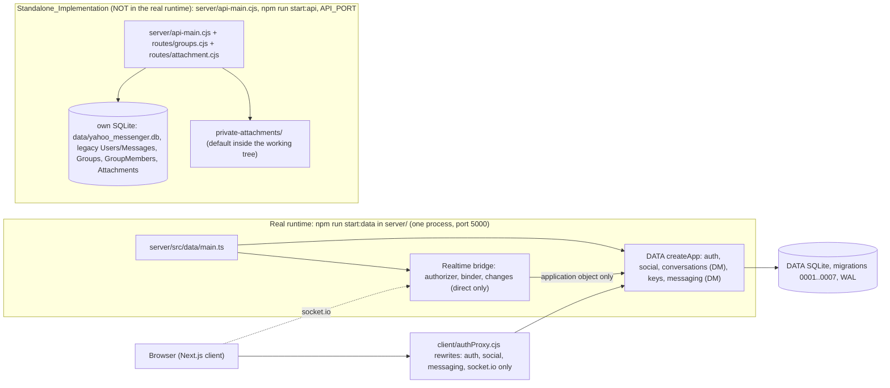
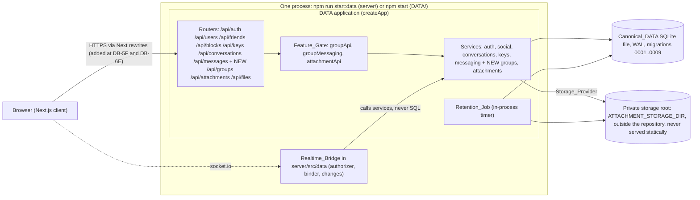
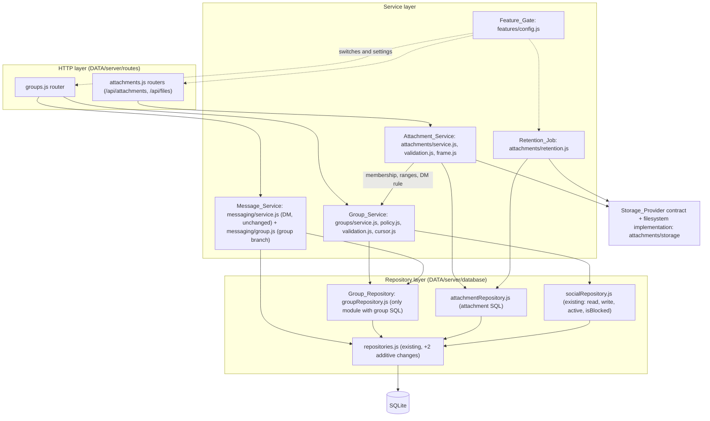
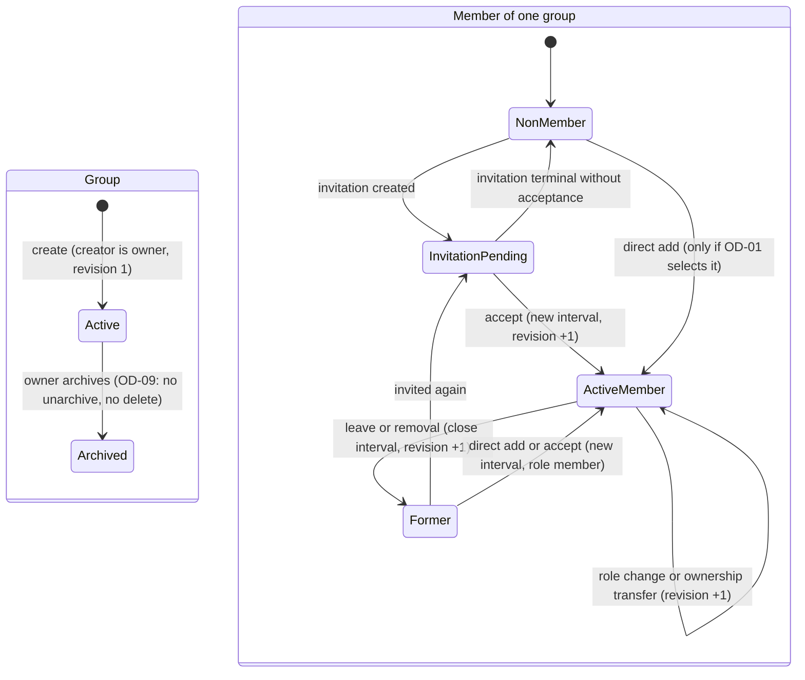
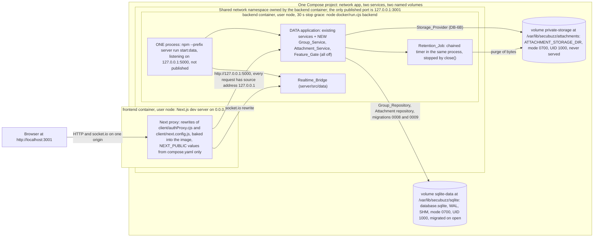
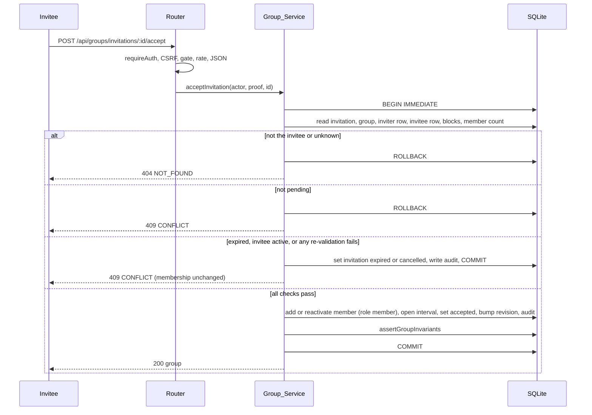
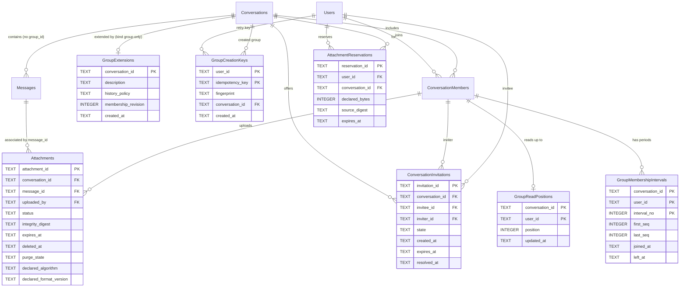
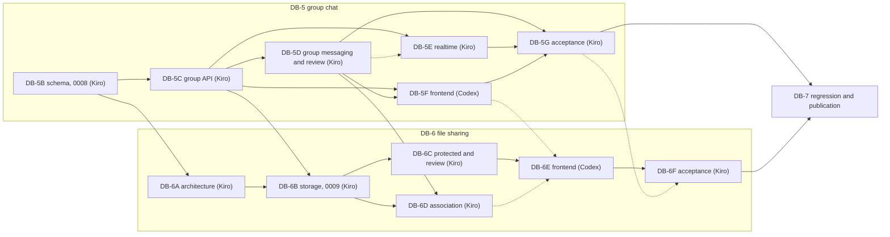

# Design Document: DB-5 / DB-6 Canonical Integration

## Overview

### Purpose and status

This design describes how DB-5 (Group Chat) and DB-6 (File Sharing) are integrated into DATA, the single authoritative persistence layer of SecuBuzz, instead of adopting the standalone implementation. The Standalone_Implementation is identified by its host file `server/api-main.cjs`, the script `npm run start:api` and the variable `API_PORT`, never by a port number alone, because in the Docker_Environment port 3001 is the browser-facing address of the application (F28). It uses the exact terms of the requirements Glossary (Canonical_DATA, Standalone_Implementation, Group_Service, Group_Repository, Message_Service, Attachment_Service, Storage_Provider, Retention_Job, Feature_Gate, Gate_Record, Realtime_Bridge and so on).

This is a design only. Nothing described here is implemented. No migration file, source file, database or git state was changed to produce it. Where a statement describes the current system, it comes from a file that was read in this run; where it describes the future system it is marked PROPOSED or ORIGINAL as the requirements define those words (ORIGINAL: the requirement comes from a roadmap line; PROPOSED: an audit finding or the specification motivates it).

### Scope

In scope: group schema, repositories, services, HTTP API, realtime bridge integration, feature gates, attachment storage and API, retention, migration plan, test strategy and phase plan for DB-5B to DB-7.

Out of scope (Explicit Exclusions of the requirements): any new cryptographic protocol, key format or envelope format; enabling incomplete group messaging or file sharing for Real_Accounts; a second database, server process or authentication system; edits to published migrations 0001 to 0007; any change to Phase 8.8 direct messaging; deletion of Standalone_Implementation code or tests; frontend work in DB-5B and DB-5C.

### Verified facts that shape the design

| # | Fact (as read or run in this session) | Evidence |
| --- | --- | --- |
| F1 | Branch chuong-data equals origin/main at d7cd40aafcf8f432d17d3f4a85abb26d19fa9bc3. Migrations 0001 to 0007 are unmodified in the working tree. (Reconciliation note: origin/main later moved to dc6c997 through PR #19, which added Docker files and documents only (see F19); the local branch was fast-forwarded to it, and every pin of this design stays at d7cd40a.) | `git rev-parse`, `git status` |
| F2 | The real runtime is DATA: `DATA/server.js` -> `startServer` in `DATA/server/start.js` -> `createApp` in `DATA/server/app.js`. `server/src/data/main.ts` (script `start:data` in `server/package.json`) loads DATA with `createRequire(DATA_ROOT)`, calls `startServer()` and attaches the realtime server to the same HTTP server with `attachRealtimeToData`. `server/api-main.cjs` (`npm run start:api`, listening on `API_PORT`, default 3001 on a host without Docker) is a separate process that mounts nothing of DATA. (Reconciliation note: origin/main later moved to dc6c997 (PR #19, Docker files and documents), which changed none of the files named here, so the reading above and every pin stay at d7cd40a; see F19 and F28.) | the files named |
| F3 | `openDatabase` in `DATA/server/database/connection.js` turns foreign keys ON, journal mode WAL, and runs `migrate(db)` on open unless `migrate:false`. Starting DATA on an existing database therefore applies pending migrations immediately. | `connection.js` |
| F4 | Runner rules in `DATA/server/database/migrate.js`: file names `^\d{4}-[a-z0-9-]+\.sql$`, contiguous versions from 1, SHA-256 checksum of the LF-normalised text in `SchemaMigrations`, one `BEGIN IMMEDIATE` transaction for the whole pending batch, `foreign_key_check` after each file, `options.directory` for tests. A ledger with more rows than files fails with `MIGRATION_HISTORY_MISMATCH`, so older code cannot start on a newer database. The runner itself does not scan for forbidden statements; that rule is documented and must be linted by a test. | `migrate.js` |
| F5 | Engine: `sqlite_version()` returned 3.53.4 with better-sqlite3 13.0.3 on Node v24.20.0. | query on an in-memory database |
| F6 | Group rows can exist today only through repositories: `conversations.create({kind:'group',created_by})` makes the creator owner; `members.insert/setRole/leave`, `messages.insertAuthenticated/history/highWater`, `receipts.insert`, `attachments.insert/get/setStatus` and `audit.insert` already work for groups. `audit.insert` accepts only the metadata keys `reason_code, operation, outcome, count, duration_ms`. | `DATA/server/database/repositories.js` |
| F7 | Every existing service is direct-message only. `directVisible` requires `kind='direct' AND origin='authenticated'`; `messaging/service.js` `submit` writes `receiver_id` from the direct capability. A group conversation id therefore returns 404 on every existing route (fail closed). | `conversations/service.js`, `repositories.js`, `messaging/service.js` |
| F8 | The E2EE layer is direct only: `E2EE_LIMITS.participants: 2` ("Group key management is out of scope") in `server/src/e2ee/protocol.ts`, and `DATA/server/e2ee/directory.js` `read` returns `null` unless `kind==='direct'`. `DATA/server/e2ee/protocol.js` imports `server/src/e2ee/index.ts`, an existing reverse dependency of DATA on server code. | the files named |
| F9 | `GET /api/conversations` is parsed strictly by `client/src/security/e2ee/api.ts` (`type==='direct'`, exactly two participants, exact key set; otherwise it throws `invalid_proof`). A group in that response would break the client. | `api.ts` lines 20 to 33 |
| F10 | `DATA/server/start.js` sets `maxHeaderSize: 16384`, `requestTimeout: 15000`, `headersTimeout: 10000`. | `start.js` |
| F11 | Existing routers order their middleware as `requireAuth`, rate limit, `requireCsrf` (non-GET), body-size check, JSON content-type check (415 on mismatch), `express.json`. Error bodies are `{code, fields}` via `AuthError` and `sendError`. | `routes/conversations.js`, `routes/messaging.js`, `auth/errors.js` |
| F12 | The realtime side already offers what group delivery needs: `RealtimeServerHandle.revokeConversationAccess(userId, conversationId)`, `refreshUserAccess`, `refreshAllAccess`, and an optional `RealtimeAuthorizer.canReceive` that is consulted immediately before every delivery. The bridge's authorizer and change observer are direct only (`conversations.list/detail`, a fixed `ROUTES` table). `server/test/data/boundaries.test.ts` forbids the bridge from importing DATA, a database driver or `process.env` outside `main.ts`. | `server/src/data/*.ts`, `server/src/realtime/*.ts`, the boundaries test |
| F13 | The Standalone_Implementation uses its own SQLite file (`server/src/db5db6/db.cjs`, default `data/yahoo_messenger.db`), loads a different base schema (`server/database/schema.sql`: `Messages.recipient_id`, `SecurityLogs.actor_user_id/summary`), declares `ON DELETE CASCADE`, rebuilds Messages with `group_id` using `foreign_keys = OFF`, has no CSRF, rate limit or Origin check, stores plaintext attachments, and returns raw `error.message` text. | the files named |
| F14 | The client has no `/api/groups`, `/api/attachments` or `/api/files` rewrite in `client/authProxy.cjs`; `NEXT_PUBLIC_ATTACHMENT_API_READY` gates the uploader in `YahooChatWindow.tsx`; `SecureConversationPanel` passes `textOnly`. `client/src/messaging/db6Attachments.ts` maps only plaintext flat rows (`encryption_algorithm === null`, `?group_id=` or `?recipient_user_id=`). | the files named |
| F15 | The 76 client attachment tests are located (a search was needed because `client/src/attachments` does not exist): running jest on exactly 8 files under `client/src` gave 76 tests, all passing. The files are listed in the classification table. | jest run on those 8 files |
| F16 | The DATA suite passes 321 of 321 in a throwaway copy of DATA under the system temp directory (no real database touched). | `node --test` in the copy |
| F17 | With draft migrations 0008 and 0009 added to that copy, 314 of 321 tests pass. The 7 failures are all hard-coded migration-ledger literals (see conflict DC-01). No other baseline test, including `schema.test.js` and the attachment tests of `repositories.test.js`, is affected by the drafted DDL. | `node --test` in the copy |
| F18 | The drafted 0008 and 0009 DDL, applied through the real runner to an in-memory version-7 database holding a populated group, passed 64 of 64 checks (upgrade, repeat, rollback of a failing 0009, fresh-versus-upgrade schema equivalence, backfill, uniqueness, immutability, restrict-only foreign keys). That run predates the OD-05 decision: the immutability guard on `history_policy` (derived from OD-05, confirmed at the DB-5C API contract approval) was added to the DDL afterwards and has not been run through the runner. | scratch script outside the repository |
| F19 | origin/main is dc6c997 (merge of PR #19, INFRA-01, the Docker development environment) and the local branch chuong-data was fast-forwarded to it (DK-02, recorded in the DB-5A reconciliation). `git diff --name-status d7cd40a dc6c997` lists 21 paths: new Docker files (`.dockerignore`, `compose.yaml`, `server/Dockerfile`, `client/Dockerfile`, 10 files under `docker/`), four new documents (`docs/docker-development.md` and three INFRA-01 result documents), edits to `README.md` and `.gitignore`, and one client test script (`client/scripts/verify-client-realtime.cjs`). It lists no path under `DATA/`, `server/src/`, `shared/`, `client/src/` or `DATA/server/database/migrations/`. The functional baseline that tests, checksums and git gates pin stays d7cd40a (F1, F16, F17); the integration base is dc6c997. `git status --short` shows only the three preserved pre-existing entries (`client/tsconfig.json` modified; `client/artifacts/phase8-8/` and `client/artifacts/phase8-8-hotfix/` untracked) and the spec folder. | `git diff --name-status d7cd40a dc6c997`, `git status --short` |
| F20 | `compose.yaml` defines exactly two services. `backend`: built from `server/Dockerfile`, whose `CMD` is `node docker/run.cjs backend`, which runs `npm --prefix server run start:data` (the unified DATA HTTP, Socket.IO and realtime process of F2); `HOST` 127.0.0.1, `PORT` 5000 (not published), `NODE_ENV=development`, `AUTH_ALLOWED_ORIGINS=http://localhost:3001`, `AUTH_TRUST_PROXY_IPS` empty; user `node` (UID 1000); `cap_drop: [ALL]`, `no-new-privileges`, `init: true`, `stop_grace_period: 30s`; no `restart:` key; health check `docker/healthcheck.cjs backend` (interval 10 s, timeout 5 s, start period 40 s, 6 retries). `frontend`: built from `client/Dockerfile`, runs the Next.js development server on 0.0.0.0:3001 inside the backend's network namespace (`network_mode: service:backend`), with `AUTH_BACKEND_URL=http://127.0.0.1:5000`; its health check requests `/login` (start period 90 s). The only published port is `127.0.0.1:3001:3001`, declared on the backend because it owns the shared namespace. All `NEXT_PUBLIC_*` values come only from `compose.yaml`, host environment files are not injected, and `NEXT_PUBLIC_ATTACHMENT_API_READY` is `"false"`. The file sets no group variable, no feature switch and no attachment setting other than `ATTACHMENT_STORAGE_DIR`. The frontend mounts only `client/src`, `client/public` and `shared`, read-only, and has no database or attachment mount. | `compose.yaml`, `server/Dockerfile`, `client/Dockerfile`, `docker/run.cjs`, `docs/docker-development.md` (Topology and security) |
| F21 | Two named volumes: `sqlite-data` at `/var/lib/secubuzz/sqlite` (holds `database.sqlite` with its WAL and SHM files; `DB_PATH=/var/lib/secubuzz/sqlite/database.sqlite`) and `private-storage` at `/var/lib/secubuzz/attachments` (the reserved `ATTACHMENT_STORAGE_DIR`; a `compose.yaml` comment states that no DB-6 API or feature gate is activated). The image creates both directories owned by `node` with mode 0700, and an empty volume inherits that. Neither volume is seeded from the repository. Both are outside the working tree `/workspace`. | `compose.yaml`, `server/Dockerfile` (lines 22 to 24), `docs/docker-development.md` (Data and future migrations) |
| F22 | The unchanged connection code of F3 runs the migration runner when the application opens the database, so the first start of an image that contains a new migration permanently changes the volume, and older code then fails with `MIGRATION_HISTORY_MISMATCH` (F4). A migration failure stops startup, and the backend has no restart policy, so the container stays stopped. `docker compose watch backend` has three `sync+restart` rules: `server/src`, `DATA/server` (migrations included; it ignores `*.sqlite*`, `*.db*` and `*.part`) and `shared`; each change restarts the backend, which then applies any pending migration to the persistent volume. `DATA/docs`, `DATA/tests` and `DATA/scripts` are not synced; they are copied into the image at build time and need a rebuild. `client/authProxy.cjs` and `client/next.config.js` are copied into the frontend image (`COPY client/`) and are not bind-mounted, so changing them needs `docker compose up --build`. The helpers `docker/database-check.cjs` and `docker/smoke.cjs` compare the ledger of a volume with `loadMigrations()` of the image they run in, so they follow 0008 and 0009 without any change and pass only for a matching revision. `docker/database-check.cjs` snapshots only the tables `Users`, `Conversations`, `Messages` and `DeviceKeys`, and checks the mode of the sqlite directory only. | `compose.yaml` (`develop.watch`, `volumes`), both Dockerfiles, `docs/docker-development.md` (Source reload and shutdown; Data and future migrations), `docker/database-check.cjs`, `docker/smoke.cjs` |
| F23 | `.dockerignore` first excludes everything and then allows `client/`, `server/`, `DATA/`, `shared/` and `docker/`. Inside them it excludes, at any depth: the directories `node_modules`, `uploads`, `.uploads`, `private-attachments`, `backups`, `secrets`, `build`, `out`, `dist`, `tmp`, `temp`, `artifacts`, `coverage`, `.cache`, `.turbo`, `.swc`, `.git`, `.aws`, `.azure`, `.codex`, `.agents`, `.kiro`, `playwright-report`, `test-results` and every name beginning `.next`; the files `.npmrc`, `.yarnrc*`, `credentials.json`, `*.log`, `*.part`, `*.bak`, `*.backup`, `*.tsbuildinfo`, `*.pem`, `*.key`, `*.crt`, `*.p12`, `*.pfx`, `*.db`, `*.db-*`, `*.db.*`, `*.sqlite`, `*.sqlite-*`, `*.sqlite.*`, `*.sqlite3`, `*.sqlite3-*`, `*.sqlite3.*`; and every environment file (`.env*`, `*.env`, `dev.env`) except the four committed examples `client/.env.example`, `server/.env.example`, `DATA/.env.example` and `DATA/.env.example.txt`. A new file or fixture with one of these names or extensions is silently absent from the image and from the Validation_Runner. | `.dockerignore` |
| F24 | `compose.yaml` sets `AUTH_TRUST_PROXY_IPS` to empty, and the guide states that no TLS-proxy address is trusted. All browser API traffic reaches DATA through the Next.js proxy over the shared loopback (`AUTH_BACKEND_URL=http://127.0.0.1:5000`). By reading, and not measured, every request therefore reaches DATA from the source address 127.0.0.1, so every per-source bucket (rate limit, `source_digest`) is one shared bucket for all users of that Docker_Environment project; the existing services behave the same way. | `compose.yaml`, `docs/docker-development.md` (Topology and security, Images and environment) |
| F25 | The backend health check calls `GET /healthz`, which `DATA/server/app.js` answers with `{status:'ok'}` outside `/api` and without a session (line 29). Shutdown: `docker/run.cjs` forwards SIGTERM and SIGINT to the npm process group, `init: true` reaps children, and `stop_grace_period` is 30 s. `server/src/data/main.ts` closing the realtime bridge and then DATA is taken from the INFRA-01 material and was not re-read in this run. | `docker/healthcheck.cjs`, `DATA/server/app.js`, `docker/run.cjs`, `compose.yaml` |
| F26 | Validation_Runner. The guide builds it with `docker compose -p <project> build backend frontend`, then `docker build -f docker/validation.Dockerfile --build-arg FRONTEND_IMAGE=<project>-frontend:latest --build-arg BACKEND_IMAGE=<project>-backend:latest -t <project>-runner:latest .`, and runs `docker run --rm --init --network none --shm-size=1g --mount type=bind,source=<evidence dir>,target=/evidence -e SECUBUZZ_DOCKER_VALIDATION=true <project>-runner:latest node docker/validate.cjs <group>`. `docker/validate.cjs` defines four groups: `data` (`npm test` in `DATA`), `server` (`npm run type-check` and `npm test` in `server`), `client` (`npm test -- --runInBand`, `npm run type-check`, `npm run lint`, `npm run build:verify` in `client`) and `browser` (`test:e2ee:browser` and `test:realtime:browser`). Evidence directories live under the ignored `docker/artifacts/`. The guide states that a damaged or empty test image is not valid evidence. | `docs/docker-development.md` (Build fresh Linux validation images), `docker/validate.cjs` lines 13 to 29 |
| F27 | Baselines recorded by INFRA-01C at d7cd40a (recorded by INFRA-01C, not re-run here): DATA 321 passed, 0 failed, 0 skipped; server type-check PASS and server tests 547/0/0; client on Linux 1075/0/0 in 102 suites (a combined result: the first full run was 1071/4/0 and a focused retry of one failed realtime unit file passed 9/0/0); client on Windows 1073/2/0 (the two failures are the Known_Baseline_Failure entries of Testing Strategy section 11); E2EE browser script 40/0/0; realtime browser script 58/0/0 after the test-only fix INFRA-01C.2 (the first Linux run was 46/1/0). The client type-check, lint and `build:verify` passed on both platforms. | `docs/infra-01c-acceptance-results.md`, section I |
| F28 | The Standalone_Implementation host is `server/api-main.cjs`, started by `npm run start:api`, and listens on `API_PORT` (default 3001). In the Docker_Environment, port 3001 is the application: the Next.js frontend, published as `127.0.0.1:3001`, which the guide names as the only browser address. A port number therefore cannot identify the Standalone_Implementation, and no statement of this design does so. | `compose.yaml`, `docs/docker-development.md`, `server/api-main.cjs` as read for F2 |
| F29 | What the Validation_Runner image contains. It is the backend image (`COPY server/`, `DATA/`, `shared/` and, from `docker/`, only `run.cjs` and `healthcheck.cjs`) plus `/workspace/client` copied from the frontend image plus `docker/validate.cjs`, with Chromium added. Inside it `/workspace` therefore holds `server/`, `DATA/` (tests, docs and scripts included), `shared/` and `client/`; it holds no `.git`, no `compose.yaml`, no `docker/compose.env.example.yaml`, no `.dockerignore`, no `docs/` and no `docker/database-check.cjs`. Of the environment files only the four committed examples of F23 can be present. `docker/validate.cjs` asserts Linux, `SECUBUZZ_DOCKER_VALIDATION=true` and that `DATA/.env` and `server/.env` do not exist, runs each suite as `npm` with `NODE_ENV=test` and `DB_PATH=/tmp/unused-validation.sqlite` (the other variables, including `SECUBUZZ_DOCKER_VALIDATION`, are inherited), and writes `/evidence/<suite>.log` and `/evidence/<group>-results.json`. For `data-tests` and `server-tests` the results file records tests, passed, failed and skipped parsed from the TAP summary; the `cancelled` and `todo` counts stay only in the log. | `docker/validation.Dockerfile`, `server/Dockerfile` (lines 18 to 21), `client/Dockerfile` (lines 11 to 13), `docker/validate.cjs`, `.dockerignore` |

### Design assumptions (not stated in the requirements)

| ID | Assumption | Why |
| --- | --- | --- |
| ASM-01 | A group name must be well-formed Unicode with no control characters; a description must be well-formed Unicode and may contain line breaks and tabs but no other control characters. Length limits are exactly those of DB5-R01. | Follows the profile validation conventions in `social/validation.js`; the requirements fix only the lengths. |
| ASM-02 | New SQL tables use the prefixes `Group` and `Conversation` (not `Groups`, `GroupMembers`, `GroupInvitations`). | Avoids a silent `CREATE TABLE IF NOT EXISTS` collision if Standalone_Implementation code is ever pointed at a DATA database (the same hazard AF-16 records for Attachments). |
| ASM-03 | Rate limit numbers in this document are operational defaults copied from the existing services, not product policy, and are constants in one module. | The requirements require separate buckets (DB5-R12.4) but give no numbers. |
| ASM-04 | Environment variable names in this document are proposals; they follow the existing `AUTH_*` and `DB_*` style. | DB5-R16.1 requires documented names but fixes none. |

### Requirement conflicts and constraints found while verifying

These are not Owner Decisions (OD-nn). They are places where the requirement text, the baseline code or the platform disagree. Each has a proposed resolution that grants the least access; the Project_Owner confirms them at the named phase.

| ID | Kind | Finding | Proposed resolution | Phase |
| --- | --- | --- | --- | --- |
| DC-01 | Conflict | ARCH-R02.1 and DB5-R15.11 say no baseline test is edited, but seven baseline tests hard-code the migration ledger and fail as soon as any migration after 0007 exists (found by running the suite with draft 0008 and 0009; precedent: the literal `[1,2]` was already rewritten to `[1,2,3,4,5,6,7]` in commit ef619d5). The seven are: `auth-migrations.test.js` line 24 (applied list), `conversations-migrations.test.js` line 21, `e2ee-migrations.test.js` lines 12 and 29, `messaging-migrations.test.js` line 11, `migrations.test.js` line 14, `social-migrations.test.js` line 25. | Amend only those literals, in the same commit that adds each migration, by appending the new file names or version numbers. The amended assertions stay exact `deepEqual` or `equal` checks, so they are not relaxed. A mechanical check compares `git diff d7cd40a -- DATA/tests` and fails if any changed line is not one of these literals. The Project_Owner approved this exception once, in the DB-5A reconciliation (OP-06 DECIDED: exactly these seven assertions, in the commit that adds the migration, with guard tests; DB5-R15 criterion 11). Separately, a later owner-approved exception permits only `DATA/tests/support/auth.js` at the exact Task 2.24 fixture hash `0d7996a8bef3be2703bfbb40dfe3c170efb3571a9bfdd6077832de2ef50bcc6f` from commit `85730dd442a570a0b4756847ce34f9300ecfb71f`; its original d7cd40a manifest hash remains unchanged, and no other hash or file is exempted. | DB-5B (0008), DB-6B (0009); later exact-hash exception by owner approval  See the later Project Owner E2EE boundary amendment for the single additional exact-hash revision. |
| DC-02 | Conflict | DB6-R03.2 says a block between direct participants yields 403 "as the direct message path does", but the baseline direct path answers 404 for a blocked pair and 403 only when the pair is not friends (`messaging-security.test.js` lines 51 to 58, `conversations-security.test.js` line 73). | Reuse the direct-path authorization unchanged for attachments: block -> 404 NOT_FOUND, not friends -> 403 FORBIDDEN. This also avoids revealing a block. DB6-R03.2 and DB5-R15.9 need an amendment. | DB-6A |
| DC-03 | Constraint | DB6-R03.1 describes one POST carrying a byte stream plus encrypted metadata of up to 16384 characters (DB6-R05.12), but the server accepts at most 16384 bytes of headers in total (F10), so the metadata cannot travel in headers. | Use a length-prefixed body frame (ADR-09). The wire format is confirmed at DB-6A. | DB-6A |
| DC-04 | Constraint | `requestTimeout: 15000` caps the time to receive a whole request. A 50 MiB upload needs about 28 Mbit/s to finish in 15 s. | Add a setting `ATTACHMENT_UPLOAD_TIMEOUT_SECONDS` that raises `server.requestTimeout` only while the Attachment_API switch is enabled; the default keeps 15 s. The value belongs to the limits of OD-15. | DB-6B |
| DC-05 | Note | DB5-R12.11 requires 400 VALIDATION_ERROR for a non-JSON content type; existing routers answer 415. | Group routes follow the requirement. Existing routes keep 415 (COMP-02). Body-parser encoding errors still reach the global handler (415). | DB-5C |
| DC-06 | Note | `schema.test.js` asserts that every table except `SchemaMigrations`, `AuthChallenges` and `AuthRateLimits` has at least one foreign key. | Every new table in this design has at least one foreign key. | DB-5B |
| DC-07 | Note | DB5-R14.5 forbids BEGIN in migrations, but every trigger body contains BEGIN ... END (0002 to 0007 do). | The migration lint test tokenises statements and ignores trigger bodies; it must accept 0001 to 0007 to prove it is correct. | DB-5B |
| DC-08 | Note | `startServer` returns an object that includes `db`; the bridge type `DataApplication` deliberately omits it. | Keep the type narrow; ARCH-R01.7 is enforced by the existing boundaries test plus a new assertion that the type has no `db`. | DB-5E |
| DC-09 | Note | DB5-R04.9 requires the Invitation state to change and the request to answer 409, but DB5-R13.10 says a status 400 or higher leaves records unchanged. | DB5-R13.10 names group, membership and message records only. Invitation state changes commit in a transaction that returns a refusal result; the router then answers 409. | DB-5C |

### Not verified

- The DATA suite was run by the design run only inside a throwaway copy (F16), not in the working tree. The design run did not run the server suites (`npm test`, `npm run type-check`) or the client suites in full; of the client suites it ran only the 8 client attachment test files. The owner's workspace run and the INFRA-01C report record 321/0/0 for DATA, 547/0/0 for the server tests (type-check PASS) and the client numbers of F27. This reconciliation re-ran no suite. The DB-5B entry criteria measure every suite again in the Validation_Runner (CI-24).
- Not read in full: `server/src/realtime/server.ts`, `authentication.ts`, `receipts.ts`; `DATA/server/auth/{service,adapters,passwords}.js` beyond excerpts; `DATA/server/routes/{auth,social,keys,users,messages,logs}.js`; `DATA/server/e2ee/repository.js`; the 13 tests of `server/test/integration/attachments.test.ts` beyond their titles; client hooks and components beyond the files named.
- The payload of the existing realtime event `conversation:updated` was not read. DB-5E must read it before deciding whether to reuse it for group hints.
- Whether the Next.js 14 rewrite proxy streams request bodies of 50 MiB without truncation was not tested (risk R-07).
- `fs.link` as an atomic no-replace rename was not tested on every target filesystem (risk R-10).
- The real development database (`DATA/server/database/database.sqlite` and its sidecars) was not opened.
- The INFRA-01C baselines of F27 (DATA 321/0/0, server 547/0/0, client 1075/0/0 on Linux and 1073/2/0 on Windows, E2EE browser 40/0/0, realtime browser 58/0/0) were recorded by INFRA-01C and were not re-run in this reconciliation. The DB-5B entry criteria measure them again in the Validation_Runner, with a Windows host run as additional evidence.
- No application container was started, no image was built and no Docker volume was opened for the Docker material of this design. The only Docker commands run for it were `docker compose version` (v5.4.0) and `docker compose config`, which only render the configuration; the temporary override described in the Docker section rendered without a `ports` key. No Disposable_Project was created, and its commands (`-p`, the override file, `down -v`) are a design, not an observation.
- The 50 MiB request body through the Next.js development rewrite proxy, and the proxy's timeout, were not measured inside the Docker_Environment (R-22, R-07, CI-27).
- Whether the backfill of 0008 on a populated database finishes inside the 40 s `start_period` of the backend health check was not measured (R-21); no timing of 0008 exists.
- The immutability trigger on `history_policy` that 0008 gained from OD-05 has not been run through the runner (F18); only the earlier draft DDL was.

### Traceability of design sections to requirements

| Design section | Requirement IDs |
| --- | --- |
| Architecture: existing, runtime view, component view, dependency direction | ARCH-R01, ARCH-R02, ARCH-R03 |
| Architecture: lifecycle state machine | DB5-R04, DB5-R05, DB5-R06, DB5-R07 |
| Architecture: component classification | ARCH-R03.1 to R03.3, all requirements by row |
| Architecture: Docker development environment compatibility (the Docker section; facts F19 to F29) | COMP-10, ARCH-R01.9, ARCH-R01.10, DB5-R14.17, DB5-R14.20 to R14.24, DB5-R15.10 to R15.16, DB5-R16.7, DB6-R02, Explicit Exclusion 11 |
| Components: Group_Repository, Group_Service | DB5-R01 to DB5-R08, DB5-R10, DB5-R12, DB5-R14.14 |
| Components: group messages (Message_Service) | DB5-R08, DB5-R09, DB5-R10 |
| Components: createApp mounting, middleware order | ARCH-R01.3 to R01.8, DB5-R12, DB5-R13.4 |
| Components: Feature_Gate | DB5-R16, DB6-R05.8, DB6-R05.9, ARCH-R02.10 |
| Components: Realtime_Bridge | DB5-R05.11, DB5-R09.13, ARCH-R01.7, ARCH-R02.6, ARCH-R02.10, COMP-07 |
| Components: group API contracts | DB5-R01 to DB5-R13 |
| Components: attachment API contracts | DB6-R01, DB6-R03, DB6-R04 |
| Components: concurrency and consistency | DB5-R04, DB5-R05.12, DB5-R05.17, DB5-R06.7 to R06.11, DB5-R12.5, NFR-01 |
| Components: Storage_Provider, Retention_Job, DB-6 forward compatibility | DB6-R02, DB6-R03.12 to R03.15, DB6-R03.22, DB6-R05, COMP-09, NFR-05 |
| Data Models: 0008 and 0009, backfill, migration plan | DB5-R14, DB6-R01.2, DB6-R01.11, COMP-03 to COMP-05, ARCH-R02.5, ARCH-R01.11 |
| Correctness Properties | DB5-R15, DB5-R13, DB5-R14, DB6-R02, DB6-R04, ARCH-R02 |
| Error Handling | DB5-R12, DB5-R13, DB6-R03.16, DB6-R04.2, DB6-R04.5 |
| Testing Strategy | DB5-R15 (including R15.10, R15.14 to R15.16: Validation_Runner gate of record, Known_Baseline_Failure), DB5-R13.6, DB5-R13.7, DB5-R14.17, DB5-R14.21, DB5-R14.24, ARCH-R02.1 to R02.3, ARCH-R03.4, NFR-01 to NFR-09 |
| ADRs | ARCH-R01, ARCH-R03, DB5-R14; ADR-19 and ADR-20 also DB5-R14.17, DB5-R14.20 to R14.24, DB5-R15.10, DB5-R15.14 to R15.16, COMP-10, Explicit Exclusion 11 |
| Phase plan | Phase map of the requirements, all `Implementation phase` lines |
| Unresolved Decisions | OD-01 to OD-21 |
| Unresolved Decisions: Decisions recorded in the DB-5A reconciliation | OD-01 (part: DB5-R03.5, R03.6), OD-04 (DB5-R03.12, DB5-R16.7), OD-05 (DB5-R01.1, R01.7, R01.10, R01.14, R01.15, DB5-R02.10, R02.13, DB5-R06 role matrix, DB5-R07.2, DB5-R08.1, R08.2), OD-08 (part: DB5-R04.1, R04.18, DB5-R16.7), OP-06 (DB5-R15.11, ARCH-R02.1), DK-01 (DB5-R15.10, R15.14 to R15.16), DK-02 (Baseline section), DK-03 (DB5-R14.17, R14.21, R14.24), DK-04 (DB5-R14.22, Explicit Exclusion 11), DK-05 (DB5-R14.20, R14.23), DK-06 (no requirement; DB5-R14.23), DK-07 (DB5-R14.24); the amendments OA-01 to OA-04 are gated and not applied |

### ORIGINAL versus PROPOSED

| Requirement | Origin as stated by the requirement |
| --- | --- |
| DB5-R01 | ORIGINAL (POST /api/groups); PROPOSED for the idempotency key and for the historyPolicy field (OD-05 decided in the DB-5A reconciliation) |
| DB5-R02 | ORIGINAL (GET and PATCH /api/groups/:id); PROPOSED for member-only paged listing |
| DB5-R03 | ORIGINAL (members list and add); PROPOSED for consent, block and elevation controls |
| DB5-R04 | ORIGINAL (member invitations must be defined); PROPOSED for re-validation, uniqueness and cancellation |
| DB5-R05 | ORIGINAL |
| DB5-R06 | ORIGINAL (owner rules, transfer); PROPOSED for the role-change endpoint and stale-request safety |
| DB5-R07 | PROPOSED |
| DB5-R08 | ORIGINAL (history visibility); PROPOSED for interval storage |
| DB5-R09 | ORIGINAL (reuse storage); PROPOSED for gating |
| DB5-R10 | PROPOSED |
| DB5-R11 | ORIGINAL |
| DB5-R12 | ORIGINAL; PROPOSED for the single enforcement chain |
| DB5-R13 | ORIGINAL; PROPOSED for error hardening |
| DB5-R14 | ORIGINAL; PROPOSED for upgrade validation on populated databases; PROPOSED for criterion 5 (trigger bodies) and for criteria 17 and 20 to 24 (Docker_Environment constraints of the DB-5A reconciliation) |
| DB5-R15 | ORIGINAL; PROPOSED for stale-request, concurrency and regression coverage; PROPOSED for the amendments of criteria 10 and 11 and for criteria 14 to 16 (DB-5A reconciliation: DK-01, OP-06) |
| DB5-R16, ARCH-R01 to ARCH-R03 | PROPOSED |
| DB6-R01 | ORIGINAL (metadata schema); PROPOSED for association and integrity fields |
| DB6-R02 | ORIGINAL (storage abstraction); PROPOSED for path and traversal controls |
| DB6-R03 | ORIGINAL (POST, GET, download, search, retention); PROPOSED for scheduling and relationship checks |
| DB6-R04 | ORIGINAL (size and type validation, restart); PROPOSED for quotas |
| DB6-R05 | ORIGINAL (never silently decrypt or index); PROPOSED for the enablement gate |

Routes inherit this origin. ORIGINAL roadmap routes: `POST /api/groups`, `GET /api/groups/:id`, `PATCH /api/groups/:id`, `GET` and `POST /api/groups/:id/members`, `DELETE /api/groups/:id/members/:userId`, `POST /api/groups/:id/leave`, `POST /api/attachments`, `GET /api/attachments/:id`, `GET /api/attachments/:id/download`, `GET /api/files/search`. Every other route in this document is PROPOSED.

## Architecture

### Existing architecture (as verified)



What this shows, with evidence in facts F2, F7, F9, F13 and F14: the real runtime already contains everything except groups and files; the standalone host shares no code path, database or authentication with it, and the client cannot reach it.

### Proposed canonical architecture

#### Runtime and process view

One DATA process, one Canonical_DATA database, one private storage root outside the repository. The Realtime_Bridge stays in `server/` and consumes only the DATA application object.



The Standalone_Implementation is not started, proxied to or imported (ARCH-R01.10). Its host, identified by `server/api-main.cjs`, `npm run start:api` and `API_PORT` and not by a port number alone, is documented as not a supported runtime (ARCH-R01.9). In the Docker_Environment port 3001 is the browser-facing address of the application, not of the Standalone_Implementation (F28).

#### Component view



Dependency rule (ARCH-R01.6): the Group_Repository calls the existing functions for conversations, members, messages, receipts, attachments and audit and adds only new functions of its own. Routers contain no SQL. Services never import a router.

#### Dependency direction

`DATA <- server bridge <- client`.

- The client depends on DATA only through HTTP and Socket.IO. The client does not import DATA or server code at runtime.
- The server bridge receives DATA as an injected application object (`createRequire` only in `main.ts`) and imports no DATA code, driver or test code. The existing boundaries test enforces this and stays unchanged.
- DATA depends on no client code at runtime. Two existing exceptions are not changed: `DATA/server/e2ee/protocol.js` imports `server/src/e2ee/index.ts` (pure protocol code, no database), and test helpers load `client/src/utils/crypto.ts` to build envelopes. Group messaging tests reuse the second exception.

#### Group lifecycle state machine

Invitation states (DB5-R04.17: only pending can change; accepted, declined, cancelled and expired are terminal):

```mermaid
stateDiagram-v2
    [*] --> pending: create (owner or admin, one per group and invitee, expires 604800 s after creation)
    pending --> accepted: invitee accepts, all re-validation passes
    pending --> declined: invitee declines
    pending --> cancelled: inviter, owner or admin cancels; member removed or left; re-validation fails; invitee already active
    pending --> expired: server time reached expiry (lazy, on any touch)
    accepted --> [*]
    declined --> [*]
    cancelled --> [*]
    expired --> [*]
```

Membership and group states (one ConversationMembers row per user; one Membership_Interval per continuous period):



Terminal and fixed points: an archived group stays archived; a non-pending Invitation never reopens; a closed Membership_Interval never changes; the single active owner can leave only after a transfer (OD-10).

### Component classification

Dispositions are exactly one of REUSE AS IS, REUSE WITH ADAPTATION, EXTEND, DEPRECATE AFTER MIGRATION, REQUIRES OWNER DECISION. "Evidence" states what was read or run.

| Component | Path(s) | Evidence | Disposition | Requirements |
| --- | --- | --- | --- | --- |
| Migration runner | `DATA/server/database/migrate.js` | Read: contiguous versions, SHA-256 ledger, one immediate transaction, FK check per file, `options.directory`, history mismatch on extra rows. Run: applied 0008 and 0009 in one batch, rolled back a failing 0009 completely. | REUSE AS IS | DB5-R14, ARCH-R02 |
| DATA connection and config | `database/connection.js`, `database/config.js`, `start.js`, `server.js` | Read: FK ON, WAL, migrate on open, `DB_PATH` relative to DATA, request limits (F10). | REUSE AS IS (the migrate-on-open behaviour is the one-way hazard of risk R-01) | ARCH-R01, DB5-R14.16 |
| Table Conversations | migrations 0002, 0005 | Read: kind check, title required for groups, identity immutable by trigger, `origin`, `archived_at`; no description or policy. | EXTEND (additive 0008: sibling table GroupExtensions) | DB5-R02.1, DB5-R14 |
| Table ConversationMembers | migration 0002 | Read: PK (conversation, user), role, `joined_at`, `left_at`, unique active-owner index, direct-only triggers. Rows are never deleted. | EXTEND (additive 0008: GroupMembershipIntervals reference it) | DB5-R05.9, DB5-R06.2, DB5-R08 |
| Table Messages | migrations 0002, 0006, 0007 | Read: shared DM and group store, `message_seq`, `UNIQUE(conversation_id,client_id)` for authenticated rows, `key_id`, active-sender trigger, group needs `receiver_id` NULL. Ran draft 0008 and 0009 against it: no change to Messages. | EXTEND (no change in 0008 or 0009; reused as the only message table) | DB5-R09.1, DB5-R09.15, ARCH-R01.11 |
| Table MessageReceipts | 0002, 0007 | Read: PK (conversation, message, user, status), membership and message composite FKs. | EXTEND (reused; group rules in service; Read_Position added as a sibling table) | DB5-R10 |
| Table Attachments | 0002, 0007 | Read: no hash, expiry, deleted time or purge state; free status transitions; 0007 drops and recreates it. | EXTEND (additive 0009: columns, indexes, triggers) | DB6-R01 |
| repositories.js | `DATA/server/database/repositories.js` | Read: group create path, members, messages, receipts, attachments, audit allow-list (F6); `translate()` maps trigger errors to `INVALID`. | EXTEND (two additive edits only: allow `target_id` and `role` in `audit.insert` metadata; export `translate`) | ARCH-R01.6, DB5-R12.8, DB5-R13.5 |
| socialRepository.js | `database/socialRepository.js` | Read: `read` (deferred), `write` (immediate), `active`, `isBlocked`. | REUSE AS IS | DB5-R12.5, DB5-R03.8 |
| Conversations service and the DM contract of GET /api/conversations | `conversations/service.js`, `conversations/validation.js`, `routes/conversations.js` | Read: `directVisible`; groups invisible; response shape pinned by `api.ts` (F9). | REUSE AS IS (groups use separate services and `/api/groups`) | DB5-R02.8, ARCH-R02.2, COMP-06 |
| Messaging service (DM path) and validation | `messaging/service.js`, `messaging/validation.js`, `routes/messaging.js` | Read: `submit`, `history`, `bindStore`; `envelope`, `fingerprint`, `page`. | EXTEND (DM code path byte-identical; a group branch is added in a new file and dispatched from `bindStore` at DB-5E) | DB5-R09, ARCH-R02.3 |
| E2EE envelope, key directory, protocol | `e2ee/*`, `routes/keys.js`, `server/src/e2ee/*` | Read: direct only (F8). | REUSE AS IS (no change; group key model is OD-19) | DB5-R09.14, ARCH-R02.4 |
| app.js createApp | `DATA/server/app.js` | Read: middleware order, service factories, injected `limiter`, `now`, `messageOptions`; legacy 503 stub; final handlers. | EXTEND (mount routers after `/api/messages`, pass `features`, return `groups` and `attachments`) | ARCH-R01.3, ARCH-R01.4 |
| start.js and server.js | `DATA/server/start.js`, `DATA/server.js` | Read: owned database, server limits, generic start failure message. | EXTEND (load feature config, start and stop Retention_Job, name missing settings on failure) | DB5-R16.7, DB6-R03.15, DB6-R04 |
| Auth and social conventions | `auth/*`, `social/validation.js`, `auth/rateLimiter.js` | Read: `AuthError`, `sendError`, session and CSRF proof, injectable `limiter` and `now`, cursor and query validators. | REUSE AS IS | DB5-R12, DB5-R13 |
| Test helpers | `DATA/tests/support/{database,auth,social,messaging,e2ee}.js`, `messaging-worker.cjs` | Read: `fixture`, `setup`, `Browser`, `socialFixture`, `messagingFixture`, `fixtureVerifier`, child-process worker. | REUSE AS IS (new group and attachment fixtures are new files) | DB5-R15.1 |
| Realtime_Bridge authorizer, changes, binder, types | `server/src/data/{authorizer,changes,binder,types}.ts` | Read: DM-only `listConversationIds` and `canReceive`; fixed `ROUTES`; `bindStore` metering; `assertDataApplication`. | EXTEND (gated, DB-5E only; new members optional so existing tests stay valid) | DB5-R05.11, DB5-R09.13, ARCH-R01.7, ARCH-R02.6, ARCH-R02.10 |
| Realtime server handle and rooms | `server/src/realtime/{server,rooms,authority,messages}.ts` | Read: `revokeConversationAccess`, `refreshUserAccess`, `canReceive` before each delivery, room per conversation id. | REUSE AS IS | DB5-R05.11 |
| Standalone streaming write | `server/src/storage/attachmentStorage.cjs` | Read: `.part` temp file with flag `wx` and mode 0600, byte-counting Transform, SHA-256, rename. Gaps: key is `randomUUID` (122 bits, hyphens), root defaults inside the working tree and is created at import, rename replaces, error text reaches the client. | REUSE WITH ADAPTATION | DB6-R02, DB6-R04.10 |
| Standalone role checks | `server/src/routes/groups.cjs` (`canManage`, remove, transfer rules) | Read: owner or admin manage; admin removes members only; owner cannot be removed; transfer demotes owner to admin. Matches DB5-R05 and DB5-R06 except the gaps below. | REUSE WITH ADAPTATION (ported as pure functions in `groups/policy.js`) | DB5-R05, DB5-R06 |
| Standalone history-visibility query | `groups.cjs` GET `/:id/messages` | Read: lower bound `created_at >= joined_at`, `joined_at` overwritten on re-add (AF-14), limit up to 500, no cursor. | REUSE WITH ADAPTATION (policy values `all` and `from_joined` kept; the query is replaced by interval ranges) | DB5-R08 |
| Standalone invitation, direct add and group messages | `groups.cjs` invitations, `POST /:id/members`, `POST /:id/messages` | Read: accept re-activates any existing row with role `member` and no checks (AF-03, AF-04); `idx_groupinvitations_user_status` is not unique (AF-05); direct add allows role `admin` (AF-06); messages accept any string (AF-08). | DEPRECATE AFTER MIGRATION (replaced; the three scenarios are re-created as regression tests) | DB5-R04, DB5-R06, DB5-R09, DB5-R15.3 |
| Standalone route inventory | `groups.cjs`, `attachment.cjs` paths and success codes | Read: 201 create, 204 remove and leave, soft delete, 404 for unauthorised reads. | REUSE WITH ADAPTATION (paths and success codes kept where they match the roadmap) | DB5-R13, DB6-R03 |
| Standalone attachment handlers | `server/src/routes/attachment.cjs` upload, metadata, download, delete | Read: streaming upload, `canRead` per request, `nosniff` and `no-store`, soft delete. Gaps: plaintext allowed, `?group_id`, uploader and recipient keep access after removal (AF-21), no CSRF, no quotas, error text leaks. | REUSE WITH ADAPTATION | DB6-R03, DB6-R04 |
| Standalone plaintext path and name search | `attachment.cjs` MIME allow-list, `original_name LIKE` search | Read: stores file name and MIME in plaintext (AF-15, AF-18). | DEPRECATE AFTER MIGRATION | DB6-R05, DB6-R03.11 |
| Standalone cleanup | `server/src/db5db6/cleanup.cjs` | Read: selects expired and old deleted rows, unlinks files and hard-DELETEs rows inside one SQLite transaction, runs only when started by hand. | REUSE WITH ADAPTATION (becomes the Retention_Job: status change instead of DELETE, bytes removed after commit, scheduled) | DB6-R03.13 to R03.15, R03.22 |
| Standalone database module and Messages rebuild | `server/src/db5db6/db.cjs` | Read: second database, `foreign_keys = OFF` rebuild adding `group_id`, cascades, executes at import. | DEPRECATE AFTER MIGRATION (retired per ARCH-R03.3) | ARCH-R01.2, DB5-R09.15, ARCH-R03.3 |
| Standalone app, entry and auth stub | `server/src/api-app.cjs`, `server/api-main.cjs`, `server/src/middleware/requireAuth.cjs` | Read: `AUTH_MIDDLEWARE_MODULE`, `req.user` contract, 2 MB JSON limit, no Origin check. | DEPRECATE AFTER MIGRATION | ARCH-R01.5, ARCH-R01.9, DB5-R12.10 |
| Standalone filename transport | `server/src/attachments/db6Transport.ts` | Read: percent-encoded file name header and RFC 5987 disposition for plaintext names. | DEPRECATE AFTER MIGRATION (protected uploads carry names only inside encrypted metadata) | DB6-R05.4 |
| Standalone legacy base schema | `server/database/schema.sql`, `server/database/db.js` | Read: different `Users`, `Messages.recipient_id`, `SecurityLogs.actor_user_id/summary` (F13). | DEPRECATE AFTER MIGRATION | ARCH-R03.3 |
| Standalone server tests | `server/test/db5_db6.test.cjs` (1 test), `server/test/integration/attachments.test.ts` (13 tests) | Read: the group scenario and the attachment scenarios; the titles are listed under the table. | REUSE WITH ADAPTATION (ported to `DATA/tests` per ARCH-R03.4; originals untouched until the DB-5G and DB-6F Gate_Records) | ARCH-R03.4, ARCH-R03.5, ARCH-R03.10, ARCH-R03.13 |
| Client uploader and its 76 tests | `client/src/messaging/{db6Attachments,attachmentUpload,attachmentFiles,attachmentContent,localAttachmentStore}.ts`, `client/src/hooks/useAttachmentSource.ts`, `client/src/components/YahooChatWindow.attachments.test.tsx`, `.../messenger/__tests__/{MessageAttachmentView,MessageComposer.attachments}.test.tsx`, `.../hooks/__tests__/useAttachmentSource.test.tsx`, `.../messaging/__tests__/{attachmentContent,attachmentFiles,attachmentUpload,localAttachmentStore}.test.ts` | Run: 8 files, 76 tests, all pass (3, 22, 9, 5, 6, 3, 23, 5). The uploader assumes plaintext flat rows. | REUSE WITH ADAPTATION (frozen until DB-6E; adapted there to the protected contract) | ARCH-R03.9, DB6-R05.9, DB6-R05.10 |
| shared attachment policy | `shared/attachmentPolicy.ts` | Read: 5 files, 100 MB, per-category caps (image 5, document 10, audio 20, archive 25, video 50 MB). | REUSE AS IS (the server mirrors it; a parity test fails on drift) | DB6-R04.1 |
| authProxy and next.config | `client/authProxy.cjs`, `client/next.config.js` | Read: rewrites for auth, social, messaging and socket.io only. | EXTEND (add `/api/groups` rewrites at DB-5F; `/api/attachments` and `/api/files` at DB-6E; not before) | DB5-R16.11 |
| Strict DM parser | `client/src/security/e2ee/api.ts` | Read: F9. | REUSE AS IS | COMP-06, DB5-R02.8 |
| Text-only secure panel and readiness flag | `SecureConversationPanel.tsx`, `YahooChatWindow.tsx` | Read: `textOnly`; `NEXT_PUBLIC_ATTACHMENT_API_READY === 'true'` gate. | REUSE AS IS (flag stays false until the DB-6C Gate_Record) | DB6-R05.8, DB6-R05.9 |
| Legacy `/api/messages` and `/api/logs` stub | `app.js` | Read: authenticated 503 FEATURE_UNAVAILABLE. | REUSE AS IS | ARCH-R02 |
| DATA docs | `DATA/docs/{schema,migrations,repositories}.md`, OpenAPI files | Read: schema.md, migrations.md, repositories.md; existing OpenAPI 3.1 files. | EXTEND (additions only; new `groups-api.md`, `groups-openapi.json`, attachment equivalents, handoff, inventory, Gate_Records) | DB5-R13.6, DB5-R14.15, ARCH-R03.1 |
| Docker development environment | `compose.yaml`, `.dockerignore`, `server/Dockerfile`, `client/Dockerfile`, `docker/*`, `docs/docker-development.md` | Read: facts F19 to F29, the Docker section. The cold-backup procedure of the guide is the only backup procedure (DK-05). The optional database backup helper (`DATA/scripts/backup-database.js` with `npm run db:backup`, the former task T-5B-34) is dropped (DK-06): it has no row because nothing is created. | REUSE AS IS (no Docker configuration file is edited and no backup helper is created; one documentation update is proposed for the Project_Owner's approval, OP-18) | COMP-10, ARCH-R01.9, DB5-R14.17, DB5-R14.20 to R14.24, DB5-R15.10 to R15.16, Explicit Exclusion 11 |
| Consent model and invitation limits | policy | Requirements OD table. Decided in the DB-5A reconciliation: OD-01 in part (direct add stays disabled and answers 503; membership starts only through an accepted Invitation), OD-04 (50 active members per group, still a required setting), OD-08 in part (the Invitation expiry is the fixed constant 604,800 s, not a setting). | REQUIRES OWNER DECISION (OD-01 friendship sub-question, OD-02, OD-08 pending maxima and re-invite delay, OD-11) | DB5-R03, DB5-R04 |
| History and rejoin policy | policy | Requirements OD table. OD-05 is decided in the DB-5A reconciliation (values `all` and `from_joined`, default `from_joined`, chosen at creation, immutable afterwards). | REQUIRES OWNER DECISION (OD-06, OD-07; OD-05 decided) | DB5-R08 |
| Receipts visibility | policy | Requirements OD table. | REQUIRES OWNER DECISION (OD-12) | DB5-R10 |
| Owner departure and group deletion | policy | Requirements OD table. | REQUIRES OWNER DECISION (OD-09, OD-10) | DB5-R05, DB5-R07 |
| Admin powers and moderation | policy | Requirements OD table. | REQUIRES OWNER DECISION (OD-03, OD-13, OD-18) | DB5-R06, DB6-R03 |
| Quotas and retention | policy | Requirements OD table. | REQUIRES OWNER DECISION (OD-14, OD-15, OD-17) | DB6-R03, DB6-R04 |
| Plaintext-attachment policy | policy | Requirements OD table. | REQUIRES OWNER DECISION (OD-16) | DB6-R05 |
| Group key model | policy | Requirements OD table; F8. | REQUIRES OWNER DECISION (OD-19) | DB5-R09, DB5-R16 |
| Standalone data import and attachment association form | policy | Requirements OD table. | REQUIRES OWNER DECISION (OD-20, OD-21) | ARCH-R03, DB6-R01 |


#### Standalone test inventory and planned replacements (ARCH-R03.1, R03.4, R03.10)

| Standalone test | Disposition | Canonical replacement (planned file) | Notes |
| --- | --- | --- | --- |
| `db5_db6.test.cjs`: one test with a linear group and attachment scenario | REUSE WITH ADAPTATION, split into several tests | `groups-http.test.js` (create, non-member 404, member PATCH 403, transfer, owner leave, removed member 404), `groups-invitations.test.js` (invite, list, accept), `groups-messages.test.js` (post and history), `attachments-http.test.js` (upload, download, outsider 404), `attachments-protected.test.js` (filename not persisted) | Direct add with role `member` now answers 503 (OD-01 decided in part: direct add stays disabled); the plaintext upload now answers 400 until OD-16 (ARCH-R03.11). |
| `attachments.test.ts` 1: actual frontend uploader maps flat DB6 rows, persists bytes once and reads canonical downloads | REUSE WITH ADAPTATION | `attachments-http.test.js` (bytes stored once, canonical metadata) and, at DB-6E, a client test for the protected uploader | The flat snake_case row contract is retired. |
| 2: preserves images, video, Word, PDF, SVG, audio, spreadsheets and archives using DB6 binary transport | REUSE WITH ADAPTATION | `attachments-storage-contract.test.js` (opaque bytes of every category round-trip with equal SHA-256) | Content is opaque; no type sniffing. |
| 3 to 7: exact file name for five names (spaces, percent, accents, emoji, CJK) | REUSE WITH ADAPTATION | `attachments-protected.test.js`: names live inside encrypted metadata and round-trip byte for byte; search by name answers 400 | The name moves from a header to opaque metadata (DB6-R05.4, DB6-R03.11). |
| 8: unmarked legacy percent-containing names and the `/api/files` alias | DEPRECATE AFTER MIGRATION | none | Only `/api/files/search` exists on `/api/files`. |
| 9: malformed encoded filename headers write nothing | REUSE WITH ADAPTATION | `attachments-http.test.js`: malformed frame header writes no row and no file (DB6-R04.12) | |
| 10: outsiders, invalid sessions and unauthorised groups without trusting identity headers | REUSE WITH ADAPTATION | `attachments-security.test.js` (actor-class matrix of DB5-R15.9) | |
| 11: group downloads preserve history visibility and active membership | REUSE WITH ADAPTATION | `attachments-http.test.js` using intervals and the removed-member rule (DB6-R03.8) | Removed uploaders lose access (AF-21). |
| 12: size limits authoritative; failed transfers create no rows or files | REUSE WITH ADAPTATION | `attachments-quota.test.js` and `attachments-storage-contract.test.js` | Limits come from `shared/attachmentPolicy.ts`. |
| 13: expiry, soft deletion and the cleanup job | REUSE WITH ADAPTATION | `attachments-retention.test.js` (Retention_Job `runOnce` with an injected clock) | Rows are marked deleted, not removed. |

### Docker development environment compatibility

Other sections call this subsection "the Docker section". It records how the design fits the Docker_Environment of facts F19 to F29 and changes nothing in that environment (COMP-10, Explicit Exclusion 11). DB-5 and DB-6 add code inside the one backend process and use the two named volumes that already exist. They add no service, no container, no volume and no published port. The Docker_Environment is a local development environment (the guide says production needs a separate reviewed design), and the host commands of the repository keep working unchanged.



The diagram shows two things. All new server code (Group_Service, Attachment_Service, Feature_Gate, Retention_Job, the two migrations) runs inside the existing backend process, so nothing in the Compose file has to change. The frontend container contains no database or storage mount, so a client change can never touch the data volumes.

| Concern | Fact | Design consequence |
| --- | --- | --- |
| Unified runtime (ARCH-R01, COMP-10) | F20: the backend runs `npm --prefix server run start:data`, one process that serves DATA and realtime; the frontend only proxies. | Group and attachment routers mount inside `createApp` (ARCH-R01.3) and the Retention_Job lives in the same process. The Standalone_Implementation host is neither started nor needed, and no second process or service appears (ARCH-R01.10). `npm run start:data` is the only supported server on a host and in the Docker_Environment. |
| Migrate on open and the one-way effect on volumes (DB5-R14.16, R14.20, R14.23) | F3, F22: the first start of an image that contains 0008 migrates `sqlite-data` at once and permanently. Older code then stops with `MIGRATION_HISTORY_MISMATCH`. A failed migration stops startup and, with no restart policy, leaves the container stopped. | Cold backup of both complete volume roots before the first start of code that contains a new migration against data to keep (DK-05). Rehearsal only on synthetic fixtures or an isolated copy in a Disposable_Project (DK-07). The handoff and the pull request carry the one-way warning. Rollback is a restore into fresh volumes (COMP-05). A start failure must print the runner's code and message, never the cause (CI-20), because in the Docker_Environment the operator reads `docker compose logs backend`. |
| Compose Watch and draft migrations (DK-04, DB5-R14.22) | F22: the `DATA/server` watch rule syncs migration files and restarts the backend, which then applies pending migrations to the persistent volume. | Watch is not started, and is stopped, for any project whose volumes hold data to keep while a migration file is a draft (present and not committed). This is a checklist item of the DB-5B entry criteria and of the DB-6B entry (`git status --short -- DATA/server/database/migrations` prints nothing before any `docker compose watch`). No test can observe a running watch, so no test claims to. |
| Cold backup (DK-05, DK-06) | `docs/docker-development.md` has the procedure: stop all writers, archive both complete volume roots with GNU tar from the backend image, restore only into fresh volumes, validate with `docker/database-check.cjs`. It states that online backup tooling is not supplied. | No `db:backup` helper and no backup script (DK-06; the identifier T-5B-34 is never reused). The handoff cites the guide sections "Cold backup commands" and "Restore into new volumes first" and does not copy them. The check `docker/database-check.cjs` compares the ledger with the migration files of the image it runs in (F22), so it must run with the image of the revision that took the backup to validate a restore, and again with the new image after the rehearsal start. It snapshots only `Users`, `Conversations`, `Messages` and `DeviceKeys` and does not look at the private-storage volume, so the DB-5B and DB-6B rehearsals add their own counts of the new tables and a digest check of stored files against `integrity_digest`, without editing that helper. |
| Disposable_Project rules (DK-03, DK-07; DB5-R14.21, R14.24) | Compose names the volumes and the network by project name (rendered: `<project>_sqlite-data`, `<project>_private-storage`, `<project>_app`). The guide already runs smoke, validation and restore projects under unique names and without published ports. | A Disposable_Project is named `secubuzz-disposable-` followed by 8 lowercase hexadecimal characters and is created with an explicit `-p`. It has its own volumes and no published port: a temporary override file kept outside the repository removes the `ports` key of the backend. `down -v` runs only after the name matches that prefix and the project was created for that one test. `-v` is never used on any other project. The volumes of the running project and the live database are never opened. Repository Docker files are never modified. Commands follow this table. |
| Private storage volume and `ATTACHMENT_STORAGE_DIR` (DB6-R02.8, R02.12, COMP-10) | F21: a separate named volume at `/var/lib/secubuzz/attachments`, mode 0700, UID 1000, outside `/workspace`, not seeded, and reserved: no feature uses it yet. | The Attachment_API storage root is that shipped path, so the start checks of the Feature_Gate (set, writable directory, outside the working tree, not served statically) pass with no Compose change. No static route is ever mounted over it. Files are written with mode 0600 and directories with 0700 under UID 1000. It is backed up and restored together with `sqlite-data` in the same cold-backup run, because rows and bytes must not diverge (a restore of only one side shows up as the two orphan counts of DB6-R03.14). Quota disk usage lives in the Docker disk image (see DB-6 forward compatibility). |
| Per-source rate limits (F24) | Every request reaches DATA from 127.0.0.1, so each per-source bucket is one shared bucket for all users of the project. Existing services already behave this way. | Every new per-source limit (the limiter keys and `ATTACHMENT_MAX_CONCURRENT_UPLOADS_PER_SOURCE`) stays configurable and is documented as such (ASM-03). The design does not defend them by trusting `X-Forwarded-For` or any forwarded header, and adds no entry to `AUTH_TRUST_PROXY_IPS`. Per-user and per-conversation limits are the controls that distinguish users inside a project. Multi-user manual tests in one project can meet 429 earlier than a deployment with real source addresses. |
| Shutdown and the Retention_Job (F25) | SIGTERM reaches the npm process group through `docker/run.cjs`, and the stop grace period is 30 s. | `close()` of `startServer` stops the Retention_Job before the database closes: the chained timer is cleared and an in-flight batch finishes its current row. Batches are bounded for that reason. A test calls `close()` during `runOnce()` and asserts that it returns, that no timer remains and that no row is half changed. The whole sequence (bridge, Retention_Job, DATA, database) must end inside the 30 s grace period. |
| Health check and feature-status (F25) | The backend health check calls `GET /healthz`, outside `/api` and without a session. The feature-status route G26 sits under `/api` and needs a session. | The health check is unaffected by the authenticated G26 and by every switch state, and nothing in this design alters `/healthz`. Migrations run inside `openDatabase` before the server listens, so `/healthz` is unreachable until the 0008 backfill ends. The start period is 40 s and 6 retries of 10 s follow it, which is about 100 s before the container is marked unhealthy and 180 s for `up --wait` in the guide (a reading of the Compose settings, not a measurement). The backfill time on a populated volume is not known and is timed at DB-5B (R-21). |
| `.dockerignore` names and extensions (F23) | A new file whose path matches the exclusion list is silently absent from the image and from the Validation_Runner. | New code, tests and fixtures avoid: the directory names `uploads`, `.uploads`, `private-attachments`, `backups`, `secrets`, `build`, `out`, `dist`, `tmp`, `temp`, `artifacts`, `coverage`, `.cache`, `playwright-report`, `test-results` and names starting `.next`; the extensions `.db`, `.sqlite`, `.sqlite3` (and their `-wal`, `-shm` and `-journal` forms), `.log`, `.part`, `.bak`, `.backup`, `.pem`, `.key`, `.crt`, `.p12`, `.pfx` and `.tsbuildinfo`; and any environment file other than the four committed examples. Fixtures are `.json` or `.txt`, or generated in memory or under `os.tmpdir()` at run time and never committed. Command G7 of section 11 lists any new path that matches. |
| What needs a rebuild (F22) | The watch rules sync only `server/src`, `DATA/server` and `shared`. The frontend mounts only `client/src`, `client/public` and `shared`. | These need `docker compose up --build -d` (no watch rule or mount covers them): `DATA/docs`, `DATA/tests`, `DATA/scripts`, `client/authProxy.cjs`, `client/next.config.js`, any `package.json` or lockfile (none is expected, NFR-09) and any Dockerfile. `NEXT_PUBLIC_*` values come only from `compose.yaml`, so a change needs the frontend container recreated (the guide's frontend-only command) and, for a flag, an override file outside the repository. Backend code under `server/src` and `DATA/server` reaches a running container only through Compose Watch (not while a migration is a draft) or a rebuild. |
| Gate runner contents (F26, F29) | The Validation_Runner holds `server/`, `DATA/`, `shared/` and `client/` under `/workspace` and only three files under `docker/`. It holds no `.git`, `compose.yaml`, `docker/compose.env.example.yaml`, `.dockerignore` or `docs/`. | A DATA test that reads a file outside those folders or a git object cannot run in the Validation_Runner. Such checks are written as commands at the repository root (G1 to G9, section 11) and as in-suite tests that assert the expectation of each context: when `SECUBUZZ_DOCKER_VALIDATION` is `true` they assert that the root files are absent from the image, and on a host they scan the files. They are never skipped. |
| Windows host paths (COMP-09) | The host commands, host environment files and Windows paths stay supported; Docker data is separate from host data. | The Storage_Provider handles Windows and POSIX paths and refuses reserved device names and alternate data stream syntax. Paths are built with `node:path`. Storage assertions that depend on the platform branch on it and are never skipped (Testing Strategy section 8). A Windows host path for `ATTACHMENT_STORAGE_DIR` must be absolute and outside the working tree, as on Linux. |

Commands for a Disposable_Project (a design; the reconciliation created none). PowerShell, from the repository root:

```powershell
$project  = 'secubuzz-disposable-' + [guid]::NewGuid().ToString('N').Substring(0,8)
$override = Join-Path ([IO.Path]::GetTempPath()) ($project + '.override.yaml')    # outside the repository
Set-Content -Encoding ascii -Path $override -Value "services:`n  backend:`n    ports: !reset []`n"
docker compose -p $project -f compose.yaml -f $override config | Select-String 'published'   # must print nothing
docker compose -p $project -f compose.yaml -f $override build backend frontend
# Synthetic-fixture rehearsal: start empty.  Backup rehearsal: first restore the archives into the fresh volumes
# "${project}_sqlite-data" and "${project}_private-storage" (guide section "Restore into new volumes first"),
# using the image of the revision that took the backup for the restore check.
docker compose -p $project -f compose.yaml -f $override up -d --wait --wait-timeout 180
# ... run the rehearsal and read the result ...
if ($project -match '^secubuzz-disposable-[0-9a-f]{8}$') {
  docker compose -p $project -f compose.yaml -f $override down -v      # this project only; never -v elsewhere
  Remove-Item $override
}
```

The override form `ports: !reset []` was rendered with `docker compose config` on Compose v5.4.0 and produced no `ports` key and the volume names listed above. It was not started. The migration test cases (a) to (i) of Testing Strategy section 7 run on temporary databases and need no container; only a rehearsal that must start the application image uses a Disposable_Project.

**What DB-5 and DB-6 change in Docker material: nothing, with one proposal.** The work requires no change to `compose.yaml`, to `server/Dockerfile` or `client/Dockerfile`, to any `docker/*.cjs` or `docker/validation.Dockerfile`, or to `docs/docker-development.md`. One documentation update is proposed for the DB-5B and DB-5C handoff and needs the Project_Owner's approval because INFRA-01 owns that file. The section "Data and future migrations" says that INFRA-01B contains versions 0001 through 0007 and speaks of 0008 and 0009 only as future migrations. When 0008 and 0009 ship, it should name the shipped versions, repeat the one-way warning and point to the migration documents under `DATA/docs`. The same file also says that no groups or attachment implementation or new migrations are supplied ("Images and environment" and "Security and support boundary"); the owner reviews those two sentences in the same update. This work edits none of them. Docker configuration files are never edited by this work.

## Components and Interfaces

### Module layout (new files only; existing files change as the classification table states)

```
DATA/server/
  features/config.js          loadFeatureConfig(env) -> frozen config; FeatureConfigError; DISABLED_FEATURES
  features/gate.js            createFeatureGate(config): status(), assertEnabled(name), middleware(name)
  groups/service.js           createGroupService({db, auth, limiter, features, now})
  groups/policy.js            pure functions: role matrix, removal/transfer decisions, permitted ranges, invitation decisions
  groups/validation.js        body, query, id and cursor validators (reuses social/validation.js helpers)
  groups/cursor.js            context-bound base64url codec (encode, decode) used by every paged route
  messaging/group.js          createGroupMessageService: submit, history, get, remove, readPosition, receipts, bindStore
  routes/groups.js            createGroupRouter(...) with a frozen route table for the OpenAPI test
  database/groupRepository.js Group_Repository: the only runtime module with group SQL
  database/attachmentRepository.js  attachment SQL that repositories.js does not already hold
  attachments/service.js      Attachment_Service
  attachments/validation.js   metadata, frame header, search and association validators
  attachments/frame.js        upload frame codec (encode, parseHeader) - see ADR-09
  attachments/retention.js    createRetentionJob(...): runOnce, start, stop
  attachments/storage/provider.js     contract documentation and assertStorageProvider()
  attachments/storage/filesystem.js   Storage_Provider implementation (DB-6B)
  routes/attachments.js       createAttachmentRouters(...) -> { attachments, files }
  database/migrations/0008-groups.sql and 0009-attachment-lifecycle.sql
(no database backup helper: DK-06 dropped it; cold backup follows docs/docker-development.md)
```

### Group_Repository (`database/groupRepository.js`)

`createGroupRepository(db)` composes `createRepositories(db)` exactly as `socialRepository.js` does. Every function binds all values as parameters (DB5-R14.14). Write functions throw a `TypeError` unless `db.inTransaction` is true, so no write can run outside the service's immediate transaction. Errors are normalised once into the classes of the Repository error class mapping (Error Handling): unique or primary key -> `DUPLICATE`, trigger abort or a compare-and-set that changed other than one row -> `CONFLICT`, check constraint or input guard -> `INVALID`, foreign key -> `REFERENCE`, busy or locked -> `BUSY`, cannot open, I/O error, disk full or read-only database -> `UNAVAILABLE` (OP-09), otherwise `DATABASE` (DB5-R13.5). Every state-changing update is a compare-and-set: its `WHERE` clause names the expected previous state and the function throws `CONFLICT` unless exactly one row changed.

| Function | Kind | Purpose | Requirement |
| --- | --- | --- | --- |
| `getVisibleGroup(id)` | read | `Conversations` joined to `GroupExtensions` where `kind='group' AND origin='authenticated'`; null for anything else, including a group without an extension record (fail closed) | DB5-R14.18, DB5-R02.3 |
| `getMember(id, user)`, `countActiveMembers(id)` | read | membership row and active count | DB5-R03.12 |
| `listGroupsForUser(actor, {limit, after})` | read | active groups of the actor ordered by `updated_at DESC, conversation_id DESC`, with role, member count and unread count | DB5-R02.4, DB5-R10.5 |
| `listMembers(id, {limit, after, former})` | read | active members ordered by open-interval `joined_at, user_id`; former members ordered by `left_at, user_id` | DB5-R03.1, R03.2 |
| `intervalsFor(id, user)`, `openInterval(id, user)` | read | intervals in order | DB5-R08.3 |
| `historyPage(id, user, {policy, limit, highWater, before})` | read | one query: permitted ranges and page selection together | DB5-R08.5, R08.12, DB5-R09.6 |
| `getPermittedMessage(id, user, policy, messageId)` | read | the same range predicate for one message | DB5-R08.8, R08.13 |
| `unreadCount(id, user, policy)`, `getReadPosition(id, user)` | read | count of permitted, live, foreign messages above the position | DB5-R10.5 |
| `getInvitation(invitationId)`, `findPending(id, invitee)`, `countPendingForGroup(id, nowIso)`, `countPendingForInvitee(user, nowIso)`, `listPendingForInvitee(...)`, `listPendingForGroup(...)` | read | Invitation lookups; counts exclude rows past expiry | DB5-R04.6, R04.19 |
| `closedIntervalSince(id, user, sinceIso)` | read | true when an interval of the user ended at or after `sinceIso` (removal after the Invitation) | DB5-R04.8 |
| `getCreationKey(user, key)` | read | idempotency record | DB5-R01.10 |
| `invariantReport(id)` | read | active owners, active members, open intervals, mismatches (used by the post-condition check and by tests) | DB5-R06.2 |
| `insertGroup(...)` | write | `repositories.conversations.create({kind:'group', origin:'authenticated', created_by})` (creator becomes owner), then `GroupExtensions` row (revision 1, policy equal to the `historyPolicy` argument that `insertGroup` receives from the service, `from_joined` when the request omitted it; derived from OD-05, confirmed at the DB-5C API contract approval), then the creator's first interval | DB5-R01.2, R01.14 |
| `addMember(id, user, at)`, `reactivateMember(id, user, at)` | write | insert a `member` row; or clear `left_at` and set role `member` `WHERE left_at IS NOT NULL` | DB5-R03.13 |
| `endMembership(id, user, at)` | write | set `left_at` `WHERE left_at IS NULL AND role <> 'owner'` | DB5-R05.1, R05.6 |
| `changeRole(id, user, from, to)`, `transferOwnership(id, from, to)` | write | CAS updates; transfer demotes first, then promotes | DB5-R06.3, R06.7 |
| `updateSettings(id, patch, at)`, `archiveGroup(id, at)` | write | title in `Conversations`, description in `GroupExtensions` (`updateSettings` never writes `history_policy`, which is immutable after insert, OD-05); `repositories.conversations.archive` equivalent with CAS `WHERE archived_at IS NULL` | DB5-R02.9, DB5-R07.1 |
| `bumpRevision(id)` | write | `membership_revision = membership_revision + 1`, returns the new value | DB5-R03.14, R05.10, R06.3 |
| `openIntervalAt(id, user, at, firstSeq)`, `closeInterval(id, user, at, lastSeq)` | write | `firstSeq = messages.highWater(id) + 1`; `lastSeq = messages.highWater(id)` | DB5-R08.3, R08.4 |
| `insertInvitation(...)`, `resolveInvitation(id, to, at)`, `cancelPendingFor(id, user, at)`, `expirePast(id, invitee, nowIso)` | write | CAS `WHERE state='pending'`; `cancelPendingFor` handles both directions and returns the count | DB5-R04.12, R04.15, R04.20 |
| `upsertReadPosition(id, user, n, at)` | write | `INSERT ... ON CONFLICT DO UPDATE SET position = max(position, excluded.position)`; returns the stored value | DB5-R10.2, R10.3 |
| `claimCreationKey(...)` | write | insert, or replace only a row older than 24 hours | DB5-R01.10 to R01.13 |
| `touchConversation(id, at)` | write | `updated_at` after a stored message | DB5-R09 |

Changes to `repositories.js` (DB-5B): two additive edits, as the classification table states. First, the `allowed` list in `audit.insert` gains `target_id` and `role`, both checked by the existing pattern `^[a-zA-Z0-9_.:-]{1,64}$`; the existing test that rejects `password`, `prompt`, `ciphertext` and spaced `reason_code` keeps passing. Second, `translate()` is exported and its behavior does not change. It maps a trigger abort to `INVALID`, so the Group_Repository maps a trigger abort to `CONFLICT` itself and uses `translate()` for the other classes (PROPOSED).

### Group_Service (`groups/service.js`)

`createGroupService({db, auth, limiter, features, now})` follows `conversations/service.js`: it composes `createSocialRepository(db)` for `read` (deferred transaction), `write` (immediate transaction), `active(userId)` (credential-enabled, not disabled) and `isBlocked(a, b)`. It adds three helpers.

- `groupRead(context, work)`: checks the session through `auth.checkSession`, then runs `work` in a deferred transaction.
- `groupWrite(context, proof, work)`: checks the session, verifies the CSRF session proof exactly as `conversations.write` does (`proof.type === 'session'` and equal session and user, then `auth.repository.verifyProof`), then runs `work(actor, nowIso)` in an immediate transaction. `work` is synchronous (the same guard as `synchronous()` in the conversation service). After `work` returns, `groupWrite` runs `assertGroupInvariants(groupId)` (see Concurrency) and writes nothing after commit.
- `visibleGroup(actor, id)` inside the transaction returns `{group, member}` or throws one `NOT_FOUND` for an unknown id, a Direct_Conversation, a legacy-origin group, a group without an extension record and a non-member (DB5-R02.3, DB5-R14.18). `requireRole(member, roles)` throws `FORBIDDEN`.

`policy.js` holds the pure rules so they can be tested with generated inputs: `roleMatrix(role, action)` (table of DB5-R06.13 with OD flags; the action `changeHistoryPolicy` is refused for every role, the owner included, because the History_Policy is chosen at creation only: OD-05 decided, derived consequence confirmed at the DB-5C API contract approval; an owner's PATCH that carries `historyPolicy` is therefore answered by the validation of DB5-R02.13, while an admin or member meets the 403 of DB5-R02.11 first), `removalDecision(actorRole, targetRole)` returning `allow`, `forbidden` or `conflict`, `permittedRanges(intervals, policy)`, `inRanges(seq, ranges)`, `invitationRevalidation(state)`, `transferDecision(...)`. It also holds the constant `INVITATION_EXPIRY_SECONDS = 604800` (name PROPOSED): the Invitation expiry of 7 days is a fixed constant of the design, decided in part in OD-08, and not an environment setting, so the Group_Service computes `expires_at` as the creation time plus this constant when it creates an Invitation.

Operations and their refusal order (the first failing check wins; this restates the ordering criteria of the requirements):

| Operation | Order of checks inside the transaction | Requirement |
| --- | --- | --- |
| create | validate body (400; a supplied `historyPolicy` that is not exactly `all` or `from_joined`, `null` included, names `historyPolicy` in `fields`) -> idempotency key (200 replay, 409 conflict; the fingerprint includes the History_Policy, an omitted one counting as `from_joined`) -> create (policy as supplied, else `from_joined`; derived from OD-05, confirmed at the DB-5C API contract approval) | DB5-R01, DB5-R01.14, R01.15 |
| update (PATCH) | group or membership (404) -> not owner (403) -> archived (409) -> body shape and values (400) -> `historyPolicy` present with any value, the stored one included (400 `VALIDATION_ERROR`, `historyPolicy` in `fields`, no row changed; derived from OD-05, confirmed at the DB-5C API contract approval) -> `membershipRevision` stale (409) | DB5-R02.15, DB5-R02.13 |
| direct add | OD-01 not direct add (503) -> group or membership (404) -> role `member` (403) -> body (400) -> target unknown, disabled or without credential (404) -> block either way (404) -> already active (409) -> member maximum reached (409) | DB5-R03.17 |
| invite | pending-Invitation maximum settings (OD-08) unset (503, test-injected configuration only, DB5-R04.18) -> group or membership (404 for non-member) -> role not permitted (403) -> archived (409) -> body (400) -> target unknown or blocked (404) -> already active (409) -> pending exists or limits reached (409) -> create with `expires_at` = creation time + `INVITATION_EXPIRY_SECONDS` (604,800 s, fixed constant) | DB5-R04, DB5-R04.1 |
| accept | not the invitee or unknown (404) -> not pending (409, no change) -> expired, meaning server time at or after `expires_at` (state `expired`, 409) -> already active (state `cancelled`, 409) -> other re-validation fails (state `cancelled`, 409) -> success (200) | DB5-R04.8 to R04.11, R04.15, R04.16, R04.22 |
| remove | requester not active (404) -> requester role `member` (403) -> target not active (404) -> admin versus admin or owner (403) -> owner target (409) -> success (204) | DB5-R05 |
| leave | not active (404) -> owner (409 while OD-10) -> success (204; allowed in an archived group) | DB5-R05.6, R05.7, DB5-R07.11 |
| role change | requester or group (404) -> admin or member requester (403) -> body role not `admin` or `member` (400) -> target not active (404) -> stale revision (409) -> target is the owner or already has that role (409) | DB5-R06.17 |
| transfer | requester or group (404) -> not owner (403) -> target missing, not active or self (400) -> stale revision (409) -> success | DB5-R06.17 |
| archive | group or membership (404) -> not owner (403) -> already archived (409) -> success | DB5-R07 |
| group message write | gate (503) -> envelope validation (400 or 403) -> membership and archive (404 or 409) -> verifier (503 or 403) -> idempotency (200 duplicate or 409) -> revision check (409 STALE_STATE) -> store | DB5-R09.18 |

Rate limiting uses the injected limiter with the bucket pairs of DB5-R12.4. The numbers are operational defaults (ASM-03): reads `groups:read:<user>` 120 per minute and `groups:read-source:<ip>` 240 per minute; mutations `groups:write:<user>` 60 per minute and `groups:write-source:<ip>` 120 per minute; invitation creation additionally 20 per hour per user, 5 per hour per user, group and invitee, and 60 per hour per source (copied from friend requests in `social/service.js`); group creation 20 per hour per user and 60 per hour per source.

Audit events (one row in the same transaction, `source: 'groups'`, `subject_id` the group id, metadata only `operation`, `outcome`, optional `target_id`, optional `role`; DB5-R12.8): `group.created`, `group.updated`, `group.archived`, `group.member.added`, `group.member.removed`, `group.member.left`, `group.role.changed`, `group.owner.transferred`, `group.invitation.created`, `.accepted`, `.declined`, `.cancelled`, `.expired`. A failed audit write is caught and rethrown as `INTERNAL_ERROR` 500 so the transaction rolls back (DB5-R12.9).

### Group messages in the Message_Service (`messaging/group.js`, DB-5D)

The direct path in `messaging/service.js` stays byte-identical. `createGroupMessageService` reuses `messaging/validation.js` (`envelope`, `fingerprint`, `page`-style cursor), the `project(row)` projection, `repositories.messages.insertAuthenticated`, `findAuthenticatedClient` and `highWater`, and `repositories.receipts`. It adds the group authority. This keeps one message store and one write pattern (DB5-R09.1, R09.15) without touching the direct code.

Write path (mirrors the direct pattern, because a verifier call is asynchronous and no SQLite transaction may span an await):

1. Prepare (immediate transaction): gate, envelope validation, `visibleGroup` and membership, archive state; read `membership_revision`, the active members other than the sender and `policy`.
2. Verify (no transaction): `groupRecipientKeyVerifier.verifyEnvelope(actor, envelope, {conversationId, recipientIds: [...], membershipRevision, fingerprint})` with the 2000 ms deadline and the 32-call concurrency cap that the direct path uses. Missing verifier, a verifier marked `testOnly` when `auth.config.production`, a throw or a timeout -> 503 `RECIPIENT_KEYS_UNAVAILABLE`; a result other than `{verified: true}` -> 403 `RECIPIENT_KEYS_UNVERIFIED` (DB5-R09.11, R09.12). The injection point is `messageOptions.groupRecipientKeyVerifier`, next to the existing `recipientKeyVerifier`. No default verifier exists (OD-19).
3. Write (immediate transaction): re-read membership, archive state and the revision. Not active -> 404; archived -> 409. Duplicate (same sender, client id and fingerprint) -> `duplicate` regardless of revision; same client id with another sender or fingerprint -> 409 `IDEMPOTENCY_CONFLICT`. If the stored revision differs from the verified revision -> 409 `STALE_STATE` (PROPOSED; DB-5D review confirms the rule). Otherwise `message_seq = highWater + 1`, `receiver_id = NULL`, store, `touchConversation`, audit `message.stored`.
4. Envelope version 2 is refused for groups with 503 `RECIPIENT_KEYS_UNAVAILABLE` until DB-5D selects a key model, because the key directory returns `null` for groups (F8). Envelope version 1 passes the existing validation and the group verifier.

Read path: `history`, `get`, `remove` (tombstone by the sender only, OD-13), `readPosition`, `recordReceipt`, `unread` all call `groups.visibleGroup` and the permitted-range predicate in the same query. `bindStore(context, proof)` returns the same three methods the realtime store uses (`storeMessage`, `findMessage`, `recordReceipt`) and dispatches by `Conversations.kind`: a direct id goes to the unchanged direct code, a group id to this service (DB5-R09.13). The dispatch lands in DB-5E; before that, a group id through `bindStore` still answers `NOT_FOUND`.

### createApp mounting and middleware order

New lines in `DATA/server/app.js`, after the existing `/api/messages` lifecycle mount and before the legacy 503 stub and the final `NOT_FOUND` handler (ARCH-R01.3):

```js
const features = dependencies.features ?? DISABLED_FEATURES;          // DB5-R16.1: disabled unless injected
const groups = createGroupService({ db, auth, features, ...limiterArg });
const groupMessages = createGroupMessageService({ db, auth, groups, conversations, ...messageOptions, ...limiterArg });
app.use('/api/groups', createGroupRouter({ groups, groupMessages, features }, middleware));   // DB-5C
const attachments = createAttachmentService({ db, auth, groups, conversations, features, storage, ...limiterArg });
const attachmentRouters = createAttachmentRouters(attachments, middleware);                    // DB-6B
app.use('/api/attachments', attachmentRouters.attachments);
app.use('/api/files', attachmentRouters.files);
// returned: { app, auth, social, conversations, keys, messaging, groups, groupMessages, attachments, features, ... }
```

The routers are mounted even when a switch is off, so a disabled function answers 503 instead of 404 (DB5-R16.2). Before DB-5C and DB-6B the lines do not exist, so those prefixes answer 404 for every method (ARCH-R01.8; a DB-5B test asserts this).

Group router middleware, in order: (1) the global Origin check already applied to `/api` (DB5-R12.3); (2) `requireAuth` (DB5-R12.1, R12.12); (3) `GET /feature-status` handler (read bucket, no gate); (4) `requireCsrf` for every method except GET and HEAD (DB5-R12.2); (5) gate check, 503 `FEATURE_UNAVAILABLE` before any rate-limit write or group read; (6) rate limit (separate read and mutation buckets); (7) body handling for non-GET: `Content-Length` above the route limit -> 413 `PAYLOAD_TOO_LARGE` (8 KiB for group routes; `MAX_BODY` 131072 for message writes), no body -> `req.body` stays undefined and the validator answers 400, content type other than JSON -> 400 `VALIDATION_ERROR` (DC-05), then `express.json({strict: true, inflate: false})`; (8) the route table; (9) a final `NOT_FOUND`, which is also the answer for `DELETE /api/groups/:id` (DB5-R07.5). Fixed routes (`/feature-status`, `/invitations`, `/invitations/:invitationId/accept`, `/invitations/:invitationId/decline`) are registered before `/:id` so a group id can never capture them. The group router never reads `AUTH_MIDDLEWARE_MODULE` (DB5-R12.10); a static test greps DATA for that name.

`AuthError` carries the code, status and `fields`; the existing final error handler maps unknown errors to 500 `INTERNAL_ERROR` without text (DB5-R13.3). The group service maps repository errors itself, because the handler maps only `DUPLICATE` and `BUSY`: `DUPLICATE` and `CONFLICT` -> 409 `CONFLICT`, `INVALID` and `REFERENCE` -> 400 `VALIDATION_ERROR`, `BUSY` -> 503 `SERVICE_UNAVAILABLE`, anything else -> 500.

### Feature_Gate (`features/config.js`, `features/gate.js`)

Three independent switches (DB5-R16.1) read once at start from `env`. A switch is on only when the variable equals the string `true` exactly; every other value, including unset, is off.

| Switch | Variable | Meaning when on |
| --- | --- | --- |
| Group_API | `GROUPS_API_ENABLED` | `/api/groups` routes other than feature-status are served |
| Group messaging | `GROUP_MESSAGING_ENABLED` | group message writes are served; reported enabled only while the Group_API switch is also on (DB5-R16.13) |
| Attachment_API | `ATTACHMENTS_API_ENABLED` | `/api/attachments` and `/api/files` are served, the Retention_Job runs |

Required companion settings (positive whole numbers unless stated), validated at start. If a switch is on and a required setting is missing or invalid, `startServer` throws `FeatureConfigError`, writes one line to stderr naming each setting that is still missing or invalid (names only, never values, and never a setting that no longer exists) and the process exits before it accepts a request (DB5-R16.7).

| When on | Settings | Decision |
| --- | --- | --- |
| Group_API | `GROUP_MAX_MEMBERS` (approved value 50; required, no default in code), `GROUP_MAX_PENDING_INVITATIONS_PER_GROUP` and `GROUP_MAX_PENDING_INVITATIONS_PER_INVITEE` (unresolved, no default) | OD-04 decided (50, supplied as configuration, fail-closed while unset); OD-08 decided in part (the expiry is not a setting, see below; both maxima and any re-invite delay stay unresolved, and no setting exists for a delay) |
| Attachment_API | `ATTACHMENT_PENDING_TTL_SECONDS`, `ATTACHMENT_PURGE_DELAY_SECONDS`, `ATTACHMENT_RETENTION_INTERVAL_SECONDS` | OD-14 |
| Attachment_API | `ATTACHMENT_QUOTA_USER_BYTES`, `ATTACHMENT_QUOTA_CONVERSATION_BYTES`, `ATTACHMENT_MAX_PENDING_PER_USER`, `ATTACHMENT_UPLOADS_PER_HOUR`, `ATTACHMENT_MAX_CONCURRENT_UPLOADS_PER_USER`, `ATTACHMENT_MAX_CONCURRENT_UPLOADS_PER_SOURCE`, optional `ATTACHMENT_UPLOAD_TIMEOUT_SECONDS` (DC-04) | OD-15 |
| Attachment_API | `ATTACHMENT_STORAGE_DIR` | not an OD; if unset, not a writable directory, inside the repository working tree or under a statically served directory, the Attachment_API stays disabled, the start-up log names the setting, and feature-status reports `attachmentApi: false` (DB6-R02.8) |

Group messaging needs no numeric setting. Its readiness is a registered `groupRecipientKeyVerifier` that is not `testOnly` in production; otherwise writes answer 503 `RECIPIENT_KEYS_UNAVAILABLE` (DB5-R16.6). The Invitation expiry is no setting either: OD-08 (decided in part) fixes it at 604,800 seconds (7 days) as the constant `INVITATION_EXPIRY_SECONDS` of `groups/policy.js`, so `GROUP_INVITATION_TTL_SECONDS` does not exist, is never read and is never named by a start failure. `GROUP_MAX_MEMBERS` stays a required setting with the approved value 50 (OD-04 decided): the code carries no default, so an unset or invalid value still stops the start while the Group_API switch is on.

Test harness (DB5-R16.5): `createApp` and `startServer` accept an injected `features` object `{ groupApi, groupMessaging, attachmentApi, groups: {...}, attachments: {...} }`. It is plain per-app data, never module state, so enabling a function in one test database cannot affect another. The default when `features` is absent is everything disabled. A test that does not exercise a limit injects `groups.maxMembers: 50`, the approved value of OD-04; a test of the maximum itself (P-03, P-08) injects a smaller value. The pending-Invitation maxima have no approved value, so every test that needs them injects its own (P-05 uses 1 to 4).

Gate_Records (DB5-R16.8, DB6-R05.8): a Gate_Record is a dated entry in `DATA/docs/gate-records.md` with an identifier `GR-<stage>-<date>`, the evidence (test commands and results, review report), the commit and the Project_Owner approval. Stages: `GROUP-MANAGEMENT` (DB-5C evidence), `GROUP-MESSAGING` (DB-5D independent review, OD-19), `GROUP-REALTIME` (DB-5E tests), `GROUP-FRONTEND` (DB-5F tests), `ATTACHMENTS-PROTECTED` (DB-6C review), plus `DB5-ACCEPTANCE` and `DB6-ACCEPTANCE` (ARCH-R03.6). Enforcement is two-fold. A release test (`gate-records.test.js`) fails if `.env.example` or any committed environment file enables a switch whose Gate_Record is absent. In production (`NODE_ENV=production`), a switch that is on also requires `GROUPS_API_GATE_RECORD`, `GROUP_MESSAGING_GATE_RECORD` or `ATTACHMENTS_API_GATE_RECORD` to hold a record id of the form `GR-[A-Z0-9-]{3,48}`; the server checks the format only. The runtime acknowledgement is optional hardening that the Project_Owner may drop (ADR-06).

Feature-status (`GET /api/groups/feature-status`): `200 {"groupApi": boolean, "groupMessaging": boolean, "attachmentApi": boolean}` in every switch state, behind authentication only. Rollback of function is turning a variable off and restarting; no row, stored byte or ledger row changes (DB5-R16.12).

Client behaviour (DB-5F and DB-6E, Codex): a client switch `NEXT_PUBLIC_GROUPS_UI_READY` (new) and the existing `NEXT_PUBLIC_ATTACHMENT_API_READY` must both be `true`, and the feature-status response must match the documented shape exactly; otherwise all three functions are treated as disabled for Real_Accounts and no group screen, navigation entry or composer is shown (DB5-R16.9, R16.10, R16.14). The client has no `/api/groups` rewrite before DB-5F and no `/api/attachments` or `/api/files` rewrite before DB-6E (DB5-R16.11).

Docker_Environment (COMP-10, F20, F29; see the Docker section). `compose.yaml` sets none of the three server switches and none of the companion settings, so in a project started from the shipped file every switch is off and every function fails closed. The only variable of this feature set that it defines is `ATTACHMENT_STORAGE_DIR`, which enables nothing. No committed environment file may enable a switch. The scan of `gate-records.test.js` therefore covers `compose.yaml`, `docker/compose.env.example.yaml` and any Docker override file kept in the repository, in addition to `.env.example` and the other committed environment files, and fails on a switch set to `true` without its Gate_Record and on `NEXT_PUBLIC_ATTACHMENT_API_READY` or `NEXT_PUBLIC_GROUPS_UI_READY` set to `true` before the matching record. The Validation_Runner holds none of those Docker files (F29), so the test asserts the expectation of each context (absent in the runner, scanned on a host) and command G8 of Testing Strategy section 11 runs the same scan at the repository root; neither is skipped. A switch is enabled for manual testing only through a temporary override file kept outside the repository (the form shown in the Docker section, with the variable under `services.backend.environment`), removed afterwards. `compose.yaml` sets `NODE_ENV=development`, so the production-only `*_GATE_RECORD` acknowledgement of ADR-06 does not apply there; the committed-file scan and the override rule are the guards in that environment. The client flags `NEXT_PUBLIC_*`, namely the existing `NEXT_PUBLIC_ATTACHMENT_API_READY` (`"false"` in the file) and the new group UI flag, come only from `compose.yaml` and host environment files are not injected, so a manual test sets them in the same kind of override file and recreates the frontend container. The client rewrites (`client/authProxy.cjs`, `client/next.config.js`) are copied into the frontend image, so adding the `/api/groups` rewrite at DB-5F and the attachment rewrites at DB-6E needs an image rebuild (`docker compose up --build`). Enabling a function for Real_Accounts is a separate Project_Owner act under DB5-R16.8; a committed change of a flag in `compose.yaml` belongs to that act, not to this work, because INFRA-01 owns the file.

Disabled state and the Realtime_Bridge (ARCH-R02.10): the bridge reads `application.groups.status()` and grants group rooms only when both `groupApi` and `groupMessaging` are on. Direct events do not change in any state.

### Realtime_Bridge extension (DB-5E, gated)

The bridge changes are small because the realtime server already revalidates every grant and consults `canReceive` before every delivery (F12). Rooms are hints; `canReceive` is the authority.

| File | Change | Requirement |
| --- | --- | --- |
| `types.ts` | `DataApplication` gains an optional `groups` member (`status()`, `membership.listRoomIds(context, page)`, `membership.canReceive(context, id)`); `assertDataApplication` validates it only when present, so the current boundaries test passes unchanged. The type still has no `db`. | ARCH-R01.7, DC-08 |
| `authorizer.ts` | `listConversationIds` appends group ids when `groups.status()` allows; `canReceive` asks the direct path first, and on a denial for an unknown direct id asks `groups.membership.canReceive`. | DB5-R05.11 |
| `changes.ts` | New `Change` kinds and `ROUTES` entries: `DELETE /api/groups/:id/members/:userId` (204) revokes the target at once through `revokeConversationAccess(targetId, groupId)` (the target id is in the path, not the body) and then refreshes; `POST /api/groups/:id/leave` (204) revokes the actor; accept (200), direct add (201), role change (200), transfer (200), archive (200) and create (201) call `refreshAllAccess`. The effect type adds `revokeConversationAccess` and `refreshUserAccess`. | DB5-R05.11 |
| `binder.ts` | Unchanged. `messaging.bindStore` dispatches by kind inside DATA. | DB5-R09.13 |
| realtime events | Group message delivery reuses `message:new`. Membership hints reuse `conversation:updated` only if its payload permits (not verified); otherwise one additive event is defined. Existing clients ignore unknown events (COMP-07). | COMP-07 |

A removed member's next delivery is withheld by `canReceive` even if the hint is late; the periodic revalidation (15 s) and the per-delivery check make the hints an optimisation, not a dependency. Hints are process-local, as the file header of `changes.ts` already states. Fan-out calls `canReceive` once per member, so the OD-04 maximum bounds the cost.

### API contracts: groups

Conventions for every route below: JSON in and out, camelCase fields, `Cache-Control: no-store`, `X-Content-Type-Options: nosniff` and the other headers that `createApp` already sets (NFR-08). Mutations need the CSRF header and cookie proof. Every error body is `{ "code": string, "fields": string[] }`.

Common errors on every route: 401 `UNAUTHENTICATED` or `SESSION_EXPIRED`; 403 `FORBIDDEN` (Origin); 403 `CSRF_INVALID` (mutations); 400 `VALIDATION_ERROR` (malformed JSON, non-JSON content type, unknown fields); 413 `PAYLOAD_TOO_LARGE`; 415 `UNSUPPORTED_MEDIA_TYPE` (body-parser encoding or charset error, the existing answer); 429 `RATE_LIMITED` with `Retry-After`; 503 `FEATURE_UNAVAILABLE` (switch off); 503 `SERVICE_UNAVAILABLE` (database busy); 500 `INTERNAL_ERROR`. Additional codes beyond DB5-R13.2, listed here as the requirement demands: `RECIPIENT_KEYS_UNAVAILABLE` 503 and `RECIPIENT_KEYS_UNVERIFIED` 403 (DB5-R09.11, R09.12, both already used by the direct path), `PAYLOAD_TOO_LARGE` 413 (existing), `QUOTA_EXCEEDED` 409 (DB6-R04.5).

Projections.

- Group: `{ id, name, description | null, historyPolicy: "all" | "from_joined", membershipRevision, archived, createdAt, updatedAt, memberCount, role }`; list items add `unreadCount`. `historyPolicy` is set by G01 and is the same value in every later response: no route changes it (OD-05 decided).
- Member: `{ id, username, displayName, avatar, role, joinedAt }`; former members add `leftAt`. No e-mail, session, device key or credential data (DB5-R03.4).
- Invitation (to the invitee): `{ id, groupId, groupName, inviterDisplayName, createdAt, expiresAt }`. Invitation (to a manager): `{ id, groupId, invitee: { id, username, displayName, avatar }, inviterId, state, createdAt, expiresAt }`.
- Message: the existing direct projection (`storageId, id, conversationId, senderId, senderName, timestamp, type, encryption, storedAt, updatedAt, sequence, revision, state, deletedAt`), with `conversationId` the group id.

| # | Method and path | Min role | Request | Success | Errors (beyond common) | Idempotency | Req | Origin |
| --- | --- | --- | --- | --- | --- | --- | --- | --- |
| G01 | `POST /api/groups` | any user | `{ name, description?, historyPolicy?, idempotencyKey? }`, no other field; `historyPolicy` is `"all"` or `"from_joined"`, default `from_joined` when omitted (OD-05 decided; derived from OD-05, confirmed at the DB-5C API contract approval) | 201 `{ group }`; replay 200 | 400 `VALIDATION_ERROR` with `historyPolicy` in `fields` for any other value, `null` and case variants included; 409 `IDEMPOTENCY_CONFLICT` | key per user, 24 h, fingerprint of trimmed name, description and History_Policy (an omitted policy counts as `from_joined`) | DB5-R01 (policy: R01.14, R01.15) | ORIGINAL (the `historyPolicy` field is PROPOSED) |
| G02 | `GET /api/groups?limit&cursor` | member | none | 200 `{ items, nextCursor }` | 400 on bad limit or cursor | read | DB5-R02.4 to R02.7, R10.5 | PROPOSED |
| G03 | `GET /api/groups/:id` | member | none | 200 `{ group }` | 404 | read | DB5-R02.2, R02.3 | ORIGINAL |
| G04 | `PATCH /api/groups/:id` | owner | `{ name?, description?, membershipRevision? }`, at least one of `name` and `description`; the field `historyPolicy` is never accepted (a body that carries only `historyPolicy` is refused for that field, see Errors, as DB5-R02.10 and R02.13 order) | 200 `{ group }` | 400 `VALIDATION_ERROR` with `historyPolicy` in `fields` for any request that contains `historyPolicy`, whatever its value, the stored one included, and no row changes (OD-05 decided: the policy is chosen at creation and immutable afterwards; derived from OD-05, confirmed at the DB-5C API contract approval); 403, 404, 409 `CONFLICT` (archived), 409 `STALE_STATE` | repeat with same values is a no-op update | DB5-R02.9 to R02.15 (policy: R02.13) | ORIGINAL |
| G05 | `GET /api/groups/:id/members?limit&cursor&former=true` | member (owner or admin for `former`) | none | 200 `{ items, nextCursor }` | 403 for `former` by a member, 404 | read | DB5-R03.1, R03.2, R03.15 | ORIGINAL |
| G06 | `POST /api/groups/:id/members` | owner, admin | `{ userId }` only | 201 `{ member }` | 400, 403, 404, 409 `CONFLICT` (active or maximum), 503 `FEATURE_UNAVAILABLE` (direct add stays disabled by the OD-01 decision; only a later decision can enable it) | none (second call 409) | DB5-R03.5 to R03.17 | ORIGINAL |
| G07 | `DELETE /api/groups/:id/members/:userId` | owner, admin (admin removes members only) | none | 204 | 403, 404, 409 (owner target) | second call 404 | DB5-R05.1 to R05.5, R05.15 to R05.17 | ORIGINAL |
| G08 | `PATCH /api/groups/:id/members/:userId` | owner | `{ role: "admin" \| "member", membershipRevision? }` | 200 `{ member }` | 400, 403, 404, 409 `CONFLICT`, 409 `STALE_STATE` | same role again 409 | DB5-R06.3 to R06.6, R06.14 to R06.17 | PROPOSED |
| G09 | `POST /api/groups/:id/leave` | member, admin | none | 204 | 404, 409 (owner while OD-10) | second call 404 | DB5-R05.6, R05.7 | ORIGINAL |
| G10 | `POST /api/groups/:id/transfer` | owner | `{ userId, membershipRevision? }` | 200 `{ group }` | 400, 403, 404, 409 `STALE_STATE` | stale owner gets 403 | DB5-R06.7 to R06.12 | PROPOSED path (rule is ORIGINAL) |
| G11 | `POST /api/groups/:id/archive` | owner | none | 200 `{ group }` | 403, 404, 409 | second call 409 | DB5-R07 | PROPOSED |
| G12 | `POST /api/groups/:id/invitations` | owner, admin (OD-02) | `{ userId }` only | 201 `{ invitation }` (`expiresAt` = creation time + 604,800 s) | 400, 403, 404, 409 `CONFLICT`, 503 `FEATURE_UNAVAILABLE` while a pending-Invitation maximum (OD-08, unresolved) is unset in a test-injected configuration (DB5-R04.18) | second identical call 409 | DB5-R04.1 to R04.5, R04.18 to R04.21 | PROPOSED path (rules ORIGINAL) |
| G13 | `GET /api/groups/:id/invitations?limit&cursor` | owner, admin | none | 200 `{ items, nextCursor }` pending only | 403, 404 | read | DB5-R04.14 (needed to cancel) | PROPOSED beyond requirement text |
| G14 | `DELETE /api/groups/:id/invitations/:invitationId` | inviter, owner, admin | none | 204 | 403 (member), 404, 409 (not pending) | second call 409 | DB5-R04.14, R04.21, R04.22 | PROPOSED |
| G15 | `GET /api/groups/invitations?limit&cursor` | invitee | none | 200 `{ items, nextCursor }` unexpired pending only | 400 | read | DB5-R04.6 | PROPOSED |
| G16 | `POST /api/groups/invitations/:invitationId/accept` | invitee | none | 200 `{ group }` | 404, 409 | second call 409 | DB5-R04.8 to R04.11, R04.15, R04.16 | PROPOSED |
| G17 | `POST /api/groups/invitations/:invitationId/decline` | invitee | none | 204 | 404, 409 | second call 409 | DB5-R04.13 | PROPOSED |
| G18 | `GET /api/groups/:id/messages?limit&cursor` | member | none | 200 `{ items, nextCursor }` | 400, 404 | read | DB5-R08, R09.6, R09.17 | PROPOSED |
| G19 | `POST /api/groups/:id/messages` | member | the envelope object | 201 `{ outcome: "created", message }`; 200 `duplicate` | 400, 403 (`senderId`, `senderName`, `RECIPIENT_KEYS_UNVERIFIED`), 404, 409 (`CONFLICT` archived, `IDEMPOTENCY_CONFLICT`, `STALE_STATE`), 503 (`FEATURE_UNAVAILABLE`, `RECIPIENT_KEYS_UNAVAILABLE`) | client id plus fingerprint | DB5-R09 | PROPOSED |
| G20 | `GET /api/groups/:id/messages/:messageId` | member | none | 200 `{ message }` (`messageId` is the storage id) | 404 outside permitted ranges | read | DB5-R08.8, R08.13 | PROPOSED |
| G21 | `DELETE /api/groups/:id/messages/:messageId` | sender (OD-13) | none | 200 `{ message }` tombstoned | 403, 404 | repeat returns the stored tombstone | DB5-R10.5 (tombstones), OD-13 | PROPOSED |
| G22 | `GET /api/groups/:id/read-position` | member | none | 200 `{ readPosition }` | 404 | read | DB5-R10 | PROPOSED |
| G23 | `PUT /api/groups/:id/read-position` | member | `{ position }` integer 0 to high-water, permitted when above 0 | 200 `{ readPosition }` stored maximum | 400, 404 | idempotent by maximum | DB5-R10.2 to R10.4 | PROPOSED |
| G24 | `POST /api/groups/:id/messages/:messageId/receipts` | member | `{ status: "delivered" \| "read" }` | 201 or 200 `{ outcome, receipt }` | 404 (unknown, not permitted, own message) | one row per message, observer, status | DB5-R10.9, R10.10 | PROPOSED |
| G25 | `GET /api/groups/:id/messages/:messageId/receipts` | member | none | 503 `FEATURE_UNAVAILABLE` until OD-12 selects visible receipts | 404 | read | DB5-R10.7, R10.8 | PROPOSED |
| G26 | `GET /api/groups/feature-status` | any user | none | 200 `{ groupApi, groupMessaging, attachmentApi }` | none beyond common | read | DB5-R16.13 | PROPOSED |

`DELETE /api/groups/:id` and any `unarchive` route do not exist (DB5-R07.5, OD-09): the router answers 404.

### API contracts: attachments and files

All attachment routes require authentication; mutations require CSRF; a disabled switch answers 503 before any read or write (DB5-R16.4).

| # | Method and path | Min role | Request | Success | Errors (beyond common) | Idempotency | Req | Origin |
| --- | --- | --- | --- | --- | --- | --- | --- | --- |
| A01 | `POST /api/attachments` | active member (direct: the direct send rule) | one framed body (ADR-09): header JSON `{ conversationId, byteSize, encryptedMetadata, algorithm, formatVersion }` then the byte stream | 201 `{ attachment }` (status `pending`) | 400 (frame, size mismatch, missing declaration or metadata, metadata over 16384), 403 (direct, not friends), 404 (not a member, removed member, blocked pair), 409 `CONFLICT` (archived group), 409 `QUOTA_EXCEEDED`, 413 `PAYLOAD_TOO_LARGE`, 429 `RATE_LIMITED`, 503 `SERVICE_UNAVAILABLE` (storage) | none; a retry creates a new pending attachment that expires | DB6-R03.1 to R03.3, R03.16, DB6-R04, DB6-R05 | ORIGINAL |
| A02 | `POST /api/attachments/associations` | uploader | `{ conversationId, messageId, attachmentIds: [1 to 5] }` | 200 `{ attachments }`, all become `ready` | 400 (more than 5 or 100 MB), 404 (missing, other conversation, other uploader), 409 `CONFLICT` (not pending, expired, already associated, message not committed) | all or nothing; a retry after success answers 409 | DB6-R01.4, R01.5, DB6-R04.11 | PROPOSED (form fixed by OD-21 at DB-6C) |
| A03 | `GET /api/attachments/:id` | member within permitted ranges; uploader while pending | none | 200 `{ attachment }` | 404 (one answer for every cause) | read | DB6-R01.7, R01.8, DB6-R03.4, R03.19 | ORIGINAL |
| A04 | `GET /api/attachments/:id/download` | same as A03, status `ready` | none | 200 raw bytes; headers `Content-Type: application/octet-stream`, `Content-Disposition: attachment`, `X-Content-Type-Options: nosniff`, `Cache-Control: no-store`, `Content-Length` | 404 (one answer), 503 `SERVICE_UNAVAILABLE` (bytes missing or length differs, before the first byte) | read | DB6-R03.5 to R03.8 | ORIGINAL |
| A05 | `DELETE /api/attachments/:id` | uploader (OD-03, OD-13, OD-18) | none | 204; status `deleted`, bytes removed, metadata kept | 404 | second call 404 | DB6-R03.12, R03.18 | PROPOSED |
| A06 | `GET /api/files/search?conversationId&uploadedBy&minBytes&maxBytes&createdAfter&createdBefore&limit&cursor` | active member | none; any other filter, including a name or content filter, is 400 | 200 `{ items, nextCursor }` ready attachments in permitted ranges, newest first | 400 | read | DB6-R03.9, R03.10, R03.11, R03.20 | ORIGINAL |

Attachment projection: `{ id, conversationId, messageId | null, uploadedBy, byteSize, status, createdAt, expiresAt | null, integrityDigest, algorithm, formatVersion, encryptedMetadata }`. `storage_key` and any path are never returned (DB6-R01.8). `algorithm` and `formatVersion` are the non-secret descriptors of DB6-R05.5 and are returned because a client cannot decrypt without them (PROPOSED). `/api/files` serves only `GET /search`; every other path under it answers 404 (ADR-09 discards the standalone alias).

### Concurrency and consistency design

1. **One writer, one transaction.** Every mutation runs inside `db.transaction(work).immediate()`. The first statement takes the write lock, so the reads in the transaction see every committed write and no other writer interleaves. Busy timeout is the existing 5000 ms; `SQLITE_BUSY` surfaces as 503 `SERVICE_UNAVAILABLE`. The same holds across processes that share the file (the existing tests spawn child processes with `messaging-worker.cjs`; the group tests add `groups-worker.cjs`).
2. **Re-read inside the transaction (DB5-R12.5).** Actor role, target role and state, Invitation state, block state, member count, archive state and `membership_revision` are selected after the lock is held. The authorization decision is computed from those rows only. Request bodies and path parameters are targets, never actors (DB5-R12.6).
3. **Compare-and-set writes.** Each `UPDATE` names the expected old state in `WHERE` and the repository requires `changes === 1`. If an unexpected row count appears the transaction rolls back with `CONFLICT`. This guards against a future code path that forgets a check.
4. **No await between a read and its write.** Service work is synchronous (the guard pattern of `conversations/service.js`). The only asynchronous boundary is the key verifier in group message writes, handled by prepare, verify, write with a re-check.
5. **Exactly one active owner.** At most one is enforced by the existing partial unique index `uq_members_active_owner`. At least one is enforced by service rules and a post-condition: the owner row cannot be removed, cannot leave (OD-10), cannot be role-changed, and changes only through transfer, which demotes the old owner and then promotes the target in one transaction (the index rejects the reverse order). Before commit, `assertGroupInvariants` checks that the group has exactly one active owner, that every active member has exactly one open interval and every former member has none; any mismatch rolls back with 500 `INTERNAL_ERROR`.
6. **Membership_Revision.** Starts at 1 for a new or backfilled group. It increases by exactly 1 in each committed operation that adds a member (create does not; direct add, accept, rejoin do), ends a membership (remove, leave), changes a role, or transfers ownership (one increase for the whole transfer). It never changes on a refused request, a metadata update, an archive, an Invitation operation or a message. The trigger `group_extensions_update` rejects any other step, so the value is strictly monotonic and gap-free.
7. **Idempotency and fingerprints.** Group creation: key table `GroupCreationKeys`, fingerprint `sha256(JSON.stringify(["secubuzz-group-create-v2", trimmedName, description ?? null, historyPolicy]))`, where an omitted `historyPolicy` is replaced by `from_joined` before hashing, so the History_Policy is part of the fingerprint and a replay that differs only in the policy is a different payload (derived from OD-05, confirmed at the DB-5C API contract approval). The label was bumped from v1 to v2 because the fingerprint input changed, so no fingerprint produced under the earlier label can equal a v2 fingerprint. Same user and key within 24 h with the same fingerprint returns the group (200), with another fingerprint 409 `IDEMPOTENCY_CONFLICT`; a row older than 24 h is replaced. Two concurrent requests serialize on the write lock, so exactly one group exists. Messages: unique `(conversation_id, client_id)` for authenticated rows (index `uq_messages_authenticated_client`) plus the stored fingerprint, as the direct path does. Read position: idempotent by `max`. Invitations and removals are deliberately not idempotent (second call 409 or 404) as the requirements specify.
8. **Lazy expiry.** Time comes from `auth.now()` (injectable). `expires_at` is written once, at creation, as the creation time plus the fixed constant of 604,800 seconds (7 days, OD-08 decided in part); it is no setting, and the trigger `invitations_transition` keeps it from changing afterwards. A pending row past `expires_at` is treated as expired on every touch. Create first moves any past-expiry pending row for the same group and invitee to `expired`, then inserts, so the partial unique index never blocks a legitimate new invitation (DB5-R04.15).

Design rules for the three audited defects (they replace the standalone logic in `groups.cjs`):

| Finding | Root cause as read in `groups.cjs` | Design rule | Enforced by | Regression test name |
| --- | --- | --- | --- | --- |
| AF-03 | `accept` runs `UPDATE GroupMembers SET role='member', status='active', joined_at=now WHERE group_id AND user_id` for any existing row; removal does not touch invitations | Acceptance is a transaction that re-validates (pending and unexpired; group not archived; inviter still active with a role that may invite; no block either way; member maximum; invitee not removed since creation); removal and leave cancel every pending Invitation to or from the user in the same transaction | service, `closedIntervalSince`, `cancelPendingFor` | `AF-03: an invitation issued before removal cannot restore the removed member` |
| AF-04 | the same unconditional `UPDATE` overwrites the role of an active owner with `member`, leaving zero owners | Acceptance never updates an Active_Member row (it sets the Invitation `cancelled` and answers 409); reactivation updates only a row with `left_at IS NOT NULL`; post-condition of exactly one owner | service, CAS `WHERE left_at IS NOT NULL`, `assertGroupInvariants`, `uq_members_active_owner` | `AF-04: a stale invitation accepted by the current owner leaves exactly one owner` |
| AF-05 | `idx_groupinvitations_user_status` is not unique and no existence check precedes the insert | One pending Invitation per group and invitee, by a partial unique index, lazy expiry and an immediate transaction | `uq_invitations_pending`, service | `AF-05: duplicate pending invitations are rejected` |



### DB-6 forward compatibility (design only; nothing is implemented now)

**Storage_Provider contract** (JSDoc interface in `attachments/storage/provider.js`, with one shared contract test run against every implementation, DB6-R02.11):

| Operation | Behaviour |
| --- | --- |
| `write(key, readable, {maxBytes})` | validates the key; writes `<key>.part` with flags `wx` and mode 0600; counts bytes in a Transform and aborts above `maxBytes`; computes SHA-256; on success links the temporary file to the final name without replacing an existing file, then removes the temporary file; returns `{byteCount, sha256}`; on abort, size excess, I/O error or an existing final file it removes the temporary file, leaves any existing file unchanged and throws a sanitised error |
| `read(key)` | validates the key; `lstat` must report a regular file, not a link; returns `{stream, byteCount}` |
| `stat(key)`, `exists(key)` | length or null; boolean |
| `delete(key)` | removes the file; returns false when absent (idempotent) |
| `usage()` | `{bytes, files}` of the stored files |
| `sweepTemporary(olderThanMs)`, `listKeys()` | needed by the start-up sweep and the orphan report (DB6-R03.14); PROPOSED additions to the interface of DB6-R02.1 |

Chunking uses a 64 KiB stream high-water mark, so a transfer never holds more than 1,048,576 bytes (DB6-R04.10, NFR-05).

**Storage root.** `ATTACHMENT_STORAGE_DIR`, an absolute path. At start the provider resolves its real path and refuses it when it is inside the repository working tree (the parent directory of `DATA/`, resolved from the location of `app.js`) or equal to or below any directory the application serves statically (none exists; no static route is mounted, DB6-R02.12). No error or result returns the root or an absolute path (DB6-R02.7). Directories are created with mode 0700 and files 0600 where the platform honours modes.

**Docker volume facts (F21, F29; the Docker section).** In the Docker_Environment the storage root is the reserved `private-storage` volume path `/var/lib/secubuzz/attachments`, which `compose.yaml` already sets as `ATTACHMENT_STORAGE_DIR`: a Linux named volume outside the working tree, mode 0700 and owned by UID 1000 (`node`), never served statically, and not seeded from the repository. Consequences. (1) The volume is archived and restored together with `sqlite-data` by the cold-backup procedure of `docs/docker-development.md`, so rows and bytes are restored as a pair; restoring only one side would show up as the two orphan counts of DB6-R03.14. (2) The disk usage that `usage()` and the quotas of OD-15 count lives in the Docker disk image, which has its own free-space limit (the guide's troubleshooting section); a full image makes storage writes fail as 503 `SERVICE_UNAVAILABLE` (storage), and a database write that fails for lack of space is handled by the error-class mapping of CI-13. (3) File mode and link-based rename assertions branch on the platform and are never skipped (Testing Strategy section 8). (4) The storage contract tests run on Linux in the Validation_Runner (the gate of record) and on the Windows host (additional evidence). (5) The in-stack measurement of a 50 MiB framed upload through the Next.js development rewrite proxy (CI-27, R-07, R-22) is taken inside the Docker_Environment at DB-6A, in a Disposable_Project so that the proxy, its body buffering and its timeout settings are those of the Docker_Environment. The result records the digest and byte count received, the memory use of the frontend container and the time to completion. The method (a throwaway receiver inside the disposable containers, with no repository file edited) is fixed at DB-6A.

**Storage_Key.** 24 random bytes from `crypto.randomBytes`, written as 48 lowercase hexadecimal characters (192 bits; characters `a-f0-9`, inside the `a-z0-9` set and the 32 to 128 length rule). Never derived from user text or content (DB6-R02.3).

**Path-traversal controls (DB6-R02.4, COMP-09).** `resolve(key)` accepts only `^[a-z0-9]{32,128}$`, rejects the Windows device names (`con`, `prn`, `aux`, `nul`, `com1` to `com9`, `lpt1` to `lpt9`) case-insensitively even though a 32-character key can never equal one, joins the key to the resolved root, and verifies that `path.dirname(result) === root`. Separators, `..`, absolute forms, `:` (alternate data streams) and every non-matching character fail the pattern. Reads `lstat` the file and refuse links. Writes use `wx`, which fails on an existing link. The contract test feeds generated and hand-written hostile strings.

**Integrity and restart availability.** `integrity_digest` is the SHA-256 returned by `write`, stored with the row (DB6-R01.2). A download compares `stat().byteCount` with `byte_size` before the first byte (503 otherwise, with an audit event, DB6-R03.7). The restart test reads the stored bytes and compares the digest after a restart (DB6-R04.8). Quotas are enforced in one transaction (below).

**Upload flow and quotas (DB6-R04.4 to R04.7, R04.12).**

1. Reserve (immediate transaction): authenticate, CSRF, gate, membership or direct rule, archive state, validate the frame header, per-file size limit, then check per-user and per-conversation byte quotas (sum of `byte_size` of `pending` and `ready` rows plus `declared_bytes` of live `AttachmentReservations`), the pending count, the concurrent-upload counts (reservation rows per user and per `source_digest`) and the upload rate; insert one reservation row; commit.
2. Stream the bytes into the Storage_Provider with `maxBytes = declared size`.
3. Finalize (immediate transaction): re-check membership, direct rule and archive state; compare the streamed count with the declared size; insert the `Attachments` row with status `pending`, `expires_at = now + pending TTL`, the digest and the descriptors; delete the reservation; write the audit event `attachment.uploaded`; commit.
4. Any failure after step 1 deletes the temporary or final file and the reservation, so no row, file or counted quota usage remains. A crash leaves a reservation that the Retention_Job removes when `expires_at` passes.

The reservation table exists because deleting an abandoned `Attachments` row would contradict the retained-row model, and a process-local counter would not hold across processes.

**Message association (OD-21 provisional).** An explicit authenticated request, A02, after the message is committed. The transaction checks each attachment (pending, unexpired, same conversation, same uploader, not yet associated, message committed and sent by the same user), limits the count to 5 and the total to 100 MB, and sets `message_id` and `status='ready'` for all attachments or for none (DB6-R01.4, R01.5, DB6-R04.11). The trigger `attachments_lifecycle` repeats the sender and one-way rules. If OD-21 later selects an association field inside the message, the message write would validate the same conditions and bind the identifiers to the fingerprint; that is a DB-6C decision.

**Retention_Job** (`attachments/retention.js`): `createRetentionJob({db, repository, storage, now, settings, logger})` exposes `runOnce()`, `start()` and `stop()`. `start()` schedules chained `setTimeout` calls (not `setInterval`, so runs cannot overlap) at `ATTACHMENT_RETENTION_INTERVAL_SECONDS`, unreferenced so it never keeps the process alive. `runOnce()` does, in bounded batches: (1) for each pending row past `expires_at`, in an immediate transaction confirm it is still pending and expired, set `status='deleted'`, `deleted_at`; after commit remove the bytes and set `purge_state='purged'`; (2) for each deleted row with `purge_state='not_purged'` older than the purge delay, remove the bytes and mark it purged; (3) delete expired `AttachmentReservations`. On start it also removes `.part` files older than the pending TTL and logs only two counts: records without bytes and bytes without records (DB6-R03.14). A failure is caught per row, logged as a count, and retried at the next run (DB6-R03.22). Ready attachments are never purged automatically (OD-14 provisional). Several processes sharing one database may each run the job; every step re-checks state in its transaction, so the work is idempotent. `startServer` starts the job only when the Attachment_API is enabled and stops it in `close()`; tests call `runOnce()` with an injected clock.

**Protected-content gate (DB-6C).** The Attachment_Service never decrypts, parses, previews, scans or indexes bytes or `encrypted_metadata` and handles no key (DB6-R05.1, R05.2). It stores `media_type = application/octet-stream` for every protected upload, the declared `algorithm` and `formatVersion` (1 to 64 characters each) in `declared_algorithm` and `declared_format_version`, and the opaque metadata (at most 16384 characters, also enforced by a trigger). While OD-16 is unresolved, an upload without the declaration or the metadata is refused with 400 before any byte is read (DB6-R05.3). No cryptographic primitive is added; SHA-256 is the only use of cryptography (DB6-R05.11). Residual risk, to be recorded for the DB-6C review: the server cannot verify that uploaded bytes are ciphertext (DB6-R05.6). A hostile or buggy client can upload plaintext in an otherwise valid request, and the server has no sound way to detect it without inspecting content, which the requirements forbid. Controls that remain: the client sends ciphertext only (DB6-R05.10, R05.13), the Attachment_API stays disabled for Real_Accounts until the `ATTACHMENTS-PROTECTED` Gate_Record exists, and the client flag stays false. File byte size and upload time are visible to the server by design; the review decides whether padding is required.


## Data Models

### Migration files and the phase that ships each

| File | Phase | Adds | Why a separate file |
| --- | --- | --- | --- |
| `0008-groups.sql` | DB-5B | `GroupExtensions`, `GroupMembershipIntervals`, `ConversationInvitations`, `GroupReadPositions`, `GroupCreationKeys`, their indexes and triggers, and the backfill for existing group rows | Needed before any group code; contains no attachment change |
| `0009-attachment-lifecycle.sql` | DB-6B | six nullable or defaulted columns on `Attachments`, four indexes, three triggers, `AttachmentReservations` | DB-6A is documentation and contract work; shipping attachment schema earlier would add an unreviewed one-way change |

Published migrations 0001 to 0007 are never edited. The Verification_Suite pins their SHA-256 checksums (LF-normalised, as the runner computes them) at baseline d7cd40a:

| File | SHA-256 |
| --- | --- |
| `0001-legacy.sql` | `7ac0d3b5695135a3f8b2a2bc747e707b211899ee6651aff63d0aeb4ea49a006f` |
| `0002-foundation.sql` | `8f2e3b0bbdd09e59e85ab5c395518b816b9590804b42fcb0c84ef26a893c55c4` |
| `0003-authentication.sql` | `ad5b31788a95ea296a7ba908f647fbc9bc8ae91d9035a31503681a3f5199634f` |
| `0004-profiles-friends.sql` | `cc3e1700a5ec4b83e9fd4a72a61a6ad647108d08a0e4c816cbcdcc9f99f7bd89` |
| `0005-conversation-provenance.sql` | `e6129fab323e2f0576f3b30b2da3225ab0efedb4cc02c37307ea949ea81c1e0c` |
| `0006-encrypted-message-lifecycle.sql` | `68b73b2d80569ddb24d8e68b51de919f61fa167b93032e76012ed9af96712ef9` |
| `0007-recipient-keys.sql` | `6a73d3a1533a40f09546fff27639ec654363837f4e6fcb6bd23a7aef5eff06c2` |

### Why no `group_id` column and no second message table

Messages already stores both direct and group messages: `conversation_id` is the group, `receiver_id` is NULL for groups (enforced by the trigger `messages_member_insert`), `message_seq` is per conversation, and `UNIQUE(conversation_id, client_id)` gives idempotency. A `group_id` column or a second table would duplicate that key, split history across two stores and require the very rebuild of Messages that the standalone `db.cjs` performs with `foreign_keys = OFF` (F13). The only group state that is not a conversation property (history policy, revision, description, membership periods, invitations, read positions) lives in new sibling tables keyed by `conversation_id`. A test asserts that Messages has no `group_id` column and that no table duplicates `Conversations`, `ConversationMembers`, `Messages` or `Attachments` (ARCH-R01.11, DB5-R09.15).

### `0008-groups.sql` (DB-5B)

The DDL below is the design-level shape. It was applied through the real runner to an in-memory version-7 database and passed the checks listed in F18, except for one change made afterwards: `history_policy` was added to the column list and the condition of the trigger `group_extensions_update`, so the policy is immutable after insert (OD-05 decided; derived consequence, confirmed at the DB-5C API contract approval). That change has not been run through the runner yet and is covered by case (i) of the migration plan. Final names may change in review; the rules may not. The file contains no BEGIN, COMMIT, ROLLBACK, VACUUM, ATTACH or PRAGMA statement outside trigger bodies, and no `IF NOT EXISTS` (the ledger gives idempotence).

```sql
-- Group_Extension_Record: data that Conversations does not hold. history_policy is set at insert and immutable afterwards (OD-05).
CREATE TABLE GroupExtensions (
    conversation_id TEXT NOT NULL PRIMARY KEY REFERENCES Conversations(conversation_id) ON DELETE RESTRICT,
    description TEXT CHECK(description IS NULL OR length(description) <= 1000),
    history_policy TEXT NOT NULL DEFAULT 'from_joined' CHECK(history_policy IN ('all','from_joined')),
    membership_revision INTEGER NOT NULL DEFAULT 1 CHECK(typeof(membership_revision) = 'integer' AND membership_revision >= 1),
    created_at TEXT NOT NULL DEFAULT (strftime('%Y-%m-%dT%H:%M:%fZ','now'))
);
CREATE TRIGGER group_extensions_group_only BEFORE INSERT ON GroupExtensions BEGIN
    SELECT CASE WHEN NOT EXISTS(SELECT 1 FROM Conversations WHERE conversation_id = NEW.conversation_id AND kind = 'group')
        THEN RAISE(ABORT,'invalid_group_extension') END;
END;
CREATE TRIGGER group_extensions_update BEFORE UPDATE OF conversation_id, history_policy, membership_revision, created_at ON GroupExtensions BEGIN
    SELECT CASE WHEN NEW.conversation_id IS NOT OLD.conversation_id OR NEW.created_at IS NOT OLD.created_at OR NEW.history_policy IS NOT OLD.history_policy
        OR (NEW.membership_revision IS NOT OLD.membership_revision AND NEW.membership_revision <> OLD.membership_revision + 1)
        THEN RAISE(ABORT,'group_extension_immutable') END;
END;
CREATE TRIGGER group_extensions_keep BEFORE DELETE ON GroupExtensions BEGIN SELECT RAISE(ABORT,'group_extension_retained'); END;

-- Membership_Interval: one continuous period of active membership, bounded by message sequence numbers (both inclusive).
CREATE TABLE GroupMembershipIntervals (
    conversation_id TEXT NOT NULL,
    user_id TEXT NOT NULL,
    interval_no INTEGER NOT NULL CHECK(typeof(interval_no) = 'integer' AND interval_no >= 1),
    first_seq INTEGER NOT NULL CHECK(typeof(first_seq) = 'integer' AND first_seq BETWEEN 1 AND 9007199254740991),
    last_seq INTEGER CHECK(last_seq IS NULL OR (typeof(last_seq) = 'integer' AND last_seq >= first_seq - 1)),
    joined_at TEXT NOT NULL,
    left_at TEXT,
    PRIMARY KEY(conversation_id, user_id, interval_no),
    CHECK((last_seq IS NULL) = (left_at IS NULL)),
    FOREIGN KEY(conversation_id, user_id) REFERENCES ConversationMembers(conversation_id, user_id) ON DELETE RESTRICT
);
CREATE UNIQUE INDEX uq_group_intervals_open ON GroupMembershipIntervals(conversation_id, user_id) WHERE left_at IS NULL;
CREATE INDEX idx_group_intervals_open_joined ON GroupMembershipIntervals(conversation_id, joined_at, user_id) WHERE left_at IS NULL;
CREATE TRIGGER group_intervals_insert BEFORE INSERT ON GroupMembershipIntervals BEGIN
    SELECT CASE WHEN NEW.interval_no <> coalesce((SELECT max(interval_no) FROM GroupMembershipIntervals
            WHERE conversation_id = NEW.conversation_id AND user_id = NEW.user_id), 0) + 1
        OR NEW.first_seq <= coalesce((SELECT max(last_seq) FROM GroupMembershipIntervals
            WHERE conversation_id = NEW.conversation_id AND user_id = NEW.user_id), 0)
        OR NOT EXISTS(SELECT 1 FROM Conversations WHERE conversation_id = NEW.conversation_id AND kind = 'group')
        THEN RAISE(ABORT,'invalid_group_interval') END;
END;
CREATE TRIGGER group_intervals_close BEFORE UPDATE ON GroupMembershipIntervals BEGIN
    SELECT CASE WHEN OLD.left_at IS NOT NULL OR NEW.left_at IS NULL OR NEW.last_seq IS NULL
        OR NEW.conversation_id IS NOT OLD.conversation_id OR NEW.user_id IS NOT OLD.user_id
        OR NEW.interval_no IS NOT OLD.interval_no OR NEW.first_seq IS NOT OLD.first_seq OR NEW.joined_at IS NOT OLD.joined_at
        THEN RAISE(ABORT,'group_interval_immutable') END;
END;
CREATE TRIGGER group_intervals_keep BEFORE DELETE ON GroupMembershipIntervals BEGIN SELECT RAISE(ABORT,'group_interval_retained'); END;

-- Invitation: states pending, accepted, declined, cancelled, expired; only pending may change.
CREATE TABLE ConversationInvitations (
    invitation_id TEXT NOT NULL PRIMARY KEY CHECK(length(trim(invitation_id)) > 0),
    conversation_id TEXT NOT NULL REFERENCES Conversations(conversation_id) ON DELETE RESTRICT,
    invitee_id TEXT NOT NULL REFERENCES Users(user_id) ON DELETE RESTRICT,
    inviter_id TEXT NOT NULL,
    state TEXT NOT NULL DEFAULT 'pending' CHECK(state IN ('pending','accepted','declined','cancelled','expired')),
    created_at TEXT NOT NULL,
    expires_at TEXT NOT NULL,
    resolved_at TEXT,
    CHECK(invitee_id <> inviter_id),
    CHECK(expires_at > created_at),
    CHECK((state = 'pending') = (resolved_at IS NULL)),
    FOREIGN KEY(conversation_id, inviter_id) REFERENCES ConversationMembers(conversation_id, user_id) ON DELETE RESTRICT
);
CREATE UNIQUE INDEX uq_invitations_pending ON ConversationInvitations(conversation_id, invitee_id) WHERE state = 'pending';
CREATE INDEX idx_invitations_invitee ON ConversationInvitations(invitee_id, state, created_at DESC, invitation_id DESC);
CREATE INDEX idx_invitations_group ON ConversationInvitations(conversation_id, state, created_at DESC, invitation_id DESC);
CREATE INDEX idx_invitations_inviter ON ConversationInvitations(conversation_id, inviter_id);
CREATE TRIGGER invitations_insert BEFORE INSERT ON ConversationInvitations BEGIN
    SELECT CASE WHEN NEW.state <> 'pending' OR NOT EXISTS(SELECT 1 FROM Conversations WHERE conversation_id = NEW.conversation_id AND kind = 'group')
        THEN RAISE(ABORT,'invalid_invitation') END;
END;
CREATE TRIGGER invitations_transition BEFORE UPDATE ON ConversationInvitations BEGIN
    SELECT CASE WHEN OLD.state <> 'pending' OR NEW.state = 'pending'
        OR NEW.invitation_id IS NOT OLD.invitation_id OR NEW.conversation_id IS NOT OLD.conversation_id
        OR NEW.invitee_id IS NOT OLD.invitee_id OR NEW.inviter_id IS NOT OLD.inviter_id
        OR NEW.created_at IS NOT OLD.created_at OR NEW.expires_at IS NOT OLD.expires_at
        THEN RAISE(ABORT,'invalid_invitation_transition') END;
END;
CREATE TRIGGER invitations_keep BEFORE DELETE ON ConversationInvitations BEGIN SELECT RAISE(ABORT,'invitation_retained'); END;

-- Read_Position: one row per group and member; the value never decreases.
CREATE TABLE GroupReadPositions (
    conversation_id TEXT NOT NULL,
    user_id TEXT NOT NULL,
    position INTEGER NOT NULL DEFAULT 0 CHECK(typeof(position) = 'integer' AND position BETWEEN 0 AND 9007199254740991),
    updated_at TEXT NOT NULL,
    PRIMARY KEY(conversation_id, user_id),
    FOREIGN KEY(conversation_id, user_id) REFERENCES ConversationMembers(conversation_id, user_id) ON DELETE RESTRICT
);
CREATE TRIGGER group_read_positions_monotonic BEFORE UPDATE OF position ON GroupReadPositions BEGIN
    SELECT CASE WHEN NEW.position < OLD.position THEN RAISE(ABORT,'read_position_monotonic') END;
END;
CREATE TRIGGER group_read_positions_insert BEFORE INSERT ON GroupReadPositions BEGIN
    SELECT CASE WHEN NOT EXISTS(SELECT 1 FROM Conversations WHERE conversation_id = NEW.conversation_id AND kind = 'group')
        THEN RAISE(ABORT,'invalid_read_position') END;
END;

-- Idempotency keys for group creation (24 hour window enforced by the service).
CREATE TABLE GroupCreationKeys (
    user_id TEXT NOT NULL REFERENCES Users(user_id) ON DELETE RESTRICT,
    idempotency_key TEXT NOT NULL CHECK(length(idempotency_key) BETWEEN 1 AND 256),
    fingerprint TEXT NOT NULL CHECK(length(fingerprint) = 64 AND fingerprint NOT GLOB '*[^0-9a-f]*'),
    conversation_id TEXT NOT NULL REFERENCES Conversations(conversation_id) ON DELETE RESTRICT,
    created_at TEXT NOT NULL,
    PRIMARY KEY(user_id, idempotency_key)
);
CREATE INDEX idx_group_creation_keys_conversation ON GroupCreationKeys(conversation_id);

-- Backfill: see "Backfill of existing rows" below (two INSERT ... SELECT statements).
```

Column and constraint notes that the DDL does not show on its face:

- Types: identifiers and timestamps are `TEXT` (UTC ISO strings written by `auth.now()`, the same convention as the other tables); counters and sequences are `INTEGER` with `typeof(...) = 'integer'` checks, the existing style.
- Every new foreign key is `ON DELETE RESTRICT`. No new table uses `CASCADE`, `SET NULL` or `SET DEFAULT` (DB5-R14.11). Every new table has at least one foreign key (DC-06).
- `ConversationMembers.joined_at` is never changed after the first insert. The join time of the current period is `GroupMembershipIntervals.joined_at` of the open row. This removes the defect AF-14, where re-adding reset `joined_at`.
- `GroupExtensions.history_policy` keeps its `CHECK (history_policy IN ('all','from_joined'))` and the default `from_joined`. It is written once, by the insert of `insertGroup` (the supplied value, or the default), and `group_extensions_update` rejects every later change of it with `RAISE(ABORT, ...)`, for an archived and an unarchived group alike. An UPDATE that assigns the stored value is not a change and passes the trigger, but no repository function issues one, and the API answers 400 to any PATCH that names the field (G04). The backfill inserts rows and does not update them.
- `GroupExtensions.description` stores `NULL` when none is supplied; the service validates well-formedness (ASM-01), the table bounds the length. The name stays in `Conversations.title` (DB5-R02.1), which already requires a non-blank title for groups.
- A group is served by the Group_API only when it has a `GroupExtensions` row and `origin = 'authenticated'`. Rows created by older code paths (for example a repository call in a test) have no extension row after migration unless they existed at migration time, so they stay invisible (DB5-R14.18).
- No new index on `Messages`. The permitted-range query uses the existing `idx_messages_authenticated_history`; EXPLAIN QUERY PLAN on the prototype showed `SEARCH m USING COVERING INDEX idx_messages_authenticated_history` plus an `EXISTS` probe of the interval primary key. A covering index for unread counts is a candidate for DB-5D if NFR-02 or NFR-03 measurements require it; a partial index with `deleted_at IS NULL` would not match the direct history query, so the direct plan would not change (NFR-04). The decision is evidence driven, not assumed.

Entity-relationship diagram (new tables marked in the upper block; existing tables show only the columns the design uses):



Constraint to requirement map:

| Object | Rule it enforces | Requirement |
| --- | --- | --- |
| `uq_invitations_pending` | at most one pending Invitation per group and invitee | DB5-R04.2, DB5-R14.12 |
| `invitations_transition`, `CHECK((state='pending') = (resolved_at IS NULL))` | only pending changes; terminal states never reopen; resolution time exists exactly when resolved | DB5-R04.17 |
| `GroupReadPositions` primary key, `group_read_positions_monotonic` | one position per group and member; never decreases | DB5-R10.1, R10.2, DB5-R14.12 |
| `uq_group_intervals_open`, `group_intervals_insert`, `group_intervals_close`, `group_intervals_keep` | at most one open interval per member; intervals ordered and disjoint; closed boundaries immutable; never deleted | DB5-R08.3, R08.4, DB5-R14.12 |
| `group_extensions_update`, `GroupExtensions.history_policy` | revision moves by exactly 1; policy limited to `all` and `from_joined`, default `from_joined`; policy never changes after insert (OD-05 decided) | DB5-R02.1, DB5-R02.13, DB5-R03.14, DB5-R08.1, R08.2 |
| `uq_members_active_owner` (existing) | at most one active owner | DB5-R06.2 |
| all `ON DELETE RESTRICT` and the `*_keep` triggers | no cascade, no deletion of retained rows | DB5-R14.11, DB5-R07.6 |

### Backfill of existing rows (DB5-R14.13, COMP-03)

The runner applies the migration in one immediate transaction, so the backfill and the DDL commit together or not at all.

| Existing rows | Result |
| --- | --- |
| Direct conversations, legacy and authenticated; every direct member; all messages, receipts, key rows, social rows and attachments | Untouched. No statement of 0008 reads or writes them (the prototype compared the seven pre-existing tables with data before and after: identical, except that `Attachments` gained only the new columns). |
| Group conversations of any origin (legacy or authenticated) | One `GroupExtensions` row with `history_policy = 'from_joined'` (inserted once, never updated, so the immutability trigger does not apply to it and the value stays fixed afterwards), `membership_revision = 1`, `description = NULL`, `created_at` copied from the conversation. |
| Each existing member of such a group | One interval, `interval_no = 1`. `first_seq` is the lowest `message_seq` of an authenticated message created at or after the member's `joined_at`, or, when there is none, one above the highest existing sequence (least access: a member never gains messages from before joining). For a member with `left_at`, `last_seq` is the highest sequence created at or before `left_at`, or `first_seq - 1` when the period is empty. Active members get an open interval. |
| Groups created through older code paths after the migration (for example `repositories.conversations.create` in a test) | No extension row and no interval; the Group_API answers 404 for them. |

Legacy-origin group messages have no `message_seq` and are not addressable by intervals, so they never reach the Group_API. The comparison `created_at >= joined_at` relies on both columns being ISO strings of one format; the prototype used that format. If a real database holds another format, the interval would be wider or narrower at the boundary only; DB-5B validates the backfill only on synthetic fixtures or on an isolated copy of a cold backup restored into fresh volumes of a Disposable_Project (DB5-R14.24, see the Docker section), never on the live database or on the volumes of the running project, and records the result.

### Compatibility with the Migration_Runner rules

| Rule (F4, DB5-R14) | How 0008 and 0009 comply |
| --- | --- |
| Name `^\d{4}-[a-z0-9-]+\.sql$`, contiguous | `0008-groups.sql`, `0009-attachment-lifecycle.sql` |
| No BEGIN, COMMIT, ROLLBACK, VACUUM, ATTACH, PRAGMA | Only DDL and `INSERT ... SELECT`. A lint test tokenises statements, ignores `BEGIN ... END` inside `CREATE TRIGGER` (tracking `CASE ... END` depth), and must also pass 0001 to 0007 (DC-07). |
| Additive only; no change to an existing value | `CREATE` statements and `ALTER TABLE ADD COLUMN` with a `NULL` or constant default. Existing rows keep every value; the prototype confirmed this for all seven pre-existing tables with data. |
| No rebuild of a canonical table | None. If a later change needs one, DB5-R14.4 requires a before and after proof as for 0007. Note for that case: 0007 dropped and recreated `Attachments` and `MessageReceipts`, so a future rebuild of `Messages` or `Attachments` must also recreate the triggers and indexes that 0009 adds. |
| New foreign keys RESTRICT | all |
| Foreign key check after the file | `PRAGMA foreign_key_check` returned no row after both files |
| Batch rolls back on failure; error names the file | A copy of 0009 with a trailing bad statement in a temporary directory produced `MIGRATION_FAILED`, left no `GroupExtensions` table and no ledger. The test uses the runner's `options.directory`. |
| Older code cannot start on a newer ledger | A ledger at version 9 against a directory of 0001 to 0007 failed with `MIGRATION_HISTORY_MISMATCH` |

### `0009-attachment-lifecycle.sql` (DB-6B)

```sql
ALTER TABLE Attachments ADD COLUMN integrity_digest TEXT CHECK(integrity_digest IS NULL OR (length(integrity_digest) = 64 AND integrity_digest NOT GLOB '*[^0-9a-f]*'));
ALTER TABLE Attachments ADD COLUMN expires_at TEXT;
ALTER TABLE Attachments ADD COLUMN deleted_at TEXT;
ALTER TABLE Attachments ADD COLUMN purge_state TEXT NOT NULL DEFAULT 'not_purged' CHECK(purge_state IN ('not_purged','purged'));
ALTER TABLE Attachments ADD COLUMN declared_algorithm TEXT CHECK(declared_algorithm IS NULL OR length(declared_algorithm) BETWEEN 1 AND 64);
ALTER TABLE Attachments ADD COLUMN declared_format_version TEXT CHECK(declared_format_version IS NULL OR length(declared_format_version) BETWEEN 1 AND 64);
CREATE INDEX idx_attachments_pending_expiry ON Attachments(expires_at) WHERE status = 'pending';
CREATE INDEX idx_attachments_uploader_usage ON Attachments(uploaded_by, status);
CREATE INDEX idx_attachments_search ON Attachments(conversation_id, created_at DESC, attachment_id DESC) WHERE status = 'ready';
CREATE INDEX idx_attachments_purge ON Attachments(deleted_at) WHERE status = 'deleted' AND purge_state = 'not_purged';
CREATE TRIGGER attachments_immutable BEFORE UPDATE OF attachment_id, conversation_id, uploaded_by, storage_key, byte_size, created_at,
    integrity_digest, declared_algorithm, declared_format_version, encrypted_metadata, media_type ON Attachments BEGIN
    SELECT RAISE(ABORT,'attachment_identity_immutable');
END;
CREATE TRIGGER attachments_lifecycle BEFORE UPDATE ON Attachments BEGIN
    SELECT CASE WHEN OLD.status = 'deleted' AND (
        NEW.attachment_id IS NOT OLD.attachment_id OR NEW.conversation_id IS NOT OLD.conversation_id OR NEW.message_id IS NOT OLD.message_id
        OR NEW.uploaded_by IS NOT OLD.uploaded_by OR NEW.storage_key IS NOT OLD.storage_key OR NEW.encrypted_metadata IS NOT OLD.encrypted_metadata
        OR NEW.media_type IS NOT OLD.media_type OR NEW.byte_size IS NOT OLD.byte_size OR NEW.status IS NOT OLD.status
        OR NEW.created_at IS NOT OLD.created_at OR NEW.updated_at IS NOT OLD.updated_at OR NEW.integrity_digest IS NOT OLD.integrity_digest
        OR NEW.expires_at IS NOT OLD.expires_at OR NEW.deleted_at IS NOT OLD.deleted_at
        OR NEW.declared_algorithm IS NOT OLD.declared_algorithm OR NEW.declared_format_version IS NOT OLD.declared_format_version
        OR (NEW.purge_state IS NOT OLD.purge_state AND NOT (OLD.purge_state = 'not_purged' AND NEW.purge_state = 'purged')))
        THEN RAISE(ABORT,'invalid_attachment_lifecycle') END;
    SELECT CASE WHEN (OLD.status = 'deleted' AND (NEW.status IS NOT OLD.status OR NEW.message_id IS NOT OLD.message_id OR NEW.deleted_at IS NOT OLD.deleted_at))
        OR (NEW.status IS NOT OLD.status AND NOT ((OLD.status = 'pending' AND NEW.status IN ('ready','deleted')) OR (OLD.status = 'ready' AND NEW.status = 'deleted')))
        OR (NEW.status = 'ready' AND NEW.message_id IS NULL)
        OR (OLD.message_id IS NOT NULL AND NEW.message_id IS NOT OLD.message_id)
        OR (OLD.message_id IS NULL AND NEW.message_id IS NOT NULL AND NOT (OLD.status = 'pending' AND NEW.status = 'ready'))
        OR ((NEW.status = 'deleted') <> (NEW.deleted_at IS NOT NULL))
        OR (NEW.purge_state = 'purged' AND NEW.status <> 'deleted')
        OR (OLD.purge_state = 'purged' AND NEW.purge_state <> 'purged')
        THEN RAISE(ABORT,'invalid_attachment_lifecycle') END;
    SELECT CASE WHEN OLD.message_id IS NULL AND NEW.message_id IS NOT NULL AND NOT EXISTS(SELECT 1 FROM Messages m
        WHERE m.conversation_id = NEW.conversation_id AND m.message_id = NEW.message_id AND m.sender_id = NEW.uploaded_by)
        THEN RAISE(ABORT,'attachment_message_sender') END;
END;
CREATE TRIGGER attachments_metadata_insert BEFORE INSERT ON Attachments BEGIN
    SELECT CASE WHEN length(NEW.encrypted_metadata) > 16384 THEN RAISE(ABORT,'attachment_metadata_too_long') END;
END;
CREATE TABLE AttachmentReservations (
    reservation_id TEXT NOT NULL PRIMARY KEY CHECK(length(trim(reservation_id)) > 0),
    user_id TEXT NOT NULL REFERENCES Users(user_id) ON DELETE RESTRICT,
    conversation_id TEXT NOT NULL REFERENCES Conversations(conversation_id) ON DELETE RESTRICT,
    declared_bytes INTEGER NOT NULL CHECK(typeof(declared_bytes) = 'integer' AND declared_bytes >= 1),
    source_digest TEXT NOT NULL CHECK(length(source_digest) = 64 AND source_digest NOT GLOB '*[^0-9a-f]*'),
    created_at TEXT NOT NULL,
    expires_at TEXT NOT NULL
);
CREATE INDEX idx_reservations_user ON AttachmentReservations(user_id);
CREATE INDEX idx_reservations_conversation ON AttachmentReservations(conversation_id);
CREATE INDEX idx_reservations_source ON AttachmentReservations(source_digest);
CREATE INDEX idx_reservations_expiry ON AttachmentReservations(expires_at);
```

Notes:

- Owner-approved DB-6B Task 8.4 clarification (2026-11-23): once `status` is `deleted`, every actual column-value change is rejected except an isolated `purge_state` transition from `not_purged` to `purged`. The lifecycle trigger therefore runs before every update and uses NULL-safe comparisons across all attachment columns; no other value may change in the same statement. This preserves the retention job, which performs the purge-state transition alone.

- The state machine of DB6-R01.6 (pending to ready, pending to deleted, ready to deleted; deleted terminal) and the rule `ready` needs `message_id` live in `attachments_lifecycle`. A row that was already deleted can still move `purge_state` from `not_purged` to `purged` (found and fixed during the prototype).
- Deliberately not enforced by the database, so the baseline attachment test keeps passing (it inserts the key `opaque/test-key` and sets `ready` without a digest): the `storage_key` format, a non-null `integrity_digest` and the declaration descriptors. The service enforces them for every upload; legacy-style rows remain valid.
- `purge_state` stores the deletion state of DB6-R01.2 (bytes not purged or purged). `deleted_at` is set in the same statement as `status = 'deleted'` (DB6-R01.11), which the trigger enforces.
- `AttachmentReservations` rows are infrastructure (like `AuthRateLimits`), are deleted when an upload ends or expires, and carry only a SHA-256 of the source address, never the address itself (NFR-06).
- A conversation-level quota counts `pending` and `ready` rows through `idx_attachments_conversation` (existing); a per-user quota counts through `idx_attachments_uploader_usage`.

### Migration plan

1. **Additive rules.** Only `CREATE` statements, `ALTER TABLE ADD COLUMN` with a `NULL` or constant default, and backfill `INSERT ... SELECT`. No `UPDATE`, `DELETE` or `DROP` of existing data.
2. **Validation on temporary databases only (DB5-R14.17).** Every migration test creates a fresh directory under the system temp location and never opens `DATA/server/database/database.sqlite` or the database file on the volumes of a running Docker_Environment project. Cases: (a) fresh database from empty reaches version 9 with one ledger row per file and an empty foreign key check; (b) upgrade from version 7 with at least one row of each kind of legacy data (legacy and authenticated direct conversations, messages, key rows, social data, attachments, a group with members and messages) preserves every pre-existing column value and yields the same objects as (a) (tables, columns with type, nullability and default, indexes, triggers, foreign keys); (c) repeat run applies nothing and changes no row; (d) a failing file in a temporary directory rolls back the whole batch and the error names the file; (e) checksums of 0001 to 0007 equal the table above; (f) lint of forbidden statements, with 0001 to 0007 as controls; (g) every new foreign key reports `RESTRICT`; (h) `EXPLAIN QUERY PLAN` of direct message history, captured at version 7 and at the latest version, is identical (NFR-04); (i) `history_policy` immutability (OD-05 decided, derived consequence confirmed at the DB-5C API contract approval): on a database at the latest version, a direct UPDATE of `GroupExtensions.history_policy` from `from_joined` to `all`, and from `all` to `from_joined`, is rejected by `group_extensions_update` and leaves the row unchanged; an UPDATE of `description` on the same row still succeeds; a value outside `all` and `from_joined` is rejected by the CHECK on INSERT; and every backfilled row still holds `from_joined`.
3. **Rehearsal only on synthetic fixtures or an isolated copy (DB5-R14.21, R14.24; DK-03, DK-04, DK-07).** The design run opened no real database file and no application container. An implementation phase rehearses a migration only on synthetic fixtures, or on an isolated copy of a cold backup restored into fresh volumes of a Disposable_Project (a Compose project named `secubuzz-disposable-<8 hex characters>` with its own volumes and no published ports, removed afterwards). It never rehearses on the live database or on the volumes of the running project. Docker Compose Watch is not used while a migration file is a draft (DB5-R14.22). See the Docker section for the commands.
4. **Cold backup before migrating (DB5-R14.20, R14.23; DK-05, DK-06).** Before the first start of code that contains a new migration against data to keep, the handoff document requires stopping every process that writes and then taking a cold backup that includes the write-ahead log. For the volumes of a Docker_Environment project this is the cold-backup procedure of `docs/docker-development.md`: archive both complete volume roots (`sqlite-data` with `database.sqlite`, `-wal` and `-shm`, and the attachment storage volume) and restore only into fresh volumes. For a database file on a host it is a cold copy of `database.sqlite`, `-wal` and `-shm` taken with every connection closed. A copy of a live database file alone is not a backup. The design adds no backup helper and no backup script (DK-06). The migration is then rehearsed as item 3 says (on a host copy, `DB_PATH` set to the copy and `npm run db:migrate`).
5. **One-way warning (DB5-R14.16).** A database migrated to 0008 or higher cannot start under code that lacks the migration, because the ledger has more rows than files and the runner refuses it. Because `openDatabase` migrates on open (F3), merely starting the new code against an existing database performs the one-way change. The handoff and the pull request description say so in the first paragraph.
6. **Rollback.** Function rollback: turn the switch off and restart; no row, byte or ledger row changes. Schema rollback: restore the cold backup taken before the first start (Docker_Environment: into fresh volumes by the procedure of `docs/docker-development.md`) while all processes are stopped. There is no down migration (COMP-05).
7. **Order of delivery.** Each migration is committed together with the code that needs it and with the baseline-literal updates of DC-01. 0008 first (DB-5B), 0009 later (DB-6B).

## Error Handling

This section fixes how failures of the Group_API, the group message path, the Attachment_API, the Feature_Gate, the Retention_Job, the Realtime_Bridge extension and the migration runner are reported, what a failed request may change and what it may reveal. It adds no route and no schema object. Names marked PROPOSED are choices of this section. Tests for these rules belong to the Testing Strategy.

### Error model

Every error is a JSON object `{ "code": string, "fields": string[] }` (DB5-R13.1), built by `sendError` or by an `AuthError`. A 429 also sets `Retry-After` from the limiter's `retryAfterSeconds` (whole seconds, at least 1). `fields` is non-empty only for 400. It then names the body keys, query parameters or path parameters that failed, and a name is echoed only if it matches `^[a-zA-Z][a-zA-Z0-9]{0,63}$` (PROPOSED, so a hostile key is never reflected). Every other status sends `[]`. No error body has a message, detail or cause member, and every error response carries the headers of NFR-08.

Codes beyond the list of DB5-R13.2 are declared here before use (DB5-R13.2): `RECIPIENT_KEYS_UNAVAILABLE`, `RECIPIENT_KEYS_UNVERIFIED`, `PAYLOAD_TOO_LARGE`, `QUOTA_EXCEEDED`, and the existing `UNSUPPORTED_MEDIA_TYPE`.

| Status and code | Cause | Raised by | Requirements |
| --- | --- | --- | --- |
| 400 VALIDATION_ERROR | missing, empty, malformed or non-object JSON body; non-JSON content type (DC-05); unknown or invalid field, query parameter, limit or cursor; envelope that fails validation; bad upload frame, metadata or declared size; streamed size differs from declared size; search by name or content; association over 5 files or 100 MB; a supplied `historyPolicy` of POST `/api/groups` that is not exactly `all` or `from_joined`, and any `historyPolicy` in PATCH `/api/groups/:id` (`historyPolicy` in `fields`; OD-05 decided); database check or foreign key error | router body handling; validators; services; repository classes INVALID and REFERENCE | DB5-R12.11, DB5-R13.2 to R13.5, DB5-R01.15, DB5-R02.6, R02.7, R02.13, DB5-R09.10, R09.17, DB6-R03.11, R03.20, DB6-R04.3, R04.11, DB6-R05.3 |
| 401 UNAUTHENTICATED or SESSION_EXPIRED | session missing, expired or revoked | Auth_Layer (`requireAuth`, `auth.checkSession`); group code reuses these codes and adds none | DB5-R12.1, R12.12 |
| 403 FORBIDDEN | failed Origin check (before any group code); Active_Member lacks the role; `former` query by a member; envelope names another sender; direct upload to a non-friend (DC-02) | global `/api` Origin filter; `requireRole`; Message_Service; Attachment_Service | DB5-R12.3, R12.13, DB5-R03.15, DB5-R09.10, DB6-R03.2 |
| 403 CSRF_INVALID | no CSRF proof bound to the session on a state-changing method | `requireCsrf`; `groupWrite` proof check | DB5-R12.2, DB6-R03.21 |
| 403 RECIPIENT_KEYS_UNVERIFIED | verifier did not confirm protection for every active recipient device | Message_Service, verify step of the group write | DB5-R09.12 |
| 404 NOT_FOUND | unknown or inaccessible target of any kind, unrouted path, `DELETE /api/groups/:id` (see Uniform 404 rules) | `visibleGroup`; Attachment_Service; final router handler | DB5-R02.3, R12.7, R12.13, R14.18, DB6-R03.3, R03.8, R03.19 |
| 409 CONFLICT | duplicate; trigger or compare-and-set refusal; archived group; target already active; member or Invitation maximum; pending Invitation exists; Invitation not pending; accept refused after re-validation; role already held; owner as target; owner leave (OD-10); attachment not pending, expired or already associated | services; repository classes DUPLICATE and CONFLICT | DB5-R03.11, R03.12, DB5-R04, DB5-R05, DB5-R06.16, DB5-R07, DB5-R13.5, DB6-R01.4 |
| 409 STALE_STATE | Membership_Revision precondition differs; verified revision differs from the stored one at a group message write | Group_Service; Message_Service write step | DB5-R02.12, DB5-R06.12 |
| 409 IDEMPOTENCY_CONFLICT | creation key reused with another fingerprint; client message id with another sender or fingerprint | Group_Service create; Message_Service | DB5-R01.10 to R01.13, DB5-R09.4 |
| 409 QUOTA_EXCEEDED | per-user or per-conversation byte quota; pending-attachment count | Attachment_Service, reserve step | DB6-R04.4, R04.5, R04.7 |
| 413 PAYLOAD_TOO_LARGE | JSON body over the route limit; declared or streamed bytes over the per-file limit | router; body parser; Attachment_Service | DB5-R12.14, DB6-R04.2 |
| 429 RATE_LIMITED | limiter denies a read, mutation, invitation, creation, upload rate or upload concurrency bucket; `Retry-After` set | injected limiter through the service `rate` step | DB5-R12.4, DB6-R04.6 |
| 500 INTERNAL_ERROR | unexpected exception; repository class DATABASE; audit write failure; invariant post-condition failure | services; final error handler | DB5-R12.9, DB5-R13.3 |
| 503 FEATURE_UNAVAILABLE | switch off; operation tied to a decision that is disabled or unresolved (OD-01 direct add, which stays disabled; OD-08 invitations while a pending-Invitation maximum is unset in a test-injected configuration; OD-12 receipt list); legacy `/api/messages` stub. The policy field no longer belongs here: OD-05 is decided, and `historyPolicy` errors are 400 | Feature_Gate middleware; services | DB5-R16.2 to R16.4, DB5-R03.6, DB5-R04.18 |
| 503 SERVICE_UNAVAILABLE | database busy or locked, or unavailable (cannot open, I/O error, disk full, read-only); storage root inaccessible, stored bytes missing, storage I/O error | repository classes BUSY and UNAVAILABLE; Attachment_Service | DB5-R13.12, DB6-R02.10, DB6-R03.7, R03.16 |
| 503 RECIPIENT_KEYS_UNAVAILABLE | no verifier, test-only verifier in production, verifier error or no answer in 2000 ms, envelope version 2 for groups until DB-5D | Message_Service | DB5-R09.11, R16.6 |
| 415 UNSUPPORTED_MEDIA_TYPE (existing) | unsupported content encoding or charset on a JSON body | early charset guard, or body parser through the final error handler; before JSON syntax validation (P-20 owner decision, 2026-11-22) | DC-05, COMP-02 |

### Repository error class mapping

One mapping function, shared by the Group_Service, the group message service and the Attachment_Service, turns a `RepositoryError` into an `AuthError`. The final error handler keeps its current map (DUPLICATE to 409 CONFLICT, BUSY to 503 SERVICE_UNAVAILABLE) for existing routes (COMP-02) and is only the last net here.

| Class | Raised for | Response | Fields |
| --- | --- | --- | --- |
| DUPLICATE | unique or primary key (for example the pending-Invitation index, a second member row) | 409 CONFLICT | `[]` |
| CONFLICT | trigger abort; compare-and-set update that changed other than one row | 409 CONFLICT | `[]` |
| INVALID | check constraint; repository input guard | 400 VALIDATION_ERROR | `[]` |
| REFERENCE | foreign key | 400 VALIDATION_ERROR | `[]` |
| BUSY | `SQLITE_BUSY` or `SQLITE_LOCKED` after the 5000 ms busy timeout | 503 SERVICE_UNAVAILABLE | `[]` |
| UNAVAILABLE | `SQLITE_CANTOPEN`, `SQLITE_IOERR`, `SQLITE_FULL` or `SQLITE_READONLY` (cannot open, I/O error, disk full, read-only database); PROPOSED, the provisional default of OP-09 | 503 SERVICE_UNAVAILABLE | `[]` |
| DATABASE | any other driver error | 500 INTERNAL_ERROR | `[]` |
| other | `TypeError` of the write-transaction guard, a failed `assertGroupInvariants`, any unknown error | 500 INTERNAL_ERROR | `[]` |

An `AuthError` thrown by a service passes through unchanged. A 400 from INVALID or REFERENCE means a validator missed a value. That is a defect to fix in the validator, but the response stays safe and the transaction has rolled back.

Never forwarded to a client, a log line or an audit row: stack traces; SQL text and bound parameters; driver messages and result codes; table, column, index, constraint and trigger names (for example `uq_invitations_pending`, `group_extension_immutable`); absolute paths, the storage root and the database location; operating system error text and errno names; the `cause` of a wrapped error; the text of a `RepositoryError`.

### Refusal order, unchanged records and audit failure

The first failing check wins. Request-level checks run in the chain of "createApp mounting and middleware order". Inside the immediate transaction the order is the operation table of the Group_Service ("Operations and their refusal order"), which is not repeated here. Its last row is the group message write order of DB5-R09.18. Attachment writes follow the upload flow of "DB-6 forward compatibility". A non-member meets 404 before any 403, 409 or body validation, so no refusal reveals a group the requester cannot see.

A request that ends with status 400 or higher leaves group, membership and message records unchanged (DB5-R13.10). Request-level refusals happen before any transaction, and a refusal inside a transaction is a thrown error that rolls the whole transaction back. The only writes a request with status 400 or higher may leave:

| Write | When | Why it is allowed |
| --- | --- | --- |
| limiter counters (`AuthRateLimits`) | any request that reaches the rate-limit step | infrastructure table, existing behaviour, not a group, membership or message record |
| Invitation state change and its audit row | accept refused after re-validation or expiry (DC-09) | DB5-R04.9 requires the change; DB5-R13.10 names group, membership and message records only |
| one audit row `attachment.download.unavailable` (name PROPOSED) | download refused with 503 because bytes are missing (DB6-R03.7) | the requirement demands the event; no Attachments change |
| removal of the upload reservation and of partial bytes | an upload that ended in any error | cleanup (DB6-R04.12), not a record of Attachments |

Invitation-state exception (DC-09). The accept operation does not throw for a refusal that changes the Invitation. It returns a refusal result, so the transaction commits exactly three things: the Invitation state (`expired` when `expires_at` has passed, otherwise `cancelled`), its `resolved_at`, and one audit row (`group.invitation.expired` or `group.invitation.cancelled`). The router maps the result to 409 CONFLICT with `[]`. Membership, role, revision, interval and message rows stay unchanged, which `assertGroupInvariants` and the AF-03 and AF-04 regression tests assert. An Invitation that is not pending (409) and a user who is not the invitee (404) write nothing. Lazy expiry done on the way to another operation (create) belongs to that operation's transaction. If the operation is refused, the change rolls back, and the row is still treated as expired because of its time.

Audit-failure rule. Every state-changing operation writes its audit row in the same transaction (DB5-R12.8, NFR-01). If that insert throws, the service catches it and rethrows `INTERNAL_ERROR` 500 with `[]`, so the transaction rolls back, including a DC-09 Invitation change, a stored message and a stored attachment row (DB5-R12.9). Nothing is audited or retried after commit. A client that gets 500 or 503, or loses the connection, may see the first attempt's effect on a retry: 409 for a repeated invitation, 404 for a repeated removal, a 200 duplicate for a message or a group creation that reuses its key.

### Uniform 404 rules

Every case below answers `404 {"code":"NOT_FOUND","fields":[]}` and nothing else.

| Case | Route family | Decided by |
| --- | --- | --- |
| group id that does not exist, of any shape | groups | `visibleGroup` |
| Direct_Conversation id on a group route | groups | `visibleGroup` (kind check) |
| group id on a direct route | `/api/conversations`, `/api/messages` | existing `directVisible`, unchanged (F7) |
| group of legacy origin, or without a Group_Extension_Record | groups | `getVisibleGroup` returns null (DB5-R14.18) |
| non-member, pending invitee, removed or departed member | groups, attachments | `visibleGroup` (DB5-R04.7, R05.8) |
| Invitation id unknown or addressed to another user | invitations | lookup by invitee (DB5-R04.16) |
| message id unknown, of another group, or outside the permitted ranges | group messages | permitted-range predicate in the query (DB5-R08.13) |
| target of a role change or removal not an Active_Member; invitation or add target unknown, disabled, without credential or blocked | members, invitations | service, after the role check (DB5-R03.9, R04.4, R06.15) |
| `DELETE /api/groups/:id`, any unarchive route, any unknown path | groups | final router handler (DB5-R07.5) |
| attachment id unknown; requester not an Active_Member (removed member included, also for own uploads); blocked direct pair; ready attachment outside the permitted ranges; pending attachment of another uploader; deleted attachment; download of a non-ready attachment; deletion by a member who is not the uploader | attachments | Attachment_Service (DB6-R03.3, R03.8, R03.19, DC-02) |

How the answers stay identical:

- One constructor, `notFound()`, throws `AuthError('NOT_FOUND', 404, [])`. No cause-specific code, field name, header or log line exists, and a 404 writes no audit row.
- The body is the same and the headers are those that `createApp` sets on every response. A 404 never carries `Retry-After`, `Content-Disposition`, `ETag` or an attachment `Content-Type`, because every download check finishes before any attachment header is set.
- Path identifiers are looked up as given and are not format-checked first, so a malformed id and an unknown id are the same case. Body values are validated only after the group lookup and the role check.
- `GET /api/files/search` with a `conversationId` the requester cannot access returns 200 with an empty page, as for an unknown id (A06 lists no 404).
- Timing is not claimed to be equal across causes. The causes differ by a few indexed reads inside one transaction.

### Request-level failures

The router chain refuses these before any group, membership or message code runs. None changes a record. The steps run in the listed order.

| Step | Condition | Response | Detected by |
| --- | --- | --- | --- |
| 1 | Origin check fails | 403 FORBIDDEN | global `/api` filter (DB5-R12.3) |
| 2 | session missing, expired or revoked | 401 UNAUTHENTICATED or SESSION_EXPIRED | `requireAuth` |
| 3 | no CSRF proof on a state-changing method | 403 CSRF_INVALID | `requireCsrf` |
| 4 | switch off | 503 FEATURE_UNAVAILABLE, before any read, write or limiter use | gate |
| 5 | limiter denies | 429 RATE_LIMITED with `Retry-After`; read bucket for GET, mutation bucket otherwise | limiter |
| 6 | `Content-Length` above the route limit | 413 PAYLOAD_TOO_LARGE (8 KiB on group routes, 131072 bytes on message writes); `entity.too.large` covers a body without `Content-Length` | router; `express.json` given the same `limit` |
| 7 | body present and content type not JSON | 400 VALIDATION_ERROR, `[]` (DC-05) | router |
| 8 | unsupported content encoding or charset | 415 UNSUPPORTED_MEDIA_TYPE (existing behaviour) | charset guard, then body parser and final handler |
| 9 | JSON syntax error after supported encoding and charset checks | 400 VALIDATION_ERROR, `[]` | `express.json` (`strict: true`, `inflate: false`), then the final handler |
| 10 | body missing or empty where one is required; top level not an object (array, string, number, null) | 400 VALIDATION_ERROR, `[]` | strict parser or validator; `req.body` stays undefined without a body |
| 11 | unknown key, wrong type or range, bad query parameter, limit or cursor | 400 VALIDATION_ERROR naming the fields | validators |

`GET /api/groups/feature-status` passes steps 1, 2 and 5 only. The content-type check runs only when the request has a body (`Content-Length` above 0 or `Transfer-Encoding`), as in the existing routers, so POST routes without a body (leave, archive, accept) need no content type. Node itself rejects oversized headers (`maxHeaderSize` 16384) and slow requests (`requestTimeout`, DC-04) before any handler runs, with a bare status or a closed connection. Those answers are outside the contract table; for an upload they are a partial stream (see Storage and upload failures).

Owner decision (P-20 charset precedence, 2026-11-22): preserve DB5-R12.11 and reject an unsupported charset with 415 UNSUPPORTED_MEDIA_TYPE before attempting JSON syntax validation, including when the body contains malformed JSON. Unsupported charsets are never accepted or decoded for a syntax probe. The existing production parsing behavior is retained. Steps 8 and 9 above record this approved precedence; earlier Origin, session, CSRF, gate, rate, size and content-type checks retain their order. Charset checks apply only when a body is present.

### Startup and configuration failures

`loadFeatureConfig(env)` runs first in `startServer`, before `openDatabase`, so a configuration error never triggers a migration (PROPOSED order; risk R-01). A test-injected `features` object skips it.

| Condition | Process | Output | Requests |
| --- | --- | --- | --- |
| a switch is on and a required setting is unset or not a positive whole number; in production the matching `*_GATE_RECORD` is missing or malformed (PROPOSED treatment of the optional check) | `FeatureConfigError`, exit code 1 before the server listens (DB5-R16.7) | one stderr line naming every offending setting that is still missing or invalid, never a value; for the Group_API these are `GROUP_MAX_MEMBERS` (approved value 50, still required) and the two pending-Invitation maxima (the Invitation expiry is a fixed constant, not a setting) | none accepted |
| `ATTACHMENT_STORAGE_DIR` unset, not a writable directory, inside the working tree or under a served directory (DB6-R02.8) | process starts; Attachment_API disabled; Retention_Job not started | one start-up line with the setting name and a reason code (`unset`, `not_directory`, `not_writable`, `inside_working_tree`, `static_directory`; PROPOSED), no path | `attachmentApi: false` in feature-status; `/api/attachments` and `/api/files` answer 503 FEATURE_UNAVAILABLE |
| group messaging on, no verifier or a test-only verifier in production (DB5-R16.6) | process starts | none | group message writes answer 503 RECIPIENT_KEYS_UNAVAILABLE; the rest of the Group_API works |
| a switch variable holds anything but the exact string `true` | switch off, no error | start-up line per switch with state on or off, so a typo shows as off (PROPOSED) | 503 FEATURE_UNAVAILABLE |

FEATURE_UNAVAILABLE means turned off by configuration or gate. SERVICE_UNAVAILABLE means a dependency failed now and a retry may work, so a storage root that fails after start (DB6-R02.10) answers SERVICE_UNAVAILABLE, not FEATURE_UNAVAILABLE. `DATA/server.js` prints one generic line for every start failure today. It gains one branch that prints the setting names of a `FeatureConfigError`. The start path of `server/src/data/main.ts` was not read and must print the same names.

### Storage and upload failures

The Storage_Provider throws errors that carry only a closed code (`STORAGE_KEY`, `STORAGE_EXISTS`, `STORAGE_SIZE`, `STORAGE_MISSING`, `STORAGE_IO`; names PROPOSED). Paths and operating system text are dropped inside the provider (DB6-R02.7). The service maps `STORAGE_SIZE` by the size rule below and every other code to 503 SERVICE_UNAVAILABLE with `[]` (DB6-R02.10, DB6-R03.16).

| Point of failure | Response | Cleanup before the request ends |
| --- | --- | --- |
| frame header malformed, declaration or metadata missing, metadata over 16384 | 400 | nothing exists yet; no byte is read (DB6-R05.3, DB6-R04.12) |
| declared size above the per-file limit | 413 | none; no byte is read |
| byte quota or pending count reached | 409 QUOTA_EXCEEDED | none |
| concurrent uploads or upload rate exceeded | 429 with `Retry-After` of at least 1 s | none |
| stream aborted by the client, cut by `requestTimeout`, or storage I/O error | none possible, or 503 | `.part` file and reservation removed |
| stream passes the declared size | 413 or 400 (size rule) | same |
| stream ends short of the declared size | 400 | same |
| finalize finds the member removed, the group archived, or the database or audit write fails | 404, 409, 503 or 500 | final file and reservation removed; no row |
| process killed at any point | none | crash recovery below |

Size rule (DB6-R04.2, R04.3). The service reads at most the declared size plus one byte. A declared size above the per-file limit is 413 before any byte is read. If the stream passes the declared size, the answer is 413 when that count also passes the per-file limit (declared size equal to the limit) and 400 otherwise. Reading stops at the first excess byte. The per-file limit is the category limit of `shared/attachmentPolicy.ts`, or 52,428,800 bytes when no category is named.

Missing bytes at download (DB6-R03.7). After the membership, state and permitted-range checks (uniform 404 on failure) and before any header is set, the service compares `stat().byteCount` with `byte_size`. A missing file or a different length writes one audit row (`attachment.download.unavailable`, name PROPOSED, `reason_code` `missing` or `length_mismatch`, `target_id` the attachment id) in its own short transaction and answers 503 SERVICE_UNAVAILABLE with `[]`, no attachment byte and no Attachments change. If that audit write fails, the answer stays 503 and the failure is counted in the log. After the first byte, an error or client abort destroys the response, so the transfer ends short of `Content-Length`. The completion event of DB6-R03.17 is written only when the last byte was sent.

Reservation cleanup and crash recovery. Every upload path ends in one `finally` that deletes the temporary or final file and then the reservation row, each as its own step. A cleanup error never replaces the response status and is counted. A killed process can leave a `.part` file, a final file without a record, or a reservation row. At start the Retention_Job removes `.part` files older than the pending TTL and reports the two counts of DB6-R03.14. Each run deletes reservations past `expires_at`. Final files without a record are only counted and are left to the operator. A failed run is caught per row, logged as a count, leaves unprocessed rows unchanged and retries at the next interval. The chained timer is rescheduled in a `finally`, so a failure never stops the job or the process (DB6-R03.22).

### Realtime failures

- Hints are an optimisation. `changes.ts` emits them only after a success status (200, 201, 204), so a response with status 400 or higher produces none. A hint call that throws, or is lost because the process restarted or another process served the request, does not change the HTTP result and is not retried.
- `canReceive` is the authority. It runs before every delivery (F12), and the periodic revalidation (15 s) repeats it. A late or missing hint can delay the end of a subscription but cannot deliver an event to a removed member.
- Fail closed. If `canReceive` throws, the database is busy, or `groups.status()` returns anything other than the documented shape, that delivery is denied and no group room is granted. The bridge does not retry. The member reads the stored message through `GET /api/groups/:id/messages`, because persistence is in DATA and realtime is best effort.
- Optional members absent. When `DataApplication.groups` is missing, `assertDataApplication` skips it, the authorizer lists direct ids only, `canReceive` denies any id the direct path does not know, and no group `ROUTES` entry has anything to call. `bindStore` for a group id still answers `NOT_FOUND` before DB-5E. A `groups` member that is present but malformed is rejected by `assertDataApplication`, never half used.
- Switches off (`groupApi` or `groupMessaging` false) grant no group room. Direct events behave as before in every state (ARCH-R02.10). The store interface raises the same coded errors as the HTTP path (DB5-R09.13). How the realtime server reports them to a socket is existing behaviour that this design did not read in full.

### Logging and audit policy

| Allowed in logs, audit rows and responses | Forbidden everywhere (NFR-06) |
| --- | --- |
| error code and HTTP status; route template without parameter values | user names, display names, group names, descriptions |
| opaque identifiers (user, group, Invitation, attachment, target) | message text, ciphertext, envelopes, `encrypted_metadata`, file content |
| counts (rows, bytes, failed rows) and durations in ms | file names, including names inside metadata |
| operation and outcome names, role names, reason codes of a closed set | absolute paths, the storage root, the database location |
| setting names and switch states | key material, Storage_Keys, idempotency keys, cursors, tokens, cookies, CSRF values, passwords, environment values |
| `source_digest` (SHA-256 of the source address) | source addresses; SQL, constraint names, stack traces, OS error text, error `cause` |

The audit allow-list stays `operation`, `outcome`, `count`, `duration_ms`, `reason_code`, plus `target_id` and `role` (additive edit of DB-5B); every value matches `^[a-zA-Z0-9_.:-]{1,64}$`. A refused request writes no audit row, except the DC-09 Invitation change and the missing-bytes download. The final error handler logs nothing about request errors, and the group and attachment code does the same. Its only log output is the start-up lines above, the Retention_Job counts, and the counted cleanup or audit failures named in this section. A canary test sends hostile values (a group name, a file name, a path) through failing requests and asserts that none appears in a response, stderr or an audit row.

### Operator view of migration failure and the one-way warning

Migrations run when the database opens (F3), before the server listens. A failure therefore stops the process with exit code 1 and no request is served.

| Situation | What the process does | What the operator sees | Database afterwards |
| --- | --- | --- | --- |
| a pending file fails (SQL error, foreign key check) | `MIGRATION_FAILED`, whole batch rolled back, exit | today the generic line of `server.js`; PROPOSED: also the runner code and message, which name the file and hold no path (never `cause`) | unchanged, still at the earlier version; older code can still start |
| ledger has more rows than files (older code on a migrated database), or an applied file differs from its checksum | `MIGRATION_HISTORY_MISMATCH`, exit | the same | unchanged |
| another process holds the write lock past the busy timeout | busy error before the batch starts, exit | the same | unchanged |
| the batch succeeds | ledger gains one row per file, server listens | the listening line only; PROPOSED: one line naming the applied files | one-way change done |

Warning text for the handoff document and the first paragraph of the pull request (risk R-01, DB5-R14.16):

> WARNING: starting this version against an existing database applies migration 0008 (and 0009 once DB-6B ships) at once. A migrated database cannot be started by older code, because the runner stops with MIGRATION_HISTORY_MISMATCH. Turning a feature switch off does not undo a migration. The only way back is to restore the cold backup taken before the first start, with every process stopped.

Before the first start of code that contains a new migration against data to keep (DB5-R14.20, R14.23): stop every process that writes; take the cold backup (a Docker_Environment project: archive both complete volume roots by the cold-backup procedure of `docs/docker-development.md`; a host database: copy `database.sqlite`, `-wal` and `-shm` with every connection closed; a copy of a live database file alone is not accepted); rehearse the migration only on synthetic fixtures or on an isolated copy of that backup restored into fresh volumes of a Disposable_Project (DB5-R14.24; see the Docker section); then start. No Docker Compose Watch while a migration file is a draft (DB5-R14.22). A backup taken after the migration does not restore the earlier version.

### Consistency notes

Mismatches seen while writing this section. Earlier text was not changed.

- `translate()` in `repositories.js` maps trigger errors to INVALID and foreign keys to REFERENCE. The Group_Repository text says trigger to CONFLICT and check or foreign key to INVALID, and names one additive edit to `repositories.js`, while the classification table names two (audit allow-list and exporting `translate`). This section uses the classes of the service mapping. Closed (CI-12): the Group_Repository text now names the two edits and the classes of the mapping above.
- DB5-R13.12 asks for 503 when the database is "busy, locked or unavailable". The mapping table above answers 503 for class BUSY (busy, locked) and for the class UNAVAILABLE (cannot open, I/O error, disk full, read-only); only other driver errors answer 500 through class DATABASE (CI-13 resolved in the design wording). The class UNAVAILABLE is the provisional default of OP-09; the Project_Owner has not approved it yet.
- DB5-R12.2 (as amended in the DB-5A reconciliation) names every method other than GET and HEAD for CSRF, which is what the router design and G23 (`PUT`) check (CI-07 resolved). DB5-R12.4 still names POST, PATCH and DELETE for the mutation bucket, and the PUT of G23 is not named there; the design treats PUT as a mutation (OP-17, CI-37).
- Existing routers order authentication, rate limit, CSRF (F11). The group chain orders authentication, CSRF, gate, rate limit. A request without CSRF is refused before it uses a bucket, and a disabled function answers 403 to a request without CSRF instead of 503.
- DB5-R16.7 exits at start when `GROUP_MAX_MEMBERS` (OD-04, decided value 50) or a pending-Invitation maximum of OD-08 is unset, so the 503 of DB5-R04.18 (G12) is reachable only through a test-injected `features` object. The 503 of G06 is the decided direct-add refusal (OD-01 in part) and is reachable in every configuration (CI-08 resolved).
- The upload flow lists the membership check before frame-header validation, yet `conversationId` is inside the frame header, so a header that cannot name a conversation answers 400 first. Step 2 passes `maxBytes` equal to the declared size, while DB6-R04.2 can be read as 413 for any stream beyond the per-file limit, which would need `maxBytes` equal to the limit and a final count comparison. The frame header has no category field, so the 52,428,800-byte default applies to every upload.
- DB6-R04.12 asks for no counted quota usage after a failed upload. After a process kill the reservation counts until its `expires_at`, and the design does not define that value.
- An audit write failure is 500 (DB5-R12.9). This section applies it to attachment transactions too, although DB6-R03.16 calls a database failure 503. The same mapping function is applied to the Attachment_Service, which earlier text does not state.
- DB5-R13.2 (as amended in the DB-5A reconciliation) lists 415 UNSUPPORTED_MEDIA_TYPE itself, and DB5-R12.11 keeps it for an encoding or charset error. The group router preserves this answer through its early charset guard, before JSON syntax validation, or through the body parser (P-20 owner decision, 2026-11-22; CI-04 and CI-19 resolved).
- `DATA/server.js` drops the runner's error, so the file name required by DB5-R14.10 reaches the operator only after the PROPOSED change above.
- This section sits directly after Data Models, before the not yet written Correctness Properties, whereas the required order puts Correctness Properties before Error Handling. Risks R-01, R-07 and R-10 are referenced by earlier text, but the risk register is not written yet.

## Correctness Properties

*A property is a characteristic or behavior that should hold true across all valid executions of a system-essentially, a formal statement about what the system should do. Properties serve as the bridge between human-readable specifications and machine-verifiable correctness guarantees.*

This section lists the properties that the Verification_Suite checks with generated input. Each property has the form "For any ..., X holds". X is checked after every generated case, and each case can be reproduced from a seed. Property-based testing fits this feature because the design has pure rules (`groups/policy.js`, `groups/cursor.js`, the permitted-range predicate, the key checks of `attachments/storage/filesystem.js`), many state-dependent refusals and several invariants over sequences of operations. It does not fit criteria that have no input space (documents, wiring, process rules). The coverage matrix lists those criteria as example-based.

### Test tooling and conventions

- **No library.** DATA has no property-testing library (no fast-check). The properties use a small seeded pseudo-random generator in `DATA/tests/support/random.js` (a 32-bit generator such as mulberry32). Every name in this section that belongs to that helper is a proposal. Adding a dependency needs Project_Owner approval and a handoff record (NFR-09), so this section assumes none.
- **Generator API (proposed).** `createRandom(seed)` returns `int(min, max)`, `bool(p)`, `pick(list)`, `weighted(pairs)`, `shuffle(list)`, `string(alphabet, min, max)`, `bytes(n)` and `fork(label)`. `forAll(id, {runs, seed}, generate, check)` derives one run seed from the base seed and the run index and runs `check`. On failure it prints one line, `property=<id> seed=<base> run=<index> runSeed=<n>`, followed by the generated operation list (identifiers and labels only; no secrets). There is no shrinking, and the operation list is the aid for reducing a failure by hand.
- **Reproduction.** A failure is replayed with `PROPERTY_SEED=<base> PROPERTY_RUN=<index> node --test tests/<file>`. The generator is the only source of randomness in a test: no `Math.random`, no wall clock (the injected `now` clock is advanced by the generator) and no network (NFR-07). Identifiers that the application creates (UUIDs, Storage_Keys) are mapped to generator labels before any comparison. P-01 and P-12 print the seed of every sequence, as DB5-R15.6 and DB5-R08.9 require. The other properties print it on failure only.
- **Concurrency.** The seed fixes the operations, the initial state and the start order of the processes. It does not fix the operating system interleaving. A concurrency property therefore asserts a result that every legal interleaving must satisfy (a serial order, an invariant) and prints the log of each process on failure.
- **Iterations.** Model-based and fuzz properties run at least 100 generated cases (DB5-R15.6 fixes 100 sequences of 50 operations for P-01). Concurrency properties run 20 repeats for each operation pair (DB5-R15.5). Scenario properties that restart the application or start processes run 20 to 50 cases, because each case opens a new database file. The count is one constant at the top of each test file. The lower counts deviate from the usual minimum of 100 (see the Consistency notes).
- **Tag.** Each test carries the comment `Feature: db5-db6-canonical-integration, Property P-nn: <statement>`, and each property is implemented by exactly one test, so a failing seed names one property.

### Kinds of property

| Kind | Meaning |
| --- | --- |
| model-based | The result of the system is compared with an oracle computed from the generated state. The oracle is a pure function: `policy.js` (`roleMatrix`, `removalDecision`, `transferDecision`, `permittedRanges`, `inRanges`, `invitationRevalidation`), a brute-force count over a message log, or an ordered list of checks transcribed from the requirements. |
| fuzz | Generated input (operation sequences, malformed bodies, hostile strings, mutated cursors, random byte streams) is checked against invariants, refusals or round trips. |
| scenario | A fixed scenario with generated content, or an enumerated set of interleavings, including restart and fixture replay. |
| concurrency | Two or more requests in flight from separate processes on one database file. |

Oracle independence. The services import `policy.js`. A property that uses `policy.js` as its oracle (P-03, P-11, P-36) shows that the service, the repository SQL and the database constraints agree with the pure rules. It does not show that the pure rules are right. The rules are pinned separately by example tests that print the literal tables of DB5-R06.13 and DB5-R08.12 (including the empty-interval edge), and by P-12, whose oracle is an event log that does not use `policy.js`.

The list was reduced from 61 candidate properties to 40 by merging candidates that share a generator and a module. Every clause of a merged statement is still asserted. P-41 was appended afterwards, in the DB-5A reconciliation, for the History_Policy consequences of OD-05 (derived from OD-05, confirmed at the DB-5C API contract approval), so the table now holds 41 properties and no number was reused or renumbered.

### Table of properties

All planned test files are under `DATA/tests/` unless a path is given. Group properties run through `createApp` with an injected `features` object (DB5-R16.5) on a database in a new temporary directory per test (DB5-R11.6, DB5-R14.17).

| ID | Statement | Requirements | Generator or scenario | Module under test | Planned test file | Kind |
| --- | --- | --- | --- | --- | --- | --- |
| P-01 | For any sequence of operations on any group (create, invite, accept, decline, cancel, clock advance, remove, leave, role change, transfer, archive, direct add where enabled, message send; refused, stale and wrong-actor requests included), after every operation the group has exactly one Active_Member with the role owner, and `invariantReport(id)` shows no mismatch. | DB5-R04.10, DB5-R05.4, R05.7, DB5-R06.2, R06.7, R06.8, DB5-R15.6 | 100 sequences of 50 operations over 6 users and 1 to 3 groups; operations drawn by weight; one draw in five replays an earlier request after the state changed; seed printed for every sequence | Group_Service (`groups/service.js`), Group_Repository `invariantReport`, index `uq_members_active_owner` | `groups-sequences.test.js` | fuzz |
| P-02 | For any group state and any pair of ownership-affecting requests (transfer and transfer to different targets; owner leave and transfer; remove an admin and transfer to that admin; accept and transfer; role change and transfer), run with two requests in flight, after every run the group has exactly one owner, at most one transfer has committed, and a stale former owner received 403 FORBIDDEN. | DB5-R05.7, DB5-R06.2, R06.10, R06.11, DB5-R15.5 | per pair 20 repeats; groups of 3 to 6 members with random roles; two worker processes (`support/groups-worker.cjs`) on one database file | Group_Service transfer, leave and remove paths; index `uq_members_active_owner` | `groups-concurrency.test.js` | concurrency |
| P-03 | For any group state (member roles, blocks, archive flag, revision, member count against the maximum), any acting session user, any target and any operation in {remove, leave, role change, transfer, archive, update, invite, cancel Invitation, direct add, list former members}, the status and code equal the decision of `policy.js` (`roleMatrix`, `removalDecision`, `transferDecision`); a successful operation changes the membership rows exactly as the model predicts (a transfer demotes the former owner to admin); a refusal changes no row; and a user identifier carried in a body or path never changes who the acting user is (a spoofed actor field is refused as an unknown field or ignored). | DB5-R02.11, DB5-R03.2, R03.5, R03.8 to R03.12, R03.15, DB5-R04.4, R04.5, R04.13, R04.14, R04.21, DB5-R05.1 to R05.6, R05.15, R05.16, DB5-R06.3 to R06.6, R06.8, R06.9, R06.13 to R06.16, DB5-R07.9, DB5-R12.6, R12.13 | groups of 2 to 8 members with random roles, 0 to 3 blocks, archived or not, member maximum 2 to 10 through the injected features object; each case draws one operation, one actor class (owner, admin, member, former, non-member, pending invitee) and one target class; spoofed `actorId`, `ownerId`, `createdBy` fields on 1 case in 10 | Group_Service against `groups/policy.js` | `groups-model.test.js` | model-based |
| P-04 | For any sequence of Invitation operations and clock advances, the state of a `ConversationInvitations` row moves only from pending to accepted, declined, cancelled or expired. A row that has left pending never changes any column afterward. `resolved_at` is NULL exactly while the row is pending. A pending row at or after `expires_at` answers accept and decline with 409 CONFLICT, as expired, without any background job. A direct UPDATE or DELETE of a non-pending row, or any change to the identity, inviter, invitee, group or times of a pending row, is rejected by `invitations_transition` or `invitations_keep` and leaves the row unchanged. | DB5-R04.9, R04.15, R04.17, R04.22, DB5-R14.12, DB5-R15.6 | the harness of P-01 with an Invitation snapshot after every operation; clock jumps of 0 to 3 expiry periods (604,800 s each, the fixed Invitation expiry of OD-08); a direct SQL mutation attempt on 1 step in 10 | Group_Service invitation operations, Group_Repository `resolveInvitation`, triggers `invitations_transition` and `invitations_keep` | `groups-sequences.test.js` | fuzz |
| P-05 | For any group and invitee, at every point of any operation sequence at most one `ConversationInvitations` row is pending. A second invitation request for the same pair (from the same inviter or another manager, before expiry, or while the pending-Invitation limit of the group or invitee is reached) answers 409 CONFLICT and adds no row. After expiry a new request succeeds and the old row is expired. A direct INSERT of a second pending row is rejected by `uq_invitations_pending`. Regression test name: `AF-05: duplicate pending invitations are rejected`. | DB5-R04.2, R04.3, R04.15, R04.19, DB5-R14.12, DB5-R15.3 | invitation-heavy sequences over 3 to 6 users with two or three managers; limits 1 to 4 set through the injected features object; direct INSERT attempts | Group_Service `invite`, Group_Repository `insertInvitation` and `expirePast`, index `uq_invitations_pending` | `groups-invitations.test.js` | fuzz |
| P-06 | For any sequence in which a user U is removed, or leaves, while an Invitation addressed to U or issued by U is pending, every such Invitation is cancelled in the same transaction. Any later accept answers 409 CONFLICT (404 when the requester is not the invitee). U has no Active_Member row and no open interval, and Membership_Revision is unchanged by the refused request. A stale request of a removed actor (invite, add, remove, role change) answers 404 and changes no row. U regains membership only through an Invitation or a direct add created after the removal. Regression test name: `AF-03: an invitation issued before removal cannot restore the removed member`. | DB5-R04.8, R04.9, R04.12, DB5-R05.8, R05.14, R05.15, DB5-R12.13, DB5-R15.3 | random scenarios: invite U; U joins by another route (direct add enabled in the test features) or the inviter is removed; remove or leave; replay accept and the other recorded requests from the request log | Group_Service `acceptInvitation`, `removeMember`, `leave`; Group_Repository `closedIntervalSince`, `cancelPendingFor` | `groups-invitations.test.js` | fuzz |
| P-07 | For any group state and any Invitation (pending, stale, or issued before the invitee joined by another route) accepted by a user who is an Active_Member (owner, admin or member) when the transaction reads the state, the answer is 409 CONFLICT and the Invitation becomes cancelled. The member row (role, `joined_at`, `left_at`), all intervals, the revision and the owner count are identical to before, and the group keeps exactly one active owner. Regression test name: `AF-04: a stale invitation accepted by the current owner leaves exactly one owner`. | DB5-R04.10, DB5-R06.2, DB5-R12.5, DB5-R15.3 | group of 2 to 6 members; the invitee is made owner (by transfer), admin or member after the Invitation is issued; row snapshot before and after the accept | Group_Service `acceptInvitation`; Group_Repository `reactivateMember` (compare-and-set on `left_at IS NOT NULL`) | `groups-invitations.test.js` | fuzz |
| P-08 | For any group state and any pair of requests from {two identical invitations; two creations with one idempotency key; accept and cancel; accept and removal of the inviter; two adds of one user; two adds that together pass the member maximum; two removals or leaves of one user; remove and role change of one target; accept and decline}, run with two requests in flight, the pair of responses and the final state equal those of one of the two serial orders applied to the model. Where the requirements say so, exactly one wins: invitation (one 201, one 409), removal (one 204, one 404, Membership_Revision +1 once), creation by key (one group), add (at most one per target, never above the maximum). | DB5-R01.13, DB5-R03.16, DB5-R04.20, R04.22, DB5-R05.17, DB5-R06.11, DB5-R12.5, DB5-R15.5 | per pair 20 repeats; two worker processes on one database file; serial reference run on a copy of the start state | Group_Service (immediate transactions), Group_Repository compare-and-set updates | `groups-concurrency.test.js` | concurrency |
| P-09 | For any sequence of operations, Membership_Revision read after each operation equals the previous value plus the number of qualifying changes that operation committed: +1 for each accept, direct add, rejoin, removal, leave and role change, and +1 once for a transfer; +0 for creation (the value stays 1), update, archive, invitation create, decline, cancel and expiry, message, read position and every refused request. Over a sequence the observed values are 1, 2, 3, ... with no gap and no repeat. A request that carries a `membershipRevision` different from the stored value answers 409 STALE_STATE and changes nothing. A direct UPDATE to any value other than old + 1 is rejected by `group_extensions_update`. | DB5-R01.14, DB5-R02.12, DB5-R03.14, DB5-R04.11, DB5-R05.10, R05.13, R05.17, DB5-R06.3, R06.7, R06.12 | the harness of P-01 with the revision read after each operation; one request in five carries a correct, stale or future precondition; direct SQL update attempts | Group_Service, Group_Repository `bumpRevision`, trigger `group_extensions_update` | `groups-sequences.test.js` | fuzz |
| P-10 | For any sequence of join, leave, rejoin, removal and message-send events, after every operation each Active_Member has exactly one open Membership_Interval (`left_at` and `last_seq` NULL) and each former member has none. The `interval_no` values of one member are 1 to k without gap. The intervals of one member are disjoint and ordered (each `first_seq` is above the previous `last_seq`). At a join `first_seq` is the highest `message_seq` plus 1. At a removal or leave `last_seq` is the highest `message_seq` (`first_seq - 1` when the interval is empty). No boundary or `joined_at` of a closed interval changes between observations, and `ConversationMembers.joined_at` never changes after the first insert. Direct SQL that opens a second interval, overlaps one, edits a closed one or deletes one is rejected by `uq_group_intervals_open`, `group_intervals_insert`, `group_intervals_close` or `group_intervals_keep`. | DB5-R03.13, DB5-R05.1, R05.6, R05.9, R05.10, DB5-R08.3, R08.4, DB5-R14.12 | 100 sequences of 50 events over 6 users; messages stored by the repository between membership events; snapshot of all intervals after every event; direct SQL attempts on 1 event in 10 | Group_Repository `openIntervalAt`, `closeInterval`, `intervalsFor`, `invariantReport`; triggers and indexes of `GroupMembershipIntervals` | `groups-sequences.test.js` | fuzz |
| P-11 | Owner-approved scope (2026-11-21): the range oracle applies only to currently active, authorized members under the stored history policy and approved visibility boundaries; former members and never-members receive no history, and rejoined members retain earlier permitted intervals without absence-gap history. For any set of Membership_Intervals of such an active requester (0 to 5, at most one open, disjoint and ordered, empty intervals with `last_seq = first_seq - 1` included), any History_Policy (`all`, `from_joined`) and any message stream (sequences 1 to N, any senders, tombstones, any `created_at` order, any intervals of other members), a full traversal of `historyPage` returns exactly the sequences s with `inRanges(s, permittedRanges(intervals, policy))` true, `getPermittedMessage` finds a message exactly when the same predicate holds, and the result does not change when other members' intervals, senders or `created_at` values are changed (metamorphic). | DB5-R08.1, R08.5 to R08.8, R08.12 to R08.14, DB5-R09.6 | N 0 to 200; interval bounds drawn with a bias toward boundary values (0, 1, N, first_seq - 1); page sizes 1 to 50; intervals written through the repository functions | Group_Repository `historyPage`, `getPermittedMessage`, `unreadCount` against `groups/policy.js` (`permittedRanges`, `inRanges`) | `groups-history.test.js` | model-based |
| P-12 | For any seeded sequence of join, leave, rejoin, removal and message-send events by up to 6 users, each Active_Member's history, traversed in pages of random size, contains exactly the messages sent while that user was an Active_Member and, under the policy `all`, also the messages sent before the user's first join, and nothing sent between a leave and a rejoin. A removed or departed user receives 404 NOT_FOUND with no message, including messages of earlier intervals. | DB5-R05.8, DB5-R08.6, R08.7, R08.9, R08.10, DB5-R15.6 | 100 sequences of 40 events; the oracle is an event log (who was active when each message was sent) that does not use `policy.js`; seed printed for every sequence | Message_Service group history (`messaging/group.js`), Group_Service | `groups-history.test.js` | fuzz |
| P-13 | For any valid cursor payload (route kind, user identifier, conversation identifier or filter digest, ordering-key tuple, high-water integer from 0 to 2^53 - 1, filter strings of any Unicode), `decode(encode(payload, context), context)` equals the payload. The encoding is base64url without padding, is at most 2048 characters and is deterministic. | DB5-R02.5, DB5-R09.7 | payloads for the cursor shapes of G02, G05, G13, G15, G18 and A06; random identifiers, tuples and filter strings | `groups/cursor.js` | `groups-pagination.test.js` | fuzz |
| P-14 | For any valid cursor issued to user A for route R and conversation C (or filter set F), any alteration (flip, insert, delete or replace a character, truncate, append, change case, replace by random base64url, exceed 2048 characters, use characters outside base64url) and any presentation to another user, route, conversation or filter set, the API answers 400 VALIDATION_ERROR with `cursor` in `fields`, returns no item, never answers 500 and changes no row. Likewise any unknown query parameter or any `limit` outside 1 to 50 answers 400 with the parameter name in `fields`. | DB5-R02.6, R02.7, DB5-R09.17, DB6-R03.20 | cursors taken from real first pages of G02, G05, G18 and A06; 1 to 3 random mutations; random foreign contexts; random `limit` strings and parameter names | `groups/cursor.js`, `routes/groups.js`, `routes/attachments.js` | `groups-pagination.test.js` | fuzz |
| P-15 | For any data set and page size 1 to 50: (a) the history pages of a member are pairwise disjoint, strictly descending in `message_seq` inside and across pages, every page except the last holds exactly `limit` items while that many permitted messages remain, the last page has no cursor, the union equals the permitted messages with `message_seq` not above the high-water of the first page, and a message stored between two page requests never appears in the traversal; (b) the listings of groups, members, former members, own pending Invitations, pending Invitations of a group and file search concatenate to the oracle's sorted sequence in the documented order, without a duplicate or a skipped element, and the last page has no cursor. | DB5-R02.4, R02.5, DB5-R03.1, DB5-R04.6, DB5-R08.5, R08.14, DB5-R09.6, DB6-R03.9 | 0 to 150 messages or list items; one to five sends between page requests; page sizes drawn per request; oracle is a sorted list built in the test | Message_Service group `history`; Group_Repository `listGroupsForUser`, `listMembers`, `listPendingForInvitee`, `listPendingForGroup`; Attachment_Service search | `groups-pagination.test.js` | model-based |
| P-16 | For any Active_Member sender, valid envelope and client message identifier, a repeated submission with the same identifier and the same fingerprint (any number of times, also after other messages and after a Membership_Revision change) answers `duplicate` with status 200, returns the stored message and leaves `Messages`, `MessageReceipts`, the high-water `message_seq` and `updated_at` unchanged. A submission with the same identifier and another sender, or the same identifier and another fingerprint, answers 409 IDEMPOTENCY_CONFLICT and stores nothing. A body that is not an envelope answers 400 (403 when the envelope names another sender) and stores nothing. | DB5-R09.3, R09.4, R09.10 | 2 to 5 members; client identifiers of 1 to 256 characters (some repeated); envelopes from the test helper `support/messaging.js`; plaintext-looking bodies on 1 submission in 10 | Message_Service group `submit`, index `uq_messages_authenticated_client` | `groups-messages.test.js` | fuzz |
| P-17 | For any number of senders (2 to 6) and any 10 to 60 sends spread over separate processes on one database file (with repeated client identifiers, invalid envelopes and senders removed during the run), the stored `message_seq` values of the conversation are exactly 1 to K without gap or duplicate, K equals the number of `created` responses, every `created` response carries the sequence under which the message was stored, duplicates store nothing, and a refused write leaves no gap. | DB5-R09.1, R09.3 to R09.5, R09.8, NFR-01 | per case 2 to 6 worker processes (`support/groups-worker.cjs`); about 20 percent repeated identifiers; one member removed after a random number of sends | Message_Service group `submit` (immediate transaction, `highWater + 1`) | `groups-concurrency.test.js` | concurrency |
| P-18 | For any sequence of position reports by an Active_Member (valid and invalid, some interleaved from two connections to one file), the stored Read_Position after each report equals the maximum of 0 and the valid reports so far, the response returns the stored value, and a repeated report changes nothing. An invalid report (not an integer, negative, above the high-water, or above 0 and outside the permitted ranges) answers 400 and changes no row. The unread count of the group equals the count of messages that are permitted, not tombstoned, above the Read_Position and sent by another member (brute-force oracle over the message log). A receipt request creates at most one receipt for each message, observer and status, only for a permitted message of another sender, and answers 404 without a row otherwise. | DB5-R08.8, DB5-R10.1 to R10.5, R10.9, R10.10, DB5-R14.12 | 0 to 100 messages with tombstones and own messages; 1 to 30 reports; rejoined members with several intervals; both policies | Group_Repository `upsertReadPosition`, `unreadCount`; Group_Service read state; trigger `group_read_positions_monotonic` | `groups-messages.test.js` | model-based |
| P-19 | For any generated population (up to 6 users; direct conversations and groups of both origins in any membership state, archived or not; pending Invitations; messages; attachments) and any gate state, `GET /api/conversations` returns only Direct_Conversations with exactly two participants and the exact key set that `client/src/security/e2ee/api.ts` parses, and never a group identifier. Every group identifier sent to an existing direct route (conversations, messages, keys) answers 404, every direct identifier sent to a group route answers 404, and no row changes. Replaying the fixtures recorded at baseline d7cd40a (direct send, history, receipts, lifecycle, key directory) on that population gives the recorded status, response fields and error code, except identifiers and timestamps. | DB5-R02.8, DB5-R09.16, DB5-R14.18, DB5-R15.4, ARCH-R02.2 to R02.4, COMP-06 | 10 to 30 cases; fixture file `DATA/tests/fixtures/direct-baseline-d7cd40a.json` recorded once from the baseline commit and then read-only | `conversations/service.js` and `messaging/service.js` (unchanged), `groups/service.js` `visibleGroup` | `direct-regression.test.js` | scenario |
| P-20 | For any combination of failing conditions of one request, the response is that of the first failing check of the documented order, and every refusal changes no row. The orders are: (a) request chain (Origin, session, CSRF, switch, rate limit, `Content-Length`, content type, JSON syntax, body shape, field validation), on group and attachment routes, also when `AUTH_MIDDLEWARE_MODULE` is set; (b) PATCH group (DB5-R02.15); (c) direct add (DB5-R03.17); (d) role change and transfer (DB5-R06.17); (e) group message write (switch, envelope, membership and archive, verifier, idempotency). | DB5-R01.8, R01.9, DB5-R02.13, R02.15, DB5-R03.6, R03.7, R03.17, DB5-R06.17, DB5-R09.9 to R09.12, R09.18, DB5-R12.1 to R12.3, R12.10 to R12.12, R12.14, DB5-R13.2, R13.4, DB5-R16.2 to R16.4, R16.6, DB6-R03.21, ARCH-R01.5 | per case a subset of 1 to 5 failing conditions is drawn and the state and request are built to violate exactly that subset; the oracle is an ordered list of (condition, status, code) per operation, transcribed from the requirements and from the Request-level failures table of Error Handling | `app.js` middleware chain, `routes/groups.js`, `routes/attachments.js`, Group_Service, Message_Service group | `groups-model.test.js` | model-based |
| P-21 | For any request answered with status 400 or higher (route table of G01 to G26 and A01 to A06, any actor class, any fault), the snapshot of `Conversations`, `ConversationMembers`, `GroupExtensions`, `GroupMembershipIntervals`, `ConversationInvitations`, `GroupReadPositions`, `GroupCreationKeys`, `Messages`, `MessageReceipts`, `Attachments`, `AttachmentReservations` and `AuditLogs` is identical before and after. The only allowed differences are the limiter counters in `AuthRateLimits`, the documented Invitation-state change with its audit row when an accept is refused with 409 (DC-09), and the audit row of a download refused with 503 because bytes are missing. | DB5-R04.9, DB5-R13.10, DB5-R15.2, R15.9, DB6-R03.7 | each route against the actor classes unauthenticated, non-member, pending invitee, member, admin, owner and removed member; faults: bad body, bad query, bad cursor, wrong content type, stale state, archived group, missing bytes | all group and attachment routers and services | `groups-security.test.js` | fuzz |
| P-22 | For any request that fails on a group or attachment route, the body is exactly `{code, fields}` with `code` a string and `fields` an array that is non-empty only for 400 and holds only names matching `^[a-zA-Z][a-zA-Z0-9]{0,63}$`. The status and code pair is in the documented list of the route. No client-supplied malformed input answers 500. No response, stderr line or audit row contains a stack trace, SQL text, a constraint or trigger name, an absolute path, the storage root or a canary value placed in the request. For every denial cause of the Uniform 404 table (unknown, malformed, direct or legacy identifier, group without extension record, non-member, pending invitee, removed or departed member on every group route, other users' Invitation) the status, body, header names and header values (except `Date`) are identical. | DB5-R02.3, DB5-R03.3, DB5-R04.7, R04.16, DB5-R05.8, R05.15, DB5-R07.7, DB5-R09.2, DB5-R10.6, DB5-R12.7, R12.13, DB5-R13.1 to R13.3, R13.11, DB5-R14.18, DB6-R03.19, NFR-06, NFR-08 | route table x actor class x fault; ids, names and descriptions are canary strings (control characters, quotes, separators, 10 to 300 characters); a removed member is tried on every group route | `app.js` error handlers, `groups/service.js`, `routes/*.js`, `auth/errors.js` | `groups-security.test.js` | fuzz |
| P-23 | For any body of POST `/api/groups` or PATCH `/api/groups/:id` (name of 0 to 120 code points with any whitespace or control characters, description string, null, over-long or of another type, `historyPolicy` absent, `all`, `from_joined`, `null`, a case variant, any other string or another type, unknown fields, idempotency key of any type and length), the answer is 201 (200 for PATCH) exactly when the validators accept (trimmed name of 1 to 100 code points, description null or at most 1000, for POST `historyPolicy` absent or exactly `all` or `from_joined`, for PATCH no `historyPolicy` field at all, no unknown field, key of 1 to 256 characters) and otherwise 400 with the offending names in `fields` (`historyPolicy` for an invalid POST value and for every PATCH that contains it), never 500, with no row created or changed. On 201 the Conversations row, the owner row, the Group_Extension_Record (revision 1, policy equal to the supplied `historyPolicy`, or `from_joined` if absent, description null if absent), the first interval and the audit row all exist. A repeated key of the same user within 24 hours with the same fingerprint (same trimmed name, description and History_Policy, an omitted policy counting as `from_joined`) answers 200 with the original group and creates no group; with another fingerprint it answers 409 IDEMPOTENCY_CONFLICT; after 24 hours (injected clock) the key is replaced. | DB5-R01.1 to R01.7, R01.10 to R01.12, R01.14, R01.15, DB5-R02.9, R02.10, R02.13, R02.14, DB5-R08.2 | 100 bodies per run from a grammar of valid and invalid parts (`historyPolicy` drawn from absent, `all`, `from_joined`, `null`, `ALL`, empty string, other strings and numbers); key sequences with clock advances of 0 to 48 hours | `groups/validation.js`, Group_Service `create` and `update`, Group_Repository `claimCreationKey` | `groups-http.test.js` | fuzz |
| P-24 | For any operation sequence that contains an archive, after the archive commit every message submission, direct add, invitation creation, role change, transfer, attachment upload and change of name or description answers 409 CONFLICT (unless an earlier check of the documented order refuses it), reads of group metadata, members, permitted history and attachment metadata answer as before, and leave behaves as in an unarchived group. A second archive answers 409, leaves `archived_at` unchanged and writes no audit row. Across every sequence the row counts of `Conversations`, `ConversationMembers`, `GroupMembershipIntervals`, `ConversationInvitations`, `Messages`, `MessageReceipts` and `Attachments` never decrease for a group, and `DELETE /api/groups/:id` and any unarchive route answer 404. | DB5-R05.9, DB5-R07.1 to R07.6, R07.10, R07.11, DB5-R09.8 | the harness of P-01 with archive weighted up after step 10 of 50; row counts compared after every operation | Group_Service `archive` and the archived guards of every write; `routes/groups.js` final handler | `groups-sequences.test.js` | fuzz |
| P-25 | For any assignment of the three switches (all 8 combinations, group messaging with a ready or missing verifier) and any request of a disabled family (every method and path of the frozen route tables, valid or invalid body, authenticated with a valid CSRF proof), the answer is 503 FEATURE_UNAVAILABLE and the snapshots of every group, membership, Invitation, message, receipt, attachment, reservation, audit and limiter table and the listing of the storage directory are identical. After enabling a function, creating data, turning the switch off and restarting on the same files, the data, the `SchemaMigrations` ledger and the stored bytes are unchanged and the function answers 503 again. A request without CSRF proof answers 403 before the switch is read (see the Consistency notes of Error Handling). | DB5-R09.9, DB5-R15.8, DB5-R16.2 to R16.5, R16.12 | per case a random switch assignment and 10 to 40 requests drawn from the route tables, with bodies from the validators of the routes; restart on the same temporary files | `features/gate.js` middleware, `routes/groups.js`, `routes/attachments.js`, `messaging/group.js`, `start.js` (Retention_Job not started when the Attachment_API is off) | `features-gate.test.js` | fuzz |
| P-26 | For any environment map, a switch is on exactly when its variable is the string `true`. A switch that is on with a required setting missing or not a positive whole number makes `loadFeatureConfig` throw `FeatureConfigError` that names exactly the offending settings and no value; with valid settings the result is frozen. For every switch assignment, verifier state and storage-root state, `GET /api/groups/feature-status` answers 200 with exactly the booleans `groupApi`, `groupMessaging` and `attachmentApi`, `groupMessaging` is true only while `groupApi` is true, and without a session the answer is 401. For any candidate storage root (relative, inside the working tree directly or through `..` or a link, a file, missing, not writable, a valid external directory), `attachmentApi` is true only for a writable directory whose real path is outside the repository working tree. | DB5-R16.1, R16.5 to R16.7, R16.13, DB6-R02.2, R02.8 | env maps from a pool of switch names, setting names and values (`true`, `TRUE`, `1`, empty, spaces, negative, fractional, huge); storage roots built under a temporary directory | `features/config.js` (`loadFeatureConfig`, `FeatureConfigError`, `DISABLED_FEATURES`), `features/gate.js`, feature-status handler | `features-gate.test.js` | model-based |
| P-27 | For any generated database at version 7 (legacy and authenticated direct conversations, messages, receipts, key rows, social rows, attachments, groups of both origins with members, former members and messages, in random quantities), the upgrade to the latest version keeps every row of every table that exists at version 7 with identical values in every pre-existing column (row-by-row digest, including `Messages`, `MessageReceipts`, `DeviceKeys`, `ConversationKeyEpochs`, `ConversationKeyWraps`); produces the same schema as a fresh database (tables, columns with type, nullability and default, indexes, triggers, foreign keys, all new foreign keys RESTRICT); leaves `foreign_key_check` empty; gives every group exactly one Group_Extension_Record (policy `from_joined`, revision 1, description NULL) and intervals per the backfill rule, so that under `from_joined` no member can read a message created before joining; and leaves `Messages` without a `group_id` column and no table that duplicates `Conversations`, `ConversationMembers`, `Messages` or `Attachments`. | DB5-R08.3, DB5-R09.15, DB5-R14.3, R14.6 to R14.8, R14.11, R14.13, DB6-R01.2, ARCH-R01.11, ARCH-R02.5, COMP-03 | 100 databases; 0 to 5 users, 0 to 4 groups, 0 to 30 messages each, with legacy rows included; the database is built at version 7 through the runner with the directory of 0001 to 0007, then upgraded with the full directory | Migration_Runner (`database/migrate.js`), `0008-groups.sql` (and `0009-attachment-lifecycle.sql` from DB-6B) | `groups-migrations.test.js` | fuzz |
| P-28 | For any database at the latest version (fresh or upgraded, populated), running the runner n times (n at least 1) applies zero migrations and leaves `SchemaMigrations` and every row byte-identical. For any pending batch that contains a generated failing statement (syntax error, constraint violation or foreign-key violation, at a random statement position of a copy of a migration in a temporary directory), the runner rejects with `MIGRATION_FAILED` naming the failing file and no path, and the schema, the ledger and every row equal their state before the run. | DB5-R11.2, DB5-R14.9, R14.10, DB5-R15.7 | failure injected at a random statement of a copy of `0008-groups.sql` or `0009-attachment-lifecycle.sql`; populated databases from the generator of P-27 | Migration_Runner with `options.directory` | `groups-migrations.test.js` | fuzz |
| P-29 | For each file 0001 to 0007 the SHA-256 of the LF-normalised text equals the pinned value of the Data Models table and equals the checksum that the runner records. For any single-byte mutation of an applied file in a temporary directory, the runner refuses to start and changes nothing. For any generated SQL text built from statements and trigger bodies, the lint reports a violation exactly when a BEGIN, COMMIT, ROLLBACK, VACUUM, ATTACH or PRAGMA statement occurs outside a `CREATE TRIGGER` body, and it accepts the files 0001 to 0009. File names match `^\d{4}-[a-z0-9-]+\.sql$` and are contiguous, and 0008 and later use no `ON DELETE CASCADE`, `SET NULL` or `SET DEFAULT`. | DB5-R14.1, R14.2, R14.3, R14.5, R14.11 | mutation position and byte drawn at random for each of the seven files; SQL text generator with trigger bodies containing BEGIN, END and CASE | Migration_Runner, the migration lint helper in `DATA/tests/support/` | `groups-migrations.test.js` | fuzz |
| P-30 | For any group, message or attachment operation with hostile text (names, descriptions, file names, metadata strings, canary values with spaces, quotes, newlines and path separators), each committed state-changing operation writes exactly one `AuditLogs` row in the same transaction, with `source` `groups` for group operations (the attachment source name chosen in DB-6B for attachments), `subject_id` the group or attachment identifier, and `metadata_json` keys within `operation`, `outcome`, `count`, `duration_ms`, `reason_code`, `target_id` and `role`. String values match `^[a-zA-Z0-9_.:-]{1,64}$` and numeric values are finite and not negative. A refused request writes no audit row, except the documented DC-09 change and the missing-bytes download event. No audit row, log line or stderr line contains a canary value. `audit.insert` still rejects any other key. | DB5-R12.8, DB6-R03.7, R03.17, NFR-06 | operations drawn from the harness of P-01 and from attachment upload, association, download and delete; canary strings of 1 to 200 characters of any Unicode | `repositories.js` `audit.insert`, Group_Service, Message_Service group, Attachment_Service | `audit-metadata.test.js` | fuzz |
| P-31 | For any state-changing operation of the Group_Service, the group Message_Service or the Attachment_Service (create, update, archive, add, invite, accept, decline, cancel, remove, leave, role change, transfer, send, read position, associate, delete) and any write step k inside its transaction (every statement, including the audit insert), forcing a failure at step k answers with the status of the repository error mapping (409, 400, 503 or 500; 500 for an audit failure), forwards no database text, and leaves every table equal to the snapshot taken before the operation. The one commit that may precede a refusal is the Invitation state and audit row of DC-09. | DB5-R01.2, DB5-R05.14, DB5-R07.1, DB5-R11.5, DB5-R12.9, DB5-R13.5, R13.12, DB6-R03.16, NFR-01 | per operation, the number of write steps n is measured in a dry run; then each k from 1 to n is injected through a test-only seam (a counter around the write statements, or a trigger that RAISEs on the k-th write); error classes DUPLICATE, CONFLICT, INVALID, BUSY, UNAVAILABLE and DATABASE are injected in turn | `groupWrite` and the immediate transactions of Group_Service, group Message_Service and Attachment_Service; the repository error mapping | `groups-atomicity.test.js` | fuzz |
| P-32 | For any generated operation sequence (users, groups, Invitations including some that expire while the application is stopped, roles, policy, read positions, revisions, messages), stopping the application and starting it again on the same database file yields identical API projections: groups, members, former members, unexpired pending Invitations, history pages, Read_Positions, unread counts and revisions. The second start applies zero migrations. Accepting an Invitation whose expiry passed during the stop answers 409 CONFLICT and creates no membership. Each user and action gets the same allow or refuse result before and after. When a child process is killed without shutdown after a 2xx write response, that change is present after the next start, and a transaction that had not committed leaves no trace. | DB5-R11.1 to R11.5, R11.7, DB5-R15.7 | 20 to 50 sequences of 20 operations; stop and start through `startServer` on the same file in a temporary directory; kill of a worker process (`support/groups-worker.cjs`) after a random write response; the injected clock jumps past expiry during the stop | `startServer`, `openDatabase`, Group_Service, Group_Repository | `groups-restart.test.js` | scenario |
| P-33 | For any string used as a Storage_Key (random Unicode; strings of the pattern alphabet of 0 to 200 characters; hostile corpus with separators, `..`, absolute and drive-letter forms, `:` stream syntax, NUL, Windows device names in any case, trailing dots and spaces, 8.3 forms and percent-encodings), the filesystem Storage_Provider either throws `STORAGE_KEY` (the key does not match `^[a-z0-9]{32,128}$`, or the path resolves outside the real root, or the target is a link) or resolves to a path whose directory equals the real root. Keys generated by the service match the pattern, carry at least 128 random bits (48 hexadecimal characters) and do not collide in 10000 draws. For any byte stream (0 bytes to a few MiB, random chunking) that is aborted at a random byte, meets an injected I/O error, exceeds `maxBytes` or meets an existing file at the final key, the write rejects, leaves no `.part` file and no new final file, and leaves the bytes of an existing file unchanged. A successful write returns `byteCount` and `sha256` equal to an independent computation, never replaces an existing file, and creates files with mode 0600 where the platform honours modes. No error or result contains an absolute path or the root. | DB6-R02.1, R02.3 to R02.7, R02.9, R02.13, DB6-R04.12, COMP-09 | 100 keys per class; 100 streams; the same test body runs against every Storage_Provider implementation (shared contract, DB6-R02.11) | `attachments/storage/filesystem.js`, contract helper `attachments/storage/provider.js` | `attachments-storage-contract.test.js` | fuzz |
| P-34 | For any quota configuration (small per-user and per-conversation byte quotas, pending-count maximum, concurrent-upload maximums) and any batch of uploads started together from separate processes (sizes up to the limit, aborted streams, malformed frames, oversize declarations, short or long streams, members removed during the run, injected storage or audit failures), at every observation point and at the end the sum of `byte_size` of `pending` and `ready` rows plus the `declared_bytes` of live reservations does not exceed either quota, and the pending count does not exceed its maximum. An upload over a limit answers 409 QUOTA_EXCEEDED, 413 or 429 as specified. Every refused, aborted or failed upload leaves no `Attachments` row, no `AttachmentReservations` row after cleanup, no `.part` or final file and no counted usage (usage after the batch equals usage computed from the committed rows). | DB6-R02.6, R02.10, R02.14, DB6-R03.1, R03.16, DB6-R04.2 to R04.7, R04.12, DB6-R05.3, R05.12 | 20 batches of 4 to 12 uploads over 2 to 4 processes; quotas of 1 to 6 files of 1 to 200 KiB; streams cut at a random byte; frame headers and metadata lengths drawn around their limits | Attachment_Service reserve and finalize steps, Storage_Provider, `attachments/frame.js` | `attachments-quota.test.js` | concurrency |
| P-35 | For any content (0 bytes to a few MiB of arbitrary bytes, including content that looks like text, JSON or an image header), any `encrypted_metadata` string of up to 16384 characters and any descriptors of 1 to 64 characters, after upload and association the download body is byte-identical to the upload, its SHA-256 equals `integrity_digest` and an independently computed digest, the headers are `application/octet-stream`, `attachment`, `nosniff` and `no-store`, and the stored `media_type` is `application/octet-stream`. After stopping and restarting the application on the same database file and storage directory, the metadata, the search results and the bytes are equal. No file name, content pattern or metadata text appears in any column other than `encrypted_metadata`, in an audit row or in a log. When the stored file is deleted or its length changes, the download answers 503 before any attachment byte. | DB6-R01.8, DB6-R02.13, DB6-R03.5 to R03.7, DB6-R04.8, R04.9, DB6-R05.1, R05.4, R05.5, NFR-08 | 20 to 50 cases of the scenario of DB6-R04.9 (upload, association with a message, search, download, restart, search, download) with generated content, metadata and descriptors | Attachment_Service, Storage_Provider, `startServer` restart | `attachments-restart.test.js` | scenario |
| P-36 | For any conversation (direct or group; intervals, policy and archive state generated) with ready, pending and deleted attachments associated to messages at various sequences, and any requester class (uploader, Active_Member, member whose message lies outside the permitted ranges, removed member including the uploader, non-member, blocked direct participant, direct participant who is not a friend, unauthenticated), metadata and download answer 200 exactly when the oracle says so (ready attachment, requester an Active_Member, message sequence inside the permitted ranges; or pending attachment and the requester its uploader, metadata only). Every other case, unknown identifiers included, answers the identical 404 with no attachment byte, no attachment header and no row change, except that the direct pair rule of DC-02 gives 404 for a block and 403 for a pair that is not friends. File search returns exactly the ready attachments of conversations where the requester is an Active_Member and that lie inside the permitted ranges, newest first, honours only the permitted filters, and answers 400 to a name or content filter or to a range whose minimum exceeds its maximum. | DB5-R05.8, DB5-R08.8, R08.13, DB5-R15.9, DB6-R01.7, R01.8, DB6-R03.2 to R03.5, R03.8 to R03.11, R03.19, R03.20 | 100 cases; 1 to 4 members with 0 to 3 intervals each; 0 to 12 attachments; the oracle uses the `policy.js` ranges and the membership state | Attachment_Service, Group_Service membership interface, `groups/policy.js` | `attachments-security.test.js` | model-based |
| P-37 | For any association request naming k attachments (k from 0 to 8; sizes with totals around 100 MB, 104857600 bytes; states pending, expired, ready, deleted; another uploader; another conversation; message committed or not), the request succeeds exactly when 1 <= k <= 5, the total `byte_size` of the message's attachments (those already associated included) is at most 104857600, every attachment is pending, unexpired, in the conversation, uploaded by the requester and not yet associated, and the message is committed and sent by the requester. On success all k become `ready` with the `message_id`. On any failure no attachment changes, the valid ones included, and the answer is 400, 404 or 409 as DB6-R01.5 and DB6-R04.11 specify. Across any sequence of upload, association, delete and Retention_Job runs, no message has more than 5 attachments or more than 104857600 bytes; status moves only pending to ready, pending to deleted and ready to deleted; `deleted_at` is set exactly for deleted rows; `uploaded_by`, `conversation_id`, `storage_key` and `byte_size` never change; and direct SQL that breaks a rule is rejected by `attachments_lifecycle` or `attachments_immutable`. | DB6-R01.3 to R01.6, R01.11, DB6-R03.12, R03.18, DB6-R04.11 | attachments created through the Attachment_Service, with sizes set by direct row edit for the 100 MB cases; 20 to 50 operations per sequence; clock jumps around expiry | Attachment_Service `associate` and `delete`; triggers `attachments_lifecycle` and `attachments_immutable` | `attachments-association.test.js` | model-based |
| P-38 | For any database state (attachments of every status with `expires_at` around the injected clock, deleted rows with and without purged bytes, reservations before and after their expiry, `.part` files older and younger than the pending TTL, rows whose byte removal fails) and any clock value, `runOnce` marks every pending attachment whose expiry has passed as deleted (`deleted_at` set, bytes removed, `purge_state` purged), leaves every unexpired pending row alone, never changes a ready attachment (status, bytes or metadata), removes expired reservations, and a second `runOnce` at the same clock changes no row and no file. A row whose processing fails stays unprocessed, the other rows are still processed, and the next run processes it. | DB6-R01.11, DB6-R03.13, R03.14, R03.22, DB6-R04.12 | 100 states of 0 to 20 rows; failure injected into the byte removal of 0 to 3 rows; the oracle is a function of (state, clock) | Retention_Job `runOnce` (`attachments/retention.js`), `attachmentRepository.js`, Storage_Provider | `attachments-retention.test.js` | model-based |
| P-39 | For each category of `shared/attachmentPolicy.ts` (image, document, audio, archive, video) the per-file limit of the server in bytes equals the matching `ATTACHMENT_LIMITS` value in MB times 1,048,576, the per-message count equals `maxCount`, the per-message total equals `maxTotalSizeMb` times 1,048,576, and the default of 52,428,800 bytes applies when no category is named. For any declared size the size check accepts exactly the sizes up to the limit and answers 413 above it. | DB6-R04.1, R04.2, R04.11 | sizes 0, 1, limit - 1, limit, limit + 1 and random values up to twice the limit for each category; the constants are imported from `shared/attachmentPolicy.ts` (Node type stripping, as the test helpers already do for `client/src/utils/crypto.ts`) | `attachments/validation.js` limit table against `ATTACHMENT_LIMITS` | `attachments-policy.test.js` | model-based |
| P-40 | For any interleaving of the events group message commit, removal or leave commit, hint (on time, late, lost or duplicated), periodic revalidation and delivery attempt, with `canReceive` throwing or `groups.status()` malformed in some interleavings, and for every combination of the switches `groupApi` and `groupMessaging`, the Realtime_Bridge delivers a group event to user U only when U is an Active_Member at the moment `canReceive` is evaluated for that delivery, delivers no event committed after the removal of U on any connection of U, grants no group room unless both switches are on, and denies when `canReceive` throws or the status is malformed. A `DataApplication` without `groups` keeps the direct behaviour, and direct-message events keep the baseline event names, payload fields and recipients in every switch state. | DB5-R05.11, DB5-R09.13, ARCH-R01.7, ARCH-R02.6, ARCH-R02.10, COMP-07 | exhaustive enumeration of all orderings of 4 events for 3 users, 4 hint modes and 4 switch states, with test doubles for the realtime server handle; the server package has its own test runner and does not import the DATA test helpers, so interleavings are enumerated instead of drawn | `server/src/data/authorizer.ts`, `changes.ts`, `types.ts` (`assertDataApplication`) | `server/test/data/groups-bridge.test.ts` | scenario |
| P-41 | For any group created with `historyPolicy` absent, `all` or `from_joined`, and any sequence of operations on it (invite, accept, decline, cancel, clock advance, remove, leave, role change, transfer, archive, message send, and PATCH attempts that carry `historyPolicy` with any value, the stored one included, alone or together with a valid name or description, from any actor class, on an archived or unarchived group), the History_Policy read after every operation equals the value fixed at creation (`from_joined` when none was supplied). Every PATCH that contains `historyPolicy` answers 400 VALIDATION_ERROR with `historyPolicy` in `fields` (404, 403 or 409 when an earlier check of the order of DB5-R02.15 refuses it first), and the snapshot of every group table, `GroupExtensions` included, is identical before and after it. A direct UPDATE of `history_policy` to another value is rejected by the trigger `group_extensions_update` and leaves the row unchanged. For any two creations by one user with one idempotency key, the same trimmed name and description and different History_Policy values (an omitted policy counting as `from_joined`), the second answers 409 IDEMPOTENCY_CONFLICT and creates no group, and with equal policies it answers 200 with the original group, so the fingerprint distinguishes policies. Derived from OD-05, confirmed at the DB-5C API contract approval. | DB5-R01.14, R01.15, DB5-R02.13, DB5-R08.1, R08.2 | 50 sequences of 20 operations over 4 users and 1 to 2 groups; creation with the policy drawn from absent, `all` and `from_joined`; one step in four is a PATCH attempt (values `all`, `from_joined`, the stored value, other strings, `null`, numbers; owner, admin, member, non-member; archived groups included); one step in ten is a direct SQL UPDATE of `history_policy`; creation pairs with a shared key and different policies | Group_Service `create` and `update`, `groups/validation.js`, Group_Repository `insertGroup` and `updateSettings`, trigger `group_extensions_update`, `claimCreationKey` fingerprint | `groups-model.test.js` | scenario |

### Matrix: Property to requirement coverage

Each row lists the properties that cover at least one criterion of the requirement. The last column lists the criteria that no property covers. They are verified by example-based tests, static checks or document checks, which the Testing Strategy section will name. A criterion that appears in a property row of the table above is counted as covered here.

| Requirement | Properties | Criteria covered by example-based tests only |
| --- | --- | --- |
| DB5-R01 | P-08, P-09, P-20, P-23, P-31, P-41 | none |
| DB5-R02 | P-03, P-09, P-13, P-14, P-15, P-19, P-20, P-22, P-23, P-41 | R02.1 (field storage location), R02.2 (projection field list) |
| DB5-R03 | P-03, P-08, P-09, P-10, P-15, P-20, P-22 | R03.4 (no sensitive member fields) |
| DB5-R04 | P-03, P-04, P-05, P-06, P-07, P-08, P-09, P-15, P-22 | R04.1 (creation record fields, `expires_at` 604,800 s after creation), R04.18 (503 while a pending-Invitation maximum of OD-08 is unset in a test-injected configuration) |
| DB5-R05 | P-01, P-02, P-03, P-06, P-08, P-09, P-10, P-12, P-22, P-24, P-31, P-36, P-40 | R05.12 (read inside the transaction; observable only through the interleavings of P-08) |
| DB5-R06 | P-01, P-02, P-03, P-07, P-08, P-09, P-20 | R06.1 (role values) |
| DB5-R07 | P-03, P-22, P-24, P-31 | R07.8 (disabled owner account, OD-10) |
| DB5-R08 | P-10, P-11, P-12, P-15, P-18, P-23, P-27, P-36, P-41 | R08.11 (documentation statement) |
| DB5-R09 | P-11, P-13, P-14, P-15, P-16, P-17, P-19, P-20, P-22, P-24, P-25, P-27, P-40 | R09.14 (no new key or envelope format, a review item) |
| DB5-R10 | P-18, P-22 | R10.7, R10.8 (visibility of other members' receipts, OD-12) |
| DB5-R11 | P-28, P-31, P-32 | R11.6 (test isolation rule, enforced by the helper) |
| DB5-R12 | P-03, P-06, P-07, P-08, P-20, P-22, P-30, P-31 | R12.4 (separate read and mutation buckets of the injected limiter) |
| DB5-R13 | P-20, P-21, P-22, P-31 | R13.6 to R13.9 (documents, OpenAPI parity over the finite route table, camelCase key scan) |
| DB5-R14 | P-04, P-05, P-10, P-18, P-19, P-22, P-27, P-28, P-29 | R14.4 (rebuild proof; no rebuild planned), R14.14 (static scan for group SQL), R14.15, R14.16, R14.20 (documentation), R14.17 (test isolation rule), R14.19 (OD-20, static check) |
| DB5-R15 | P-01, P-02, P-04, P-05, P-06, P-07, P-08, P-12, P-19, P-21, P-25, P-28, P-32, P-36 | R15.1, R15.10 to R15.13 (suite-level run counts, baseline diff, ported-test records, handoff entries) |
| DB5-R16 | P-20, P-25, P-26 | R16.8 (Gate_Record presence, `gate-records.test.js`), R16.9 to R16.11, R16.14 (client behaviour, client tests) |
| DB6-R01 | P-27, P-35, P-36, P-37, P-38 | R01.1 (single table), R01.9 (OD-21 field), R01.10 (OD-20, static check) |
| DB6-R02 | P-26, P-33, P-34, P-35 | R02.11 (shared contract structure), R02.12 (no static route, route-table inspection), R02.15 (call signature, static check) |
| DB6-R03 | P-14, P-15, P-20, P-22, P-30, P-31, P-34, P-35, P-36, P-37, P-38 | R03.15 (schedule and interval wiring, fake timers) |
| DB6-R04 | P-34, P-35, P-37, P-39 | R04.10 (memory bound, a measurement with a large file) |
| DB6-R05 | P-34, P-35 | R05.2 (no key handled, review), R05.6 (documentation), R05.7 (OD-16 allowlist), R05.8 to R05.11, R05.13 (Gate_Record, client behaviour, no new primitive) |
| ARCH-R01 | P-20, P-27, P-40 | R01.1 to R01.4, R01.6, R01.8 to R01.10 (wiring, static scans, phase-limited 404 of unmounted prefixes, documentation) |
| ARCH-R02 | P-19, P-27, P-40 | R02.1 (321 baseline tests pass, a suite-level result), R02.7 to R02.9 (release process) |
| ARCH-R03 | none | R03.1 to R03.13 (all) |

Other requirement groups touched by properties: NFR-01 by P-17 and P-31; NFR-06 by P-22 and P-30; NFR-08 by P-22 and P-35; COMP-03 by P-27; COMP-06 by P-19; COMP-07 by P-40; COMP-09 by P-33. NFR-02 to NFR-05 (latency, query plans, memory) are measurements and stay example-based.

Requirements covered only by example-based tests:

- **ARCH-R03** (all 13 criteria). The criteria describe an inventory, dispositions, porting records and the rule that standalone code stays untouched until the DB-5G and DB-6F Gate_Records exist. These are documents and git-history checks over finite lists, so no input varies and a generator adds nothing. The Testing Strategy covers them with a document check (each artifact has one disposition, a reason and a requirement ID) and a baseline-diff check.

Requirements where properties cover only a small part (the remaining criteria are example-based for the reasons in the matrix):

- **ARCH-R01**: only R01.5, R01.7 and R01.11 have properties. Mounting, wiring, static scans and documentation are finite checks, and the 404 of an unmounted prefix (R01.8) holds only until the router is mounted.
- **DB6-R05**: only R05.1, R05.3 to R05.5 and R05.12 have properties. Gate_Records, client behaviour, the plaintext allowlist and the residual-risk statement are not computable properties.
- **DB5-R16**: the switches and the gate behaviour have properties. Gate_Record presence and client rules (R16.8 to R16.11, R16.14) are example-based.
- **DB5-R14 and DB5-R15**: the rules for files, schema and behaviour have properties. Documentation, static scans and suite-level evidence are example-based.

### Consistency notes

- **Cursor integrity (P-14).** DB5-R09.17 and DB5-R02.6 require that an altered cursor is rejected. The design describes `groups/cursor.js` as a context-bound base64url codec and names no integrity field. A change that keeps the payload well formed (for example another high-water value) can be detected only if the cursor carries a keyed integrity tag. If the codec stays unsigned, P-14 can assert only the rejection of malformed cursors and of cursors for another user, route, conversation or filter set. An altered position that still decodes cannot expose a message outside the permitted ranges, because the range predicate runs in the same query. The decision belongs to DB-5B and DB-5D.
- **Association limits (P-37).** The design says that association 'limits the count to 5 and the total to 100 MB' without saying whether attachments already associated to the message count. P-37 asserts the limits for the message as a whole, which is the reading of DB6-R04.11 ('give a message more than 5 attachments'). If the service checks only the request, two association calls for one message can exceed the limits, and P-37 fails. The service must count the existing associations inside the same transaction.
- **Iteration counts.** The workflow default is at least 100 iterations per property. DB5-R15.5 fixes 20 repeats for concurrent pairs, and a case of P-32, P-34, P-35 or P-40 starts processes or a new database file. These properties run fewer cases (20 to 50, or an exhaustive enumeration for P-40). If the Project_Owner wants 100 for them, the run time of the DATA suite grows accordingly.
- **Test file names.** Closed (CI-21): Testing Strategy section 2 reconciles these names (`groups-sequences` becomes `groups-random`, `features-gate` becomes `groups-gate`, `direct-regression` becomes `dm-fixtures-replay`; every other name is kept). The rest of this note dates from the time when the Testing Strategy section was not yet written. Names already used by this document are `groups-http`, `groups-invitations`, `groups-messages`, `attachments-http`, `attachments-protected`, `attachments-storage-contract`, `attachments-security`, `attachments-quota`, `attachments-retention`, `gate-records` and `groups-worker.cjs`. Every other name in the table (`groups-sequences`, `groups-model`, `groups-history`, `groups-pagination`, `groups-concurrency`, `groups-security`, `groups-atomicity`, `groups-restart`, `groups-migrations`, `features-gate`, `audit-metadata`, `direct-regression`, `attachments-association`, `attachments-policy`, `attachments-restart`, `support/random.js`, `fixtures/direct-baseline-d7cd40a.json` and `server/test/data/groups-bridge.test.ts`) is proposed here and must be reconciled with that section.
- **Baseline fixtures (P-19).** ARCH-R02.3 requires fixtures recorded at baseline d7cd40a. They have to be recorded from the baseline code before the first migration or route change is committed, because a recording made afterward would capture the changed code. This is a DB-5B task that no earlier section states. Closed (CI-21): Testing Strategy section 7 and the DB-5B row of the Phase Plan state it.
- **Order of checks (P-20, P-25).** DB5-R12 does not fix an order among the Origin check, session, CSRF proof, switch and rate limit. P-20 uses the order of the Request-level failures table of Error Handling, which differs from the existing routers (session, rate limit, CSRF). P-25 therefore applies to requests that carry a valid CSRF proof.
- **Section order.** This section is appended after Error Handling at the request of the parent task. The required document order puts Correctness Properties before Error Handling, and the Error Handling consistency notes already record the mismatch. No earlier line was moved.

## Testing Strategy

This section plans the Verification_Suite for DB5-R15, DB5-R13.6 and R13.7, DB5-R11, DB6-R04.8 and R04.9, ARCH-R02, ARCH-R03.4 and NFR-01 to NFR-09. It names tests only. None of the planned files below exists yet, and no command was run to write it. Known facts: `node --test` in `DATA/` (script `test`) passes 321 tests at baseline d7cd40a; `server/` has `npm run type-check` and `npm test` (`node --test`, `--test-concurrency=1`, `--test-timeout=60000`); `client/` has `npm test` (jest) and `npm run type-check`. DATA has no property-testing library, so generated-input tests use `DATA/tests/support/random.js` and the conventions of the Correctness Properties section (tag line, seed line, replay variables, iteration counts). Paths are relative to the repository root. Test files under `DATA/tests` end in `.test.js`.

### 1. Principles and test layers

- One owner test per criterion. The property table and the coverage matrix of Correctness Properties decide which criteria use generated input (P-01 to P-41). The other criteria get example tests named after the criterion, for example `DB5-R03.15: a member cannot list former members`.
- The lowest layer that can show a behaviour tests it: pure rules without a database, SQL in repository tests, refusal order and atomicity in service tests, status, `code`, `fields` and headers over HTTP.
- Every refusal test asserts status, `code`, `fields` and that no row changed (section 3). Every success test asserts the documented projection and the exact rows written, the audit row included.
- Determinism (NFR-07): injected `now` and `limiter`, a new temporary directory per test, loopback only, seed printed, paths built with `node:path` so Windows and Linux conventions both apply.
- Existing tests are never edited except the seven literals of DC-01 (section 7). New fixtures are new files; the baseline helpers `DATA/tests/support/{database,auth,social,messaging,e2ee}.js` and `messaging-worker.cjs` stay unchanged.
- Each property is one test tagged `Feature: db5-db6-canonical-integration, Property P-nn: <statement>`.

| Layer | How it runs | What it proves | Properties |
| --- | --- | --- | --- |
| Pure policy unit | `groups-policy.test.js` calls `groups/policy.js`; the cursor codec and `attachments/validation.js` limit table are called directly in `groups-pagination` and `attachments-policy`; no database, no HTTP | The literal tables of DB5-R06.13 and DB5-R08.12 (empty-interval edge included), removal and transfer decisions, invitation revalidation, cursor round trip, size limits. These pin the oracle that P-03, P-11 and P-36 reuse | P-13, P-39 |
| Repository | `groups-repository.test.js`, `groups-history.test.js` with `fixture(t)` from `support/database.js`, calling `createGroupRepository(db)` inside transactions | SQL results, compare-and-set (`CONFLICT` unless one row changed), `TypeError` for a write outside a transaction, error class mapping, triggers and indexes reject direct SQL, `invariantReport`, query plans (NFR-03), group SQL only in `groupRepository.js` (static scan, DB5-R14.14) | P-11 |
| Service | The `groups`, `groupMessages` and `attachments` members of the object that `createApp` returns, called with `actorContext`-style context and proof helpers as `support/messaging.js` does | Refusal order, atomicity with a forced failure at write step k, audit rows, revision rules | P-03, P-31 |
| HTTP | The existing `Browser`, `setup`, `socialFixture` and `messagingFixture`, plus new `support/groups.js` (group fixture, actor classes, snapshot) | Middleware order, status, code and fields, headers (NFR-08), CSRF, Origin, rate limit, camelCase projections, uniform 404, gate states | P-20 to P-26, P-30 |
| Concurrency | Child processes of `support/groups-worker.cjs` on one database file | Result equals one serial order, one active owner, gap-free `message_seq`, quotas hold | P-02, P-08, P-17, P-34 |
| Migrations | The runner with `options.directory` on temporary databases and failing copies of a migration | Upgrade, fresh, repeat, rollback, checksums, lint, schema equivalence | P-27 to P-29 |
| Fixture replay | `dm-fixtures-replay.test.js` replays `fixtures/direct-baseline-d7cd40a.json` against the current code | Direct messaging answers as at d7cd40a (ARCH-R02.3) | P-19 |
| OpenAPI conformance | `groups-openapi.test.js` | Documents equal the mounted routes; every example validates | none (static) |
| Storage contract | One shared contract suite run for each Storage_Provider implementation | Key safety, no replace, no partial file, byte and digest equality | P-33 |
| Restart | A new `createApp` or `startServer` on the same database file and storage directory; process-kill variant | Persistence, expiry across a stop, commit atomicity | P-32, P-35 |
| Server bridge | `server/test/data/*.test.ts` with test doubles for the realtime handle | Delivery only to Active_Members; direct events unchanged | P-40 |
| Client | jest in `client/`, owner Codex | Gating, rewrites, protected uploader | none |

### 2. Planned test files

Name reconciliation (resolves the "Test file names" note of Correctness Properties): `groups-sequences` becomes `groups-random`, `features-gate` becomes `groups-gate`, `direct-regression` becomes `dm-fixtures-replay`. Every other name of the property table is kept. "Added" is the phase whose commit creates the file; later phases extend it.

| File | Added | Requirements | Properties and named tests |
| --- | --- | --- | --- |
| `baseline-checksums.test.js` | DB-5B, first commit | DB5-R14.2, DB5-R15.11, ARCH-R02.1, DC-01 | P-29 (checksums); DC-01 guard |
| `dm-fixtures-replay.test.js` | DB-5B; fixture recorded before any other change; runs in every later phase | ARCH-R02.2 to R02.4, DB5-R15.4, COMP-06 | P-19 |
| `migration-lint.test.js` | DB-5B | DB5-R14.1, R14.5, R14.11, DC-07 | P-29 (lint) |
| `groups-migrations.test.js` | DB-5B (0008); DB-6B (0009) | DB5-R14.3 to R14.16, DB5-R11.2, DB5-R15.7, ARCH-R01.11, ARCH-R02.5, NFR-03, NFR-04 | P-27, P-28; cases (a) to (i) |
| `groups-policy.test.js` | DB-5B | DB5-R06.13, DB5-R08.12, DB5-R04.8 | examples; pins the oracle of P-03, P-11, P-36 |
| `groups-repository.test.js` | DB-5B | DB5-R14.12, R14.14, R14.18, DB5-R13.5, DB5-R11.5, ARCH-R01.8, NFR-03 | examples; direct SQL attempts are generalised in P-04, P-05, P-09, P-10, P-41; the immutability case of `history_policy` (OD-05 decided): a direct UPDATE of `GroupExtensions.history_policy` to another value is rejected by `group_extensions_update`, a same-value UPDATE and an UPDATE of `description` pass, `insertGroup` stores the supplied policy or `from_joined`, and `updateSettings` never writes the column; the 404 of an unmounted prefix is asserted as a function of the router file's existence, so it needs no edit when the router is mounted and never skips |
| `groups-history.test.js` | DB-5B (P-11); DB-5D (P-12) | DB5-R05.8, DB5-R08, DB5-R09.6, DB5-R15.6 | P-11, P-12; AF-14 |
| `audit-metadata.test.js` | DB-5B (allow-list); DB-5C; DB-6B | DB5-R12.8, DB6-R03.17, NFR-06 | P-30 |
| `groups-http.test.js` | DB-5C | DB5-R01 to R03, R05 to R07, DB5-R12.10, DB5-R13.4; ports of `db5_db6.test.cjs` | P-23; AF-06, AF-11 |
| `groups-invitations.test.js` | DB-5C | DB5-R04, DB5-R15.3 | P-05, P-06, P-07; AF-03, AF-04, AF-05; example for DB5-R04.1: `expires_at` equals the creation time plus 604,800 s |
| `groups-model.test.js` | DB-5C | DB5-R03 to R07, DB5-R12.1 to R12.6, R12.13; DB5-R01.14, R01.15, DB5-R02.13, DB5-R08.1, R08.2 (P-41) | P-03, P-20, P-41 |
| `groups-random.test.js` | DB-5C; message operations DB-5D | DB5-R15.6, DB5-R04.17, DB5-R06.2, DB5-R08.9 | P-01, P-04, P-09, P-10, P-24 |
| `groups-pagination.test.js` | DB-5C; history cases DB-5D | DB5-R02.4 to R02.7, DB5-R09.6, R09.7, R09.17, DB6-R03.20, NFR-02 | P-13, P-14, P-15; latency example (100 groups, 200 members, 10000 messages, p95 within 200 ms) |
| `groups-security.test.js` | DB-5C | DB5-R15.2, DB5-R13.1 to R13.3, R13.10, R13.11, NFR-06, NFR-08 | P-21, P-22 over G01 to G26 |
| `groups-atomicity.test.js` | DB-5C; DB-5D; DB-6B and DB-6D | NFR-01, DB5-R12.9, DB5-R13.12 | P-31 |
| `groups-concurrency.test.js` with `support/groups-worker.cjs` | DB-5C; P-17 in DB-5D | DB5-R15.5, DB5-R04.20, R05.17, R06.11, R09.5 | P-02, P-08, P-17 |
| `groups-openapi.test.js` | DB-5C (groups); DB-6B (attachment document) | DB5-R13.6, R13.7, R13.9, R13.11 | examples and static checks |
| `groups-gate.test.js` | DB-5C; messaging switch DB-5D; attachment switch DB-6B | DB5-R16.1 to R16.7, R16.12, R16.13, DB5-R15.8 | P-25, P-26 |
| `gate-records.test.js` | DB-5C | DB5-R16.8, DB6-R05.8, ARCH-R03.1, R03.2, R03.10, NFR-09 | document checks (Gate_Records, `.env.example`, standalone inventory, dependency lists); the Docker files scan of the Feature_Gate section (`compose.yaml`, `docker/compose.env.example.yaml`, any Docker override), with the context assertion for the Validation_Runner (F29) |
| `groups-restart.test.js` | DB-5B (repository level); DB-5C (API); DB-5G (kill variant, complete) | DB5-R11.1 to R11.7, DB5-R15.7 | P-32 |
| `groups-messages.test.js` | DB-5D; `bindStore` dispatch DB-5E | DB5-R09, DB5-R10, DB5-R16.3, R16.6 | P-16, P-18; AF-08 |
| `attachments-storage-contract.test.js` | DB-6B | DB6-R02, DB6-R04.12, COMP-09, NFR-05 | P-33 |
| `attachments-quota.test.js` | DB-6B | DB6-R03.1, DB6-R04.2 to R04.7, R04.12 | P-34 |
| `attachments-retention.test.js` | DB-6B | DB6-R01.11, DB6-R03.13 to R03.15, R03.22 | P-38 |
| `attachments-policy.test.js` | DB-6B | DB6-R04.1, R04.2, R04.11 | P-39 |
| `attachments-http.test.js` | DB-6B (A01, A03 pending, A05); DB-6D (A02, A04, A06) | DB6-R03, DB6-R04.3, R04.12; standalone tests 1, 9, 11 | AF-21 |
| `attachments-protected.test.js` | DB-6C | DB6-R05.1 to R05.5, R05.12, DB6-R03.11; standalone tests 3 to 7 | examples; AF-15, AF-18 |
| `attachments-association.test.js` | DB-6D | DB6-R01.3 to R01.6, DB6-R04.11 | P-37 |
| `attachments-security.test.js` | DB-6D | DB5-R15.9, DB6-R03.2 to R03.11, R03.19 | P-36; attachment actor matrix; AF-17 |
| `attachments-restart.test.js` | DB-6D; gate at DB-6F | DB6-R04.8, R04.9, DB6-R01.8 | P-35 |
| `support/{random,groups,migration-lint}.js`, `fixtures/{direct-baseline-d7cd40a,baseline-d7cd40a}.json` | DB-5B | support for the files above | helpers and recorded data, not tests |
| `support/{contract,schema-check}.js` | DB-5C | route tables G01 to G26 (A01 to A06 at DB-6B), schema subset checker | helpers |
| `support/{attachments,storage-providers}.js` | DB-6B | frame builder, storage root helper, provider registry | helpers |
| `server/test/data/groups-bridge.test.ts` | DB-5E | DB5-R05.11, DB5-R09.13, ARCH-R01.7, ARCH-R02.6, ARCH-R02.10, COMP-07 | P-40 |
| `server/test/data/groups-types.test.ts` | DB-5E | ARCH-R01.7, DC-08 | `DataApplication` has no `db`; `assertDataApplication` accepts an application without `groups` and rejects a malformed `groups` |
| `client/src/**/__tests__/` (names chosen by Codex) | DB-5F | DB5-R16.9 to R16.11, R16.14, COMP-06 | all three functions disabled when the client switch is unset or the status response is missing or malformed; no group navigation or composer while disabled; `/api/groups` rewrite present, `/api/attachments` and `/api/files` absent; strict direct parser unchanged |
| the same folders, 8 attachment files adapted and new tests | DB-6E | DB6-R05.8 to R05.10, R05.13, ARCH-R03.9 | flag false sends no `POST /api/attachments`; upload carries ciphertext, encrypted metadata and the declaration only (a canary file name appears nowhere outside the metadata); no plaintext fallback |

Existing files stay as they are: the seven files of `server/test/data` (`boundaries.test.ts` included), `server/test/db5_db6.test.cjs` and `server/test/integration/attachments.test.ts` until both Gate_Records exist (ARCH-R03.5), and the 76 client attachment tests until DB-6E (ARCH-R03.9).

### 3. Actor-class matrix (DB5-R15.2, DB5-R15.9)

`groups-security.test.js` runs G01 to G26 and `attachments-security.test.js` runs A01 to A06. Both read `support/contract.js`, a test-owned transcription of the route tables: per route the id, method, path template, minimum role, success status, documented errors and a scope flag (`any` for G01, G02, G26; `self` for G15; `invitee` for G16 and G17). A self-check fails when a route id has no row, when a row is missing from the router's frozen route table or from the OpenAPI document, and when a response carries a status and code pair that the row does not list (DB5-R13.11). The actor classes are unauthenticated, non-member, pending invitee (a non-member, DB5-R04.7), member, admin, owner and removed member (removed or departed; the removed uploader for attachments). Expected cells derive by the first matching rule:

| Rule | Condition | Expected | Source |
| --- | --- | --- | --- |
| 1 | no valid session | 401 `UNAUTHENTICATED`, or `SESSION_EXPIRED` for an expired or revoked session; also G26 and A06 | DB5-R12.1, R12.12 |
| 2 | authenticated, state-changing method, no CSRF proof (one extra cell per route, owner session) | 403 `CSRF_INVALID` | DB5-R12.2, DB6-R03.21 |
| 3 | route names a group or conversation and the class is non-member, pending invitee or removed member | 404 `NOT_FOUND`, `fields` empty, one body for every cause | DB5-R12.13, R04.7, R05.8, Uniform 404 rules |
| 4 | Active_Member below the minimum role of the route (member on G04, G06 to G08, G10 to G14, G05 with `former`; admin on G04, G08, G10, G11; any role on G21 for another sender) | 403 `FORBIDDEN` | route Min role column, DB5-R06.13 matrix |
| 5 | role sufficient | the success status of the route, or the documented state refusal (G07 admin on admin 403, on owner 409; G09 by the owner 409 while OD-10; writes to an archived group 409) | route tables, DB5-R05, DB5-R07 |
| 6 | scope flags | G01, G02, G26 succeed for any authenticated user; G15 lists only own Invitations (other classes get an empty page); G16 and G17 succeed only for the invitee, every other class 404 | route tables |

Each denied cell runs twice, with a valid body and with an invalid body, to prove that 404 and 403 precede 400 (DB5-R13 refusal-order tables). Per route, the denied cells run first and the success cell runs last on its own fresh group, so one cell never changes the state of another.

"No row changed" is a snapshot hash. `snapshot(db)` in `support/groups.js` returns the SHA-256 of each of the 12 tables of P-21 (rows ordered by primary key, columns sorted, JSON) and a total, so a failure names the table. `AuthRateLimits` is excluded. Attachment cells also compare the storage directory listing (file names and byte sizes). A denied cell passes only when status, code, fields and every hash equal the expectation. The allowed differences are those of P-21: after an accept refused with 409, exactly the Invitation row and one audit row (DC-09); after a download refused with 503 for missing bytes, one audit row. A completeness check fails when `sqlite_master` holds a table created by 0008 or 0009 that the snapshot list lacks.

Attachment variant (A01 to A06 in a group conversation). "Other member" means a member, admin or owner who did not upload the attachment. Outside the permitted ranges every class gets 404.

| Route | Unauthenticated | Non-member, pending invitee, removed member (removed uploader included) | Other member | Uploader still active |
| --- | --- | --- | --- | --- |
| A01 | 401 | 404 | 201 | 201 |
| A02 | 401 | 404 | 404 | 200 |
| A03 | 401 | 404 | 200 if ready, 404 if pending | 200 if ready or pending |
| A04 | 401 | 404 | 200 if ready | 200 if ready, 404 if pending |
| A05 | 401 | 404 | 404 (OD-03, OD-13, OD-18 provisional) | 204 |
| A06 | 401 | 200 with an empty page | 200 | 200 |

Direct variant, including the blocked direct participant (DB5-R15.9): friend participant, participant blocked by the other, participant who blocked the other, former friend, non-participant. The expected status is the status of the existing direct route for the same actor and state (`POST /api/conversations/:id/messages` for A01, the message history read for A03 and A04), read first in the same test. The literals of DC-02 are asserted explicitly for A01: a block in either direction answers 404 `NOT_FOUND`, a pair that is not friends answers 403 `FORBIDDEN`, and nothing is stored.

### 4. Regression tests

Each test below has the exact name shown, lives in the file shown and uses the injected `features` object (DB5-R16.5) to enable what it needs. All assert that the snapshot of section 3 is unchanged by each refused request.

| Test name | File | Scenario | Assertions |
| --- | --- | --- | --- |
| `AF-03: an invitation issued before removal cannot restore the removed member` | groups-invitations | Owner O invites U (I1 pending). Case 1: direct add is enabled, U is added, O removes U (204). Case 2: admin A invites U, then O removes A. U accepts I1 | 409 `CONFLICT`; I1 `cancelled` by the removal transaction; U gets 404 on the group; U's member row, role, `joined_at` and intervals unchanged and no open interval; Membership_Revision unchanged by the accept; one active owner; at most one pending Invitation for the pair; no `group.invitation.accepted` audit row |
| `AF-04: a stale invitation accepted by the current owner leaves exactly one owner` | groups-invitations | O invites U (I1). U is added by direct add. Run 1: O transfers ownership to U. Run 2: O makes U admin. U accepts I1 | 409 `CONFLICT`; I1 `cancelled`; U's row keeps role owner (run 1) or admin (run 2), `joined_at` and `left_at`; exactly one active owner (U in run 1, O in run 2); revision unchanged by the accept |
| `AF-05: duplicate pending invitations are rejected` | groups-invitations | A invites U (201). Same inviter again, another manager, and a limit-reached case. Direct INSERT of a second pending row. Clock past `expires_at`, then a new invitation | 409 `CONFLICT` for each repeat; one pending row; the INSERT raises a unique constraint error; the new invitation answers 201 and the old row is `expired` |
| `AF-06: direct add grants no role` | groups-http | Direct add disabled by the OD-01 decision: POST members with and without a `role` field. Direct add enabled for the test only: body with `role` admin; admin adds a user; member adds; blocked pair; role change by an admin | 503 `FEATURE_UNAVAILABLE` in the first case (first in the order of DB5-R03.17); 400 naming `role`; 201 with role `member`; 403 for the member; 404 identical to an unknown user for a block; 403 for the admin's role change; no row changed on any refusal |
| `AF-08: a group message that is not a protected envelope is refused and nothing is stored` | groups-messages | Messaging enabled with the test verifier: `{content: canary}`, a plain string as ciphertext, an envelope with extra fields, an envelope naming another sender. Then switch off, no verifier, test-only verifier under a production config, refusing verifier | 400, 400, 400, 403; 503 `FEATURE_UNAVAILABLE`; 503 `RECIPIENT_KEYS_UNAVAILABLE`; 403 `RECIPIENT_KEYS_UNVERIFIED`; `Messages` and `MessageReceipts` unchanged; the canary is absent from responses, stderr and audit rows |
| `AF-14: a rejoin keeps the earlier interval and does not rewrite joined_at` | groups-history | Messages 1 and 2 before U joins (first_seq 3); messages 3 and 4; U removed (last_seq 4); messages 5 and 6; U rejoins (first_seq 7); message 7 | `joined_at` equals the first value after the rejoin; interval 1 row identical before and after; interval 2 starts at 7; under `from_joined` U reads 3, 4, 7; under `all` also 1, 2; never 5 or 6; 404 on history while removed |
| `AF-21: a removed uploader loses access to the group attachments, including own uploads` | attachments-http | U uploads F, sends message M, associates F (ready). O downloads F. O removes U (also run with U leaving). U requests A03, A04, A05 and A06 with the conversation filter | 404, 404, 404 and 200 with an empty page, bodies equal to those for an unknown id; no byte sent; rows and stored file unchanged; remaining members still download F with equal bytes and digest (OD-18 provisional) |

Further audited scenarios, one named test each: AF-11 (`POST /api/groups` without a body answers 400, not 500, `groups-http`), AF-12 (wrong Origin 403, no session 401, no CSRF 403, `AUTH_MIDDLEWARE_MODULE` set and still behind the Auth_Layer, `groups-model`, P-20), AF-15 and AF-18 (upload without declaration or metadata answers 400; `media_type` stored as `application/octet-stream` whatever is declared, `attachments-protected`), AF-17 (direct upload to a blocked or non-friend peer, `attachments-security`), AF-19 (no path or driver text in any error body, `groups-security` P-22 and the storage contract), AF-20 (`attachments-quota`), AF-22 (`attachments-retention`, schedule checked with fake timers).

### 5. Concurrency plan (DB5-R15.5)

Files: `groups-concurrency.test.js` and `support/groups-worker.cjs`, modelled on `messaging-worker.cjs`. The worker refuses to start unless `SECUBUZZ_ISOLATED_GROUP_WORKER=1`, `NODE_ENV=test` and `DB_PATH` is a temporary fixture file, then runs `startServer` with the `features` object read from one JSON environment variable. For each repeat: (1) the test builds the group state in one database file; (2) two workers open that file (WAL, busy timeout 5000 ms); (3) the test logs in through one worker (sessions live in the database, so both accept the cookie) and sends each worker one stdin line `{method, path, body, cookie, csrf}`; (4) each worker opens a keep-alive connection to its own server, creates `barrier/ready-<n>` beside the database file and polls every 1 ms for `barrier/go`; (5) when both ready files exist the test creates `go`, so both requests are in flight within about 1 ms; (6) each worker prints `{status, body}` as one line. The seed fixes the state and the start order only, so each test asserts the set of legal serial outcomes, not one interleaving. A 503 or 500 fails the repeat. Each pair runs 20 repeats on 20 groups of one database file; the four pairs below are the gate minimum, and P-02 and P-08 add the pairs of the property table in the same file.

| Pair | Requests | Legal results (one per serial order) | Post-condition after every repeat |
| --- | --- | --- | --- |
| transfer, transfer | O transfers to X; O transfers to Y | (200, 403) or (403, 200); the loser is the stale former owner (DB5-R06.11) | exactly one active owner (the winner's target); former owner is admin; revision +1 once; one `group.owner.transferred` row |
| invite, invite | two managers, or one manager twice, invite U | (201, 409) or (409, 201) (DB5-R04.20) | one pending Invitation for the pair; one `group.invitation.created` row |
| accept, remove | U accepts I1 issued by admin A; O removes A | accept first (200, 204): U member, A removed, revision +2. Remove first (409, 204): I1 cancelled by the removal, U not a member, revision +1 | no Active_Member without an open interval; I1 not pending |
| leave, transfer | O leaves; O transfers to X | results as (leave, transfer): leave first (409, 200), the owner cannot leave (OD-10); transfer first (204, 200), the former owner leaves as admin | owner is X; revision +1 or +2 |

Every repeat also asserts `invariantReport` is empty, the active owner count is exactly 1, and the audit row count equals the number of committed operations.

### 6. Randomised sequences (DB5-R15.6)

- `groups-random.test.js` runs 100 sequences of 50 operations (constants at the top of the file) over 6 users and 1 to 3 groups, in one process and one temporary database per sequence. Operations are drawn by weight from create, invite, accept, decline, cancel, clock advance, remove, leave, role change, transfer, archive, direct add (enabled through `features`) and message send from DB-5D. Refused, stale and wrong-actor requests are included, and one draw in five replays an earlier request after the state changed.
- Seed: a fixed default base seed in the file, overridden by `PROPERTY_SEED`. Each sequence derives its run seed from the base seed and its index and prints `property=P-01 seed=<base> run=<index> runSeed=<n>` through `t.diagnostic`, so all 100 seeds are printed on every run (DB5-R15.6).
- Reproduction: `PROPERTY_SEED=<base> PROPERTY_RUN=<index> node --test tests/groups-random.test.js` in `DATA/` (PowerShell: set `$env:PROPERTY_SEED` and `$env:PROPERTY_RUN` first). A sequence is single-process and uses only the generator and the injected clock, so the same seed repeats the same operations and the same state. On failure the operation list is printed with labels instead of identifiers.
- After every operation the test checks: exactly one active owner and an empty `invariantReport` (P-01); no Invitation that left a terminal state changed, and `resolved_at` is NULL only while pending (P-04); the revision moved by the amount of P-09; one open interval per Active_Member and none otherwise (P-10); row counts of the group tables did not decrease (P-24); the status and code of the operation equal the model's decision; each user's readable messages equal those of the event-log oracle (DB5-R08.9).
- Oracles: the model state is held in the test and updated by `groups/policy.js` (`roleMatrix`, `removalDecision`, `transferDecision`, `invitationRevalidation`, `permittedRanges`, `inRanges`). That shows the service, SQL and constraints agree with the pure rules. The pure rules are pinned by `groups-policy.test.js`, and message visibility uses the event-log oracle of P-12, which does not import `policy.js`.
- Runtime budget (target, not measured): `groups-random.test.js` under 120 s and all new group files under 5 minutes on a development machine, with `{ timeout }` set on each long test. DB5-R15.6 fixes counts, not time. If the target is missed, the per-operation visibility read moves from HTTP to the group Message_Service `history` function and still runs after every operation. The 100 by 50 counts do not change.

### 7. Migration test plan (DB5-R14, ARCH-R02.5)

All cases use a new temporary directory per test and never open `DATA/server/database/database.sqlite`. A version-7 database is built with the runner and a temporary directory holding copies of 0001 to 0007.

| Case | Test | Evidence | Phase |
| --- | --- | --- | --- |
| (a) fresh | `groups-migrations` | latest version is 8 after DB-5B and 9 after DB-6B; one ledger row per file in order with a 64-hex checksum; `foreign_key_check` empty; `integrity_check` ok | DB-5B, DB-6B |
| (b) upgrade from 7 | P-27 | legacy and authenticated direct data, key rows, social rows, attachments, a group with members and messages; every version-7 column of every version-7 table equal by row digest; same tables, columns (type, nullability, default), indexes, trigger text and foreign keys as (a); one extension record per group (`from_joined`, revision 1, description NULL) and intervals per the backfill rule; `Messages` has no `group_id`; no table duplicates Conversations, ConversationMembers, Messages or Attachments | DB-5B, DB-6B |
| (c) repeat | P-28 | zero applied; ledger and rows byte-identical | DB-5B, DB-6B |
| (d) failing file | P-28 | a copy of 0008 or 0009 in a temporary directory with a failing statement at a random position (syntax, constraint, foreign key); `MIGRATION_FAILED` names the file and no path; schema, ledger and rows equal their state before | DB-5B, DB-6B |
| (e) checksums | `baseline-checksums` | SHA-256 of the LF-normalised 0001 to 0007 equals the Data Models table and the runner's ledger; a single-byte change in a temporary copy makes the runner refuse | DB-5B |
| (f) lint | `migration-lint` | see below | DB-5B |
| (g) RESTRICT | `groups-migrations` | `PRAGMA foreign_key_list` of every table created by 0008 or 0009 reports `RESTRICT`, and each has at least one foreign key (DC-06) | DB-5B, DB-6B |
| (h) query plans | `groups-migrations` | `detail` text of `EXPLAIN QUERY PLAN` for the direct history statements (kept as literals in the test) is identical on a fresh version-7 database and on the latest (NFR-04); group list, history and search statements use an index and never scan Messages, ConversationMembers or Attachments in full (NFR-03) | DB-5B, DB-6D |
| (i) `history_policy` immutability | `groups-migrations` (with the `groups-repository` case) | on a database at the latest version, a direct UPDATE of `GroupExtensions.history_policy` from `from_joined` to `all` and from `all` to `from_joined` is rejected by `group_extensions_update` and the row is unchanged; an UPDATE of `description` succeeds; an INSERT with a value outside `all` and `from_joined` fails the CHECK; every backfilled row holds `from_joined` after the upgrade; the same trigger text exists on a fresh database and on an upgraded one (case (b)) | DB-5B |

- One-way compatibility test: a database at the latest version is opened by the runner with `options.directory` pointing at a temporary directory with only the previous files (0001 to 0007, later 0001 to 0008). The runner must reject with `MIGRATION_HISTORY_MISMATCH` and leave ledger and rows unchanged (DB5-R14.16). A documentation check requires the one-way sentence in `DATA/docs/migrations.md`, and every object created by 0008 and 0009 and every file name in `DATA/docs/schema.md` and `DATA/docs/migrations.md` (DB5-R14.15).
- Linter test (DC-07): `support/migration-lint.js` removes comments, string literals and quoted identifiers, splits statements, ignores `CREATE [TEMP] TRIGGER ... BEGIN ... END` bodies (including `CASE ... END`), and reports BEGIN, COMMIT, ROLLBACK, VACUUM, ATTACH and PRAGMA outside trigger bodies, `ON DELETE CASCADE`, `SET NULL` or `SET DEFAULT` in 0008 and later, and file names outside `^\d{4}-[a-z0-9-]+\.sql$` or not contiguous. The test first proves the linter accepts 0001 to 0007 (the trigger bodies of 0002 to 0007 contain BEGIN), then accepts the latest set, then rejects hand-written cases: each keyword alone, a keyword inside a string, a comment, the identifier `begin_at` (accepted), a trigger with `CASE`, and the generated texts of P-29.
- DC-01 guard, in `baseline-checksums.test.js`: `fixtures/baseline-d7cd40a.json` is recorded once from `git show d7cd40a:<path>` for the 29 baseline test files and 6 support files in `DATA/tests` (SHA-256 of the LF-normalised text, plus, for the seven DC-01 lines, file, line number and baseline text). Each file must hash to its manifest value, except that the seven lines may differ by appended migration file names of the form `'00NN-name.sql'` or appended version numbers, after which the file must hash to the manifest again. A later, separately approved exception accepts `support/auth.js` only when its manifest digest remains the d7cd40a value `e9910b540e2078a34ff77763c95a00090a02a9d323fe239ecb40a96e69ac08d7` and its current LF-normalised text hashes exactly to `0d7996a8bef3be2703bfbb40dfe3c170efb3571a9bfdd6077832de2ef50bcc6f`, the fixture-only change in commit `85730dd442a570a0b4756847ce34f9300ecfb71f`. No other hash for `support/auth.js` or any other file is excepted; the original manifest and its hash are unchanged. The seven lines are `auth-migrations.test.js` line 24, `conversations-migrations.test.js` line 21, `e2ee-migrations.test.js` lines 12 and 29, `messaging-migrations.test.js` line 11, `migrations.test.js` line 14 and `social-migrations.test.js` line 25. Any other difference fails and names the file and line. The amended assertions stay exact, because each of those tests compares against the runner's real output. Files of `DATA/tests` that are not in the manifest are new and are scanned for skip markers (`.skip(`, `.todo(`, `.only(`, `skip:`, `todo:`); a text search found none in the baseline files, only the words in titles. The same rule is checked in review by commands G3, G5a and G5b of section 11.
- Where the migration tests run (DB5-R14.17, R14.21, R14.24; the Docker section). Cases (a) to (i) run on temporary databases that each test creates and removes, and none needs a container, so they run unchanged in the Validation_Runner and on the Windows host. No test of the Verification_Suite starts a container. A rehearsal that must start the application image, against synthetic fixtures or against a restored copy of a cold backup, is a manual step of DB-5B and DB-6B. It runs only in a Disposable_Project (never on the volumes of the running project and never on a live database) and its result is recorded in the handoff.

### 8. Restart, OpenAPI, storage contract and feature-gate tests

- Restart (`groups-restart.test.js`, `attachments-restart.test.js`; P-32, P-35). "Stop" closes the first application, its HTTP server and its database connection; "start" calls `openDatabase({filename})` and a new `startServer` with the same `features`, storage directory and clock source (the existing `anotherServer()` is not used, because it keeps the first connection open). Before the stop the test reads the projections of G02, G03, G05 (with `former`), G13, G15, G18, G22 and the unread counts; after the start it reads them again and compares with `deepEqual`. The second start applies zero migrations. With the clock moved past `expires_at` during the stop, accept answers 409 and creates no membership (DB5-R11.3). Process-kill variant: a `groups-worker.cjs` child is killed with `SIGKILL` right after a 2xx write response, and the change must be present after the next start. A test-only worker command `hold-write` opens an immediate transaction, performs one write through the Group_Repository, reports ready and waits to be killed; after the kill the row must be absent (DB5-R11.5, R11.7). Attachment restart runs the scenario of DB6-R04.9 (upload, association, search, download, restart, search, download) and compares metadata, search results, bytes and `integrity_digest`; a kill during an upload leaves no `Attachments` row, and quota usage after the reservation has expired equals usage from the committed rows (the reservation expiry value is defined at DB-6B, see the Error Handling notes).
- OpenAPI (`groups-openapi.test.js`). The set of (method, path) pairs must be equal in three places: `DATA/docs/groups-openapi.json` (and the attachment document at DB-6B), the router's frozen route table, and the router's mounted layer stack, so an unlisted mounted route fails (DB5-R13.7). Each operation lists the status and code pairs of its route row. Every example validates against its schema with `support/schema-check.js`, a checker for the keyword subset the documents use, written in the test tree (no dependency, NFR-09); a keyword it does not know fails the test. All keys of documented and observed bodies match `^[a-z][A-Za-z0-9]*$` (DB5-R13.9). `support/contract.js` wraps the HTTP helpers of the group and attachment tests and fails at once on a status and code pair that the route does not list.
- Storage contract (`attachments-storage-contract.test.js`). `support/storage-providers.js` is a registry of provider factories. The test runs the same suite for every registered implementation (today `filesystem`) and fails if a provider factory exported under `attachments/storage/` is not registered. The suite covers the hostile key corpus (100 keys per class), stream faults (abort at a random byte, injected I/O error, over `maxBytes`, existing final file), no `.part` left, no replacement, `byteCount` and `sha256` against an independent computation, no absolute path or root in any error, the platform branches of the next bullet, and a large generated stream for NFR-05 (size and threshold fixed at DB-6B after one measurement).
- Platform branches (DB5-R15.16). Three storage assertions depend on the platform: file mode, symbolic link refusal and link-based rename. Each is one test that branches on `process.platform` and asserts the expectation of that platform, so no run skips it. File mode: on POSIX (the Validation_Runner and the Docker volume, where the process runs as UID 1000) `lstat().mode & 0o777` equals 0o600 for a stored file and 0o700 for the root and its directories; on `win32` the test asserts that the file is created, is readable and writable by the creating user and that the mode request raised no error, and it asserts no permission bits. Symbolic link refusal: where a link can be created (POSIX, or `win32` with the privilege), `read` and `write` refuse a link at the key path; where `fs.symlink` fails with `EPERM` (a Windows host without the privilege), the same refusal is asserted through an injected `lstat` result that reports a symbolic link, so the refusal logic is exercised on every platform. Link-based rename: both platforms assert that `write` publishes through a hard link, that an existing final file is left unchanged (`EEXIST`), that the temporary name is gone afterwards and that the final file has one link; a filesystem on which `fs.link` fails is covered by an injected `EPERM` or `EXDEV` error together with the start-up probe of R-10. The exact expectations are confirmed at DB-6B.
- Feature gate (`groups-gate.test.js`, `gate-records.test.js`). For every combination of the three switches and a ready or missing verifier, one request per route of G01 to G25 and A01 to A06 with a valid CSRF proof answers 503 `FEATURE_UNAVAILABLE` where the family is off, with the snapshot and the storage listing unchanged (P-25); G26 answers 200 with exactly the three booleans and `groupMessaging` true only while `groupApi` is true, and 401 without a session (P-26). `loadFeatureConfig` is tested with an environment table (`true`, `TRUE`, `1`, empty, spaces, negative, fractional, huge) and `FeatureConfigError` names only setting names. `GROUP_INVITATION_TTL_SECONDS` is not a setting (OD-08 decided in part): setting it changes no `expires_at` and no error ever names it; with every other Group_API setting valid and `GROUP_MAX_MEMBERS` unset, the error names exactly `GROUP_MAX_MEMBERS`. A child process of `server.js` with a switch on and a setting missing must exit with code 1, print one stderr line naming the setting and no value, and leave the database file unmigrated (the config loads before `openDatabase`). Rollback by switching off: enable, create data, close, restart with the switch off; the function answers 503 and rows, ledger and stored bytes are unchanged. `gate-records.test.js` parses `DATA/docs/gate-records.md`, fails when `.env.example` or any committed environment file enables a switch whose Gate_Record is absent, and checks the record id format. Its scan also covers `compose.yaml`, `docker/compose.env.example.yaml` and any Docker override file in the repository, and fails on a switch, a group setting or a `NEXT_PUBLIC_*` readiness flag enabled there without its Gate_Record. Those files are not in the Validation_Runner (F29), so the test has two branches that each assert something: with `SECUBUZZ_DOCKER_VALIDATION` equal to `true` it asserts that the Docker files are absent from the image tree, and on a host it scans them. Command G8 (section 11) runs the same scan at the repository root for the gate of record. The test never skips.

### 9. Regression of existing suites

- DATA: C1 (section 11) at the end of every phase from DB-5B to DB-7, run in the Validation_Runner as the gate of record with a Windows host run as additional evidence (DB5-R15.10, ARCH-R02.1, COMP-01), reports at least 321 passing plus every new test, 0 failing, 0 skipped, and also 0 cancelled and 0 todo. DB-6A and the client phases DB-5F and DB-6E run it too, although they change no DATA code.
- Comparison with d7cd40a (DB5-R15.11): no removed test, because the manifest hash of each baseline file changes only on the seven DC-01 lines and command G3 lists no deleted or renamed file; no added skip marker, by the in-suite scan and G5a; no relaxed assertion, by the manifest hash and G5b, which may list only the seven DC-01 lines.
- Server: C2 and C3 at DB-5E, DB-5G, DB-6F and DB-7. The 7 existing files of `server/test/data` pass unchanged (G6), and so do the standalone `db5_db6.test.cjs` and `integration/attachments.test.ts`. INFRA-01C recorded the counts of C3 and C4 at d7cd40a (F27: 547 server tests; 1075 client tests on Linux, 1073 passed and the two Known_Baseline_Failure entries failed on Windows), and the DB-5B entry measures them again in the Validation_Runner before the first change.
- Client: C4 and C5 at DB-5F, DB-6E and DB-7. The 76 attachment tests (8 files) pass unchanged until DB-6E (G4), and the tests of the strict direct parser `client/src/security/e2ee/api.ts` pass unchanged in every phase (COMP-06).
- ARCH-R02.4 and ARCH-R02.5 rest on P-19 and P-27 (fixtures and version-7 digests), ARCH-R02.6 on P-40, ARCH-R02.10 on P-25 and P-40.

### 10. Isolation rules and non-functional checks

- Every test creates its own directory under `os.tmpdir()` (prefix `secubuzz-db5-` for new helpers) and removes its files in `t.after` one by one, as `temporary()` does. Storage directories live inside it, outside the repository working tree.
- No test opens `DATA/server/database/database.sqlite` or its `-wal` and `-shm` files (DB5-R11.6, R14.17). The new helpers refuse a path whose real path is outside `os.tmpdir()`; the worker refuses a non-temporary `DB_PATH`; a static check fails when a new test file or helper contains the literal `database.sqlite` outside the guard helper; migration tests always pass `options.directory` and a temporary file.
- Time and limits are injected: a mutable `now` object advanced by the test or generator, and the `limiter` option of `createApp`. No wall clock, no `Math.random`, no sleeping for a real interval; the Retention_Job schedule is checked with fake timers.
- No network except `127.0.0.1` with port 0, no DNS, no external service. Group messaging tests use the test-only `fixtureVerifier` or a double, and production-config tests assert that a test-only verifier is refused.
- No real secrets: the environment comes from `envDefaults` of `support/auth.js`, the passwords from `PASSWORD`, no helper loads a `.env` file, and canary values are generated per run.
- A file passes alone and in any order; `features` objects are per application, never module state (DB5-R16.5). Children are killed in `t.after`.
- Static scans run as example tests inside C1: group SQL occurs only in `groupRepository.js` and every `prepare` call there binds parameters without string interpolation (DB5-R14.14, `groups-repository`); DATA has no reference to `AUTH_MIDDLEWARE_MODULE` (DB5-R12.10, `groups-http`); DATA opens or imports nothing of the standalone database or `server/src/db5db6` (DB5-R14.19, ARCH-R01.10, `groups-migrations`).
- Docker volumes and the Disposable_Project (DB5-R14.17, R14.21, R14.24; DK-03, DK-07). No test, helper, script or command of this work opens, mounts or archives `sqlite-data` or `private-storage` of the running Docker_Environment project, or any file under `/var/lib/secubuzz/` of it. The new path helpers refuse a path under `/var/lib/secubuzz/` in the same way as a path outside `os.tmpdir()`. A container-level step runs only in a Disposable_Project: the name `secubuzz-disposable-` plus 8 hexadecimal characters, an explicit `-p`, its own volumes, no published port (override file outside the repository), removed afterwards, and `down -v` only on a name that matches that prefix and was created for that one test. The Validation_Runner is not a Disposable_Project and needs none: it runs with `--network none`, mounts only its evidence directory and opens no volume (F26).
- Per-source rate limits in the Docker_Environment (F24). Every request in one project reaches DATA from 127.0.0.1, so all users of that project share each per-source bucket. The tests are unaffected because they inject the `limiter` and use their own loopback addresses. A manual multi-user test in the Docker_Environment uses a separate browser profile for each user (the guide's rule) and can meet 429 earlier than a deployment with distinct source addresses. The limits stay configurable and are not relaxed by trusting a forwarded header.
- Environment inside the runner (F29). `docker/validate.cjs` sets `NODE_ENV=test` and `DB_PATH=/tmp/unused-validation.sqlite`, and no test opens that file. The variable `SECUBUZZ_DOCKER_VALIDATION` is `true` in the runner and is read by no test except the context assertions of the Docker files scan (Feature_Gate, the Docker section).

| NFR | Check |
| --- | --- |
| NFR-01 | P-31 in `groups-atomicity`; P-30 asserts the audit row in the same transaction |
| NFR-02 | latency example in `groups-pagination` (DB-5D) |
| NFR-03, NFR-04 | query-plan cases (h) and the attachment search plan at DB-6D |
| NFR-05 | large-stream example in `attachments-storage-contract` |
| NFR-06 | canary scans of P-22 and P-30 over responses, stderr, logs and audit rows |
| NFR-07 | this section; the two path conventions are covered by the key corpus and `node:path` |
| NFR-08 | a shared `assertSecurityHeaders` in `support/groups.js` runs on every response of `groups-security` and `attachments-security` |
| NFR-09 | `gate-records.test.js` compares the dependency lists of the three `package.json` files with the baseline and requires a handoff entry (package, reason, version) for any difference |

### 11. Verification commands per phase gate

Command set. Commands C1 to C5 are the commands of the three Validation_Runner groups `data`, `server` and `client`; they run in the folder named. The gate of record is the run in the Validation_Runner (DB5-R15.10, DK-01), whose build and run commands and group mapping are given once under "Gate runner of record" below. The same commands on a Windows host are additional evidence and never replace that run. Commands G1 to G9 run at the repository root on the host in PowerShell, because they need git, `compose.yaml` and `.dockerignore`, none of which the runner holds (F29). G1 to G6 keep d7cd40a as their base because PR #19 changed none of the paths they name (F19); G7 uses the integration base dc6c997.

```
C1  (DATA)    npm test                  (script test = node --test)       runner group: data
C2  (server)  npm run type-check                                          runner group: server
C3  (server)  npm test                                                    runner group: server
C4  (client)  npm test -- --runInBand                                     runner group: client
C5  (client)  npm run type-check                                          runner group: client
G1  git diff --diff-filter=MD --exit-code d7cd40a -- DATA/server/database/migrations
G2  git diff --exit-code d7cd40a -- server/api-main.cjs server/src/api-app.cjs server/src/routes/groups.cjs server/src/routes/attachment.cjs server/src/db5db6 server/src/storage/attachmentStorage.cjs server/src/middleware/requireAuth.cjs server/test/db5_db6.test.cjs server/test/integration/attachments.test.ts
G3  git diff --diff-filter=DR --name-only d7cd40a -- DATA/tests server client/src
G4  git diff --exit-code d7cd40a -- <the 8 client attachment test files of the classification table>
G5a git diff d7cd40a -U0 -- DATA/tests server/test client/src | Select-String -Pattern '^\+.*(\.skip\(|\.todo\(|\.only\(|skip\s*:|todo\s*:)'
G5b git diff d7cd40a -U0 -- DATA/tests server/test client/src | Select-String -Pattern '^-(?!-).*(assert|expect)'
G6  git diff --diff-filter=MD --exit-code d7cd40a -- server/test/data
G7  $pattern = '(^|/)(node_modules|uploads|\.uploads|private-attachments|backups|secrets|build|out|dist|tmp|temp|artifacts|coverage|\.cache|\.turbo|\.swc|playwright-report|test-results|\.git|\.kiro|\.next[^/]*)(/|$)|\.(db|sqlite3?|log|part|bak|backup|pem|key|crt|p12|pfx|tsbuildinfo)([-.][^/]*)?$|(^|/)(\.npmrc|\.yarnrc[^/]*|credentials\.json)$|(^|/)(\.env[^/]*|[^/]*\.env)$'
    $new = @(git diff --name-only --diff-filter=A dc6c997 -- DATA server shared client docker) + @(git ls-files --others --exclude-standard -- DATA server shared client docker)
    $new | Sort-Object -Unique | Where-Object { $_ -match $pattern -and $_ -notmatch '(^|/)\.env\.example(\.txt)?$' -and $_ -notmatch '^client/artifacts/phase8-8(-hotfix)?/' }
G8  Select-String -Path compose.yaml, docker/compose.env.example.yaml -Pattern 'GROUPS_API_ENABLED|GROUP_MESSAGING_ENABLED|ATTACHMENTS_API_ENABLED|GROUPS_UI_READY|GROUP_MAX_|GROUP_INVITATION|_GATE_RECORD|ATTACHMENT_(QUOTA|PENDING|PURGE|RETENTION|UPLOAD|MAX)|NEXT_PUBLIC_ATTACHMENT_API_READY:\s*.?true'
G9  git diff --exit-code d7cd40a -- client/src/components/ai/__tests__/messengerAI.test.tsx
```

G7 lists a new file whose path `.dockerignore` would silently drop from the image and from the Validation_Runner (F23); its last exclusion names the two preserved untracked folders of F19. G8 shows any Docker file that enables a switch or sets a feature setting (`ATTACHMENT_STORAGE_DIR` is allowed and is not matched). G9 shows any edit of the file that holds the two Known_Baseline_Failure tests. Both G7 and G8 printed nothing on the working tree of this reconciliation (checked read-only; no file was changed by them).

Passing results, in the Validation_Runner: C1 `# fail 0`, `# cancelled 0`, `# skipped 0`, `# todo 0` and `# pass` of at least 321 plus the new tests (tests, passed, failed and skipped from `data-results.json`; cancelled and todo from `data-tests.log`, F29); C2 and C5 exit code 0, and the lint and `build:verify` steps of the client group exit 0; C3 and C4 0 failed and 0 skipped with at least the counts measured at the DB-5B entry (INFRA-01C: 547 and 1075, F27); G1, G2, G4, G6 and G9 exit code 0; G3, G5a, G7 and G8 print nothing; G5b prints only the seven DC-01 lines. On the Windows host (additional evidence) C1 and C3 pass as in the runner, and C4 fails exactly the two Known_Baseline_Failure tests and no other (see "Known_Baseline_Failure handling"). G7, G8 and G9 run in every row of the table below in addition to the commands listed there. G2 holds in every phase before the DB6-ACCEPTANCE Gate_Record exists; afterwards only the deprecation markers of ARCH-R03.6 may differ, which a reviewer reads in the diff.

| Phase | Gate kind | Commands | Expected result and other evidence |
| --- | --- | --- | --- |
| DB-5B | tests | entry, before the first change of the phase: C1 to C5 in the Validation_Runner, compared with F27 and with the Known_Baseline_Failure list, and the same commands on the Windows host; then C1, G1, G3, G5a, G5b; `git diff --stat dc6c997 -- server client` | the entry counts and the Known_Baseline_Failure list are recorded in the handoff (DB-5B entry criteria, Phase Plan); C1 passes with the new files of DB-5B; G1 exit 0; G5b prints the seven lines; the `git diff --stat` prints only the preserved `client/tsconfig.json` entry (no server or client change) |
| DB-5C | tests; evidence for the GROUP-MANAGEMENT Gate_Record | C1, G1, G2, G3, G5a, G5b | as DB-5B, G2 exit 0; the `groups-openapi` test passes inside C1; the Gate_Record is written, and the approval is the Project_Owner's review |
| DB-5D | tests and independent security review | C1, G1, G2, G3, G5a, G5b | as DB-5C; the GROUP-MESSAGING record needs the review report accepted by the Project_Owner (OD-19); no command proves it, and group messaging stays off for Real_Accounts until then |
| DB-5E | tests | C1, C2, C3, G1, G2, G3, G5a, G5b, G6 | C3 includes `groups-bridge` and `groups-types`; G6 exit 0; GROUP-REALTIME record |
| DB-5F | tests (owner Codex) | C4, C5, C1, G2, G3, G4, G5a | C4 0 failed; G4 exit 0; the only new rewrite is `/api/groups`; GROUP-FRONTEND record |
| DB-5G | acceptance: tests, documentation check, Project_Owner approval | C1 to C5, G1, G2, G3, G5a, G5b | all pass (C2 to C5 are run here once to find drift early); documentation check of the handoff: test commands, pass, fail and skip counts and date of each run (DB5-R15.13), endpoint list, authorization rules, environment variables, known gaps (DB5-R13.8); DB5-ACCEPTANCE record |
| DB-6A | documentation check | C1, G1, G2, G3 | C1 count unchanged (no code); documents exist: storage contract, endpoint contract, DC-02 amendment and DC-03 frame format confirmed, OD-14 to OD-21 list, standalone inventory with one disposition, reason and requirement ID per artifact (the document check of `gate-records.test.js`) |
| DB-6B | tests | C1, G1, G2, G3, G5a, G5b | as DB-5C; the DC-01 literals are amended in the same commit as 0009 and the guard passes; 0001 to 0007 unchanged |
| DB-6C | review and tests | C1, G1, G2, G3 | independent security review of protected attachments accepted by the Project_Owner; ATTACHMENTS-PROTECTED record; the residual-risk statement of DB6-R05.6 exists (document check); the Attachment_API stays off for Real_Accounts until then |
| DB-6D | tests | C1, G1, G2, G3, G5a, G5b | association, ready metadata, download, search and attachment restart tests pass inside C1 |
| DB-6E | tests (owner Codex) | C4, C5, C1, G2, G3, G5a, G5b | C4 0 failed; G4 no longer applies; G5b lists the seven DC-01 lines and the adapted client assertions, each recorded in the inventory with its replacement (DB5-R15.12) |
| DB-6F | acceptance: tests, documentation check, Project_Owner approval | C1 to C5, G1, G2, G3, G5a, G5b | all pass; `attachments-restart` passes; the Standalone_Implementation is marked deprecated citing both Gate_Records (ARCH-R03.6); DB6-ACCEPTANCE record |
| DB-7 | combined regression, documentation check, Project_Owner approval | at start, on one commit: C1 to C5 in the Validation_Runner and `git rev-parse HEAD`, plus the Windows host run as additional evidence; at end: C1, G1, G3, G5a, G5b | command, passed, failed and skipped counts and result of each suite recorded in the handoff (ARCH-R02.7), the Validation_Runner results as the gate of record, the Windows host results beside them and the Known_Baseline_Failure entries listed separately; a failed or unfinished suite means no publication request (ARCH-R02.9); every Gate_Record and its evidence is listed before publication (ARCH-R02.8, document check) |

#### Gate runner of record

The gate of record for every phase from DB-5B to DB-7 is the run of C1 to C5 in the Validation_Runner of F26 (DB5-R15.10, DK-01): the Linux image built from the working tree and run without network. The runner starts no application container, publishes no port and mounts only its evidence directory, so it is not a Disposable_Project and never opens the volumes of the running project. Build once per gate run, then run each group that the phase row needs. The commands are those of the guide (`docs/docker-development.md`, "Build fresh Linux validation images"):

```powershell
$project = 'secubuzz-validation-' + [guid]::NewGuid().ToString('N').Substring(0,8)
docker compose -p $project build backend frontend
docker build -f docker/validation.Dockerfile --build-arg "FRONTEND_IMAGE=${project}-frontend:latest" --build-arg "BACKEND_IMAGE=${project}-backend:latest" -t "${project}-runner:latest" .
$evidence = Join-Path (Get-Location) "docker/artifacts/$project-data"     # one directory per group run; ignored by Git
New-Item -ItemType Directory -Path $evidence | Out-Null
docker run --rm --init --network none --shm-size=1g --mount "type=bind,source=$evidence,target=/evidence" -e SECUBUZZ_DOCKER_VALIDATION=true "${project}-runner:latest" node docker/validate.cjs data
```

Repeat the last three commands for the group `server` and the group `client` (and `browser` only when a phase asks for it as additional evidence; INFRA-01C baseline 40 and 58 checks), each with its own evidence directory.

| Command | Runner group | What the group runs inside the runner |
| --- | --- | --- |
| C1 | `data` | `npm test` in `DATA` |
| C2 and C3 | `server` | `npm run type-check`, then `npm test` in `server` |
| C4 and C5 | `client` | `npm test -- --runInBand`, then `npm run type-check`; the group also runs `npm run lint` and `npm run build:verify` |

- What each gate run records (DB5-R15.13): the command line and group, passed, failed and skipped from `<group>-results.json` (C1 also cancelled and todo, read from `data-tests.log`), the date, `git rev-parse HEAD` and `git status --short`. The image is built from the working tree, so uncommitted and draft files are inside it. An image built with a draft migration is never started against volumes that hold data to keep.
- A run is not evidence when the results file is missing, when `tests` is 0 or below the baseline, when the image build guards fail, or when `validate.cjs` exits non-zero for a reason other than a recorded Known_Baseline_Failure. The guide states that a damaged or empty image is not valid evidence, and an empty runner that exits 0 is not a passing test.
- Docker must be running for a gate run. No application container is started by a gate run, and Compose Watch is off while a migration file is a draft.
- The same C1 to C5 on the Windows host are additional evidence. They are recorded beside the runner results with the platform named, and their differences from the runner are the Known_Baseline_Failure entries only.

#### Known_Baseline_Failure handling

Two tests are recorded as Known_Baseline_Failure entries (DB5-R15.14, DK-01), both in `client/src/components/ai/__tests__/messengerAI.test.tsx` and both on the platform Windows only: "a prepared rewrite replaces a draft only after review and confirmation, never sends it" (line 79) and "draft changes invalidate a pending replacement instead of overwriting newer text" (line 100). INFRA-01C found that on Windows they cannot find the text `Review for draft`, and that both pass on Linux (F27).

1. The list is exactly these two names on the platform Windows. The handoff records it, with the date of each run, under "Test commands and results" and "Known gaps". A new entry exists only by a recorded Project_Owner decision.
2. They are never skipped, excluded, edited or silenced (DB5-R15.15). G9 requires the file to be unchanged from d7cd40a, G5a prints no skip marker and G5b prints no removed assertion.
3. Any other failing test fails the gate of the phase (DB5-R15.15), in the Validation_Runner and on the Windows host. A Windows run that fails anything beyond the two names is not accepted as additional evidence for the phase, and the Project_Owner decides what the extra failure is.
4. A Linux pass of the two tests is recorded in every gate run that includes the client group. The read-out below is pasted into the handoff. A Linux failure of either test is a failure that fails the gate.
5. If a Windows run shows either test passing, that is recorded as well and the list does not change.
6. A retry of a failed test file does not clear the failure. The first result and the retry result are both recorded, and the Project_Owner decides. INFRA-01C recorded one such retry: a client realtime unit file failed in a full run (1071/4/0) and passed 9 of 9 on retry (F27).

```powershell
# $evidence is the evidence directory of the client group run
(Get-Content (Join-Path $evidence 'client-jest.json') -Raw | ConvertFrom-Json).testResults.assertionResults |
  Where-Object { $_.title -in 'a prepared rewrite replaces a draft only after review and confirmation, never sends it', 'draft changes invalidate a pending replacement instead of overwriting newer text' } |
  Select-Object title, status
```

### 12. Open testing points

| Point | Question | Who decides | Phase | Until decided |
| --- | --- | --- | --- | --- |
| Cursor integrity tag (P-14) | Does `groups/cursor.js` carry a keyed integrity tag? A well-formed altered payload is detected only with a tag | Kiro recommends; the Project_Owner decides, because a tag adds a server secret and a setting (Explicit Exclusion 2 and NFR-09) | DB-5B for the codec format decision (`groups/cursor.js` and `groups-pagination.test.js` land in DB-5C), confirmed at the DB-5D review | Unsigned codec. P-14 asserts rejection of malformed cursors and of cursors for another user, route, conversation or filter set, and makes no claim about a well-formed altered payload. The range predicate runs in the same query, so such a payload cannot expose a message outside the permitted ranges |
| Association limits (P-37) | Does the service count attachments already associated to the message inside the same transaction? | Kiro implements the whole-message reading of DB6-R04.11; the Project_Owner confirms with OD-21 at the DB-6C review | DB-6D | P-37 asserts the limits for the message as a whole and fails if the service checks only the request |
| Iteration counts | P-32, P-34, P-35 run 20 to 50 cases and P-40 is exhaustive, below the usual 100, because each case starts a database file or processes. Does the Project_Owner want 100? | Project_Owner, after Kiro reports the measured run time | DB-5B for the constants; revisit at DB-6B with the measured time of C1 | The counts of the Correctness Properties table |

### Consistency notes

- The names of the property table that differ from this section are mapped in section 2 (`groups-sequences`, `features-gate`, `direct-regression`). This section also settles the "Baseline fixtures" note: `fixtures/direct-baseline-d7cd40a.json` and `fixtures/baseline-d7cd40a.json` are recorded in the first commit of DB-5B, before any migration or route change, by a script that refuses to run unless `git diff --quiet d7cd40a HEAD -- DATA server/src shared client/src` shows no difference. That holds at dc6c997, because PR #19 changed none of those paths (F19), so the recorded files describe the d7cd40a state that dc6c997 shares.
- The counts of the server and client suites at d7cd40a are not known (the server and client suites were not run in full, see "Not verified"). Section 11 requires recording them before DB-5B changes anything. INFRA-01C has since recorded them (F27), and section 11 now requires measuring them again in the Validation_Runner at the DB-5B entry.
- DB5-R15.11 forbids weakening an existing test, while DB-6E must adapt the 76 client attachment tests, whose plaintext flat-row contract is retired. Each changed assertion needs a stricter replacement listed in the inventory (DB5-R15.12). The Project_Owner should acknowledge this exception once at DB-6E, as for DC-01 at DB-5B.
- DB5-R15.9 and DB6-R03.2 say 403 for a blocked direct participant. Until the amendment proposed in DC-02 is accepted at DB-6A, `attachments-security` asserts the direct-path literals of DC-02 (404 for a block, 403 for a pair that is not friends).
- DB5-R16.11 has no machine-readable marker for "before DB-5F". Until DB-5F, `gate-records.test.js` asserts that `client/authProxy.cjs` and `client/next.config.js` hold no `/api/groups`, `/api/attachments` or `/api/files` rewrite; the DB-5F and DB-6E commits change that expectation for their prefix only, with the Project_Owner's acknowledgement.
- The runtime budgets of section 6 and the latency check of NFR-02 are targets, not measurements. A timing assertion is the one place where a test depends on machine speed; the 200 ms bound of NFR-02 is generous for a local database, and the percentile is computed over at least 50 requests.

## Phase Plan

This section turns the phase map of the requirements into a plan for DB-5B to DB-7. Phase names, scopes and `Implementation phase` lines come from the requirements. Orderings, entry and exit criteria, merge rules and anything not tied to a requirement ID are PROPOSED. The specification phase DB-0/DB-5A (the requirements and this design) makes no commit and changes no source file, migration or database.

### Overview

- Phases: DB-5B, DB-5C, DB-5D, DB-5E, DB-5F, DB-5G (group chat); DB-6A, DB-6B, DB-6C, DB-6D, DB-6E, DB-6F (file sharing); DB-7 (combined regression and publication).
- Agents, as the Ownership section of the requirements assigns them: Kiro owns database and backend work (DATA, and `server/src/data` where DB-5E names it), including the acceptance work of DB-5G, DB-6F and DB-7. Codex owns the frontend work of DB-5F and DB-6E (`client/`). The Project_Owner decides every product policy and approves every Gate_Record.
- DB-5D and DB-6C each end with an independent security review. PROPOSED reading of "independent": the reviewer did not write the code under review (OP-10).
- No phase enables a function for Real_Accounts. Enabling is a separate Project_Owner act that needs the Gate_Record of the stage (DB5-R16.8, DB6-R05.8). Every switch stays off in every committed environment file.
- A phase ends when the commands of the Testing Strategy, section 11 (C1 to C5 and G1 to G9) give the result listed there. The gate runner of record is the Validation_Runner: C1 to C5 run there (DB5-R15.10, DK-01), a run of the same commands on a Windows host is recorded as additional evidence, and the Known_Baseline_Failure entries are listed separately and never suppressed (Testing Strategy, "Gate runner of record" and "Known_Baseline_Failure handling"). Entry criteria below repeat only what is new for the phase.
- No phase starts an application container by default or changes a Docker file. Phases that need a container (rehearsal of a migration, the 50 MiB measurement of DB-6A) use a Disposable_Project only, and Docker Compose Watch is not used while a migration file is a draft (the Docker section; DB5-R14.21 to R14.24).

### Dependency graph

Solid arrows are STATED: a requirement names the dependency in a `Dependencies` line or a criterion. Dashed arrows are PROPOSED: the requirements give only the phase order or nothing.



| Edge | Basis |
| --- | --- |
| DB-5B to DB-5C | STATED: DB5-R01, DB5-R04 and DB5-R06 depend on DB5-R14 (migration 0008); the router mounts from DB-5C (ARCH-R01.8) |
| DB-5C to DB-5D | STATED: DB5-R09 depends on DB5-R12 and DB5-R16 |
| DB-5C to DB-5E | STATED: DB5-R09 (dispatch, criterion 13) depends on DB5-R12; the hints follow the removal routes (DB5-R05.11) |
| DB-5D to DB-5E | PROPOSED: the `bindStore` dispatch to group ids needs `messaging/group.js`; the DB5-R09 line gives order only |
| DB-5C and DB-5D to DB-5F | STATED: DB5-R16 (criteria 9 to 14) depends on DB5-R12 and DB5-R09 |
| DB-5D, DB-5E, DB-5F to DB-5G | STATED: phase map (final acceptance of DB-5); DB5-R15 depends on DB5-R01 to DB5-R14 |
| DB-5B to DB-6A | STATED: DB6-R01 depends on DB5-R14 |
| DB-6A and DB-5C to DB-6B | STATED: DB6-R03 depends on DB6-R01, DB6-R02, DB5-R12 and DB5-R16 |
| DB-5D to DB-6D | STATED at requirement level: DB6-R03 depends on DB5-R08, which completes in DB-5D; group messages must exist before they can be associated |
| DB-6B to DB-6C and DB-6D | STATED: DB6-R05 depends on DB6-R01 and DB6-R02; DB6-R03 depends on DB6-R01 and DB6-R02 |
| DB-6C to DB-6E | STATED: DB6-R05.8 and DB6-R05.9 (flag stays false until the DB-6C record) |
| DB-6D to DB-6E | PROPOSED: the client needs the association request A02 and the ready download A04 |
| DB-5F to DB-6E | PROPOSED: feature-status handling and group conversation views come from DB-5F; droppable if only direct conversations carry attachments |
| DB-6E to DB-6F | STATED: phase map (final acceptance of DB-6); DB5-R15 depends on DB6-R01 to DB6-R05 |
| DB-5G before DB-6F | PROPOSED: ARCH-R03.6 marks the Standalone_Implementation deprecated once both records exist; the DB-6F gate row of the Testing Strategy assumes DB5-ACCEPTANCE exists |
| DB-5G and DB-6F to DB-7 | STATED: ARCH-R02.7 and ARCH-R02.8; ARCH-R03 depends on DB5-R15 |

- In parallel after DB-5B: DB-5C and DB-6A (no shared code; both write documents). After DB-5C: DB-5D, DB-5F (screens against the contract; composer and history after DB-5D) and DB-6B (needs DB-6A too). DB-5E starts after DB-5C for revocation hints and finishes after DB-5D (PROPOSED). After DB-6B: DB-6C and DB-6D.
- Sequential: every solid or dashed edge above. Migration 0008 precedes 0009 because the ledger is contiguous (DB5-R14.1), so DB-6B never merges before DB-5B. DB-5G and DB-6F both precede DB-7.
- PROPOSED: Kiro is one agent for all backend phases, so the graph shows technical independence, not concurrency. Concurrent work needs separate sessions and the merge discipline below. Codex work (DB-5F, DB-6E) can overlap Kiro work.

### Phases

| Phase | Agent | Goal | Lands (components and files) | Requirements and properties | Decide before start | Entry criteria | Exit criteria | Gate_Record |
| --- | --- | --- | --- | --- | --- | --- | --- | --- |
| DB-5B | Kiro | Group schema, migrations, repositories; record the d7cd40a baseline before any change | `0008-groups.sql` (GroupExtensions, GroupMembershipIntervals, ConversationInvitations, GroupReadPositions, GroupCreationKeys, backfill); `database/groupRepository.js`; `groups/policy.js`; `repositories.js` (audit keys `target_id`, `role`; export `translate`); the seven DC-01 literals; `support/{random,groups,migration-lint}.js`; `fixtures/{direct-baseline-d7cd40a,baseline-d7cd40a}.json`; `schema.md`, `migrations.md`, standalone inventory (no backup helper: DK-06 dropped it) | DB5-R01, R02, R04, R06 to R11, R14, R15; ARCH-R01 (R01.8, R01.11), ARCH-R02, ARCH-R03 (R03.1 to R03.3). P-11, P-19, P-27, P-28, P-29, P-30 (allow-list), P-32 (repository level); tests `baseline-checksums`, `migration-lint`, `groups-migrations`, `groups-policy`, `groups-repository`, `groups-history`, `dm-fixtures-replay` | Nothing is left to decide: OP-06 (DC-01) and OD-05 (the option set is a CHECK in 0008) were decided in the DB-5A reconciliation (entry criterion 2). Other OD items use their provisional defaults | Five entry criteria, all recorded in the handoff. (1) The Project_Owner has approved the reconciled specification set. (2) OP-06, OD-05 and DK-01 to DK-07 are recorded (approved in the DB-5A reconciliation); the provisional defaults of OP-01, OP-07 and OP-09 are reported in the handoff. (3) The local branch is at or after origin/main dc6c997 (F19), and the working tree has no change other than the three preserved pre-existing entries (`client/tsconfig.json` modified; `client/artifacts/phase8-8/` and `client/artifacts/phase8-8-hotfix/` untracked) and the spec folder; the stash is preserved. (4) The baseline suites are measured before the first change in the Validation_Runner (gate of record) and on the Windows host (additional evidence), compared with the INFRA-01C numbers of F27, and the Known_Baseline_Failure list is recorded. (5) Docker is running for the gate runs; no application container is started for DB-5B by default; Compose Watch is off while migration files are drafts. The fixtures are recorded in the first commit by a script that refuses to run unless `git diff --quiet d7cd40a HEAD -- DATA server/src shared client/src` shows no difference | C1 passes in the Validation_Runner (at least 321 plus the new tests, 0 failed, 0 skipped, 0 cancelled, 0 todo), with the Windows host run as additional evidence; G1 exit 0; G3, G5a, G7 and G8 print nothing; G9 exit 0; G5b prints only the seven DC-01 lines; no change under `server/` or `client/`; cases (a) to (i) of the migration plan pass; `/api/groups` answers 404 for every method; one-way warning and cold-backup procedure documented (the guide's procedure, no backup helper) | none |
| DB-5C | Kiro | Group management, membership, roles and invitations over `/api/groups`, behind switches that are off | `groups/{service,validation,cursor}.js`; `routes/groups.js` (G01 to G17, G26); `features/{config,gate}.js`; `app.js` (mount; return `groups`, `features`); `start.js` (feature config, missing settings named); `groups-api.md`, `groups-openapi.json`, `gate-records.md`, `.env.example` (all off); tests `groups-{http,invitations,model,random,pagination,security,atomicity,concurrency,openapi,gate,restart}`, `gate-records`, `audit-metadata`; `support/{contract,schema-check}.js`, `groups-worker.cjs` | DB5-R01 to R08 (membership side), R12, R13, R15, R16 (criteria 1 to 8 for the Group_API); ARCH-R01 (R01.3 to R01.5, R01.8, R01.10). P-01 to P-10, P-13 to P-15, P-20 to P-26, P-30, P-31, P-32 (API level); AF-03, AF-04, AF-05, AF-06, AF-11, AF-12 | None blocks coding. Before the Group_API switch can be on outside tests (DB5-R16.7): `GROUP_MAX_MEMBERS` supplied as configuration (OD-04 decided: 50) and values for the two pending-Invitation maxima of OD-08 (no default). OP-11; OP-17 and OP-19 (defaults apply) | DB-5B exit met; OP-01 answered or defaulted | C1, G1, G2, G3, G5a, G5b as in the DB-5C row of section 11; `groups-openapi` passes; with all switches off every `/api/groups` route except G26 answers 503 FEATURE_UNAVAILABLE; contract documents merged | `GROUP-MANAGEMENT` |
| DB-5D | Kiro; independent security reviewer | Protected group messaging, history and read state through the shared Message_Service; independent security review including OD-19 | `messaging/group.js` (`submit`, `history`, `get`, `remove`, `readPosition`, `recordReceipt`, `unread`); G18 to G25 in `routes/groups.js`; injection point `messageOptions.groupRecipientKeyVerifier` (no default verifier); switch `GROUP_MESSAGING_ENABLED`; tests `groups-messages`, `groups-history` (P-12), message operations in `groups-random`, P-17 in `groups-concurrency`, history cases and the latency example in `groups-pagination`; review report | DB5-R08 (history), R09, R10, R15, R16 (criteria 3, 6, 8). P-12, P-15 (history), P-16, P-17, P-18, P-24 (message part), P-25 (messaging switch); AF-08, AF-14 | OP-10 (reviewer named); OD-19 before the review closes; OD-07, OD-12, OD-13 use defaults; OP-14 | DB-5C exit met; verifier contract (`verifyEnvelope` arguments, 2000 ms deadline, 32-call cap) frozen in the contract documents | C1, G1, G2, G3, G5a, G5b; review report delivered, each finding fixed or accepted in writing by the Project_Owner; group messaging stays off for Real_Accounts until the record exists | `GROUP-MESSAGING` (after GROUP-MANAGEMENT, DB5-R16.13) |
| DB-5E | Kiro | Realtime delivery and immediate access revocation for groups, gated | `server/src/data/{types,authorizer,changes}.ts` (optional `groups` member, `ROUTES` entries, revoke and refresh effects); `bindStore` dispatch by `Conversations.kind` inside DATA; `server/test/data/{groups-bridge,groups-types}.test.ts`; `binder.ts` unchanged; one additive event only if `conversation:updated` cannot carry the hint (OP-15) | DB5-R05 (R05.11), R09 (R09.13), R16; ARCH-R01.7, ARCH-R02.6, ARCH-R02.10, COMP-07. P-40; P-25 (bridge reads `groups.status()`) | None (OP-15 is settled by reading the payload) | DB-5C exit met; DB-5D exit met for the dispatch (PROPOSED) | C1, C2, C3, G1, G2, G3, G5a, G5b, G6; the seven `server/test/data` files and both standalone server tests pass unchanged; no group event while a switch is off | `GROUP-REALTIME` |
| DB-5F | Codex | Group UI behind a client switch and the server feature-status response | `client/authProxy.cjs`, `client/next.config.js` (rewrite `/api/groups` only); group screens, navigation, composer; client switch `NEXT_PUBLIC_GROUPS_UI_READY`; feature-status handling (all three functions disabled on a missing or malformed response); client tests named by Codex. Docker steps (the Docker section): the rewrite files are copied into the frontend image, so a test of the rewrite in the stack needs a rebuild (`docker compose up --build`); `NEXT_PUBLIC_GROUPS_UI_READY` comes only from `compose.yaml` and is set for a manual test only in a temporary override file outside the repository, followed by recreation of the frontend container; `compose.yaml` is not edited | DB5-R16 (R16.9 to R16.11, R16.14); COMP-06. No property; jest example tests | None | DB-5C and DB-5D exits met (contract documents merged) | C4, C5, C1, G2, G3, G4, G5a, run in the Validation_Runner with the Windows host run as additional evidence and the Known_Baseline_Failure entries listed separately; the only new rewrite is `/api/groups`; the strict direct parser and the 76 client attachment tests are unchanged; no group screen, entry or composer while a switch is off | `GROUP-FRONTEND` |
| DB-5G | Kiro; Codex supplies C4 and C5; Project_Owner approves | Final acceptance of DB-5 | No feature. DB-5 handoff content; `groups-restart` kill variant completed; contract documents finalised; Gate_Record entry | DB5-R11, R13 (R13.8), R15 (R15.13), R16; ARCH-R02. P-32 (kill variant); every earlier P-nn inside C1 | OD-20 (before standalone code is deprecated); OP-16 | GROUP-MANAGEMENT, GROUP-MESSAGING, GROUP-REALTIME and GROUP-FRONTEND records exist, or the Project_Owner records a missing stage as a known gap (OP-16) | C1 to C5, G1, G2, G3, G5a, G5b pass; handoff documentation check (commands, counts, dates, endpoints, authorization rules, variables, known gaps); Project_Owner approval | `DB5-ACCEPTANCE` |
| DB-6A | Kiro | Canonical attachment architecture; documents only | Storage contract; endpoint contract A01 to A06; upload frame format (DC-03, ADR-09); DC-02 amendment text; OD-14 to OD-21 list with defaults; standalone inventory completed (one disposition, reason and requirement ID per artifact); residual-risk draft (DB6-R05.6); the in-stack measurement of a 50 MiB framed upload through the Next.js development rewrite proxy inside the Docker_Environment (CI-27, R-07, R-22), taken in a Disposable_Project with a throwaway receiver and with digest, byte count, memory use and time recorded in the handoff. No code, migration or router, and no repository file is edited for the measurement | DB6-R01, R02, R05 (design level); ARCH-R01, ARCH-R03. No property; document checks in `gate-records.test.js` | None. OP-05 (DC-02) and OP-03 (DC-03) are confirmed or amended by the exit | DB-5B exit met (0008 merged) | C1 count unchanged (in the Validation_Runner), G1, G2, G3 pass; documents exist and the document check passes; the 50 MiB measurement is recorded and its Disposable_Project is removed; `/api/attachments` and `/api/files` still answer 404 for every method | none |
| DB-6B | Kiro | Storage, metadata and migration 0009: upload, pending metadata, deletion, retention, quotas | `0009-attachment-lifecycle.sql`; `database/attachmentRepository.js`; `attachments/{service,validation,frame,retention}.js`; `attachments/storage/{provider,filesystem}.js`; `routes/attachments.js` (A01, A03 for pending, A05); `app.js` mounts `/api/attachments` and `/api/files`; `start.js` (Retention_Job, `ATTACHMENT_*` settings); attachment OpenAPI document; DC-01 literals for 0009; tests `attachments-{storage-contract,quota,retention,policy,http}`, 0009 cases of `groups-migrations`, attachment switch in `groups-gate`, `audit-metadata`, `groups-atomicity` | DB6-R01 (columns, R01.1 to R01.3, R01.11), R02, R03 (R03.1 to R03.3, R03.12 to R03.17), R04 (R04.1 to R04.7, R04.10 to R04.12); DB5-R15, R16 (R16.4, R16.7); ARCH-R01.3. P-33, P-34, P-38, P-39; P-27, P-28, P-30, P-31 extended; AF-17, AF-19, AF-20, AF-22 | OD-14 and OD-15 values (no default) before the Attachment_API can be on outside tests; OP-04 (DC-04), OP-08; OD-16 default (plaintext refused) governs validation | DB-6A and DB-5C exits met | C1, G1, G2, G3, G5a, G5b; 0001 to 0007 unchanged; DC-01 literals amended in the commit that adds 0009 and the guard passes; with the switch off every attachment route answers 503 FEATURE_UNAVAILABLE | none (switch stays off) |
| DB-6C | Kiro; independent security reviewer | Protected attachment integration and independent security review | `attachments-protected.test.js`; enforcement of the protected-content declaration and descriptors (DB6-R05.3 to R05.5, R05.12); residual-risk statement (DB6-R05.6); OD-21 decision record; review report; fixes for findings | DB6-R05 (R05.1 to R05.8, R05.11, R05.12), DB6-R03.11. Example tests; AF-15, AF-18 | OP-10; OD-16, OD-17 and OD-21 at the review | DB-6B exit met; reviewer named | C1, G1, G2, G3; review report accepted by the Project_Owner; Attachment_API stays off for Real_Accounts until the record exists | `ATTACHMENTS-PROTECTED` |
| DB-6D | Kiro | Message association and lifecycle: ready state, download, search | A02, A04, A06 in `routes/attachments.js`; association, download and search in `attachments/service.js`; `groups/cursor.js` for A06; tests `attachments-{association,security,restart}`, rest of `attachments-http`; search query-plan case | DB6-R01 (R01.4 to R01.9), R03 (R03.4 to R03.11, R03.18 to R03.20), R04 (R04.8, R04.9, R04.11); DB5-R15.9; NFR-03. P-35, P-36, P-37; P-14 and P-15 for A06; AF-21 | OD-21 final form (from DB-6C) or accepted as provisional; OD-17, OD-18; OP-02 | DB-6B and DB-5D exits met | C1, G1, G2, G3, G5a, G5b; association, metadata, download, search and restart tests pass | none |
| DB-6E | Codex | Protected upload client and attachment rewrites | `client/authProxy.cjs`, `client/next.config.js` (rewrites `/api/attachments`, `/api/files`); the uploader files and 8 test files of the classification table adapted to the protected contract; `NEXT_PUBLIC_ATTACHMENT_API_READY` stays false. Docker steps (the Docker section): the rewrite files are copied into the frontend image, so a test of the rewrites in the stack needs a rebuild (`docker compose up --build`); `NEXT_PUBLIC_ATTACHMENT_API_READY` is `"false"` in `compose.yaml` and a manual uploader test sets it to `true` only in a temporary override file outside the repository, followed by recreation of the frontend container, and only in a project with no real account data; `compose.yaml` is not edited | DB6-R05 (R05.8 to R05.10, R05.13); ARCH-R03.9; DB5-R15.12. No property; jest tests | OP-13; OP-03 (frame) confirmed | DB-6C and DB-6D exits met; DB-5F exit met (PROPOSED) | C4, C5, C1, G2, G3, G5a, G5b, run in the Validation_Runner with the Windows host run as additional evidence and the Known_Baseline_Failure entries listed separately; each changed client assertion has a stricter replacement in the inventory; flag false sends no `POST /api/attachments`; no plaintext fallback | none (ATTACHMENTS-PROTECTED applies) |
| DB-6F | Kiro; Codex supplies C4 and C5; Project_Owner approves | Final acceptance of DB-6 | No feature. DB-6 handoff content; `attachments-restart` as gate; inventory finalised; deprecation markers on the Standalone_Implementation once both acceptance records exist (ARCH-R03.6) | DB6-R04 (R04.8, R04.9), DB5-R15, ARCH-R02, ARCH-R03.6. P-35 | OD-20; OP-12 | DB-6E exit met; ATTACHMENTS-PROTECTED record exists | C1 to C5, G1, G2, G3, G5a, G5b pass; documentation check; Project_Owner approval | `DB6-ACCEPTANCE` |
| DB-7 | Kiro; Codex supplies client suites; Project_Owner approves | Combined regression on one commit; publication readiness | No feature. Combined results in the handoff; list of every Gate_Record with evidence; final inventory; statement that the Standalone_Implementation host (`server/api-main.cjs`, `npm run start:api`, `API_PORT`) is not a supported runtime and that in the Docker_Environment port 3001 is the application | ARCH-R01 (R01.9, R01.10), ARCH-R02 (R02.7 to R02.9), ARCH-R03.13, COMP-01. Every P-nn through C1 | Publication approval; open OD items stay provisional and are listed as known gaps | DB5-ACCEPTANCE and DB6-ACCEPTANCE exist; clean tree; `git rev-parse HEAD` recorded | C1 to C5 on one commit with command, passed, failed, skipped and result recorded, reported from the Validation_Runner as the gate of record with the Windows host results as additional evidence and the Known_Baseline_Failure entries listed separately and never suppressed; then C1, G1, G3, G5a, G5b; a failed or unfinished suite, or a failure that is not on the recorded Known_Baseline_Failure list, means no publication request (ARCH-R02.9, DB5-R15.15) | none new |

### What is deliberately NOT done in each phase

| Phase | Not done | Basis |
| --- | --- | --- |
| DB-5B | No router or route for `/api/groups`; no service rules beyond the pure `policy.js`; no frontend; no switch; no attachment schema (0009); no `group_id` column; no data copied from the standalone database | ARCH-R01.8, Exclusion 8, ARCH-R01.11, DB5-R14.19 |
| DB-5C | No frontend and no `/api/groups` rewrite; no group message write, history or read state (G18 to G25); no realtime group event; no group deletion or unarchive route; no direct add (503 by the OD-01 decision); no enabling for Real_Accounts | Exclusion 8, DB5-R16.11, ARCH-R02.10, DB5-R07.5, DB5-R16.8 |
| DB-5D | No group messaging for Real_Accounts before the GROUP-MESSAGING record; no default `groupRecipientKeyVerifier`; no new cryptographic primitive, key format or envelope; envelope version 2 refused for groups; no change to the direct message path; no realtime dispatch | DB5-R16.6, DB5-R16.8, Exclusion 2, OD-19, ARCH-R02.3 |
| DB-5E | No group event while a switch is off; no change to a direct event; no database handle in the bridge; hints never act as authority; no client change | ARCH-R02.10, ARCH-R02.6, ARCH-R01.7 |
| DB-5F | No server change; no `/api/attachments` or `/api/files` rewrite; no change to the strict direct parser; no group UI when the client switch is unset or the status response is missing; no edit of the 76 attachment tests | DB5-R16.9 to R16.14, COMP-06, ARCH-R03.9 |
| DB-5G | No new endpoint or feature; no change to Standalone_Implementation code before both acceptance records exist; no switch enabled by the acceptance itself | ARCH-R03.5, ARCH-R03.13 |
| DB-6A | No code, migration or router; no row copied from the standalone attachment table; no cryptographic design; no change to a Docker file, `compose.yaml` or a client file for the 50 MiB measurement, and nothing of it committed | ARCH-R01.8, DB6-R01.10, DB6-R05.11, Explicit Exclusion 11 |
| DB-6B | No switch on and no ready download for Real_Accounts; no decrypt, parse, preview, scan or index of bytes; no static route on the storage root; no cryptographic primitive except the SHA-256 digest; no client change | DB6-R05.1, DB6-R02.12, DB6-R05.11, DB5-R16.11 |
| DB-6C | No enabling of the Attachment_API for Real_Accounts; no plaintext upload path; no content scanning or name indexing; no new protocol or key format | DB6-R05.3, DB6-R05.8, OD-16, Exclusion 2 |
| DB-6D | No file name or content search; no media type class filter; no automatic purge of ready attachments; no deletion of another member's attachment; no frontend | DB6-R03.11, OD-17, OD-14, OD-13 |
| DB-6E | No plaintext fallback; no plaintext name or media type outside encrypted metadata; flag false before the ATTACHMENTS-PROTECTED record; no server change; the 76 tests change only here, each with a stricter replacement | DB6-R05.9, R05.10, R05.13, ARCH-R03.9 |
| DB-6F | No new function; no deletion of Standalone_Implementation code; deprecation markers only after both acceptance records | ARCH-R03.6, ARCH-R03.13 |
| DB-7 | No deletion of Standalone_Implementation code; no commit or push without Project_Owner approval; no publication request after a failed or unfinished suite; no enabling beyond recorded Gate_Records | ARCH-R03.13, ARCH-R02.8, ARCH-R02.9, DB5-R16.8 |
| DB-5B to DB-7 (all) | No cryptographic design or change of the end-to-end encryption protocol; no deletion of Standalone_Implementation code or tests; no edit of migrations 0001 to 0007; no Real_Account enablement without the Gate_Record of the stage; no second database, process or authentication system; no change to Phase 8.8 behavior | Exclusions 2 to 7, ARCH-R02, ARCH-R03.13 |

### Merge and release rules

- One migration per commit with its code. 0008 lands in DB-5B with `groupRepository.js`, `policy.js`, tests and documents; 0009 lands in DB-6B with the attachment repository, service, storage and tests. No other phase adds a migration. When a commit is made, it contains the migration, the code that needs it and the documentation updates of DB5-R14.15.
- Baseline-literal amendments (DC-01) go in the same commit as the migration that forces them, limited to the seven lines. `baseline-checksums.test.js` guards them and G5b lists only those lines.
- One-way warning. The first paragraph of the handoff and of the pull request for 0008 (and again for 0009) carries the warning text of Error Handling, "Operator view of migration failure and the one-way warning". The cold backup before the first start (the database file with its write-ahead log; for a Docker_Environment project both volumes, by the procedure of `docs/docker-development.md`) is a documented prerequisite (DB5-R14.16, DB5-R14.20, DB5-R14.23). `openDatabase` migrates on open, so starting the new code against an existing database performs the change.
- Switches default to off. No committed environment file enables a switch whose Gate_Record is absent (`gate-records.test.js`). Rollback of function is switch off plus restart (COMP-05).
- A phase closes only when its section 11 commands pass in the Validation_Runner (gate of record) and the handoff records command, passed, failed, skipped and date (DB5-R15.13), with the Windows host results as additional evidence and each Known_Baseline_Failure entry listed by test name and platform (DB5-R15.14). A failed or skipped test, or a failure that is not on that list, keeps the phase open (DB5-R15.15).
- Standalone files stay untouched (G2 empty) until both acceptance records exist, and nothing of them is ever deleted in DB-5B to DB-7.
- PROPOSED: one branch per phase, created from the merged predecessors of the graph and merged in graph order. Parallel phases (DB-5C and DB-6A) rebase before merge. Shared files are `app.js`, `start.js`, `repositories.js`, `DATA/docs/*`, `.env.example` and `gate-records.md`; the later branch resolves conflicts.
- Gate_Records live in `DATA/docs/gate-records.md` as `GR-<stage>-<date>` with evidence (commands, results, review report), commit and approval. The phase author drafts the entry; only the Project_Owner approves it.
- PROPOSED: commits in DB-5B to DB-6F are made only when the Project_Owner asks for them, and nothing is pushed before DB-7. Before any commit or push at DB-7 the Project_Owner approves, after the list of every Gate_Record and its evidence is in the handoff (ARCH-R02.8).

### Handoff checklist

The roadmap handoff items, the phase that first produces each and the phase that finalises it. The requirements and design fix no file name for the handoff document; the name is chosen at DB-5B.

| Handoff item | Content | First produced | Finalised | Requirement |
| --- | --- | --- | --- | --- |
| Merged code | Commits and files per phase; `git rev-parse HEAD` | every phase | DB-5G, DB-6F, DB-7 | DB5-R13.8, ARCH-R03.8 |
| Endpoint list with examples | `groups-api.md`, `groups-openapi.json`; attachment contract and OpenAPI document | DB-5C (groups), DB-5D (G18 to G25), DB-6A (contract), DB-6B (document), DB-6D (A02, A04, A06) | DB-5G, DB-6F | DB5-R13.6, DB5-R13.7 |
| Authorization rules and error codes | Role matrix, actor-class tables, uniform 404 rules, additional codes (`RECIPIENT_KEYS_UNAVAILABLE`, `QUOTA_EXCEEDED`, 415) | DB-5C, DB-5D, DB-6B | DB-5G, DB-6F | DB5-R13.2, DB5-R15.2 |
| Migration instructions and environment variables | `schema.md`, `migrations.md`, one-way warning, cold-backup procedure (a citation of `docs/docker-development.md`; no backup helper), `.env.example`, switch variables and settings; the proposed update of the section "Data and future migrations" of `docs/docker-development.md` (it names versions 0001 to 0007; it must name 0008 and 0009 when they ship), submitted for the Project_Owner's approval because INFRA-01 owns that file | DB-5B (0008, warning, cold backup), DB-5C (group variables), DB-6B (0009, attachment variables) | DB-5G, DB-6F | DB5-R14.15, DB5-R14.16, DB5-R14.20, DB5-R14.23, COMP-05, COMP-08 |
| Test commands and results | Command, passed, failed, skipped and date of each run, C1 to C5 and G1 to G9; the Validation_Runner results as the gate of record, the Windows host results as additional evidence, and the Known_Baseline_Failure entries by test name and platform, with the Linux pass of the two tests | every phase end | DB-7 (all suites on one commit) | DB5-R15.10, DB5-R15.13, DB5-R15.14, ARCH-R02.7 |
| Known gaps | Open OD and OP items with their defaults, the Not verified list, the Known_Baseline_Failure entries, inventory dispositions, residual risk of DB6-R05.6, unmigrated standalone data (OD-20) | DB-5B | DB-5G, DB-6F, DB-7 | ARCH-R03, DB6-R05.6 |
| Runtime statements | The Standalone_Implementation host, named by `server/api-main.cjs`, `npm run start:api` and `API_PORT` and never by a port number alone, is not a supported runtime; in the Docker_Environment port 3001 is the application; `npm run start:data` is the only supported server; approved code lives in `DATA/` and `server/` keeps realtime and protocol code | DB-5B | DB-7, with deprecation markers once both acceptance records exist | ARCH-R01.9, ARCH-R03.6, ARCH-R03.8 |
| Gate_Record list | Every record with its evidence | DB-5C | DB-7 (listed before publication) | DB5-R16.8, ARCH-R02.8 |

### Consistency notes

- The requirements state no dependency between phases as such. Edges above come from `Dependencies` lines and criteria, and are PROPOSED where only the order of an `Implementation phase` line exists.
- The `Implementation phase` lines of DB5-R11 (now DB-5B, DB-5C and DB-5G) and DB5-R15 (now DB-5B to DB-6F) were amended in the DB-5A reconciliation, so the API-level restart test in DB-5C (`groups-restart`), `attachments-protected` (DB-6C) and the client tests (DB-6E) belong to listed phases (CI-09 resolved for the phase lines).
- No Gate_Record stage covers DB-6D or DB-6E. The requirements name only ATTACHMENTS-PROTECTED for the Attachment_API (OP-12).
- Testing Strategy section 12 dates the cursor integrity question to DB-5B, while `groups-pagination.test.js` is added in DB-5C. This plan lands `groups/cursor.js` in DB-5C and takes the format decision in DB-5B. Section 12 now says the same (CI-23 resolved).
- DB-5G entry assumes a GROUP-MESSAGING record, which needs OD-19. If OD-19 stays open, DB-5G cannot close unless the Project_Owner waives the stage (OP-16).
- ADR-06 and ADR-09 and the risks R-01, R-07 and R-10 are cited in this document, but no ADR section or risk register exists in it yet.
- The server and client suite counts at d7cd40a are not known; the DB-5B entry criterion records them. INFRA-01C has since recorded them (F27), and the DB-5B entry criterion measures them again in the Validation_Runner.
- DB-5B entry criteria. The wording "clean tree at d7cd40a" was replaced in the DB-5B row by the five criteria of the DB-5A reconciliation: the integration base is dc6c997 (F19), the working tree may hold only the three preserved pre-existing entries and the spec folder, and the baseline is measured in the Validation_Runner (the gate runner of record) with the Windows host run as additional evidence. The pins of tests, checksums and git gates stay at d7cd40a.

## Unresolved Decisions

This section mirrors the table "Unresolved Owner Decisions" of the requirements (OD-01 to OD-21) and adds the design impact and the phase each decision first affects. No OD number is invented. Open points that are not OD items carry the IDs OP-01 and up and are PROPOSED. "Constrained from" names the first phase whose code or tests follow the provisional default. "Blocks" names what cannot happen until the Project_Owner records the decision; "none" means the provisional default may stay in force. A provisional-default cell that starts with DECIDED or DECIDED IN PART records a decision that the Project_Owner approved in the DB-5A reconciliation (see "Decisions recorded in the DB-5A reconciliation" below); whatever that row leaves open keeps its provisional default. Every one of the 21 OD items stays listed.

### Decision table (OD-01 to OD-21)

| ID | Decision needed (options) | Provisional default (least access) | Design impact | First phase constrained; blocks | Requirements |
| --- | --- | --- | --- | --- | --- |
| OD-01 | Consent model for adding members: invitation only, or owner/admin direct add; whether friendship with the inviter is required | DECIDED IN PART: direct add stays disabled (503 FEATURE_UNAVAILABLE) and membership starts only through an accepted Invitation. STILL OPEN: whether friendship with the inviter is required; until decided, block rules always apply and there is no friendship rule beyond blocks | G06 `POST /api/groups/:id/members` answers 503 by decision (the direct-add branch of `groups/service.js` stays disabled; only a later decision can replace it); `invitationRevalidation` in `groups/policy.js` has no friendship check until the sub-question is decided; test `AF-06` | DB-5C; none (Invitations work, direct add stays off by decision; the open sub-question blocks nothing) | DB5-R03, DB5-R04 |
| OD-02 | Which roles may invite or add: owner and admin only, or any member | Owner and admin only | `roleMatrix` entry for invite; minimum role of G06, G12, G13 | DB-5C; none | DB5-R03, DB5-R04 |
| OD-03 | Admin permissions (edit metadata, cancel others' Invitations, remove admins, delete others' attachments); role of the former owner after a transfer | Matrix of DB5-R06.13; former owner becomes admin | `roleMatrix`, `removalDecision`, `transferDecision` in `policy.js`; G04, G07, G08, G10, G14; A05 stays uploader only | DB-5C (A05 in DB-6B); none | DB5-R03, DB5-R05, DB5-R06, DB6-R03 |
| OD-04 | Maximum active members per group | DECIDED: the maximum is 50 active members per group, supplied as configuration. `GROUP_MAX_MEMBERS` stays a required setting and is fail-closed: the Group_API cannot be enabled while it is unset (DB5-R16.7), and the code carries no default value | Setting `GROUP_MAX_MEMBERS` (required, approved value 50, no default in code); member-maximum refusal in accept (409) and in direct add if a later decision enables it; bounds realtime fan-out in DB-5E; tests inject `groups.maxMembers: 50` through `features`, and a test of the maximum injects a smaller value | DB-5C; Group_API switch outside tests (the value 50 must be supplied as configuration), so GROUP-MANAGEMENT | DB5-R03, DB5-R04, DB5-R16 |
| OD-05 | History policy options, default for new groups, who may change the policy, whether a change applies to earlier messages | DECIDED: the values are exactly `all` and `from_joined`; the default is `from_joined`; the policy is chosen at group creation (G01, optional `historyPolicy`) and is immutable afterwards. Derived from OD-05, confirmed at the DB-5C API contract approval: G04 answers 400 VALIDATION_ERROR with `historyPolicy` in `fields` (the 503 while unresolved is gone) | `GroupExtensions.history_policy` CHECK (`all`, `from_joined`) in 0008, immutable after insert through the trigger `group_extensions_update`; G01 accepts the optional `historyPolicy` and its fingerprint includes it (omitted counts as `from_joined`; label `secubuzz-group-create-v2`); G04 refuses it for every role; `permittedRanges` in `policy.js`; `historyPage` | DB-5B (the CHECK is one-way; another option set needs a rebuild migration); none, decided | DB5-R02, DB5-R08, DB5-R16 |
| OD-06 | Rejoin behavior: visibility of the gap while removed and of messages from earlier Membership_Intervals | Gap never visible; messages of the member's own earlier intervals stay visible; no access beyond what the member already had | `GroupMembershipIntervals`; `permittedRanges`, `inRanges`; `historyPage`, `getPermittedMessage`; P-11, P-12; test `AF-14` | DB-5B; none | DB5-R05, DB5-R08 |
| OD-07 | Visibility to remaining members of content by a departed member; whether a departed member may delete own content | Authored messages and files stay visible; no deletion by the departed member | History query keeps rows of former senders; G21 only for an active sender; A05 only for an active uploader (a removed uploader gets 404, AF-21) | DB-5B (history), DB-5D (G21), DB-6B (A05); none | DB5-R05, DB5-R08, DB6-R03 |
| OD-08 | Invitation expiry duration; maximum pending Invitations per group and per invitee; any re-invite delay after a decline | DECIDED IN PART: the Invitation expiry is 7 days = 604,800 seconds, a fixed constant of the design (`INVITATION_EXPIRY_SECONDS` in `groups/policy.js`), not an environment setting. STILL UNRESOLVED, no default: the maximum pending Invitations per group, the maximum pending Invitations per invitee and any re-invite delay after a decline; the Group_API cannot be enabled while the two maximum settings are unset (DB5-R16.7) | Settings `GROUP_MAX_PENDING_INVITATIONS_PER_GROUP` and `GROUP_MAX_PENDING_INVITATIONS_PER_INVITEE` (required, no default). The setting `GROUP_INVITATION_TTL_SECONDS` was removed from the design: it no longer exists and no start failure names it. `ConversationInvitations.expires_at` = creation time + 604,800 s, written once; `countPendingForGroup`, `countPendingForInvitee`; G12; no setting exists for a re-invite delay (a new Invitation may follow a decline at once) | DB-5C; Group_API switch outside tests (the two maxima), so GROUP-MANAGEMENT | DB5-R04, DB5-R16 |
| OD-09 | Group deletion versus archive-only; unarchive; retention of data after archive | Archive supported; no deletion route; no unarchive route; no data removed | G11 archive; `DELETE /api/groups/:id` answers 404; triggers `group_extensions_keep`, `group_intervals_keep`, `invitations_keep` retain rows (deletion would need a later migration) | DB-5C; none | DB5-R07 |
| OD-10 | Owner departure: automatic transfer, disabled or removed owner account, orphan groups | The owner cannot leave; no automatic transfer | G09 answers 409 for the owner; `transferDecision`; `assertGroupInvariants`; no orphan handling | DB-5C; none | DB5-R05, DB5-R06, DB5-R07 |
| OD-11 | Behavior when two existing co-members block each other | Blocks only prevent adding, inviting and accepting between the pair; existing co-membership unchanged | `isBlocked` checks in G06, G12, G16; no change to membership or delivery | DB-5C; none | DB5-R03, DB5-R04 |
| OD-12 | Exposure of read state: private per-member position, or receipts visible to other members | Private per-member position; no other member's position returned | `GroupReadPositions` (0008); G22, G23, G24; G25 answers 503 until visible receipts are chosen | DB-5D; none | DB5-R10 |
| OD-13 | Moderation: who may tombstone another member's message or delete another member's attachment | Sender or uploader only | G21 (sender only); A05 (uploader only); `roleMatrix` | DB-5D (G21), DB-6B (A05); none | DB5-R09, DB6-R03 |
| OD-14 | Attachment retention: pending upload expiry, purge delay after deletion, Retention_Job interval | No default; the Attachment_API cannot be enabled while unset; ready attachments are not purged automatically | Settings `ATTACHMENT_PENDING_TTL_SECONDS`, `ATTACHMENT_PURGE_DELAY_SECONDS`, `ATTACHMENT_RETENTION_INTERVAL_SECONDS`; 0009 columns `expires_at`, `deleted_at`, `purge_state`; `attachments/retention.js`; reservation expiry (OP-08) | DB-6A (documented), DB-6B; Attachment_API switch outside tests | DB6-R01, DB6-R03 |
| OD-15 | Quota and limit values: per-user bytes, per-conversation bytes, pending count, upload rate, concurrent uploads; confirmation of the client size policy as the server limit | Size limits equal the client policy; the Attachment_API cannot be enabled while quotas are unset | Settings `ATTACHMENT_QUOTA_USER_BYTES`, `ATTACHMENT_QUOTA_CONVERSATION_BYTES`, `ATTACHMENT_MAX_PENDING_PER_USER`, `ATTACHMENT_UPLOADS_PER_HOUR`, `ATTACHMENT_MAX_CONCURRENT_UPLOADS_PER_USER`, `ATTACHMENT_MAX_CONCURRENT_UPLOADS_PER_SOURCE`, optional `ATTACHMENT_UPLOAD_TIMEOUT_SECONDS` (DC-04); `AttachmentReservations`; limit table parity with `shared/attachmentPolicy.ts` (P-39) | DB-6B; Attachment_API switch outside tests | DB6-R04 |
| OD-16 | Whether plaintext attachments are ever permitted, the media type allowlist, content scanning | Plaintext refused; no scanning; no allowlist | `attachments/validation.js` requires `algorithm`, `formatVersion`, `encryptedMetadata` (400 otherwise); `media_type` stored as `application/octet-stream`; standalone MIME allow-list retired | DB-6B (validation), decided at the DB-6C review; none | DB6-R05 |
| OD-17 | Scope of server-side file search over encrypted metadata, including disclosure of a media type class | Filters only conversation, uploader, size range and time range; file name and content search refused | A06 filter list in `attachments/validation.js`; index `idx_attachments_search`; a media type class would need a new column and migration (none in 0009) | DB-6D; none | DB6-R03, DB6-R05 |
| OD-18 | Attachment access after a message tombstone, after the uploader's removal and after group archive | Remaining members keep access; removed members lose access; a tombstone does not delete attachments | Membership and range checks in A03, A04, A06; A05; the Retention_Job never purges ready rows; P-36; test `AF-21` | DB-6B; none | DB6-R03 |
| OD-19 | Group key model for protected group messaging (selection and review) | None selected; group messaging stays disabled | `messageOptions.groupRecipientKeyVerifier` has no default; envelope version 2 refused for groups (503 RECIPIENT_KEYS_UNAVAILABLE); `directory.js` returns null for groups; `E2EE_LIMITS.participants` is 2; no cryptographic design in this work | DB-5D; GROUP-MESSAGING record and DB-5G (OP-16) | DB5-R09, DB5-R16 |
| OD-20 | Whether any data of the Standalone_Implementation database must be migrated into DATA | No data migrated; the standalone file stays untouched | No migration, import tool or code opens the standalone file; 0008 backfills only existing DATA group rows; a "yes" needs a new migration or tool that this design does not contain | DB-5B; deprecation of the standalone code (DB-5G, DB-6F, DB-7) | DB5-R14, DB6-R01, ARCH-R03 |
| OD-21 | Whether the server may see which attachments belong to which message (association outside the encrypted content), or only a separate authenticated association request | Association by an explicit authenticated request that references a committed message; the DB-6C review decides the final form | A02 `POST /api/attachments/associations`; trigger `attachments_lifecycle`; the alternative would bind identifiers to the message fingerprint and change `messaging/group.js` and the message envelope | DB-6A (contract), decided at DB-6C, built in DB-6D; the final form of DB-6D | DB6-R01, DB6-R05 |

### Additional open points

| ID | Open point | Owner | Provisional default | Phase |
| --- | --- | --- | --- | --- |
| OP-01 | Cursor integrity tag: does `groups/cursor.js` carry a keyed tag? A tag adds a server secret and a setting (NFR-09, Exclusion 2) | Kiro recommends; Project_Owner decides | Unsigned codec. P-14 claims rejection of malformed cursors and of cursors for another user, route, conversation or filter set only. The range predicate runs in the same query, so an altered payload cannot expose a message outside the permitted ranges. PROVISIONAL: recommended by Kiro, NOT yet approved by the Project_Owner; reported in the DB-5B handoff | DB-5B (format), confirmed at the DB-5D review |
| OP-02 | Association limits when some attachments of the message are already associated: count the whole message or only the request | Kiro implements; Project_Owner confirms with OD-21 | Whole-message reading of DB6-R04.11; P-37 fails if only the request is checked | DB-6D |
| OP-03 | DC-03: wire format of the upload frame. A 16384-byte header limit cannot carry 16384 characters of encrypted metadata | Kiro proposes; Project_Owner approves; Codex adapts the client | ADR-09 length-prefixed body frame (JSON header, then bytes) | DB-6A; client in DB-6E |
| OP-04 | DC-04: upload timeout. `requestTimeout` of 15 s needs about 28 Mbit/s for 50 MiB | Project_Owner, with OD-15 | `ATTACHMENT_UPLOAD_TIMEOUT_SECONDS` unset keeps 15 s; it applies only while the Attachment_API switch is on | DB-6B |
| OP-05 | DC-02: amend DB6-R03.2 and DB5-R15.9 so that a block gives 404 and a pair that is not friends gives 403, as the direct path does today, instead of 403 for a block | Project_Owner | Direct-path outcomes (404 for a block, 403 for non-friends); `attachments-security` asserts these literals until the amendment is accepted | DB-6A |
| OP-06 | DECIDED (DB-5A reconciliation). DC-01: seven baseline test literals (migration ledger lists) are amended in the commit that adds each migration, despite ARCH-R02.1 and DB5-R15.11 | Project_Owner (decided) | DECIDED: exactly seven migration-ledger assertions of baseline tests may change when a migration is added, in the same commit as the migration, with guard tests that fail on any other changed baseline line (the seven are listed in DB5-R15 criterion 11 and in DC-01). Amendments are limited to the seven lines and checked by `baseline-checksums.test.js` | DB-5B (0008); reused for DB-6B (0009); no longer a prerequisite |
| OP-07 | Iteration counts: P-32, P-34 and P-35 run 20 to 50 cases and P-40 is exhaustive, below the usual 100 | Project_Owner, after Kiro reports run time | Counts of the Correctness Properties table. PROVISIONAL: recommended by Kiro, NOT yet approved by the Project_Owner; reported in the DB-5B handoff | DB-5B (constants); revisit at DB-6B |
| OP-08 | Expiry of `AttachmentReservations` rows after a crash (not defined in the design); quota usage counts a reservation until then | Kiro proposes; Project_Owner confirms with OD-14 | PROPOSED: the pending expiry of OD-14 | DB-6B |
| OP-09 | DB5-R13.12 asks for 503 when the database is busy, locked or unavailable, but repository class DATABASE maps to 500 | Kiro (technical); reported to the Project_Owner | Add one repository error class so cannot-open, I/O error, disk full and read-only answer 503 SERVICE_UNAVAILABLE. PROVISIONAL: recommended by Kiro, NOT yet approved by the Project_Owner; reported in the DB-5B handoff | DB-5B |
| OP-10 | Who is the independent security reviewer for DB-5D and DB-6C, and which report form the Project_Owner accepts | Project_Owner | None named: no GROUP-MESSAGING and no ATTACHMENTS-PROTECTED record, so both functions stay off | before DB-5D; again before DB-6C |
| OP-11 | Runtime acknowledgement of a Gate_Record (`GROUPS_API_GATE_RECORD`, `GROUP_MESSAGING_GATE_RECORD`, `ATTACHMENTS_API_GATE_RECORD`) in production, ADR-06; optional hardening | Project_Owner | Implemented; format check `GR-[A-Z0-9-]{3,48}` only | DB-5C |
| OP-12 | Records needed to enable attachments for Real_Accounts: the requirements name only ATTACHMENTS-PROTECTED, and no stage covers DB-6D or DB-6E | Project_Owner | Require ATTACHMENTS-PROTECTED and DB6-ACCEPTANCE before the Attachment_API switch and `NEXT_PUBLIC_ATTACHMENT_API_READY` are on for Real_Accounts | DB-6F |
| OP-13 | Exception for adapting the 76 client attachment tests at DB-6E, whose flat plaintext contract is retired (DB5-R15.11) | Project_Owner | Each changed assertion has a stricter replacement in the inventory (DB5-R15.12); no DB-6E commit before the acknowledgement | DB-6E |
| OP-14 | Group message write rules marked PROPOSED: envelope version 2 refused for groups until a key model exists; a stored `membership_revision` that differs from the verified one answers 409 STALE_STATE | DB-5D reviewer and Project_Owner | Both rules as designed | DB-5D |
| OP-15 | Realtime hint event: whether the payload of `conversation:updated` (not read) can carry group hints, or one additive event is needed | Kiro (technical) | One additive event that existing clients ignore (COMP-07) | DB-5E |
| OP-16 | May DB-5G close while a stage record is missing, for example GROUP-MESSAGING while OD-19 is open | Project_Owner | No: all four DB-5 stage records are required; the Project_Owner may waive one in writing as a known gap | DB-5G |
| OP-17 | Whether DB5-R12 criterion 4 (separate per-user and per-source buckets for reads (GET) and for mutations (POST, PATCH, DELETE)) should name every method other than GET and HEAD, because the PUT of G23 is not named. This is a requirements edit awaiting the Project_Owner's approval (CI-37) | Project_Owner | Treat PUT as a mutation: G23 uses the mutation bucket, like every non-GET request of this design (Request-level failures), and the CSRF check of DB5-R12.2 already covers it | DB-5C |
| OP-18 | One proposed documentation update of `docs/docker-development.md`: its section "Data and future migrations" lists versions 0001 to 0007, and it should name 0008 and 0009 when they ship (see the Docker section). INFRA-01 owns the file, so the update needs the Project_Owner's approval (CI-40) | Project_Owner (INFRA-01 owns the file); Kiro drafts the text | No edit until approved; the handoff document carries the proposed text meanwhile | DB-5B and DB-5C handoff (text); applied only after approval |
| OP-19 | Values of the per-source rate limits in the Docker_Environment, where every request reaches DATA from the source 127.0.0.1 and each per-source bucket is shared by all users of a project (F24) | Project_Owner decides the values; Kiro implements (ASM-03) | Configurable, generous in development, and no trust of forwarded headers (no `X-Forwarded-For`, no entry in `AUTH_TRUST_PROXY_IPS`) | DB-5C (group limits), DB-6B (upload limits) |
| OP-20 | The four requirement amendments OA-01 to OA-04 (the requirements section "Amendments awaiting owner approval at their phase") are tracked here as one pointer row. Each keeps its own tracking: OA-01 is CI-02 and OP-05, OA-02 is CI-03 and OP-03, OA-03 is CI-10 and OP-13, OA-04 is CI-11 and OP-12 | Project_Owner | None is applied: the requirement text stays unchanged, and the design follows the provisional defaults of OP-05, OP-03, OP-13 and OP-12 | DB-6A (OA-01, OA-02); DB-6E (OA-03); DB-5F and DB-6E (marker) and DB-6F (records) for OA-04 |

OP-06 is DECIDED in the DB-5A reconciliation and stays listed. OP-01, OP-07 and OP-09 keep their recommended defaults as PROVISIONAL: the Project_Owner has not approved them, and Kiro reports them in the DB-5B handoff. Every other open point stays open with its default. OP-17 to OP-20 were added in the DB-5A reconciliation.

### Decisions recorded in the DB-5A reconciliation

The Project_Owner approved the decisions below after the Docker development environment (PR #19) was merged. The table mirrors the requirements section "Decisions recorded in the DB-5A reconciliation" and says what this design does with each decision and where it lands. Every OD item that is not listed stays in the decision table above, unchanged and visible, with its provisional default. Group messaging and protected attachments stay disabled until their security designs (DB-5D, DB-6C) and the owner Gate_Records are approved.

| ID | Approved decision | Consequence in this design | Where it lands (requirements; design sections) |
| --- | --- | --- | --- |
| OD-01 (part) | Direct add of members stays disabled and answers 503 FEATURE_UNAVAILABLE; membership starts only through an accepted Invitation. Whether friendship with the inviter is required stays open, with the default of no friendship rule beyond blocks. | G06 answers 503 by decision, not as a placeholder; group membership (after the creator) comes only from the Invitation lifecycle (G12, G16). `invitationRevalidation` has no friendship check. | DB5-R03 criteria 5 and 6. Design: API contracts: groups (G06, G12, G16); Group_Service (direct add and invite rows); decision table OD-01; test `AF-06`. |
| OD-04 | The maximum number of active members per group is 50, supplied as a configuration value. The Group_API still cannot start with its switch enabled while that value is unset (fail-closed). | `GROUP_MAX_MEMBERS` stays a required setting with no default in code; the approved value is 50. Tests inject `groups.maxMembers: 50` through `features`; a test of the maximum itself injects a smaller value. | DB5-R03 criterion 12; DB5-R16 criterion 7. Design: Feature_Gate (settings, test harness); Startup and configuration failures; Concurrency and consistency design; decision table OD-04; ADR-15. |
| OD-05 | The History_Policy values are exactly `all` and `from_joined`; the default is `from_joined`; the policy is chosen at group creation and is immutable afterwards. | Derived from OD-05, confirmed at the DB-5C API contract approval: G01 accepts an optional `historyPolicy` (400 VALIDATION_ERROR with `historyPolicy` in `fields` for any other value, `null` included); G04 never accepts it (400 VALIDATION_ERROR naming it; this replaces the 503 that applied while the decision was open); the idempotent create fingerprint includes the History_Policy (an omitted value counts as `from_joined`, and the version label is `secubuzz-group-create-v2`, so a key stored under an older label never matches); the role matrix row "Change History_Policy" is refused for every role; in 0008 the column keeps its CHECK and the trigger `group_extensions_update` makes it immutable after insert, for an archived and an unarchived group alike. | DB5-R01 criteria 1, 7, 10, 14 and 15; DB5-R02 criteria 10 and 13; DB5-R06 role matrix; DB5-R07 criterion 2; DB5-R08 criteria 1 and 2. Design: Data Models (`0008-groups.sql`); Group_Repository (`insertGroup`, `updateSettings`); Group_Service (create and update rows, role matrix); API contracts: groups (G01, G04); Concurrency and consistency design (fingerprints); Testing Strategy section 7 (migration case (i)); ADR-05; ADR-11. |
| OD-08 (part) | The Invitation expiry is 7 days (604,800 seconds). The maximum pending Invitations per group, the maximum pending Invitations per invitee and any re-invite delay after a decline stay unresolved with no default; the Group_API cannot start with its switch enabled until the two maximum settings exist. | The expiry is the fixed constant `INVITATION_EXPIRY_SECONDS` of `groups/policy.js`, not an environment setting; the setting `GROUP_INVITATION_TTL_SECONDS` was removed, is never read and is never named by a start failure. `GROUP_MAX_PENDING_INVITATIONS_PER_GROUP` and `GROUP_MAX_PENDING_INVITATIONS_PER_INVITEE` stay required settings with no default. No setting exists for a re-invite delay (a new Invitation may follow a decline at once). | DB5-R04 criteria 1 and 18; DB5-R16 criterion 7. Design: Feature_Gate (settings); Group_Service (invite row); Concurrency and consistency design (lazy expiry); decision table OD-08; ADR-17. |
| OP-06 | Exactly seven migration-ledger literals in baseline tests may change when a migration is added, in the same commit as the migration, with guard tests that fail on any other changed baseline line. | The seven lines of DC-01 are amended in the commit of 0008 and again of 0009, as exact assertions; `baseline-checksums.test.js` guards them and G5b lists only those lines. No acknowledgement is pending. | DB5-R15 criterion 11; ARCH-R02 criterion 1. Design: DC-01; Testing Strategy section 7 (baseline guard); Merge and release rules; R-04; ADR-05. |
| DK-01 | The Validation_Runner (Docker Linux image) is the primary regression gate and the gate of record. The two known Windows client failures are recorded separately as Known_Baseline_Failure entries and are never suppressed. | Every phase gate from DB-5B runs C1 to C5 in the Validation_Runner; Windows host runs are additional evidence; any failure outside the two recorded names fails the gate. | DB5-R15 criteria 10, 14, 15 and 16. Design: facts F26, F27, F29; the Docker section (gate runner contents); Testing Strategy section 11 (Gate runner of record, Known_Baseline_Failure handling); Merge and release rules; ADR-19. |
| DK-02 | The local branch chuong-data is fast-forwarded to origin/main dc6c997 (PR #19), preserving local changes and stashes. | The functional baseline pinned by tests, checksums and git gates stays d7cd40a, because PR #19 changed no DATA, `server/src`, shared, `client/src` or migration file; the integration base is dc6c997. | Baseline section of the requirements. Design: facts F1, F16, F17, F19; Phase Plan (DB-5B entry criterion 3). |
| DK-03 | Migration testing uses isolated Disposable_Project instances (unique project name, own volumes, no published ports, removed afterwards). | A Disposable_Project is named `secubuzz-disposable-` plus 8 hexadecimal characters, created with an explicit `-p`; `down -v` only for such a project. | DB5-R14 criteria 17, 21 and 24. Design: the Docker section (Disposable_Project rules and commands); Testing Strategy section 7; ADR-20. |
| DK-04 | Docker Compose Watch is not used while a Schema_Migration file is a draft. | Watch syncs `DATA/server` including migrations and restarts the backend, which would apply a pending migration to the persistent volume; the DB-5B and DB-6B entry checks include it. | DB5-R14 criterion 22; Explicit Exclusion 11. Design: the Docker section (Compose Watch and draft migrations); Phase Plan entry criteria; R-17; ADR-20. |
| DK-05 | The existing Docker cold-backup procedure of `docs/docker-development.md` is used: stop all writers, archive both complete volume roots, restore only into fresh volumes, validate with `docker/database-check.cjs`. | The handoff cites the guide and does not copy it; rollback is a restore into fresh volumes. | DB5-R14 criteria 20 and 23. Design: the Docker section (Cold backup); Error Handling (Operator view of migration failure and the one-way warning); Migration plan; R-01; ADR-20. |
| DK-06 | The optional database backup helper (task T-5B-34, `DATA/scripts/backup-database.js`, `npm run db:backup`) is DROPPED, and the cold-backup procedure replaces it. The identifier T-5B-34 is never reused. | No backup helper, script or `package.json` entry is created or planned. | No requirement; DB5-R14 criterion 23 names the existing procedure. Design: the Docker section (Cold backup); Module layout; Component classification; Phase Plan (DB-5B row, handoff checklist); ADR-20. |
| DK-07 | The rehearsal on a copy (task T-5B-35 and the DB-6B equivalent) uses synthetic fixtures or an isolated copy of the cold backup restored into fresh volumes of a Disposable_Project, never the live database and never the volumes of the running project. | The backfill and the migration rehearsals run only on those inputs; cases (a) to (i) of Testing Strategy section 7 use temporary databases and need no container. | DB5-R14 criterion 24. Design: the Docker section; Data Models (Backfill of existing rows); Testing Strategy section 7; ADR-11; ADR-20. |

Requirement amendments that the Project_Owner has not approved are gated at their phase. The requirement text stays unchanged, and the design follows the provisional default in the last column until the amendment is approved. They are tracked in one row, OP-20.

| ID | Source | Criteria concerned | Pending amendment (not applied) | Approval phase | Design behavior until approved |
| --- | --- | --- | --- | --- | --- |
| OA-01 | CI-02, OP-05 | DB6-R03 criterion 2; DB5-R15 criterion 9 | Blocked direct pair: the baseline direct path answers 404 NOT_FOUND for a block and 403 FORBIDDEN for a pair that are not friends, while the criteria say 403 for a block. | DB-6A | The direct-path outcomes are reused (DC-02); `attachments-security` asserts those literals. |
| OA-02 | CI-03, OP-03 | DB6-R03 criterion 1; DB6-R05 criterion 12 | Upload frame wording: one POST with a byte stream and up to 16384 characters of encrypted metadata cannot carry the metadata in request headers. | DB-6A | The length-prefixed body frame of ADR-09 (DC-03). |
| OA-03 | CI-10, OP-13 | DB5-R15 criterion 11; ARCH-R03 criterion 9 | Exception for adapting the 76 client attachment tests at DB-6E against the rule that no baseline test is weakened, with a stricter replacement for each changed assertion. | DB-6E | The 76 tests stay frozen; no DB-6E commit before the acknowledgement. |
| OA-04 | CI-11, OP-12 | DB5-R16 criteria 8 and 11; DB6-R05 criterion 8 | A marker for "before DB-5F" in DB5-R16 criterion 11, and which Gate_Records enable the Attachment_API (the requirements name only the DB-6C security review record, and no stage covers DB-6D or DB-6E). | DB-5F and DB-6E (marker); DB-6F (records) | `gate-records.test.js` changes its expectation per prefix with the Project_Owner's acknowledgement; ATTACHMENTS-PROTECTED and DB6-ACCEPTANCE are required before the Attachment_API is enabled for Real_Accounts. |

### Decisions needed before DB-5B starts

One hard prerequisite remains, to be recorded before the first DB-5B commit:

1. The Project_Owner's approval of the reconciled specification set (the requirements, this design, the tasks and the phase order). It is not an OD item; it is tracked as CI-31 and stays OPEN until the approval is given.

Done in the DB-5A reconciliation (see "Decisions recorded in the DB-5A reconciliation"), so no longer prerequisites:

- OP-06: the DC-01 literal exception is decided (exactly seven ledger assertions, with guard tests).
- OD-05: the option set `all` and `from_joined`, the default `from_joined`, the choice at creation and the immutability are decided; the CHECK and the immutability trigger of 0008 follow them.
- DK-01 to DK-07: the Validation_Runner as gate of record, the fast-forward to dc6c997, Disposable_Project rehearsals, no Compose Watch for draft migrations, the cold-backup procedure, no backup helper, and rehearsals only on synthetic fixtures or an isolated cold-backup copy.

DB-5B entry criteria (the same five criteria as the DB-5B row of the Phase Plan; the handoff records them):

1. The Project_Owner has approved the reconciled specification set.
2. OP-06, OD-05 and DK-01 to DK-07 are recorded (approved in the DB-5A reconciliation).
3. The local branch is at or after origin/main dc6c997, and the working tree has no change other than the three preserved pre-existing entries (`client/tsconfig.json` modified; `client/artifacts/phase8-8/` and `client/artifacts/phase8-8-hotfix/` untracked) and the spec folder; the stash is preserved.
4. The baseline suites are measured in the Validation_Runner (and on the Windows host as additional evidence) and compared with the INFRA-01C numbers of F27, and the Known_Baseline_Failure list is recorded.
5. Docker is running when a gate run needs the Validation_Runner; no application container is started for DB-5B by default; Compose Watch is off while migration files are drafts.

The provisional defaults of OP-01, OP-07 and OP-09 are reported in the handoff; they are not approved. Criterion 3 replaces the earlier wording that required a clean tree at baseline d7cd40a.

These can wait, with the provisional default in force:

- OD-01 (only the friendship sub-question; direct add is decided), OD-02, OD-03, OD-08 (the two pending-Invitation maxima and any re-invite delay; the expiry is decided) and OD-09 to OD-11: service rules and settings that land in DB-5C. Tests inject the settings through `features`. OD-04 (50) and OD-05 need no further decision for coding; the Group_API switch still needs `GROUP_MAX_MEMBERS` and the two maxima as configuration before it can be on outside tests.
- OD-06, OD-07, OD-12, OD-13: the repository query, `policy.js` and the tables of 0008 carry the default and change only code if the decision differs. OD-09 is a default baked into the retained-row triggers; a deletion option would need a later migration.
- OD-19 (DB-5D), OD-14 to OD-18 and OD-21 (DB-6A to DB-6D), OD-20 (before DB-5G).
- OP-01, OP-07 and OP-09: Kiro applies the stated defaults in DB-5B and reports them in the handoff; they stay PROVISIONAL until the Project_Owner approves them. OP-17 and OP-19 are due in DB-5C, and OP-18 travels with the DB-5B and DB-5C handoff. OP-03, OP-04, OP-05 and OP-08 are due in DB-6A and DB-6B. OP-10 is due before DB-5D. The amendments of OP-20 are due at their own phases.

### Decisions that gate real-account enablement

A function stays off for Real_Accounts until the Gate_Record of its stage exists (DB5-R16.8, DB6-R05.8). Before the Project_Owner approves a record, each decision below is recorded, or its provisional default is confirmed in writing.

| Gate_Record stage | Needs a decision (no default) | Defaults to confirm or amend at approval | Other conditions |
| --- | --- | --- | --- |
| `GROUP-MANAGEMENT` (DB-5C) | OD-08 pending maxima: the two pending-Invitation maximum settings still need values (no default). The server exits at start with the Group_API switch on and `GROUP_MAX_MEMBERS` (OD-04 decided: approved value 50, still a required setting), `GROUP_MAX_PENDING_INVITATIONS_PER_GROUP` or `GROUP_MAX_PENDING_INVITATIONS_PER_INVITEE` unset (DB5-R16.7) | OD-01 (friendship sub-question; direct add is decided), OD-02, OD-03, OD-06, OD-07, OD-09, OD-10, OD-11. OD-05 and the OD-08 expiry are decided and need no confirmation | DB-5C tests pass; documented contract; OP-11; OP-17 and OP-19 |
| `GROUP-MESSAGING` (DB-5D) | OD-19 and an accepted independent review (OP-10); without a non-test verifier every write answers 503 RECIPIENT_KEYS_UNAVAILABLE (DB5-R16.6) | OD-06, OD-07, OD-12, OD-13 as they shape history, receipts and deletion; OP-14. OD-05 is decided (the History_Policy is fixed at creation) | GROUP-MANAGEMENT exists (DB5-R16.13) |
| `GROUP-REALTIME` (DB-5E) | none | OD-11. OD-04 is decided: the maximum of 50 members bounds the fan-out | DB-5E tests pass |
| `GROUP-FRONTEND` (DB-5F) | none | The UI shows only what the defaults allow: no direct add, no unarchive, no visible receipts | DB-5F tests pass; the client switch and the status response agree |
| `ATTACHMENTS-PROTECTED` (DB-6C) | OD-14 and OD-15 (the server exits at start with the switch on and a setting unset); OD-21 final form; an accepted independent review (OP-10) | OD-16, OD-17, OD-18, OD-03 and OD-13 for attachment deletion, OD-07 | A valid `ATTACHMENT_STORAGE_DIR`; OP-03, OP-05; OP-12 for the DB-6F record |
| `DB5-ACCEPTANCE` and `DB6-ACCEPTANCE` | OD-20, before the Standalone_Implementation is marked deprecated | none | OP-16 |

### Consistency notes

- OD-08 is decided in part: the expiry is the fixed constant of 604,800 seconds and is no setting. The re-invite delay after a decline stays unresolved with no default, and the settings of the Feature_Gate section have no such value. The provisional behavior is that a new Invitation may follow a decline at once; a delay would need its own decision and setting.
- DB5-R04.18 (as amended in the DB-5A reconciliation) answers 503 FEATURE_UNAVAILABLE to an invitation request (G12) while a test-injected configuration leaves a pending-Invitation maximum of OD-08 unset. G06 answers 503 because direct add stays disabled by decision (OD-01 in part, DB5-R03.6). DB5-R16.7 exits at start before any request when a real configuration lacks `GROUP_MAX_MEMBERS` or either maximum, so the 503 of DB5-R04.18 is reachable only through a test-injected `features` object (CI-08 resolved).
- OD-21 in the inside-the-message form would change the message write and its fingerprint. That touches the rule that the direct path stays byte-identical (ARCH-R02.3) and needs its own regression gate.
- OD-17 with a media type class needs a column that 0009 does not have, and therefore another migration.
- OD-14, OD-15 and the unresolved part of OD-08 (the two pending-Invitation maxima) have no provisional behavior other than "cannot be enabled". Their rows say "no default" because DB5-R16.7 makes that the safe state. OD-04 now has a decided value (50), still supplied as a required setting and fail-closed while unset, so its row no longer says "no default".

## Architectural Decisions

Each record is Proposed unless its Status line says that the Project_Owner already approved the decision. The Project_Owner accepts, amends or rejects a Proposed record; until then it is a design choice, not an approval. ADR-19 and ADR-20 record decisions approved in the DB-5A reconciliation (DK-01 and DK-03 to DK-07): the decision itself is approved, and only the elaboration that follows from it stays Proposed. Where an earlier record mentions a decision that has since been decided (OD-05, OD-08 in part, OP-06), a "decided" note says so and the reasoning is unchanged. The numbers are fixed by earlier text: ADR-06 is cited in Feature_Gate and Unresolved Decisions (OP-11), ADR-09 in DC-03, the module layout, the attachment contracts and the Phase Plan. Facts F1 to F29 and conflicts DC-01 to DC-09 are those of the Overview. Alternatives are the ones the requirements, the baseline code or the standalone code actually offer; none was prototyped except where a fact says so.

### ADR-01: One Canonical_DATA database, not a second database or federated reads

- **Status:** Proposed; to be accepted by the Project_Owner.
- **Context:** The standalone host (`server/api-main.cjs`, `npm run start:api`, `API_PORT`; not identified by a port number, because in the Docker_Environment port 3001 is the application) opens its own SQLite file with a different base schema and shares no session, CSRF or rate limit with DATA (F2, F13). DATA already owns users, sessions, conversations, messages and keys. Principles 1 and 4 and Exclusion 4 require one database and one authentication system.
- **Decision:** Groups, memberships, invitations, group messages and attachments are stored only in the Canonical_DATA file, through the existing connection and migration modules. DATA creates, opens and imports nothing of the standalone database, and no standalone row is copied (OD-20 stays open).
- **Alternatives considered:** (1) Keep the standalone database and host beside DATA. Rejected: two authorities for membership, two session systems and no shared transaction with messages, which is the divergence principle 1 forbids (F13, ARCH-R01.1). (2) Read the standalone file from DATA (`ATTACH DATABASE` or HTTP calls). Rejected: it puts the legacy schema (`Messages.recipient_id`, F13) into the authorization path, opens a second SQLite file (ARCH-R01.2), and SQLite documents that a commit across attached WAL databases is atomic per file only (documentation, not tested here). (3) One-off import of standalone rows. Not chosen: it is OD-20, and the design holds no object that supports it.
- **Consequences and trade-off:** One backup unit and one transaction scope, so every group operation can be atomic with its audit row (NFR-01). The cost is that the one-way migration risk (R-01) lands on the only database, and standalone data stays unreachable until OD-20 is decided.
- **Requirement IDs and design sections:** ARCH-R01.1, R01.2, R01.10, R01.11, DB5-R14.19, Exclusion 4; Overview F2, F13; Architecture, Proposed canonical architecture.

### ADR-02: A separate `/api/groups` namespace, not an extension of `/api/conversations`

- **Status:** Proposed; to be accepted by the Project_Owner.
- **Context:** The client parses `GET /api/conversations` strictly: `type === 'direct'`, exactly two participants, exact key set, otherwise it throws `invalid_proof` (F9). Every existing service answers 404 for a group id (F7). ARCH-R02.2 and COMP-06 keep the direct response unchanged.
- **Decision:** All group routes live under `/api/groups` (G01 to G26) in a new router. No group appears in a `/api/conversations` or direct `/api/messages` response, and a group id sent to a direct route answers 404 (P-19).
- **Alternatives considered:** (1) Return groups from `GET /api/conversations` as items of another type. Rejected: the strict parser throws on the first group and breaks direct messaging for that user (F9). (2) Add group sub-routes under `/api/conversations`. Rejected: every route there passes `directVisible` and the direct conventions (415 for a wrong content type, F11, against DB5-R12.11 and DC-05), so group rules would be added to code that must stay unchanged (ARCH-R02.3).
- **Consequences and trade-off:** Clients merge two lists, a new rewrite is needed at DB-5F (F14), and two route families repeat the same middleware order instead of sharing one router. Both directions fail closed.
- **Requirement IDs and design sections:** DB5-R02.8, DB5-R14.18, ARCH-R02.2, ARCH-R02.4, COMP-06; Component classification (Conversations service row), API contracts: groups, Uniform 404 rules.

### ADR-03: Separate group services, not generalised direct services

- **Status:** Proposed; to be accepted by the Project_Owner.
- **Context:** Every existing service is direct only: `directVisible` requires `kind='direct'`, and `submit` writes `receiver_id` from the direct capability (F7). The direct path must keep the outcomes of baseline d7cd40a (ARCH-R02.3), pinned by 321 tests and recorded fixtures.
- **Decision:** New `groups/service.js` and `messaging/group.js` compose the existing repository functions, `messaging/validation.js` (`envelope`, `fingerprint`, cursor style), `project(row)` and `insertAuthenticated`. The only touch to direct code is the `bindStore` dispatch by `Conversations.kind` at DB-5E, inside DATA, with the direct branch unchanged.
- **Alternatives considered:** (1) Branch on kind inside `conversations/service.js` and `messaging/service.js`. Rejected: every edit to working Phase 8.8 code can change a direct outcome, and the tests detect that only afterwards. (2) Replace both with one polymorphic conversation service. Rejected: it rewrites verified code, has the largest blast radius, and no requirement asks for it.
- **Consequences and trade-off:** The prepare, verify, write pattern and the refusal order are written twice, so the two services must agree on envelope rules; shared `validation.js`, P-16 and P-19 check that. Direct code stays byte-identical.
- **Requirement IDs and design sections:** ARCH-R02.3, DB5-R09.1, R09.13, R09.15, ARCH-R01.6; Group messages in the Message_Service, Component classification.

### ADR-04: New server code in `DATA/`, not in `server/`

- **Status:** Proposed; to be accepted by the Project_Owner.
- **Context:** The real runtime is DATA; `server/src/data/main.ts` loads it and attaches realtime to its HTTP server (F2). The standalone group and attachment code sits in `server/` (F2, F13). The direction is `DATA <- server bridge <- client`, and `server/test/data/boundaries.test.ts` keeps the bridge from importing DATA or a driver (F12). One reverse dependency exists: `DATA/server/e2ee/protocol.js` imports `server/src/e2ee/index.ts` (F8), and test helpers load `client/src/utils/crypto.ts`.
- **Decision:** Routers, services, repositories, migrations, storage and the Retention_Job live under `DATA/server`. `server/` gets only the bridge extension of DB-5E, which uses the DATA application object and no SQL. No reverse dependency is added; the two existing ones stay and are named in Dependency direction.
- **Alternatives considered:** (1) Extend the standalone `api-app.cjs` in `server/`. Rejected: that host shares no code, database or authentication with DATA (F2, F13) and would need a second database or imports of DATA internals. (2) Write the services in `server/src` and load them from DATA. Rejected: it adds a second reverse dependency and moves persistence logic out of the layer that owns the database (ARCH-R01.1, R01.7).
- **Consequences and trade-off:** `DATA/` grows and `server/` stays thin (ARCH-R03.8). The accepted E2EE exception remains, so a change in `server/src/e2ee` can still break DATA tests; this design does not change it.
- **Requirement IDs and design sections:** ARCH-R01.1, R01.3, R01.7, ARCH-R03.8; Dependency direction, Module layout.

### ADR-05: Additive migrations 0008 and 0009 with sibling tables

- **Status:** Proposed; to be accepted by the Project_Owner.
- **Context:** `Messages` already holds direct and group messages, with `message_seq` and `UNIQUE(conversation_id, client_id)`. Group-only state (description, history policy, revision, intervals, invitations, read positions) has no home in the existing tables. The runner applies pending files in one immediate transaction, forbids BEGIN, COMMIT, ROLLBACK, VACUUM, ATTACH and PRAGMA outside trigger bodies (DC-07), and migrates on open (F3, F4). The standalone code rebuilds `Messages` with `group_id` under `foreign_keys = OFF` (F13).
- **Decision:** `0008-groups.sql` (DB-5B) adds `GroupExtensions`, `GroupMembershipIntervals`, `ConversationInvitations`, `GroupReadPositions`, `GroupCreationKeys` and the backfill. `0009-attachment-lifecycle.sql` (DB-6B) adds columns, indexes and triggers to `Attachments` and the table `AttachmentReservations`. Every new foreign key is RESTRICT, retained rows have `*_keep` triggers, and there is no `group_id` column, no second message table and no rebuild of a canonical table. The drafts passed 64 of 64 checks (F18; the `history_policy` guard added after the OD-05 decision is not part of that run).
- **Alternatives considered:** (1) Add `group_id` to `Messages`, as the standalone code does. Rejected: it duplicates `conversation_id`, splits history across two keys and needs a rebuild with foreign keys off, which a migration cannot do (PRAGMA is forbidden, and SQLite documents `foreign_keys` as a no-op inside a transaction). (2) Rebuild `Conversations` to add description and policy columns. Rejected: its identity-immutable triggers and many referencing foreign keys make a larger one-way change than a sibling table, and DB5-R14.4 would demand a before and after proof as for 0007. (3) One migration for groups and attachments. Rejected: DB-6A is documents only, so an earlier attachment schema would be an unreviewed one-way change.
- **Consequences and trade-off:** Two separate one-way points (R-01). Group reads join `GroupExtensions`, and a group without an extension record is invisible (fail closed, DB5-R14.18). The `history_policy` CHECK is one-way (OD-05 decided), the trigger `group_extensions_update` makes the stored value immutable after insert (a different option set or a later policy change would need a new migration), and the keep triggers mean deletion needs a later migration (OD-09). Seven baseline literals need amending per migration (DC-01, R-04); OP-06 is decided in the DB-5A reconciliation: exactly those seven, in the commit of the migration, with guard tests. Table names use the prefixes `Group` and `Conversation` (ASM-02).
- **Requirement IDs and design sections:** DB5-R14.1 to R14.5, R14.11, R14.13, R14.18, DB6-R01.2, ARCH-R01.11, ARCH-R02.5, COMP-03 to COMP-05; Data Models, Migration plan.

### ADR-06: Optional runtime acknowledgement of Gate_Records by environment variable

- **Status:** Proposed; to be accepted by the Project_Owner. The Project_Owner may drop it (OP-11) without changing any other record.
- **Context:** A Gate_Record is a dated entry in `DATA/docs/gate-records.md` that the Project_Owner approves (principle 10, DB5-R16.8, DB6-R05.8). The release test `gate-records.test.js` sees only committed files. The environment of a real deployment is outside the repository, so an operator can set `GROUPS_API_ENABLED=true` with no record.
- **Decision:** When `NODE_ENV=production` and a switch is on, the matching variable (`GROUPS_API_GATE_RECORD`, `GROUP_MESSAGING_GATE_RECORD` or `ATTACHMENTS_API_GATE_RECORD`) must hold an identifier of the form `GR-[A-Z0-9-]{3,48}`. The server checks the format only. It does not read `gate-records.md`, so it cannot know whether the record exists or was approved. A missing or malformed value stops the start with a `FeatureConfigError` that names the setting and never its value.
- **Alternatives considered:** (1) No runtime check, release test only. Rejected as the default because the test cannot see a production environment; it is the fallback if the check is dropped. (2) Look the record up in `gate-records.md` at start. Rejected: the document may not ship with a deployment, the runtime would parse prose, and it still cannot prove a human approved. (3) A signed approval token or an approvals table. Rejected: it needs a secret or a schema and a cryptographic check, against Exclusion 2 and NFR-09, for little gain.
- **Consequences and trade-off:** It makes a silent enablement by a mistyped or copied environment harder. It is not an access control: anyone who can set the variables can write a well-formed string. It adds three settings and one start failure to document and test (P-26). Tests and development are unaffected because it applies in production only.
- **Requirement IDs and design sections:** DB5-R16.7, R16.8, DB6-R05.8, principle 10, OP-11; Feature_Gate (Gate_Records paragraph, line 596), Startup and configuration failures.

### ADR-07: The Retention_Job is an in-process chained timer

- **Status:** Proposed; to be accepted by the Project_Owner.
- **Context:** The standalone `cleanup.cjs` runs only when started by hand and hard-deletes rows inside one transaction. DB6-R03.13 to R03.15 and R03.22 need scheduled, retried, idempotent cleanup that keeps rows. Several processes can share one database file.
- **Decision:** `createRetentionJob` exposes `runOnce`, `start` and `stop`. `start` chains `setTimeout` calls at `ATTACHMENT_RETENTION_INTERVAL_SECONDS`, unreferenced, and reschedules in a `finally`. `startServer` starts it only while the Attachment_API switch is on and stops it in `close()`. Each step re-checks state in its own transaction, and bytes are removed after commit. Tests call `runOnce` with an injected clock and use fake timers.
- **Alternatives considered:** (1) An external cron or operating system scheduler. Rejected: the schedule lives outside the repository, differs between Windows and Linux, and cannot be tested from this design; a forgotten job lets quotas and pending rows grow silently. (2) `setInterval`. Rejected: a slow run overlaps the next, and there is no natural place to reschedule after a failure. (3) Cleanup on the request path. Rejected: it adds latency and side effects to user requests and never runs on an idle system.
- **Consequences and trade-off:** Nothing is cleaned while the process is down; the backlog runs at the next start. Several processes may each run the job, which is safe because every step is idempotent but repeats work. Failures show only as counts in the log.
- **Requirement IDs and design sections:** DB6-R03.13 to R03.15, R03.22, DB6-R01.11, OD-14; DB-6 forward compatibility (Retention_Job), Storage and upload failures.

### ADR-08: A Storage_Provider interface with a filesystem implementation outside the repository

- **Status:** Proposed; to be accepted by the Project_Owner.
- **Context:** DB6-R02 asks for a storage abstraction and a private root. The standalone writer streams to a `.part` file but defaults to a root inside the working tree, replaces on rename and leaks error text (classification table). Files reach 50 MiB, and a transfer must not hold more than 1,048,576 bytes (DB6-R04.10, NFR-05).
- **Decision:** A documented contract (`write`, `read`, `stat`, `exists`, `delete`, `usage`, `sweepTemporary`, `listKeys`) with one filesystem implementation under `ATTACHMENT_STORAGE_DIR`, an absolute path outside the working tree and any served directory. Keys are 48 hexadecimal characters from 24 random bytes. Writes use flag `wx`, mode 0600 and SHA-256, and link to the final name without replacing. One shared contract test runs for every implementation.
- **Alternatives considered:** (1) Store bytes as SQLite blobs. Rejected: a 50 MiB value either sits in memory, against the 1 MiB bound, or holds the single write lock for the whole stream, and the database file and its backups grow with every upload. (2) Object storage as the only provider. Rejected: it needs a new dependency and a network service (NFR-07, NFR-09), although the interface leaves room for it. (3) Keep the standalone default root. Rejected by DB6-R02.8: a root inside the repository can be committed or served.
- **Consequences and trade-off:** Rows and bytes are not in one transaction, so the design needs reservations (ADR-13), a start-up sweep and an orphan count. Backups must cover two locations. Hard-link support varies by filesystem (R-10), and mode bits are not enforced on Windows.
- **Requirement IDs and design sections:** DB6-R02.1 to R02.12, DB6-R04.10, COMP-09, NFR-05; DB-6 forward compatibility (Storage_Provider contract, Storage root), Storage and upload failures.

### ADR-09: A length-prefixed upload body frame (JSON header, then bytes)

- **Status:** Proposed; to be accepted by the Project_Owner. The wire format is confirmed at DB-6A (OP-03).
- **Context:** DC-03. DB6-R03.1 describes one POST that carries the byte stream and encrypted metadata of up to 16384 characters (DB6-R05.12), but the server accepts at most 16384 bytes of headers in total (F10). The standalone uploader sends the file name in a percent-encoded header (`db6Transport.ts`), and `server/src/api-app.cjs` mounts its one attachment router a second time under `/api/files`.
- **Decision:** The body of A01 is a length prefix, a JSON header `{ conversationId, byteSize, encryptedMetadata, algorithm, formatVersion }`, then exactly `byteSize` bytes (`attachments/frame.js`; prefix width and header cap are fixed at DB-6A). The header is validated before any byte is read. The standalone `/api/files` alias is discarded: `/api/files` serves only `GET /search`, and every other path under it answers 404.
- **Alternatives considered:** (1) Carry the metadata in headers. Rejected: DC-03 shows 16384 characters cannot fit in 16384 bytes of all headers, and raising `maxHeaderSize` would change every route. (2) `multipart/form-data`. Rejected: it needs a parser dependency (NFR-09) or a hand-written boundary scanner over a 50 MiB stream, with more failure modes than a fixed header. (3) Two requests, metadata first and bytes second. Rejected: the first creates a row without bytes that needs its own expiry, more states and more crash cases than the reservation of ADR-13.
- **Consequences and trade-off:** Every client must implement the new frame, so the standalone uploader is adapted at DB-6E and standalone test 8 has no replacement. Why DC-03 forces the end of the alias: the alias exists only because one router is mounted twice, and its one caller contract is the header transport. DC-03 ends that contract, so no standalone caller works unchanged under either prefix. A second prefix would then have no compatible client and would double the route table, the OpenAPI file, the rewrites and the tests, while the roadmap names only `GET /api/files/search` under `/api/files`. A malformed frame must write nothing (DB6-R04.12).
- **Requirement IDs and design sections:** DB6-R03.1, DB6-R04.12, DB6-R05.3, R05.4, R05.12, ARCH-R03.4; DC-03, API contracts: attachments and files (A01), Module layout, Standalone test inventory (test 8).

### ADR-10: Group message write as prepare, verify, write with a re-check

- **Status:** Proposed; to be accepted by the Project_Owner. The `STALE_STATE` rule is reviewed in DB-5D (OP-14).
- **Context:** The recipient key verifier is asynchronous (2000 ms deadline, 32-call cap), as on the direct path. A better-sqlite3 transaction is synchronous, and an immediate transaction holds the only write lock (busy timeout 5000 ms). Membership, archive state and Membership_Revision can change while the verifier runs.
- **Decision:** Prepare in an immediate transaction (gate, envelope, membership, archive state, revision and recipients). Verify with no transaction open. Write in a second immediate transaction that re-reads membership, archive state and revision. A changed revision answers 409 `STALE_STATE`; a duplicate answers `duplicate` whatever the revision; otherwise `message_seq` is the high-water mark plus 1.
- **Alternatives considered:** (1) Hold one transaction across the awaited verifier. Rejected: a synchronous transaction cannot span an await, and even if it could, it would block every writer for up to 2000 ms per message. (2) Verify, then write without re-reading. Rejected: a member removed or added in between makes the verified recipient set wrong, so a message could be stored for the wrong set (check-then-act race). (3) Re-check membership only, not the revision. Rejected: a role change or a new member keeps the sender's membership true while the verified recipient set is stale.
- **Consequences and trade-off:** Two transactions per message, and verifier calls for requests that the write step later refuses. A client can receive 409 `STALE_STATE` after a concurrent membership change and must retry. The pattern matches the direct path, so there is one write idiom.
- **Requirement IDs and design sections:** DB5-R09.11, R09.12, R09.18, DB5-R12.5, NFR-01; Group messages in the Message_Service (write path), Concurrency and consistency design.

### ADR-11: A Membership_Interval table, not a single `joined_at` column

- **Status:** Proposed; to be accepted by the Project_Owner.
- **Context:** The standalone history query uses `created_at >= joined_at` and overwrites `joined_at` on re-add (AF-14). In DATA one `ConversationMembers` row per user is reused on rejoin, and rows are never deleted. DB5-R08 and OD-06 need exact visibility across leave and rejoin.
- **Decision:** `GroupMembershipIntervals` holds one row per continuous period, bounded by inclusive message sequence numbers (`first_seq`, `last_seq`). A partial unique index allows one open interval per active member, closed intervals are immutable, and none is deleted. History and single-message reads apply the permitted ranges in the same query. Existing group members are backfilled by the least-access rule.
- **Alternatives considered:** (1) A `joined_at` and `left_at` pair on the member row. Rejected: a rejoin overwrites it, so the gap becomes visible or earlier periods vanish (AF-14), and it cannot express OD-06. (2) Timestamp bounds per interval. Rejected: equal or out-of-order `created_at` values and format dependence make boundary messages ambiguous, while `message_seq` is allocated one at a time inside the write transaction. (3) A visibility row per message and member. Rejected: one write per member per message, and the policy `all` for a late joiner would need a bulk rewrite.
- **Consequences and trade-off:** One more table, three triggers and one extra write at join and leave. The backfill is the only place that compares timestamps, so a database with another timestamp format can be off by one message at a boundary; DB-5B validates the backfill only on synthetic fixtures or on an isolated cold-backup copy restored into fresh volumes of a Disposable_Project (DB5-R14.24). Empty intervals (`last_seq = first_seq - 1`) are an edge case that P-11 covers. Decided note: OD-05 (the policy values, the default and the immutability after creation) is decided in the DB-5A reconciliation, so the intervals serve a policy that never changes; OD-06 stays open with its default in force.
- **Requirement IDs and design sections:** DB5-R03.13, R05.9, R05.10, DB5-R08.1 to R08.14, DB5-R14.12, AF-14, OD-05 (decided), OD-06; Data Models (GroupMembershipIntervals, Backfill), Group_Repository.

### ADR-12: Attachment association as an explicit second request (OD-21 provisional)

- **Status:** Proposed; to be accepted by the Project_Owner. Provisional until the DB-6C review decides OD-21.
- **Context:** A protected attachment is uploaded before its message exists, and the server must not read message content or attachment bytes (DB6-R05.1). A `ready` attachment needs a committed message by the same sender in the same conversation (DB6-R01.4 to R01.6). OD-21 asks whether the server may know which attachments belong to which message.
- **Decision:** After the message is committed, the uploader calls A02 `POST /api/attachments/associations` with 1 to 5 identifiers. One transaction checks each attachment (pending, unexpired, same conversation, same uploader, not yet associated, message sent by that user), counts the message's existing associations against the limits (OP-02), and sets `message_id` and `status='ready'` for all or for none. The trigger `attachments_lifecycle` repeats the sender and one-way rules.
- **Alternatives considered:** (1) An association field inside the message write, bound to the message fingerprint. Rejected for now: it changes `messaging/group.js` and the envelope fingerprint and touches the byte-identical direct path (ARCH-R02.3). It stays the option the Project_Owner can choose at DB-6C. (2) Association only inside the encrypted content, so the server is blind. Rejected: the server then cannot enforce permitted ranges, quotas, retention or the `ready` state per message (DB6-R03.8, DB6-R01.4).
- **Consequences and trade-off:** Two requests, so a message can exist while its attachments are still pending, and pending attachments expire by TTL. The server learns the link between a message and its attachments, which is the disclosure OD-21 asks about. A retry after success answers 409. If the in-message form is chosen later, A02 and the limits move into the message write.
- **Requirement IDs and design sections:** DB6-R01.4 to R01.6, DB6-R04.11, DB6-R05.1, OD-21, OP-02; DB-6 forward compatibility (Message association, line 760), A02.

### ADR-13: A reservation table for attachment quotas

- **Status:** Proposed; to be accepted by the Project_Owner.
- **Context:** Quotas count `pending` and `ready` rows, but an `Attachments` row is inserted only after the bytes are stored. A failed upload must leave no counted usage (DB6-R04.12). Uploads take seconds, and several processes can share one database file.
- **Decision:** `AttachmentReservations` is written in an immediate transaction before streaming, after the quota, count, concurrency and rate checks. Usage is the rows plus the live reservations. Finalize deletes the reservation in the transaction that inserts the row, every error path deletes it, and the Retention_Job removes expired ones. Rows carry a SHA-256 of the source address, not the address.
- **Alternatives considered:** (1) Process-local counters. Rejected: they are lost at restart and wrong across processes that share the file, so parallel uploads could pass the quota. (2) Insert a `pending` row first and delete it on failure. Rejected: deleting an abandoned row contradicts the retained-row model, where rows become `deleted` and are not removed. (3) Check quotas only at finalize. Rejected: any number of 50 MiB streams could be written before the first refusal.
- **Consequences and trade-off:** One more table and two short transactions per upload. After a process kill a reservation counts until its `expires_at`, whose value is not yet defined (OP-08, R-12). The declared size is trusted for the reservation and verified at finalize.
- **Requirement IDs and design sections:** DB6-R04.4 to R04.7, R04.12, NFR-01, NFR-06; DB-6 forward compatibility (upload flow, line 751), Data Models (0009), Storage and upload failures.

### ADR-14: Standalone code frozen, then deprecated, not deleted

- **Status:** Proposed; to be accepted by the Project_Owner.
- **Context:** Exclusion 7 and ARCH-R03.13 forbid deleting standalone code or tests in DB-5B to DB-7, and principle 8 asks for reuse. The standalone code holds the only tests of its behaviour (14 server tests, 76 client tests), and parts of it are ported (streaming write, role checks, cleanup).
- **Decision:** Standalone files stay unchanged (command G2 prints nothing) until both DB5-ACCEPTANCE and DB6-ACCEPTANCE exist. Then only deprecation markers are added (ARCH-R03.6). Ported code gets a replacement test in the same phase (ARCH-R03.4). The 76 client tests stay frozen until DB-6E and are then adapted, each changed assertion with a stricter replacement. The standalone host (`server/api-main.cjs`, `npm run start:api`, `API_PORT`) is documented as not a supported runtime.
- **Alternatives considered:** (1) Delete the standalone code at DB-5B. Rejected by Exclusion 7, and because the originals are the oracle for the ports. (2) Keep the standalone host as a supported second runtime. Rejected by ARCH-R01.9 and R01.10. (3) Adopt the standalone implementation as it is, the plan this specification replaces. Rejected by principle 1 and findings AF-01, AF-02 and AF-12.
- **Consequences and trade-off:** Dead code stays in the tree until a later task, and it can drift from the canonical rules (R-09). Its default storage root is inside the working tree, so it must stay unstarted. Deleting it needs a separate decision outside this work.
- **Requirement IDs and design sections:** ARCH-R03.1 to R03.13, ARCH-R01.9, R01.10, Exclusion 7; Component classification, Standalone test inventory, Merge and release rules.

### ADR-15: Three feature switches, off by default, with routers always mounted

- **Status:** Proposed; to be accepted by the Project_Owner.
- **Context:** Principles 6 and 10 and DB5-R16: group messaging and attachments are incomplete for Real_Accounts until OD-19 and the DB-6C review are done.
- **Decision:** Three independent switches (`GROUPS_API_ENABLED`, `GROUP_MESSAGING_ENABLED`, `ATTACHMENTS_API_ENABLED`) are on only for the exact string `true` and are read once at start. Routers are mounted in every state, and a disabled function answers 503 `FEATURE_UNAVAILABLE` before any read, write or limiter use. A switch that is on with a required setting missing stops the start. Tests inject a plain per-app `features` object. Rolling back a function means turning a variable off and restarting.
- **Alternatives considered:** (1) Do not mount a disabled router, so it answers 404. Rejected: DB5-R16.2 requires 503, and 404 cannot be told from an absent route (ARCH-R01.8 uses 404 only for the state before DB-5C and DB-6B). (2) One switch for all three functions. Rejected by DB5-R16.1, and because messaging and files have separate review gates. (3) Switch state in the database or an admin endpoint. Rejected: it adds schema and an admin surface, allows enabling at run time with no restart or Gate_Record, and makes rollback touch data.
- **Consequences and trade-off:** Changing a switch needs a restart, and a misspelled value is off, which a start-up line shows. Every route family needs a disabled-state test (P-25). The 503 for an unset OD setting is reachable only through test injection (CI-08).
- **Requirement IDs and design sections:** DB5-R16.1 to R16.7, R16.12, R16.13, DB6-R05.8, ARCH-R02.10; Feature_Gate, createApp mounting and middleware order, Startup and configuration failures.

### ADR-16: A uniform 404 for every inaccessible target

- **Status:** Proposed; to be accepted by the Project_Owner.
- **Context:** A non-member must not learn that a group, invitation, message or attachment exists (DB5-R02.3, R12.13, DB6-R03.19). The direct path already answers 404 for a blocked pair (DC-02).
- **Decision:** One constructor, `notFound()`, throws `NOT_FOUND` 404 with `fields: []` for every cause listed in Uniform 404 rules. Visibility is decided before role, state or body validation, and a 404 writes no audit row. Path identifiers are looked up as given. 403 appears only after membership is established.
- **Alternatives considered:** (1) 403 for a known but forbidden target. Rejected: it confirms existence. (2) Distinct codes or fields per cause. Rejected for the same reason, and because P-22 compares status, body and headers across causes. (3) Constant-time handling. Not adopted: the causes differ by a few indexed reads, and the design does not claim equal timing.
- **Consequences and trade-off:** A removed member sees the same answer as an unknown id, which makes client debugging harder. Timing may still tell causes apart (residual). Every new route must be added to the route table of P-22.
- **Requirement IDs and design sections:** DB5-R02.3, R04.7, R05.8, R12.7, R12.13, DB5-R14.18, DB6-R03.19, NFR-06; Uniform 404 rules, DC-02.

### ADR-17: Lazy invitation expiry

- **Status:** Proposed; to be accepted by the Project_Owner.
- **Context:** Invitations expire by time (DB5-R04.15). SQLite has no time-driven events, and a background job would add a scheduler to run and test.
- **Decision:** `expires_at` is written once, at creation, as the creation time plus the fixed constant of 604,800 seconds (OD-08 decided in part; no setting). A pending row at or after `expires_at` is treated as expired on every touch (accept, decline, list, count, create), using `auth.now()`. Create first moves any expired pending row of the same group and invitee to `expired`, so the partial unique index never blocks a new invitation. The change commits with the operation that touched it; if that operation is refused it rolls back, and the row still counts as expired by its time (Error Handling, Invitation-state exception).
- **Alternatives considered:** (1) A periodic expiry job. Rejected: a second scheduler, and the accept path would still need the time check. (2) A trigger. Rejected: triggers fire on writes, not on time. (3) Delete expired rows. Rejected by `invitations_keep` (retained rows).
- **Consequences and trade-off:** The stored state can read `pending` while the invitation is expired, so every list and count must filter by time (`countPending*` take `nowIso`). Correctness depends on the server clock (R-15). A restart does not change the outcome (P-32). Decided note: the expiry duration is decided in the DB-5A reconciliation (7 days, OD-08 in part), so no setting can change it; the pending maxima and any re-invite delay of OD-08 stay open.
- **Requirement IDs and design sections:** DB5-R04.15, R04.17, R04.19, DB5-R11.3; Concurrency and consistency design (item 8, line 688), Group lifecycle state machine.

### ADR-18: Realtime rooms are hints and `canReceive` is the authority

- **Status:** Proposed; to be accepted by the Project_Owner.
- **Context:** The realtime server revalidates grants and calls `canReceive` before every delivery (F12). Hints are process-local. The bridge may not hold SQL or a database handle (ARCH-R01.7).
- **Decision:** The bridge asks DATA through an optional `groups` member of `DataApplication` (`status()`, `membership.listRoomIds`, `membership.canReceive`) and grants group rooms only while `groupApi` and `groupMessaging` are on. Removal and leave hints call `revokeConversationAccess`, but delivery to a removed member is withheld by `canReceive` even when the hint is late or lost. If `canReceive` throws or `status()` is malformed, the delivery is denied.
- **Alternatives considered:** (1) The bridge reads SQLite itself. Rejected by ARCH-R01.7 and the boundaries test. (2) Treat the hint as the authority. Rejected: hints are lost on restart or when another process serves the request, which could deliver to a removed member. (3) No hints, only the periodic revalidation. Rejected: revocation would wait up to 15 s when it could be immediate.
- **Consequences and trade-off:** Fan-out costs one `canReceive` call per member, bounded by OD-04. A lost hint delays the end of a subscription but not the withholding. The `conversation:updated` payload was not read, so one additive event may be needed (OP-15).
- **Requirement IDs and design sections:** DB5-R05.11, DB5-R09.13, ARCH-R01.7, ARCH-R02.6, ARCH-R02.10, COMP-07; Realtime_Bridge extension, Realtime failures.

### ADR-19: The Validation_Runner (Docker Linux image) is the gate of record; Windows host runs are additional evidence; Known_Baseline_Failure entries are recorded and never suppressed (DK-01)

- **Status:** Approved by the owner in the DB-5A reconciliation (DK-01). The commands, the evidence layout and the handoff wording that carry the decision out are Proposed in this record.
- **Context:** INFRA-01C measured the baselines at d7cd40a on Linux in the Validation_Runner and on Windows on the host (F27). The two platforms differ in exactly two client tests, both in `client/src/components/ai/__tests__/messengerAI.test.tsx`: "a prepared rewrite replaces a draft only after review and confirmation, never sends it" and "draft changes invalidate a pending replacement instead of overwriting newer text". On Windows they cannot find the text `Review for draft`; on Linux both pass. The runner is built from the working tree, runs without network, starts no application container and mounts only its evidence directory (F26). Its image holds no `.git`, `compose.yaml`, `.dockerignore` or `docs/`, so the repository-root checks G7 to G9 run on the host (F29).
- **Decision:** The Validation_Runner is the primary regression gate and the gate of record of every phase from DB-5B to DB-7: C1 to C5 pass there before a phase closes (DB5-R15.10). Windows host runs of the same commands are additional evidence, recorded beside the runner results with the platform named. The two Windows failures are Known_Baseline_Failure entries recorded by test name and platform, with the Linux pass of the same two tests recorded in each run that includes the client group. They are never skipped, excluded, edited or silenced, and any other failure fails the gate (DB5-R15.14, R15.15). Platform-dependent storage assertions branch by platform and are never skipped (DB5-R15.16).
- **Alternatives considered:** (1) The Windows host as the gate of record. Rejected: it fails two baseline tests that pass on Linux, so every gate would need a standing exception for a host-platform failure, and a host run depends on the developer machine (Node and browser versions, line endings, paths) while the image fixes them. (2) Suppress the two tests on Windows with a skip, an exclusion or an edit. Rejected: DB5-R15.15 and the rule that no baseline test is weakened forbid it, a skip hides the failure from the next reader, and a list that can grow silently is no gate. (3) Require both platforms to pass with an empty list. Rejected: the Windows run cannot pass without suppressing or editing the two tests, and fixing them is outside this work, which changes no Phase 8.8 or client code in DB-5B and DB-5C.
- **Consequences and trade-off:** Every gate run needs Docker running and one image build (minutes). A change that passes on Linux can still fail on a Windows host for a reason outside the list; that Windows run is then not accepted as additional evidence until the Project_Owner decides what the extra failure is. A new Known_Baseline_Failure entry exists only by a recorded Project_Owner decision. A retry of a failed test file does not clear the failure: the first result and the retry are both recorded (the client baseline 1075 of F27 is such a combined result). The git gates cannot run inside the image and stay host commands.
- **Requirement IDs and design sections:** DB5-R15.10, R15.13 to R15.16, DK-01; facts F26, F27, F29; the Docker section (Gate runner contents); Testing Strategy section 11 (Gate runner of record, Known_Baseline_Failure handling); Merge and release rules.

### ADR-20: Disposable_Project rehearsals, cold backup, no Compose Watch for draft migrations and no backup helper (DK-03 to DK-07)

- **Status:** Approved by the owner in the DB-5A reconciliation (DK-03 to DK-07). The command sequence, the naming rule and the checklist items that carry the decisions out are Proposed in this record.
- **Context:** The backend migrates on open, so the first start of an image that contains a new migration permanently changes the volume, and older code then stops with `MIGRATION_HISTORY_MISMATCH` (F3, F22). The Compose Watch rule for `DATA/server` syncs migration files and restarts the backend, which then applies pending migrations to the persistent volume (F22). The guide documents a cold-backup and restore procedure and states that online backup tooling is not supplied. Compose names the volumes and the network by project name, so a project with its own name has its own volumes (the Docker section).
- **Decision:** (DK-03) A migration rehearsal that needs a container runs only in an isolated Disposable_Project, named `secubuzz-disposable-` plus 8 lowercase hexadecimal characters, created with an explicit `-p`, with its own volumes and no published port (a temporary override file outside the repository removes the `ports` key), and removed afterwards by `down -v` only after the name matches that prefix. (DK-04) Compose Watch is not started, and is stopped, while a migration file is a draft, for any project whose volumes hold data to keep. (DK-05) Before the first start of code that contains a new migration against data to keep, every writer is stopped and both complete volume roots are archived by the cold-backup procedure of `docs/docker-development.md`; restores go only into fresh volumes and are validated with `docker/database-check.cjs`. (DK-06) No backup helper, backup script or `npm run db:backup` is created; the former task T-5B-34 is dropped and its identifier is never reused. (DK-07) A rehearsal on a copy uses synthetic fixtures or an isolated copy of the cold backup restored into fresh volumes of a Disposable_Project, never the live database and never the volumes of the running project.
- **Alternatives considered:** (1) Run the migration rehearsal on a copy of the live database. Rejected: a copy of a live SQLite file taken while a process has it open, without its write-ahead log, may match no committed state; the copy holds real users' data; and a rehearsal container pointed at the running project's volumes would apply the migration to them for good. A cold-backup copy restored into fresh volumes is consistent and leaves the running project untouched. (2) Keep the `db:backup` helper (`DATA/scripts/backup-database.js`). Dropped by the owner (DK-06): the guide already gives a documented cold-backup and restore procedure, a second procedure would have to be kept equal to the first, and `DATA/scripts` is not synced by Compose Watch and needs a rebuild to reach a running container (F22). (3) Compose Watch always on. Rejected: it syncs a draft migration into the running backend, which restarts and applies it one way to the persistent volume that holds the developer's data.
- **Consequences and trade-off:** A rehearsal costs an image build and a restore (minutes) and needs Docker. The naming rule makes `down -v` safe by construction, because the prefix check runs first and `-v` is never used on another project. No test can observe a running watch, so the rule is a checklist item of the DB-5B and DB-6B entry and not a test (R-17). `docker/database-check.cjs` snapshots only `Users`, `Conversations`, `Messages` and `DeviceKeys` and ignores the private-storage volume, so the DB-5B and DB-6B rehearsals add their own counts and digest checks without editing that helper. No Docker file, `compose.yaml` or script of INFRA-01 is edited.
- **Requirement IDs and design sections:** DB5-R14.17, R14.20 to R14.24, DK-03 to DK-07, COMP-05, COMP-10, Explicit Exclusion 11; facts F20, F22; the Docker section (Cold backup, Disposable_Project rules, Compose Watch and draft migrations, commands); Operator view of migration failure and the one-way warning; Testing Strategy section 7; Phase Plan entry criteria.

## Risks and Mitigations

The register has 22 risks. R-01, R-07 and R-10 were cited by earlier sections (Not verified, Component classification, Error Handling); the other numbers are assigned here, in contiguous order. R-17 to R-22 were appended in the DB-5A reconciliation for the Docker_Environment; R-01 to R-16 keep their numbers. Likelihood and impact are the author's judgement on a three-step scale and are not measurements. Likelihood: Low is not expected in normal operation, Medium is plausible during the project or a deployment, High is expected or already observed. Impact: Low is delay or inconvenience with no exposure or loss, Medium is a failed function, a blocked phase or a weakened guarantee, High is data exposure, a one-way loss of the ability to start, or a function that cannot be enabled. "Basis" says whether the hazard is a verified fact (evidence named) or an assumption (not tested in this work). The owner is the role that acts; the Project_Owner decides product policy.

### Risk register

| ID | Risk | Likelihood | Impact | Mitigation | Detection | Owner | Phase | Basis |
| --- | --- | --- | --- | --- | --- | --- | --- | --- |
| R-01 | One-way schema change: `openDatabase` migrates on open, so starting the new code against an existing database applies 0008 (later 0009) at once, and older code then fails with `MIGRATION_HISTORY_MISMATCH`. | High (certain on the first start of new code) | High (the only way back is the cold backup taken before) | Cold backup first (a Docker_Environment project: both complete volume roots by the procedure of `docs/docker-development.md`; a host database: `database.sqlite`, `-wal` and `-shm` with every connection closed); rehearse only on synthetic fixtures or an isolated copy restored into fresh volumes of a Disposable_Project; no Compose Watch while a migration file is a draft (DB5-R14.20 to R14.24); warning in the first paragraph of the handoff and the pull request; feature config loads before `openDatabase`; one migration per commit; no down migration; tests use temporary databases only. | Older code stops at start with `MIGRATION_HISTORY_MISMATCH`; one-way compatibility test; documentation check of `migrations.md`. | Kiro (tests, documents); Project_Owner (operator cold backup) | DB-5B (0008), DB-6B (0009) | Verified fact (F3, F4, F18) |
| R-02 | The server cannot verify that uploaded bytes are ciphertext, so a buggy or hostile client can store plaintext in a valid request. | Medium | High | Client sends ciphertext only (DB6-R05.10, R05.13); declaration and encrypted metadata are required, else 400; Attachment_API stays off for Real_Accounts until the ATTACHMENTS-PROTECTED record; client flag false; private root outside the repository, mode 0600; independent review; residual-risk statement. The server must not inspect content (DB6-R05.1). | None by the server, by design. Client tests at DB-6E; the review. | Project_Owner (accepts the residual risk); Kiro (statement) | DB-6C | Verified fact for the limit (DB6-R05.6); likelihood is an assumption |
| R-03 | Group key model undecided (OD-19): no group key protocol exists, `E2EE_LIMITS.participants` is 2 and the key directory returns null for groups, so group messaging cannot be enabled. | High (certain until decided) | High (DB-5G cannot close unless the stage is waived) | No default verifier; writes answer 503 `RECIPIENT_KEYS_UNAVAILABLE`; envelope version 2 refused for groups; switch off; group management ships without messaging; decision and reviewer requested before DB-5D (OP-10); a waiver is a recorded known gap (OP-16). | `feature-status` shows `groupMessaging: false`; P-25; start-up state. | Project_Owner (OD-19, OP-10, OP-16) | DB-5D, DB-5G | Verified fact (F8, OD-19) |
| R-04 | Seven baseline tests hard-code the migration ledger (DC-01) and fail once 0008 exists; amending them conflicts with the no-edit wording of ARCH-R02.1 and DB5-R15.11. | High (certain) | Medium (a blocked commit, or a weakened test hidden among the edits) | Amend only the seven literals in the commit that adds the migration; assertions stay exact; a guard test hashes every baseline file; commands G3, G5a, G5b; the exception is approved (OP-06 decided in the DB-5A reconciliation). | `baseline-checksums.test.js`; G5b lists only the seven lines. | Project_Owner (OP-06); Kiro | DB-5B, DB-6B | Verified fact (F17: 314 of 321 with the draft files) |
| R-05 | Requirement text conflicts with baseline behaviour: DC-02 (a block gives 403, baseline gives 404), DC-03 (metadata cannot travel in headers), DC-05 (400 against the existing 415), DC-09 (Invitation change against unchanged records). | High (found) | Medium (building to the text would change direct-path outcomes or be infeasible) | Least-access resolutions in the Overview; tests assert the baseline literals until the text is amended; amendments listed as CI-02 to CI-05. | `attachments-security` and P-20 assert the literal outcomes; document check at DB-6A. | Project_Owner (amendments); Kiro | DB-5C (DC-05, DC-09), DB-6A (DC-02, DC-03) | Verified fact (tests and code read, F10) |
| R-06 | Realtime hints are process-local: a restart, or another process serving the request, loses them. | Medium | Low (delivery is still withheld by `canReceive`) | `canReceive` before every delivery; 15 s revalidation; fail closed on error or malformed status; interleaving tests. | P-40 in `groups-bridge.test.ts`. Nothing in production. | Kiro | DB-5E | Verified fact (F12, `changes.ts` header); likelihood is an assumption |
| R-07 | The Next.js rewrite proxy may truncate or buffer 50 MiB request bodies. | Medium (unknown) | High (uploads fail or exhaust memory in the client server) | Send a 50 MiB framed upload through the real proxy before DB-6E and compare digests; if it fails, choose another route for uploads (Codex and the Project_Owner decide); keep `NEXT_PUBLIC_ATTACHMENT_API_READY` false until it passes. | The measurement itself; client tests. | Codex (client); Kiro (server side of the test) | DB-6A (measure), DB-6E | Assumption (not tested) |
| R-08 | Upload timeout (DC-04): `requestTimeout` of 15 s needs about 28 Mbit/s for 50 MiB, and raising it affects the whole process. | High on slow links | Medium (large uploads cut off; `.part` files; a longer window for slow requests on every route when raised) | `ATTACHMENT_UPLOAD_TIMEOUT_SECONDS` applies only while the switch is on; cleanup in a `finally`; the value is chosen with OD-15; the trade-off is documented. | Slow-upload test with an injected delay; counted cleanup lines. | Project_Owner (value); Kiro | DB-6B | Verified fact for the numbers (F10); the server-wide scope of `requestTimeout` is a technical reading, not tested |
| R-09 | Standalone freeze drift: standalone code is frozen but stays in the tree and the 76 client tests are frozen until DB-6E, so canonical and standalone rules can diverge, or someone can start the standalone host (`npm run start:api`). | Medium | Medium | G2 and G4 in every phase; the standalone host documented as unsupported and named by file, script and `API_PORT`, never by port; replacement tests per inventory entry; deprecation markers after both acceptance records; nothing deleted. | G2, G3 or G4 print a difference; inventory check in `gate-records.test.js`. | Kiro; Codex (client tests) | DB-5B to DB-6F (G4 until DB-6E) | Verified fact for the freeze rules (ARCH-R03.5, R03.9); drift is an assumption |
| R-10 | `fs.link` as an atomic no-replace rename was not tested on every target filesystem (Windows, network drives); where hard links fail, the last step of a write fails or needs a weaker fallback. | Medium | Medium (uploads answer 503, or a fallback weakens the no-replace rule) | Probe the storage root at start and record a reason code; choose a documented fallback at DB-6B (for example an exclusive-create copy with a digest check) under the same contract test; require a local filesystem for the root unless the Project_Owner names another. | Start-up probe; storage contract test on Windows and Linux, and on any network path named. | Kiro; Project_Owner (target filesystems) | DB-6B | Assumption (not tested) |
| R-11 | Concurrency and `SQLITE_BUSY` under load: one writer, 5000 ms busy timeout, two transactions per group message, Retention_Job batches on the same lock. | Medium | Medium (503 `SERVICE_UNAVAILABLE`, slow writes) | Short immediate transactions, synchronous work, bounded batches, 32-call verifier cap, rate limits; BUSY maps to 503, not 500; concurrency tests P-02, P-08, P-17, P-34. | P-17; latency example (p95 within 200 ms, NFR-02); busy counts in the log. | Kiro | DB-5C, DB-5D, DB-6B | Verified fact for the design; load behaviour is an assumption (not measured) |
| R-12 | Quota accounting after a process kill: a reservation counts until `expires_at`, a final file can exist without a row, and `.part` files remain. | Low | Low (quota blocked until expiry; disk use) | Reservation expiry equal to the pending TTL (OP-08); the Retention_Job deletes expired reservations and old `.part` files at start and on each run, and reports orphan counts; final files without a row are not deleted automatically. | Start-up counts; `attachments-restart` with SIGKILL. | Kiro; Project_Owner (OP-08 value) | DB-6B | Verified fact for the gap (Error Handling notes); frequency is an assumption |
| R-13 | The owner cannot leave while OD-10 is open: a group whose owner is gone or disabled has no working owner, and it cannot be role-changed, archived or deleted. | Medium | Medium (stuck groups, support work) | The owner may transfer, then leave; decision on OD-10 (automatic transfer or orphan handling); no administrator procedure is designed. | `invariantReport`; a report of groups whose owner is disabled (not designed). | Project_Owner (OD-10); Kiro | DB-5C | Verified fact (OD-10 default, G09, OD-09); frequency is an assumption |
| R-14 | The cursor is not integrity-protected (OP-01): a well-formed altered payload is not detected. | Medium | Low (it cannot expose a message outside the permitted ranges) | Context-bound codec rejects malformed cursors and cursors for another user, route, conversation or filter set; the range predicate runs in the same query; a keyed tag only if the Project_Owner accepts a new server secret. | P-14. | Project_Owner (OP-01); Kiro | DB-5B, DB-5D | Verified fact (cursor and query design); likelihood is an assumption |
| R-15 | Time-based expiry depends on the server clock: a clock step, a restored copy or skew between hosts expires invitations and pending attachments early or late. | Low | Medium | One injectable clock (`auth.now()`); expiry is terminal once recorded; history uses sequence bounds, not timestamps; clock synchronisation is an operator requirement in the handoff; tests with clock jumps. | P-04 with clock jumps; unusual counts of expiry audit rows. | Kiro; operator | DB-5C, DB-6B | Assumption |
| R-16 | Documentation drift: schema, migrations, OpenAPI, handoff, Gate_Records and inventory must follow the code, and an operator may miss the one-way warning. | Medium | Medium | Document checks inside C1 (OpenAPI equals the routes, every object listed in `schema.md`, Gate_Record parse, `.env.example`); handoff checklist; a phase closes only with recorded counts. | `groups-openapi`, `gate-records` and the migrations documentation tests; review at each gate. | Kiro; Codex (client documents) | Every phase; finalised at DB-5G, DB-6F, DB-7 | Assumption |
| R-17 | Compose Watch applies a draft migration to a persistent volume: `docker compose watch backend` syncs `DATA/server`, migration files included, and restarts the backend, which migrates the `sqlite-data` volume at once, so a draft saved in the working tree changes data to keep one way (R-01). | Medium (the guide offers Watch as the Windows reload, and a draft exists throughout DB-5B and DB-6B) | High (a one-way change of data to keep) | DK-04 and DB5-R14.22: Watch is not started, and is stopped, for any project whose volumes hold data to keep while a migration file is a draft; a checklist item in the entry of DB-5B and DB-6B and in the handoff (`git status --short -- DATA/server/database/migrations` prints nothing before any `docker compose watch`); rehearsal only in a Disposable_Project; cold backup before the first start (DK-05). | None automatic: no test can observe a running watch. The checklist item; an older-code start fails with `MIGRATION_HISTORY_MISMATCH`. | Project_Owner (operator); Kiro (checklist and handoff text) | DB-5B (0008), DB-6B (0009) | Verified fact for the watch rules (F22); likelihood is an assumption |
| R-18 | Per-source rate limits collapse to one bucket in the Docker_Environment: every request reaches DATA from 127.0.0.1, so each per-source bucket (the limiter keys, `ATTACHMENT_MAX_CONCURRENT_UPLOADS_PER_SOURCE`) is shared by all users of the project. One user can exhaust a limit for the others, and multi-user local tests meet 429 early. | High (certain by configuration) | Low (development environment; existing services behave the same; per-user limits still apply) | Per-source limits stay configurable and are documented as such (ASM-03); the design does not trust `X-Forwarded-For` or any forwarded header and adds no `AUTH_TRUST_PROXY_IPS` entry; per-user and per-conversation limits distinguish users; manual multi-user tests use separate browser profiles. | 429 `RATE_LIMITED` in manual multi-user tests. The suite is unaffected because tests inject the `limiter`. | Kiro; Project_Owner (values, with OD-15) | DB-5C, DB-6B | Verified fact for the configuration (F24); the effect is by reading, not measured |
| R-19 | A Windows host gate run shows Known_Baseline_Failure entries that could be mistaken for regressions or hidden: the client suite fails two named tests on Windows at the baseline, and someone could read them as a regression of this work or skip, edit or exclude them to get a green run. | Medium | Medium (a false regression stops a phase, or a hidden failure weakens the gate) | DK-01: the Validation_Runner is the gate of record; the two tests are named in the handoff with their platform; they are never skipped, edited or excluded; any other failure fails the gate (DB5-R15.14, R15.15); the Linux pass of both is recorded. | G9, G5a and G5b; the Windows result compared with the recorded list; the `client-jest.json` read-out of the Testing Strategy. | Kiro (handoff); Codex (client suites); Project_Owner (any change of the list) | Every phase from DB-5B | Verified fact (F27, INFRA-01C report) |
| R-20 | `.dockerignore` silently drops new files or fixtures whose names or extensions it excludes, so a test can fail or pass for the wrong reason in the image and the Validation_Runner and behave differently on the host. | Medium | Medium (a gate result that differs between host and runner; lost fixtures) | The naming rule of the Docker section; fixtures are `.json` or `.txt` or generated at run time under `os.tmpdir()`; command G7 lists the paths of new files that match the patterns; a test that needs a fixture asserts that it exists and fails when it is missing. | G7; a runner failure on a missing fixture. | Kiro; Codex | Every phase that adds files | Verified fact for the patterns (F23); frequency is an assumption |
| R-21 | Container start budget and failure mode: the backend health check allows about 100 s (start period 40 s, then 6 retries of 10 s) and the guide waits 180 s, while migrations run before the server listens, so a slow 0008 backfill on a populated volume can mark the container unhealthy. A migration or configuration failure exits the process and, with no restart policy, leaves the container stopped. | Low | Medium (a start that looks failed, a frontend that never starts, an operator tempted to repair the volume) | Time the 0008 backfill on a synthetic large fixture and in a Disposable_Project at DB-5B and record it in the handoff; if it exceeds the budget, report it to the Project_Owner (the Compose file belongs to INFRA-01 and this work does not edit it) and document the wait; make the start failure readable (the runner code and message, never the cause, CI-20) so `docker compose logs backend` names the failure; document that a failed batch leaves the volume at the earlier version. | The DB-5B timing; `docker compose ps` showing an exited or unhealthy backend; `docker compose logs backend`. | Kiro; Project_Owner (Compose changes through INFRA-01) | DB-5B (0008), DB-6B (0009) | Assumption (not measured); the settings are verified (F20, F22) |
| R-22 | The Next.js development proxy limits for 50 MiB uploads inside the Docker_Environment: the proxy may truncate, buffer in memory or time out a 50 MiB framed upload there, and `compose.yaml` sets no memory limit for the frontend container (F20). This is R-07 measured in the Docker stack. | Medium (unknown) | Medium (uploads fail in the stack although the server accepts them) | Measure in a Disposable_Project at DB-6A (digest, byte count, memory use, time) with a throwaway receiver and no repository edit; if the proxy fails, choose another upload route (Codex and the Project_Owner decide, as for R-07); keep `NEXT_PUBLIC_ATTACHMENT_API_READY` false until it passes. | The measurement; the DB-6E stack test. | Codex (client); Kiro (receiver and measurement) | DB-6A (measure), DB-6E | Assumption (not tested), linked to R-07 |

### Evidence and residual risk

- **R-01.** Evidence: F3 and F4; the compatibility table shows a version 9 ledger against 0001 to 0007 failing with `MIGRATION_HISTORY_MISMATCH`. Residual: a start on the real database without a cold backup cannot be undone. The design documents the cold backup and fails early on bad configuration, but cannot enforce the backup.
- **R-02.** Evidence: DB-6 forward compatibility, Protected-content gate. Residual: it remains after every mitigation. The Project_Owner must accept it in writing at DB-6C. Byte size and upload time are visible to the server by design.
- **R-03.** Evidence: F8; Group messages, write path step 4. Residual: none for safety, because writes fail closed. The schedule risk stays until the decision.
- **R-04.** Evidence: F17 and DC-01 name the seven files and lines. Residual: one more editing step per migration; the guard reduces but cannot remove the chance of an unreviewed edit.
- **R-05.** Evidence: DC-02 cites `messaging-security.test.js` lines 51 to 58 and `conversations-security.test.js` line 73. Residual: until the text is amended, a reviewer holding the old text may read the baseline literals as non-compliance.
- **R-06.** Evidence: Realtime failures. Residual: a removed member can stay in a room for up to the revalidation period (15 s) without receiving events.
- **R-07.** Evidence: the Not verified list; `client/authProxy.cjs` was read only for its rewrite list (F14). Residual: unknown until measured, and the proxy timeout settings were not read.
- **R-08.** Evidence: F10 and DC-04 (52,428,800 bytes in 15 s is about 28 Mbit/s). Residual: when raised, the longer window probably applies to every request of the process, which weakens protection against slow requests on all routes.
- **R-09.** Evidence: ARCH-R03.5 and R03.9; commands G2 and G4. Residual: a real defect in frozen standalone code stays unfixed until DB-6E and DB-6F.
- **R-10.** Evidence: the Not verified list; Storage_Provider contract (`write`). Residual: a 192-bit key makes an accidental collision negligible, so the no-replace rule guards against a bug or a hostile name rather than a likely event.
- **R-11.** Evidence: Concurrency design item 1; Testing Strategy section 5. Residual: the NFR-02 target is not measured, and heavy message and attachment traffic share one writer.
- **R-12.** Evidence: the Error Handling note on DB6-R04.12 and OP-08. Residual: final files without a row are only counted, so disk can fill until an operator acts.
- **R-13.** Evidence: the OD-10 row; G09 answers 409 for the owner; OD-09 allows no deletion. Residual: no automatic way out for an abandoned group.
- **R-14.** Evidence: OP-01; Correctness Properties notes. Residual: tampering can change the page position inside data the user may already read, and nothing more.
- **R-15.** Evidence: Concurrency design item 8. Residual: a backward step does not revive an item already recorded as expired, and a forward step can expire many items at once.
- **R-16.** Evidence: the Handoff checklist and the DATA docs row of the Component classification. Residual: static checks find absence and mismatch, not unclear text.
- **R-17.** Evidence: F22 (the three watch rules and migrate on open) and the Docker section. Residual: the control is a checklist item that a person must follow; a running watch is invisible to every test.
- **R-18.** Evidence: F24 and the Docker section. Residual: inside one Docker project the per-source limits cannot separate users, by design, because the design does not trust forwarded headers.
- **R-19.** Evidence: F27 and Testing Strategy, "Known_Baseline_Failure handling". Residual: the Windows evidence stays noisy until the source owner fixes the two tests, which this work does not do.
- **R-20.** Evidence: F23 and command G7. Residual: G7 uses a hand-written pattern list that mirrors `.dockerignore`, so a later change of that file needs a matching change of G7.
- **R-21.** Evidence: F20 (health check settings, no restart policy) and F22. Residual: the backfill time is not measured, so the risk stays an assumption until DB-5B.
- **R-22.** Evidence: the Not verified list and the Docker section. Residual: unknown until measured; a result inside a Disposable_Project describes the development proxy only, not a production deployment.

### Exposure summary (likelihood against impact)

| Likelihood \ Impact | High | Medium | Low |
| --- | --- | --- | --- |
| High | R-01, R-03 | R-04, R-05, R-08 | R-18 |
| Medium | R-02, R-07, R-17 | R-09, R-10, R-11, R-13, R-16, R-19, R-20, R-22 | R-06, R-14 |
| Low | none | R-15, R-21 | R-12 |

- R-01 and R-03 sit in the top cell. R-01 is certain by construction and is handled by procedure (cold backup first). R-03 is a pending Project_Owner decision, and it blocks only group messaging; group management does not depend on it.
- R-02 and R-07 have high impact and rest on things this design could not settle: R-02 is a limit that no mitigation removes, and R-07 is an unmeasured behaviour of the client proxy.
- R-17 has high impact and a simple control (Watch off while a migration is a draft) that no test can observe, so it rests on the checklist and on the cold backup of R-01. R-18 is certain in the Docker_Environment and has low impact. R-22 is R-07 measured in the Docker stack and has the same open measurement.
- The register changes only by a recorded decision or a measurement (Open Consistency Items, groups (c) and (d)). It is re-read at every phase gate.

### Assumptions behind the register

- One DATA process serves requests. A deployment with several processes raises R-06 and R-11.
- `ATTACHMENT_STORAGE_DIR` is on a local filesystem. A network path raises R-10 and R-12.
- Every switch stays off until its Gate_Record exists. If a switch is turned on earlier, R-02 and R-03 become exposures for Real_Accounts instead of schedule risks.
- The exception of CI-01 is approved (OP-06 decided in the DB-5A reconciliation). The Project_Owner still acknowledges the exception of CI-10 in writing at DB-6E (OA-03). Without that acknowledgement, R-04 turns into a blocked commit for DB-6E.
- This work changes no Docker file (Explicit Exclusion 11). If the INFRA-01 owner changes `compose.yaml` (for example a restart policy, a longer start period, a memory limit or a published port), R-18, R-21 and R-22 are read again.
- A Docker_Environment project that holds data to keep is treated like a deployment for migrations (R-01, R-17). A project that holds only synthetic fixtures, and a Disposable_Project, is not.

### Risks that need an answer before a phase closes

| Phase | Risks |
| --- | --- |
| DB-5B | R-01 (cold-backup procedure, warning text), R-04 (guard tests; the exception is approved), R-14 (cursor format), R-17 (Watch checklist item), R-21 (timing of the 0008 backfill) |
| DB-5C | R-05 (DC-05, DC-09), R-11, R-13, R-15, R-18 (limits documented as configurable) |
| DB-5D | R-03, R-11 (P-17 and the latency example) |
| DB-5E | R-06 |
| DB-6A | R-05 (DC-02, DC-03), R-07 (measurement), R-22 (the same measurement inside the Docker_Environment) |
| DB-6B | R-01 (0009), R-08, R-10, R-12, R-15, R-17 (0009 draft), R-18 (upload limits), R-21 (0009 start) |
| DB-6C | R-02 |
| DB-6E | R-07, R-09 (the 76 client tests), R-22 (stack test of the rewrites) |
| Every phase | R-09 (commands G2 to G4), R-16, R-19 (Known_Baseline_Failure list and G9), R-20 (command G7) |

## Open Consistency Items

This section consolidates, without repeating duplicates, the items of the "Consistency notes" lists of Error Handling, Correctness Properties, Testing Strategy, Phase Plan and Unresolved Decisions, and of the Overview "Not verified" list, that still need a human decision, a measurement or an edit to earlier text. "Where" names the section and the line of the statement; the line numbers are those of design.md before this appendix was added, and appending did not shift them. The DB-5A reconciliation (consequences of the approved decisions) later inserted three lines (the history_policy bullet of the Data Models notes, the row P-41 and the migration case row (i)) and renumbered every line reference of this section accordingly. The Docker material of the same reconciliation (facts F19 to F29, the Docker section, the Gate runner of record and the risks R-17 to R-22) then inserted more lines before this appendix and renumbered every line reference again. The recording of the decisions and statuses of the same reconciliation (the section "Decisions recorded in the DB-5A reconciliation", the ADRs 19 and 20 and the table below) inserted lines once more and renumbered every line reference of parts (a) to (d) once more; those numbers are the line numbers of this file as it stands. The proposed resolutions are proposals; the same run applied the design wording of the items that the status table marks RESOLVED. The table "Status after the DB-5A reconciliation" gives the current status of CI-01 to CI-36, and part (e) lists the items CI-37 onward that the reconciliation found (their "Where" cells name sections, not lines). Open decisions that are already tracked as OD-nn or OP-nn and appear in no consistency note are not repeated here.

### Status after the DB-5A reconciliation

RESOLVED means that the requirement text or the design text now says what the item asked for, and the pointer names where. OPEN means that the gate named in the pointer still holds the item. PARTLY means that part of the item is decided and part is open. The rows of parts (a) to (d) keep their original wording, except CI-24, CI-27, CI-29, CI-31 and CI-34, which are re-worded in place because a decision of the reconciliation changed what they ask for. CI-37 onward are listed in part (e).

| ID | Status | Pointer: what resolved the item, or the gate that holds it |
| --- | --- | --- |
| CI-01 | RESOLVED | OP-06 decided in the DB-5A reconciliation; DB5-R15 criterion 11 and ARCH-R02 criterion 1 carry the exception. Design: DC-01; Decisions recorded in the DB-5A reconciliation. |
| CI-02 | OPEN | Held by OA-01 (gated, not applied) and OP-05; approval at DB-6A. |
| CI-03 | OPEN | Held by OA-02 (gated, not applied) and OP-03; approval at DB-6A. |
| CI-04 | RESOLVED | DB5-R12 criterion 11 states the encoding exception and DB5-R13 criterion 2 lists 415 (requirements). Design: DC-05; the common errors of the group API contracts. |
| CI-05 | RESOLVED | DB5-R13 criterion 10 names the Invitation state change and its audit row as the one allowed write (requirements). Design: DC-09. |
| CI-06 | RESOLVED | DB5-R14 criterion 5 reads "outside the body of a trigger" (requirements). Design: DC-07. |
| CI-07 | RESOLVED | DB5-R12 criterion 2 names every method other than GET and HEAD (requirements). Design: Error Handling notes. The related gap in DB5-R12 criterion 4 is CI-37. |
| CI-08 | RESOLVED | DB5-R04 criterion 18 states that the 503 applies to a test-injected configuration (requirements). Design: Error Handling notes; Unresolved Decisions notes. |
| CI-09 | RESOLVED (phase lines only) | The `Implementation phase` lines of DB5-R11 and DB5-R15 were amended (requirements). Design: Phase Plan notes. The OP-12 part stays open under OP-12 and OA-04 (CI-11). |
| CI-10 | OPEN | Held by OA-03 (gated, not applied) and OP-13; approval at DB-6E. |
| CI-11 | OPEN | Held by OA-04 (gated, not applied) and OP-12; marker at DB-5F and DB-6E, records at DB-6F. |
| CI-12 | RESOLVED | Design wording applied: the Group_Repository text names the two edits of `repositories.js` and the classes of the Repository error class mapping; the Error Handling note closes the item. |
| CI-13 | RESOLVED | Design wording applied: the mapping gains the class UNAVAILABLE (503 SERVICE_UNAVAILABLE). That class is the provisional default of OP-09, which stays PROVISIONAL and is not approved. |
| CI-14 | OPEN | Held by the DB-5C mounting decision (order of the group request chain); Kiro proposes, the Project_Owner approves. |
| CI-15 | OPEN | Held by DB-6A (frame order, `maxBytes` and the 413 rule; OP-03). |
| CI-16 | OPEN | Held by DB-6B (expiry of a reservation after a kill; OP-08 with OD-14). |
| CI-17 | OPEN | Held by DB-6B (audit write failure on attachment transactions against DB6-R03.16). |
| CI-18 | OPEN | Held by DB-6D (association limits; OP-02 with OD-21). |
| CI-19 | RESOLVED | Design wording applied: the common errors of the group API contracts list 415 UNSUPPORTED_MEDIA_TYPE, and DB5-R13 criterion 2 lists it. |
| CI-20 | RESOLVED (design wording) | Startup and configuration failures and the Operator view of migration failure specify the FeatureConfigError and MIGRATION_FAILED branches (code and message, never the cause; Docker section). Reading `server/src/data/main.ts` stays under CI-25 (DB-5C). |
| CI-21 | RESOLVED | The two stale Correctness Properties notes are closed; Testing Strategy section 2 holds the final test file names; section 7 and the DB-5B row of the Phase Plan settle the baseline fixtures. |
| CI-22 | OPEN | Held by the Project_Owner's choice on the section order, before approval of the design. |
| CI-23 | RESOLVED | Testing Strategy section 12 now dates the codec format decision to DB-5B and the code to DB-5C, as the Phase Plan does. |
| CI-24 | RESOLVED | The server and client baselines are known from the INFRA-01C report (F27). The DB-5B entry criterion 4 measures them again in the Validation_Runner. CI-39 says what the numbers are. |
| CI-25 | OPEN | Held by the phase that needs each unread file (DB-5C to DB-6E). The start path of `server/src/data/main.ts` was not re-read for the Docker facts (F25) and is read at DB-5C. |
| CI-26 | OPEN | Held by DB-5E (payload of `conversation:updated`; OP-15). |
| CI-27 | OPEN | Held by DB-6A. Re-worded for Docker: the 50 MiB measurement runs inside the Docker_Environment, in a Disposable_Project, through the Next.js proxy (R-22, R-07). |
| CI-28 | OPEN | Held by DB-6B. The storage contract test runs on the Windows host and in the Linux Validation_Runner; the Linux named volume is the Docker target (R-10). |
| CI-29 | OPEN | Held by DB-5B. Re-worded for Docker: the backfill runs on synthetic fixtures or an isolated cold-backup copy in a Disposable_Project (DK-07), never on the live database, and its time against the 40 s start period is measured (R-21). |
| CI-30 | OPEN | Held by DB-5B and DB-6B (run-time targets are measured in the Validation_Runner; OP-07). |
| CI-31 | OPEN | Stays OPEN until the Project_Owner approves the reconciled specification set; OP-06 and OD-05 are already decided. |
| CI-32 | OPEN | Held by OP-01, whose recommended default is PROVISIONAL and not approved (DB-5B, confirmed at DB-5D). |
| CI-33 | OPEN | Held by OD-19, OP-10 and OP-16 (DB-5D, DB-5G). |
| CI-34 | PARTLY | OD-04 is decided (50, still a required setting) and the OD-08 expiry is decided (604,800 s). Still open: the two pending-Invitation maxima, any re-invite delay, OD-14 and OD-15 (no default; DB-5C, DB-6B). |
| CI-35 | OPEN | Held by OD-21 (DB-6C review). |
| CI-36 | OPEN | Held by OD-17 (DB-6D). |

### (a) Edits to requirements.md recommended

| ID | What | Where | Proposed resolution | Who decides | Phase |
| --- | --- | --- | --- | --- | --- |
| CI-01 | DC-01: seven baseline ledger literals must change, but ARCH-R02.1 and DB5-R15.11 say no baseline test is edited | Overview, DC-01 (line 66); Testing Strategy section 7, DC-01 guard | Add an exception to both criteria for the seven named lines, limited to appended migration file names or version numbers and checked by `baseline-checksums.test.js` | Project_Owner (OP-06, once) | DB-5B |
| CI-02 | DC-02: DB6-R03.2 and DB5-R15.9 say 403 for a blocked direct pair; the baseline answers 404 for a block and 403 only for a pair that is not friends | DC-02 (line 67); Testing Strategy notes (line 1741) | Amend both criteria to 404 for a block and 403 for non-friends (OP-05). Until then `attachments-security` asserts the baseline literals | Project_Owner | DB-6A |
| CI-03 | DC-03: DB6-R03.1 and DB6-R05.12 describe one POST with a stream and up to 16384 characters of metadata, which headers cannot carry | DC-03 (line 68); ADR-09 | Name the length-prefixed frame and its header cap in both criteria once the wire format is confirmed (OP-03) | Project_Owner | DB-6A |
| CI-04 | DC-05: DB5-R12.11 says 400 for a non-JSON content type, existing routes answer 415, and body-parser encoding errors still answer 415; DB5-R13.2 needs 415 in its list of additional codes | DC-05 (line 70); Error Handling notes (line 1303) | Amend DB5-R12.11 to state the encoding exception, and list 415 `UNSUPPORTED_MEDIA_TYPE` under DB5-R13.2 | Project_Owner | DB-5C |
| CI-05 | DC-09: DB5-R04.9 changes the Invitation state and answers 409, but DB5-R13.10 says a status of 400 or higher leaves records unchanged | DC-09 (line 74); Error Handling, Refusal order (line 1169) | Amend DB5-R13.10 to name the Invitation state change and its audit row as the one allowed write | Project_Owner | DB-5C |
| CI-06 | DC-07: DB5-R14.5 forbids BEGIN in migrations, but every trigger body contains BEGIN ... END | DC-07 (line 72); Testing Strategy section 7 (linter) | Amend DB5-R14.5 to read "outside trigger bodies" | Project_Owner | DB-5B |
| CI-07 | DB5-R12.2 names POST, PATCH and DELETE for CSRF, while the design also checks PUT (G23) and every method except GET and HEAD | Error Handling notes (line 1297) | Amend DB5-R12.2 to every method other than GET and HEAD | Project_Owner | DB-5C |
| CI-08 | DB5-R04.18 answers 503 while OD-01, OD-04 or OD-08 is unset, but DB5-R16.7 stops the start for OD-04 and OD-08 first, so that 503 is reachable only through an injected `features` object | Error Handling notes (line 1299); Unresolved Decisions notes (line 2033) | State in DB5-R04.18 that the 503 for OD-04 and OD-08 applies to injected settings only, or remove those two from it | Project_Owner | DB-5C |
| CI-09 | DB5-R11 lists DB-5B and DB-5G, and DB5-R15 lists no DB-6C or DB-6E, but tests of DB-5C, DB-6C and DB-6E belong to them; no Gate_Record stage covers DB-6D or DB-6E | Phase Plan notes (lines 1895, 1896) | Amend the `Implementation phase` lines of DB5-R11 and DB5-R15; decide OP-12 on the records the Attachment_API needs | Project_Owner | DB-5B (lines), DB-6F (OP-12) |
| CI-10 | DB5-R15.11 forbids weakening a test, but DB-6E must adapt the 76 client attachment tests | Testing Strategy notes (line 1740); OP-13 | Add an exception like CI-01 for DB-6E, with a stricter replacement for each changed assertion (DB5-R15.12) | Project_Owner (OP-13) | DB-6E |
| CI-11 | DB5-R16.11 has no machine-readable marker for "before DB-5F" | Testing Strategy notes (line 1742) | Keep the `gate-records.test.js` expectation and change it for one prefix at DB-5F and DB-6E with the Project_Owner's acknowledgement, or add a marker statement to DB5-R16.11 | Project_Owner | DB-5F, DB-6E |

### (b) Edits to earlier design text

| ID | What | Where | Proposed resolution | Who decides | Phase |
| --- | --- | --- | --- | --- | --- |
| CI-12 | Group_Repository says trigger errors map to CONFLICT and check or foreign key errors to INVALID, and that `repositories.js` has one additive edit; `translate()` maps trigger errors to INVALID, and the classification table names two edits (audit allow-list, export of `translate`) | Group_Repository (lines 478, 506); Component classification (line 316); Repository error class mapping (line 1137); notes (line 1295) | Rewrite lines 478 and 506 to the two edits and the six service classes, and say whether `translate()` itself changes | Kiro | DB-5B |
| CI-13 | DB5-R13.12 asks for 503 when the database is busy, locked or unavailable, but class DATABASE maps to 500 (OP-09) | Repository error class mapping (line 1137); notes (line 1296) | Add a class so cannot-open, I/O error, disk full and read-only answer 503 `SERVICE_UNAVAILABLE`, and update the mapping table | Kiro; reported to the Project_Owner | DB-5B |
| CI-14 | The group chain runs session, CSRF, gate, rate limit; existing routers run session, rate limit, CSRF, so a request without CSRF to a disabled function gets 403 and uses no bucket | createApp mounting (line 569); Request-level failures (line 1198); notes (lines 1298, 1434) | State the order as a decision in the mounting section, or reorder to the existing order; P-25 applies to requests with a valid CSRF proof either way | Kiro proposes; Project_Owner approves | DB-5C |
| CI-15 | The upload flow checks membership before the frame header, yet `conversationId` is in the header; step 2 sets `maxBytes` to the declared size while DB6-R04.2 can be read as 413 for any stream beyond the per-file limit; the header has no category field, so 52,428,800 bytes applies to every upload | DB-6 forward compatibility, Upload flow (line 751); Size rule (line 1247); notes (line 1300) | Reorder the flow (header validation first), define `maxBytes` and the 413 or 400 rule once, and decide in OP-03 whether the frame carries a category | Kiro proposes; Project_Owner approves the frame | DB-6A |
| CI-16 | The expiry of an `AttachmentReservations` row after a kill is not defined, while DB6-R04.12 asks for no counted usage after a failed upload | Upload flow (line 751); notes (line 1301); OP-08 | Name the value (the pending TTL) in the upload flow and the Retention_Job text | Project_Owner, with OD-14 | DB-6B |
| CI-17 | An audit write failure is 500 (DB5-R12.9) and the same mapping covers attachment transactions, but DB6-R03.16 calls a database failure 503 and earlier text does not say so | notes (line 1302); Upload flow (line 751) | State the rule in the upload flow, and amend DB6-R03.16 to except an audit write failure | Kiro; Project_Owner for the requirement | DB-6B |
| CI-18 | The association text limits a message to 5 attachments and 100 MB without saying that attachments already associated to it count | Message association (line 760); notes (line 1430); OP-02 | Add that existing associations are counted in the same transaction | Kiro implements; Project_Owner confirms with OD-21 | DB-6D |
| CI-19 | The "Common errors" paragraph lists the additional codes without 415 `UNSUPPORTED_MEDIA_TYPE`, which DB5-R13.2 requires | API contracts: groups (line 624) | Add 415 to the list | Kiro | DB-5C |
| CI-20 | `DATA/server.js` prints one generic line for every start failure and drops the runner's error, so the file name that DB5-R14.10 requires does not reach the operator; `server/src/data/main.ts` was not read | Startup and configuration failures (line 1229); Operator view of migration failure; notes (line 1304) | Specify a `FeatureConfigError` branch and a `MIGRATION_FAILED` branch that print the code and message, never the cause, and require the same output from `main.ts` after reading it | Kiro | DB-5C |
| CI-21 | Stale notes: the Correctness Properties notes say the Testing Strategy is not written and use table names (`groups-sequences`, `features-gate`, `direct-regression`) that Testing Strategy section 2 renames; the baseline-fixtures note is settled in Testing Strategy section 7 and the Phase Plan | notes (lines 1432, 1433); Testing Strategy notes (line 1738) | Edit the property table to the final file names and mark those two notes closed | Kiro | DB-5B |
| CI-22 | Section order: Error Handling comes before Correctness Properties, whereas the required order is the reverse, and this appendix follows Unresolved Decisions | notes (lines 1305, 1435) | Reorder the headings in a later edit or accept the current order; no content changes | Project_Owner | Before approval of the design |
| CI-23 | Testing Strategy section 12 dates the cursor-integrity decision to DB-5B, while `groups-pagination.test.js` and `cursor.js` arrive in DB-5C | Phase Plan notes (line 1897); Testing Strategy section 12 | Align section 12 with the Phase Plan: format decision in DB-5B, code in DB-5C | Kiro | DB-5B |

### (c) Measurements still to be taken

| ID | What | Where | Proposed resolution | Who decides | Phase |
| --- | --- | --- | --- | --- | --- |
| CI-24 | Suite counts of the server (C3) and client (C4) at d7cd40a were unknown to the design run, and its DATA suite ran only in a throwaway copy; INFRA-01C has since recorded the baselines (F27) | Not verified (line 78); Testing Strategy notes (line 1739); Phase Plan notes (line 1900) | Measure C1 to C5 again at the DB-5B entry in the Validation_Runner (gate of record), with the Windows host run as additional evidence, compare them with the INFRA-01C numbers and record the Known_Baseline_Failure list, before the first change of DB-5B (entry criterion 4) | Kiro (Codex for C4 and C5) | DB-5B entry |
| CI-25 | Files not read in full: realtime `server.ts`, `authentication.ts`, `receipts.ts`; DATA `auth/service.js`, `adapters.js`, `passwords.js`, `routes/auth.js`, `social.js`, `keys.js`, `users.js`, `messages.js`, `logs.js`, `e2ee/repository.js`; 13 tests of `attachments.test.ts`; client hooks and components; `server/src/data/main.ts` | Not verified (line 79) | Read each file in the phase that depends on it: auth files and `main.ts` at DB-5C, realtime files at DB-5E, `attachments.test.ts` at DB-6A, client files at DB-5F and DB-6E | Kiro; Codex for client files | DB-5C to DB-6E |
| CI-26 | The payload of `conversation:updated` was not read | Not verified (line 80); Realtime_Bridge extension, row "realtime events"; OP-15 | Read it at DB-5E and reuse it only if it can carry a hint; otherwise define one additive event | Kiro | DB-5E |
| CI-27 | A 50 MiB body through the Next.js 14 rewrite proxy was not tested (R-07) | Not verified (line 81) | Send a 50 MiB framed upload through `client/authProxy.cjs` inside the Docker_Environment, in a Disposable_Project with a throwaway receiver, compare digests, and record memory use, time and the proxy timeout settings (R-22) | Codex with Kiro | DB-6A, before DB-6E |
| CI-28 | `fs.link` as an atomic no-replace rename was not tested on every target filesystem (R-10) | Not verified (line 82); DB-6 forward compatibility, Storage_Provider contract (`write`) | Run the storage contract test on Windows and Linux and on any network path the Project_Owner names, then choose the fallback | Kiro | DB-6B |
| CI-29 | The real development database was never opened. The backfill compares `created_at >= joined_at` and assumes one ISO format | Not verified (line 83); Backfill of existing rows (line 1025) | Run the migration and backfill only on synthetic fixtures or on an isolated copy of a cold backup restored into fresh volumes of a Disposable_Project (DK-07), never on the real file or on the running project's volumes; record the result, the timestamp format found and the time against the 40 s start period (R-21) | Kiro, with a cold backup taken by the Project_Owner | DB-5B |
| CI-30 | Run-time and latency figures are targets, not measurements: `groups-random` under 120 s, new group files under 5 minutes, p95 within 200 ms (NFR-02); the iteration counts of P-32, P-34, P-35 and P-40 are below 100 (OP-07) | Testing Strategy notes (line 1743) and section 6; Correctness Properties notes (line 1431) | Measure at DB-5B and DB-6B and report; adjust counts or approach on the result | Kiro measures; Project_Owner decides the counts | DB-5B, DB-6B |

### (d) Owner decisions

| ID | What | Where | Proposed resolution | Who decides | Phase |
| --- | --- | --- | --- | --- | --- |
| CI-31 | Phase order and dependency edges are PROPOSED; the requirements state no dependency between phases | Phase Plan notes (line 1894); Decisions needed before DB-5B starts (line 1988) | Approve the reconciled specification set (the requirements, this design, the tasks and the phase order). OP-06 and OD-05 are already decided and are no longer part of the approval | Project_Owner | Before DB-5B |
| CI-32 | OP-01: does `groups/cursor.js` carry a keyed integrity tag? | Correctness Properties notes (line 1429); Testing Strategy section 12; Phase Plan notes (line 1897); R-14 | Keep the codec unsigned and claim only the rejection of malformed and foreign-context cursors, or add a keyed tag (a server secret and a setting) | Project_Owner (Kiro recommends) | DB-5B, confirmed at DB-5D |
| CI-33 | OD-19 is open, so DB-5G cannot close without a GROUP-MESSAGING record | Phase Plan notes (line 1898); R-03 | Select a key model and name the reviewer (OP-10) before DB-5D, or waive the stage in writing as a known gap (OP-16) | Project_Owner | DB-5D, DB-5G |
| CI-34 | OD-14, OD-15 and the two pending-Invitation maxima of OD-08 have no provisional behavior other than "cannot be enabled"; OD-08 also names a re-invite delay for which no setting exists (a new invitation may follow a decline at once). OD-04 is decided (50, still a required setting) and the OD-08 expiry is decided (604,800 s) | Unresolved Decisions notes (lines 2032, 2036) | Provide the values of the two pending maxima, OD-14 and OD-15 before any switch is on outside tests, supply `GROUP_MAX_MEMBERS` as 50, and decide whether a re-invite delay setting is wanted | Project_Owner | DB-5C, DB-6B |
| CI-35 | OD-21 in the inside-the-message form would change the message write and its fingerprint, and so touch the byte-identical direct path (ARCH-R02.3) | Unresolved Decisions notes (line 2034); ADR-12 | Decide at the DB-6C review; if the in-message form is chosen, add its own regression gate | Project_Owner | DB-6C |
| CI-36 | OD-17 with a media type class needs a column that 0009 does not have | Unresolved Decisions notes (line 2035) | Keep the default (no class); if a class is wanted, plan a later migration | Project_Owner | DB-6D |

### (e) Items found in the DB-5A reconciliation

CI-37 to CI-42 were found while the reconciliation updated the requirements, the design and the Docker material. Their "Where" cells name sections, not line numbers.

| ID | What | Where | Proposed resolution | Who decides | Phase |
| --- | --- | --- | --- | --- | --- |
| CI-37 | DB5-R12 criterion 4 names separate read (GET) and mutation (POST, PATCH, DELETE) buckets, but G23 is a PUT, so no bucket is named for it (OP-17). This is a requirements edit awaiting the Project_Owner's approval | DB5-R12 criterion 4; API contracts: groups (G23); Error Handling notes | Amend DB5-R12 criterion 4 to name every method other than GET and HEAD, as criterion 2 does. Until then the design treats PUT as a mutation | Project_Owner (OP-17) | DB-5C |
| CI-38 | The immutability guard on `history_policy` (the trigger `group_extensions_update`, derived from OD-05) has not been run through the Migration_Runner. The 64 of 64 checks of F18 predate it | Overview F18 and Not verified; Data Models (`0008-groups.sql`); Testing Strategy section 7 (case (i)) | Run the guard through the runner in the DB-5B migration tests: an UPDATE to another value is rejected, and a same-value UPDATE and an UPDATE of `description` pass | Kiro | DB-5B |
| CI-39 | The client Linux baseline of 1075/0/0 (102 suites) is a combined result: the first full run was 1071/4/0 and a retry of one failed realtime unit file passed 9/0/0. The realtime browser baseline of 58/0/0 follows the test-only fix INFRA-01C.2 (the first Linux run was 46/1/0) | Overview F27; Testing Strategy section 11 (Known_Baseline_Failure handling, item 6) | At the DB-5B entry record both the first result and any retry, compare with the INFRA-01C numbers as they stand, and treat a difference as a finding for the Project_Owner; a retry does not clear a failure | Kiro measures; Project_Owner decides on any difference | DB-5B entry |
| CI-40 | The proposed update of `docs/docker-development.md` (its section "Data and future migrations" lists versions 0001 to 0007 and should name 0008 and 0009 when they ship) belongs to INFRA-01 and needs the Project_Owner's approval (OP-18) | Docker section (closing paragraph); Phase Plan handoff checklist | No edit until approved; the handoff document carries the proposed text meanwhile | Project_Owner (OP-18) | DB-5B and DB-5C handoff |
| CI-41 | Two acceptance criteria that no earlier task cited: DB5-R02 criterion 1 (group name in `Conversations.title`; description, History_Policy and revision only in the Group_Extension_Record) and DB5-R10 criterion 8 (per-message read information only to Active_Members, where OD-12 selects visible receipts) | Requirements DB5-R02 and DB5-R10; tasks.md | Cover both in tasks.md in the tasks run of the reconciliation, so that a task or a named test cites each | Kiro | Tasks run, before DB-5B |
| CI-42 | The Validation_Runner image contains no `.git`, `compose.yaml`, `.dockerignore` or `docs/`, so the repository-root checks G7 to G9 run on the host (and so does any check of a file outside `server/`, `DATA/`, `shared/` and `client/`) | Overview F29; Docker section (Gate runner contents); Testing Strategy section 11 | Keep G7 to G9 as host commands in every gate run. Write each in-suite counterpart so that it asserts the absence of those files when `SECUBUZZ_DOCKER_VALIDATION` is `true` and scans them on a host; never skip it | Kiro | DB-5B onward |

### Closed by this appendix

- The Phase Plan note (line 1899) and the last sentence of the Error Handling note (line 1305) said that ADR-06, ADR-09, R-01, R-07 and R-10 were cited but not defined. They are defined in "Architectural Decisions" and "Risks and Mitigations".
- No other note was closed by this appendix itself. The DB-5A reconciliation later closed, in place, the notes behind CI-12, CI-13, CI-19, CI-21 and CI-23 and updated the notes behind CI-07, CI-08 and CI-09 (see the status table at the top of this section).

No implementation has been started; this document is a design only.


### Later Project Owner amendment: DB-6B E2EE boundary (2026-11-23)

Scope: DB5-R15.11, ARCH-R02.1, DC-01 and Task 8.2 only; the inherited DC-01 checks of Batch 1 follow this explicit later amendment. The original immutable d7cd40a manifest remains unchanged. In addition to the unchanged seven DC-01 literal rules and existing auth.js exception, only `DATA/tests/e2ee-migrations.test.js` may use the reviewed test adaptation.

Rationale: migration 0009 adds attachment columns, while the historical test calls the latest runner and compares entire attachment rows to the pre-upgrade shape. The approved adaptation uses the existing `migrate(db, {directory})` API to execute every historical version-6-to-7 row, ledger, index, trigger, foreign-key and security assertion at version 7. Separate 0009 checks preserve all old attachment values and assert each new column's canonical NULL/default value. No assertion is removed or relaxed.

Original manifest SHA-256: `57966e96f076e234718a1a2cd3afaf5c4ede984767458be3d1a3ce00642d0a46`. Reviewed replacement raw SHA-256: `931a3f2e7bb047e234308b45165db741c7cc703829bc0bde9de4e86e808bb8df`. SHA-256 of that same reviewed replacement under the existing UTF-8/CRLF-to-LF normalization: `4ea6fb2006062a21a35b3fc4500b04328f62a9263c720abdc67fa80ad6d65dfb`. The raw hash identifies the reviewed bytes; only the canonical normalized digest is used by the verifier. This is a normalization of the same approved content, not a different test revision.

The original baseline content (with its already authorized DC-01 literal updates) and this exact normalized replacement are accepted. Every other digest fails; the exception requires the original manifest digest and exact file path. Positive, normalization and unauthorized-mutation rejection tests are required. No other integrity exception, manifest rewrite, production/migration change or feature activation is authorized. This later decision supersedes earlier statements forbidding any other baseline-file difference only for this precise E2EE revision. Tasks 8.1 through 8.6 remain subject to all other acceptance requirements.
