# Design: Phase 9B — Gemini backend for @Secu

## 1. Overview

The Phase 9A AI Hub keeps its interface and orchestration (`useAIWorkspace` → `executeAIRequest` → `AIProvider.run`). Phase 9B adds a `RemoteAIProvider` on the client and a mountable AI API in `server/src/ai/`. The API authenticates the session, verifies CSRF and origin, validates the request, applies privacy rules, verifies a server-issued consent token, reserves quota and then calls Gemini once.

Everything that depends on another team is injected and fails closed: the Session resolver and CSRF verifier (Database Team) and a durable usage store (Database Team). Without them the API answers `AI_NOT_CONFIGURED`. `AI_REMOTE_ENABLED` stays `false`.

## 2. Architecture

```mermaid
flowchart LR
  subgraph Browser
    Hub[AI Hub / @Secu] --> WS[useAIWorkspace]
    WS --> EX[executeAIRequest<br/>consent gate, 15 s deadline]
    EX --> RP[RemoteAIProvider]
  end
  RP -- "POST /api/ai/consent<br/>POST /api/ai/requests<br/>same-origin, cookie, X-CSRF-Token" --> H
  subgraph "SecuBuzz API server (Database Team process)"
    H[createAiHttpHandler] --> AUTH[Origin, Session resolver, CSRF verifier]
    AUTH --> SVC[AiService]
    SVC --> VAL[validation + privacy]
    VAL --> CON[consent token + nonce]
    CON --> Q[AiUsageStore reserve]
    Q --> GA[Gemini adapter]
  end
  GA -- "HTTPS, x-goog-api-key<br/>one call, no retry" --> G[(generativelanguage.googleapis.com)]
```



The browser never contacts Google and never receives the key. There is no demo fallback after a remote failure.

## 3. Components

| Module | Responsibility |
| --- | --- |
| `server/src/ai/protocol.ts` | Tasks, tones, languages, limits, error codes with HTTP status and fixed messages, response bodies |
| `server/src/ai/config.ts` | `loadAiConfig(env)`: validated, frozen `AiConfig` with private key and consent secret |
| `server/src/ai/validation.ts` | Strict body parsing for consent and generation requests |
| `server/src/ai/privacy.ts` | Messenger-context and credential-pattern restrictions |
| `server/src/ai/consent.ts` | Disclosure, payload digest, HMAC consent tokens |
| `server/src/ai/usage.ts` | `AiUsageStore` contract, `MemoryAiUsageStore` (development only), Pacific day helpers, breaker |
| `server/src/ai/prompts.ts` | Per-task system instructions and delimited user text |
| `server/src/ai/gemini.ts` | `generateContent` adapter with injectable `fetch`, timeout, bounded body, outcome mapping |
| `server/src/ai/service.ts` | Pipeline after authentication: validate → privacy → breaker → consent → reserve → provider → output |
| `server/src/ai/http.ts` | `createAiHttpHandler`: routing, method, enablement, origin, content type, session, CSRF, body limits, disconnect handling |
| `server/src/ai/configReport.ts`, `checkConfig.ts` | Sanitized configuration report and the `npm run ai:check-config` script |
| `server/src/ai/index.ts` | Public entry point, exported as `secubuzz-realtime-server/ai` |
| `client/src/ai/remoteAIProvider.ts` | Consent-then-request client adapter, digest, disclosure, error mapping |
| `client/src/ai/aiModel.ts` | New client error codes and optional provider capabilities (`acceptsMessengerContent`, `disclosure`) |
| `client/src/ai/demoAIProvider.ts` | `createAIProvider` selects remote only under explicit API-mode flags |
| `client/src/components/ai/AIHub.tsx` | Renders the provider disclosure next to the existing consent checkbox |
| `client/src/components/messenger/MessengerApp.tsx` | Omits Messenger AI handoffs when the provider refuses Messenger content |

Realtime utilities are reused by import only: `SessionResolver`/`HandshakeContext` types, `extractSessionCookie`, `callAdapter`, `safeLog`/`createConsoleLogger`, `parseSessionResolution`, `isDemoIdentity`, `isPlainObject`, `hasOnlyKeys`, `normalizeOrigin`, `COOKIE_NAME` and `DEFAULT_SESSION_COOKIE`. No realtime file changes.

## 4. Request pipeline

`POST /api/ai/requests`:

1. Route and method (`AI_NOT_FOUND`, `AI_METHOD_NOT_ALLOWED`).
2. Remote AI enabled (`AI_DISABLED`).
3. Session resolver, CSRF verifier and usage store present (`AI_NOT_CONFIGURED`). A `memory` store in production is refused earlier: `createAiHttpHandler` throws `AiConfigError`.
4. `Origin` in the exact allowlist (`AI_FORBIDDEN`).
5. `Content-Type: application/json`, no `Content-Encoding` (`AI_INVALID_REQUEST`, 415). A body stream already consumed by an earlier body parser is `AI_INTERNAL_ERROR` (mount the handler before body parsers).
6. Session cookie → Session resolver with a 4-second deadline; expiry and demo-identity checks (`AI_AUTH_REQUIRED`, `AI_SERVICE_UNAVAILABLE`).
7. `X-CSRF-Token` → CSRF verifier (`AI_FORBIDDEN`, `AI_SERVICE_UNAVAILABLE`).
8. Body: at most 64 KiB, 10 seconds, strict UTF-8, JSON object (`AI_INPUT_TOO_LARGE`, `AI_TIMEOUT` 408, `AI_INVALID_REQUEST`).
9. Shape and value validation (`AI_INVALID_REQUEST`, `AI_INPUT_TOO_LARGE`).
10. Privacy rules (`AI_PRIVACY_RESTRICTED`).
11. Breaker (`AI_RATE_LIMITED`, `AI_DAILY_QUOTA_EXHAUSTED`, `AI_PROVIDER_UNAVAILABLE`).
12. Consent token: MAC, session binding, digest, disclosure version, expiry, then single-use nonce in the usage store (`AI_CONSENT_REQUIRED`).
13. Atomic reservation: user concurrency, scope concurrency, user and scope minute and day counters (`AI_RATE_LIMITED`, `AI_DAILY_QUOTA_EXHAUSTED`, `AI_SERVICE_UNAVAILABLE`).
14. One Gemini call with the timeout and the client-disconnect signal.
15. Lease release (counts are never refunded).
16. Output validation and the 200 response.

`POST /api/ai/consent` runs steps 1–8, then validates `{ disclosureVersion, payloadDigest }` and returns a token. It never calls Gemini and never stores text.

Authentication happens before the body is read so unauthenticated clients cannot make the server buffer bodies. Responses sent before the body is consumed carry `Connection: close`.

## 5. API contract

All responses: `Content-Type: application/json; charset=utf-8`, `Cache-Control: no-store`, `X-Content-Type-Options: nosniff`, `Content-Security-Policy: default-src 'none'; frame-ancestors 'none'`. No CORS headers are ever sent.

### 5.1 `POST /api/ai/consent`

Request headers: `Origin`, `Cookie` (session), `X-CSRF-Token`, `Content-Type: application/json`.

```json
{ "disclosureVersion": "gemini-free-tier-2026-11-v1", "payloadDigest": "<43 base64url characters>" }
```

200 response:

```json
{ "consentToken": "v1.<payload>.<mac>" }
```

### 5.2 `POST /api/ai/requests`

```json
{
  "request": { "task": "rewrite", "input": "Send me the notes when you can.", "tone": "Professional" },
  "consentToken": "v1.<payload>.<mac>"
}
```

`request` keys: `task` (required), `input` (required), `tone` (required for and only allowed with `rewrite`), `targetLanguage` (required for and only allowed with `translate`), `conversationId` (accepted by the parser only to return `AI_PRIVACY_RESTRICTED`).

200 response:

```json
{ "output": "Please share the notes at your earliest convenience.", "kind": "answer" }
```

### 5.3 Errors

```json
{ "error": { "code": "AI_RATE_LIMITED", "message": "@Secu is receiving too many requests. Try again shortly." } }
```

429 responses, and 503 responses caused by an open breaker, include `Retry-After` in seconds.

## 6. Consent

### 6.1 Disclosure

Version `gemini-free-tier-2026-11-v1`:

> This request sends the submitted text to Google Gemini for processing. Free-tier data may be used by Google to improve its products, and human reviewers may read it. Do not submit private messages, passwords, or confidential information.

Source: Gemini API Additional Terms, "Unpaid Services". The client and server hold the same constant; a parity test enforces it. Changing the text requires a new version, which invalidates older clients' consent (they receive `AI_CONSENT_REQUIRED`).

### 6.2 Payload digest

```
digest = base64url_nopad(SHA-256(UTF-8(JSON.stringify([
  "secubuzz-ai-consent-v1", task, input, tone ?? null, targetLanguage ?? null, conversationId ?? null
]))))
```

Computed over the raw strings with no normalization. The client uses Web Crypto; the server uses `node:crypto`.

### 6.3 Consent token

`v1.<base64url(JSON payload)>.<base64url(HMAC-SHA256(secret, "secubuzz-ai-consent-v1." + payload))>`

Payload keys (exact): `v` (1), `sid` (base64url HMAC of the session ID under the same secret), `dig` (payload digest), `dv` (disclosure version), `iat`, `exp` (Unix seconds, `exp − iat = 60`), `n` (128-bit random nonce, base64url).

Verification: length and character checks, constant-time MAC comparison, exact payload keys, `v = 1`, current `dv`, constant-time `sid` comparison, `dig` equals the recomputed digest, `iat ≤ now + 5 s`, `exp > now`, `exp − iat ≤ 60`, then `consumeConsentNonce` in the usage store. Any failure is `AI_CONSENT_REQUIRED`.

The secret is `AI_CONSENT_SECRET` (at least 32 characters, required in production when enabled) or a random per-process value in development. Processes that share traffic must share the secret.

Server-enforced means: the server issues a token only to an authenticated, CSRF-verified session for one payload and one disclosure version; every generation needs a fresh, unexpired, single-use token. A server cannot prove a human ticked the checkbox; the client shows the disclosure and requires the tick before it asks for a token.

## 7. Privacy rules

- `conversationId` present → restricted (`messenger_context`). This blocks every Messenger handoff (selected message and draft) because the free-tier terms allow Google to use submitted text. Private content pasted manually into AI Hub cannot be detected; the disclosure covers it.
- Credential patterns → restricted (`credential`): PEM private keys, JWTs, `AIza…` and `AQ.Ab…` Google keys, AWS `AKIA`/`ASIA` IDs, GitHub `ghp_`/`gho_`/`ghu_`/`ghs_`/`ghr_`/`github_pat_`, Slack `xox[baprs]-`, Stripe `sk_`/`rk_` live or test keys, `sk-` style API keys, `Bearer` and `Basic` authorization values, `password`/`passwd`/`pwd`/`passphrase` assignments, `secubuzz_session=`, AES-256-GCM envelope JSON (`"algorithm":"AES-256-GCM"` with `"ciphertext"`), and private JWKs (`"kty"` with `"d"`).
- The patterns are a safety net for accidental pastes, not a data-loss-prevention system.

## 8. Error codes

| Code | HTTP | Message | Client code |
| --- | --- | --- | --- |
| `AI_DISABLED` | 503 | Remote AI is turned off on this server. | `unavailable` |
| `AI_NOT_CONFIGURED` | 503 | @Secu is not configured on this server. | `unavailable` |
| `AI_AUTH_REQUIRED` | 401 | Sign in to use @Secu. | `auth_required` |
| `AI_FORBIDDEN` | 403 | This request was not allowed. | `auth_required` |
| `AI_CONSENT_REQUIRED` | 403 | Confirm that this text may be sent to Google Gemini before submitting it. | `consent_required` |
| `AI_PRIVACY_RESTRICTED` | 403 | This content cannot be sent to the current AI provider because of SecuBuzz's privacy restrictions. | `privacy_restricted` |
| `AI_INVALID_REQUEST` | 400 (415 content type) | The AI request is invalid. | `invalid_input` |
| `AI_INPUT_TOO_LARGE` | 413 | The submitted text is too long. | `invalid_input` |
| `AI_RATE_LIMITED` | 429 | @Secu is receiving too many requests. Try again shortly. | `rate_limited` |
| `AI_DAILY_QUOTA_EXHAUSTED` | 429 | @Secu has reached its free AI usage limit. | `quota_exhausted` |
| `AI_TIMEOUT` | 504 (408 body read) | The AI request took too long. | `timeout` |
| `AI_CANCELLED` | 499 | The AI request was cancelled. | `cancelled` |
| `AI_SERVICE_UNAVAILABLE` | 503 | @Secu is temporarily unavailable. | `provider_unavailable` |
| `AI_PROVIDER_UNAVAILABLE` | 503 | @Secu is temporarily unavailable. | `provider_unavailable` |
| `AI_PROVIDER_REJECTED` | 422 | The AI provider declined to process this text. | `declined` |
| `AI_INVALID_RESPONSE` | 502 | The AI response could not be used. | `invalid_response` |
| `AI_INTERNAL_ERROR` | 500 | @Secu could not complete the request. | `request_failed` |
| `AI_NOT_FOUND` | 404 | Not found. | `request_failed` |
| `AI_METHOD_NOT_ALLOWED` | 405 | Method not allowed. | `request_failed` |

Client messages (Phase 9A wording kept for existing codes): `privacy_restricted` "This content cannot be sent to the current AI provider because of SecuBuzz's privacy restrictions.", `rate_limited` "@Secu is receiving too many requests. Wait a moment, then try again.", `quota_exhausted` "@Secu has reached its free AI usage limit.", `provider_unavailable` "@Secu is temporarily unavailable.", `auth_required` "Sign in again to use @Secu.", `declined` "@Secu couldn’t process this text. Try rephrasing it." Retryable client codes: `timeout`, `request_failed`, `rate_limited`, `provider_unavailable`.

## 9. Provider mapping

| Gemini outcome | AI API code | Breaker |
| --- | --- | --- |
| `fetch` rejects (DNS, TCP, TLS) | `AI_PROVIDER_UNAVAILABLE` | no |
| Server timeout | `AI_TIMEOUT` | no |
| Client disconnect | `AI_CANCELLED` | no |
| 400 with `ErrorInfo.reason = API_KEY_INVALID` or status `FAILED_PRECONDITION` | `AI_PROVIDER_UNAVAILABLE` | 5 min |
| Other 400 | `AI_PROVIDER_REJECTED` | no |
| 401, 402, 403, 404 | `AI_PROVIDER_UNAVAILABLE` | 5 min |
| 429 with a per-day `QuotaFailure.quotaId` | `AI_DAILY_QUOTA_EXHAUSTED` | until next Pacific midnight |
| Other 429 | `AI_RATE_LIMITED` | `RetryInfo.retryDelay`, else 60 s (1–3,600 s) |
| 499 | `AI_CANCELLED` | no |
| 504 | `AI_TIMEOUT` | no |
| Other 5xx | `AI_PROVIDER_UNAVAILABLE` | no |
| Other non-200 | `AI_INVALID_RESPONSE` | no |
| 200, body over 512 KiB, invalid JSON or shape | `AI_INVALID_RESPONSE` | no |
| 200, `promptFeedback.blockReason` | `AI_PROVIDER_REJECTED` | no |
| 200, `finishReason` SAFETY, RECITATION, LANGUAGE, BLOCKLIST, PROHIBITED_CONTENT, SPII, IMAGE_*, ESCALATION, PUP_LIMITED_DISABLED | `AI_PROVIDER_REJECTED` | no |
| 200, `finishReason` MAX_TOKENS or CONTINUATION | `AI_INVALID_RESPONSE` (truncated, never continued) | no |
| 200, other non-STOP reason or no text | `AI_INVALID_RESPONSE` | no |
| 200, STOP with text | success | no |

Text is the concatenation of `candidates[0].content.parts[].text` where `thought` is not `true`. Output is trimmed, must be 1–12,000 characters and must not contain NUL.

## 10. Quota and cost model

- **Free tier**: input and output for `gemini-3.5-flash-lite` are free of charge on the free tier. Google applies rate limits per project (not per key), resets RPD at midnight Pacific and shows the actual limits only in AI Studio. Gemini API use is a Paid Service only through a project with an active billing account. The $0 guarantee therefore depends on the project's billing state, which code cannot verify.
- **Not reused**: the Gemini 2.5 Flash-Lite figures (10 RPM / 250,000 TPM / 20 RPD) are not used for 3.5. `AI_PROJECT_RPM` and `AI_PROJECT_RPD` have no defaults and must be copied from AI Studio by the operator.
- **App policy defaults** (not Google quotas): `AI_USER_RPM=3`, `AI_USER_RPD=25`, `AI_MAX_CONCURRENT=2`, one active request per user, `AI_MAX_INPUT_CHARS=8000`, `AI_MAX_OUTPUT_TOKENS=2048` (256–3,000; includes thinking tokens), `AI_TIMEOUT_MS=12000`.
- **Tokens**: the largest request is 8,000 input characters plus a system instruction of at most 1,318 characters (chat) and 80 characters of markers, plus `AI_MAX_OUTPUT_TOKENS`. Operators must choose `AI_PROJECT_RPM` so RPM × the largest request stays below the project TPM shown in AI Studio. Token counts from `usageMetadata` are logged.
- **Accounting**: a reservation counts one request against the user and the scope for the sliding minute and the Pacific day before the call. Counts are never refunded, including on provider errors, timeouts and cancellations.
- **Store contract** (`AiUsageStore`): `reserve` must be atomic across processes and restarts (for example one SQLite `BEGIN IMMEDIATE` transaction or one Redis Lua script) and must check concurrency leases with expiry; `release` ends a lease only; `consumeConsentNonce` must be an atomic insert-if-absent with expiry. All processes and keys that share a Google project must use the same store and `AI_QUOTA_SCOPE`.
- **Memory store**: in-process, lost on restart, refused in production. Enabled only by `AI_LOCAL_DEV_MEMORY_QUOTA=true`.
- **Breaker**: in-process. Other processes may still make one call each before their own breaker opens; each such call is rejected by Google at no cost.
- **Never**: retries, paid fallback, automatic model switch, continuation calls, background or scheduled calls, health checks, `countTokens` calls, tests or CI against Google.

## 11. Configuration

| Variable | Rule | Default |
| --- | --- | --- |
| `AI_REMOTE_ENABLED` | exactly `true` enables | disabled |
| `AI_PROVIDER` | `gemini` | `gemini` when unset and disabled |
| `GEMINI_MODEL` | `gemini-3.5-flash-lite` | required when enabled |
| `GEMINI_API_KEY` | 20–512 printable ASCII, no whitespace | required when enabled |
| `AI_PROJECT_RPM`, `AI_PROJECT_RPD` | integers 1–100,000 | required when enabled |
| `AI_USER_RPM` | 1–1,000 | 3 |
| `AI_USER_RPD` | 1–100,000 | 25 |
| `AI_MAX_CONCURRENT` | 1–100 | 2 |
| `AI_MAX_INPUT_CHARS` | 1–8,000 | 8,000 |
| `AI_MAX_OUTPUT_TOKENS` | 256–3,000 | 2,048 |
| `AI_TIMEOUT_MS` | 1,000–14,000 | 12,000 |
| `AI_QUOTA_SCOPE` | `[A-Za-z0-9._-]{1,64}` | `default` |
| `AI_ALLOWED_ORIGINS` | comma-separated exact origins (`normalizeOrigin`) | none (every POST refused) |
| `AI_SESSION_COOKIE` | RFC 6265 token | `secubuzz_session` |
| `AI_CONSENT_SECRET` | 32–512 characters | random per process outside production |
| `AI_LOCAL_DEV_MEMORY_QUOTA` | `true` outside production only | off |

Unrecognized values of `AI_REMOTE_ENABLED` are reported by `ai:check-config` and treated as off.

## 12. Security model

| Threat | Control |
| --- | --- |
| Key exposure | Server-only env var, private field, never logged or returned, no `NEXT_PUBLIC_*` copy, browser has no Google URL (static test) |
| Cross-site request forgery | Exact Origin allowlist, session-bound CSRF verifier, JSON content type, no CORS |
| Identity spoofing | Identity only from the Session resolver; body user IDs are rejected as unknown keys; demo identities refused |
| Quota theft or cost abuse | Authentication before body read, one active request per user, minute and day limits per user and scope, project concurrency, breaker, bounded input and output, no retries |
| Replay of consent | Single-use nonce, 60-second expiry, session and payload binding |
| Prompt injection | Delimited user text with random markers, per-task instructions, no tools, no history, plain-text output rendered as React text |
| Private data to free tier | Messenger context refused on client and server, credential patterns refused, disclosure and per-request consent |
| SSRF or key exfiltration | Fixed provider origin, no configurable endpoint, `redirect: 'error'` |
| Resource exhaustion | 64 KiB body, 10 s body deadline, 512 KiB provider body cap, adapter deadlines, bounded memory store maps |
| Log injection or leakage | `safeLog` primitive fields, no content, IDs or tokens; provider messages discarded |
| TLS interception | Default verification only; `--use-system-ca` for OS trust; refuse `NODE_TLS_REJECT_UNAUTHORIZED=0` |

## 13. Logging

Events: `ai.request.completed` (task, durationMs, prompt/output/thoughts/total tokens, serviceTier), `ai.request.rejected` (route, code, reason, task), `ai.provider.failed` (task, code, reason, durationMs, providerStatus, providerStatusText, providerReason, networkCode), `ai.breaker.opened` (code, seconds), `ai.consent.issued` (disclosureVersion), `ai.usage.release_failed` (reason). Values are allowlisted tokens or numbers.

## 14. Client integration

- `createAIProvider(isDemoSession)` returns `DemoAIProvider` for development demo sessions, `RemoteAIProvider` only for non-demo sessions with `NEXT_PUBLIC_AUTH_MODE=api`, `NEXT_PUBLIC_AUTH_API_READY=true` and `NEXT_PUBLIC_AI_REMOTE_READY=true`, and the unavailable provider otherwise. Today Messenger mounts only for demo sessions, so remote mode is not reachable in the app until the real-account workspace is integrated.
- `RemoteAIProvider.run`: validate; refuse `conversationId` (`privacy_restricted`); read the CSRF meta tag (`unavailable` if absent); compute the digest; `POST /api/ai/consent`; `POST /api/ai/requests`; parse strictly; map errors per §8. Both calls use the abort signal from `executeAIRequest`, which also enforces the 15-second deadline.
- `RemoteAIProvider` reports `acceptsMessengerContent = false` and its disclosure. `MessengerApp` passes `onRequestAI` only when `acceptsMessengerContent !== false`, so Messenger AI actions and the draft-rewrite button disappear in remote mode. `AIHub` shows the disclosure before the existing consent checkbox and links it with `aria-describedby`.

## 15. Testing strategy

- Server unit tests: config, validation, privacy, consent tokens, digest, prompts, memory store (windows, Pacific day, leases, nonces, bounds), breaker, Gemini adapter (every status, network and TLS errors, timeout, cancellation, oversized and invalid bodies, block and finish reasons, no retry, request shape, header-only key).
- Server integration tests over real loopback HTTP: auth, CSRF, origin, content type, body limits, consent flow, privacy, quotas, concurrency, restart and multi-worker behavior with a shared test store, client disconnect, logging hygiene.
- A fetch trap fails any test that reaches a non-loopback URL. Test keys are fake.
- Parity and mocked end-to-end: the server test suite loads `client/src/ai/remoteAIProvider.ts` with `tsx` and runs it against the real handler with a mocked Gemini `fetch`.
- Client Jest tests: remote provider flow and mapping, factory selection, AI Hub remote mode with a mocked backend, Messenger AI actions hidden in remote mode, plus all Phase 9A suites.
- Browser: real Chrome against an isolated copy with a harness page that mounts AI Hub with the real `RemoteAIProvider` and a mocked backend, at desktop, tablet and mobile sizes in Light, Dark and System themes.

## 16. Deployment and dependencies

Mount in the Database Team's API server (before any body parser):

```js
import { createAiHttpHandler, loadAiConfig } from 'secubuzz-realtime-server/ai';
const ai = createAiHttpHandler({ config: loadAiConfig(process.env), sessionResolver, csrfVerifier, usageStore });
app.use('/api/ai', ai);
```

Start with `node --use-system-ca` when the OS trust store is needed. Enable only after: Session resolver, CSRF verifier and CSRF meta bootstrap exist; a durable `AiUsageStore` passes the store contract tests; `AI_PROJECT_RPM`/`AI_PROJECT_RPD` are copied from AI Studio; the project has no active billing account; `AI_CONSENT_SECRET` and `AI_ALLOWED_ORIGINS` are set; and the real-account workspace mounts AI Hub.

## 17. Decisions

| Decision | Chosen | Rejected | Reason |
| --- | --- | --- | --- |
| Provider client | Small `generateContent` adapter over injectable `fetch` | `@google/genai` SDK; Interactions API | No new dependency, SDK retries by default; preflight verified `generateContent`; Phase 9A contract is single-turn |
| Location | Mountable handler in `server/src/ai/`, subpath export `./ai` | Edit `main.ts`; standalone AI process; extend `src/index.ts` | Realtime process ownership; no auth in a standalone process; `boundaries.test.ts` pins the realtime exports |
| Quota storage | `AiUsageStore` contract + development memory store | SQLite store in this phase | Database Team owns schemas and persistence |
| Project limits | Required, no defaults | Reuse 2.5 numbers or invent 3.5 numbers | Limits are visible only in AI Studio |
| Messenger content | Block any `conversationId` | Synthetic-fixture allowlist | Free-tier data use; demo sessions cannot authenticate; YAGNI |
| Messenger handoffs in remote mode | Hide via `acceptsMessengerContent` | Change AI Hub selection logic | Keeps Phase 9A behavior; drafts and selected messages are private content |
| Consent | HMAC token bound to session, digest, disclosure, 60 s, single use | Client boolean only | Server must enforce consent |
| Truncated output | `AI_INVALID_RESPONSE` | Return partial text; continuation call | Partial answers mislead; continuation is a second billable-class call |
| Status endpoint | None | `GET /api/ai/status` | Same-origin GET carries no Origin header; not needed by the client; `ai:check-config` covers operators |
| Browser verification | Harness page in an isolated copy with a mocked backend | Real-account browser flow | The app mounts AI Hub only for demo sessions |
