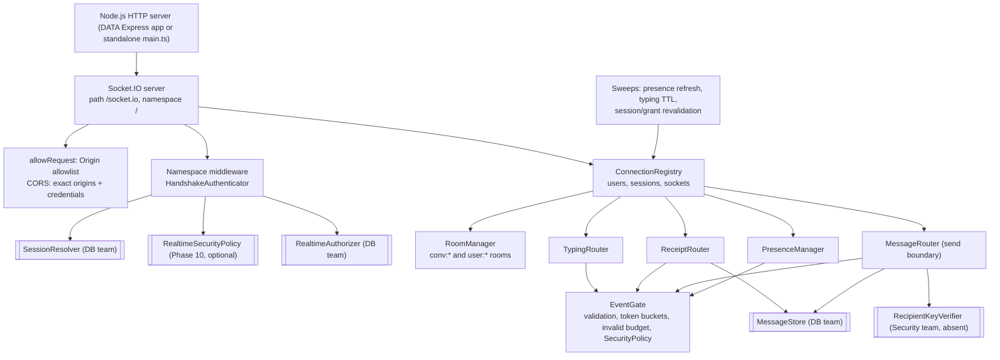
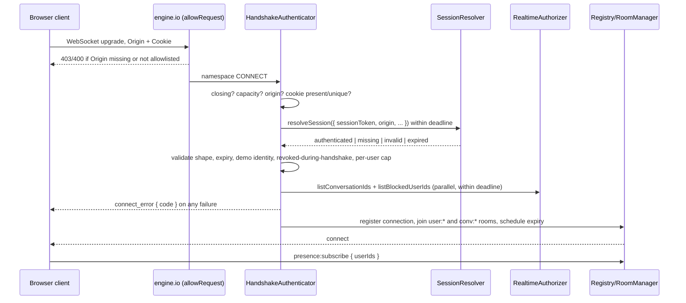
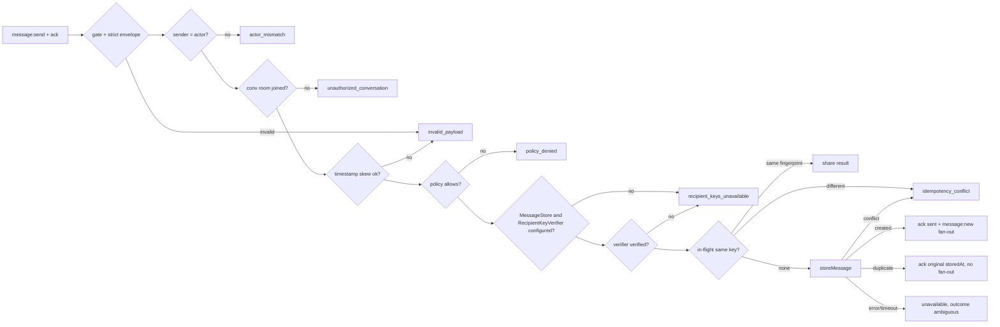

# Design Document

## Overview

The realtime server is a TypeScript module in `server/` that attaches Socket.IO 4.8 to an existing Node.js HTTP server. It implements the Phase 8.7A client contract (`docs/realtime-client-contract.md`) without renaming events or changing payloads, and keeps every dependency the Database and Security teams own behind typed adapters that fail closed.

Repository inspection found:

- `server/` contained only a planned `src/database/schema.sql` and empty `routes/` and `agents/` folders. The README assigns "Node.js backend, Socket.io real-time communication, Kiro agent integration" to this role, so the realtime package lives here.
- `DATA/` is the Database Team's Express 5 CommonJS API (`DATA/server.js`, port 5000). It has no authentication, sessions, Socket.IO or conversation model. Its `/api/messages` routes accept any `sender_id`, so they cannot back realtime authorization.
- The client uses `socket.io-client` 4.8.4, connects lazily with `withCredentials: true`, WebSocket first, `retries: 0`, five bounded reconnects, and expects auth rejection codes in `connect_error.data.code`.

Because no backend owns a competing HTTP framework yet, the module exposes `attachRealtimeServer(httpServer, options)`. The Database Team can mount it on the server returned by `app.listen()` in `DATA/server.js` (same process, same cookie, same session store), or use the standalone entry point `server/src/main.ts`. Both paths share one implementation. This phase does not modify `DATA/`.

The source runs directly on Node.js 24 with built-in type stripping, so there is no build step. The code uses only erasable TypeScript syntax, which `tsc --noEmit` enforces with `erasableSyntaxOnly` and `verbatimModuleSyntax`. A CommonJS consumer can `require()` the ESM entry on Node.js 22.18+.

## Architecture



Each component is a small class with injected collaborators. `server.ts` only wires them together. No component reads environment variables; `config.ts` validates options once and `main.ts` maps environment variables to options.

### Component responsibilities

| Component | File | Responsibility |
| --- | --- | --- |
| Protocol | `realtime/protocol.ts` | Canonical event names, connect-error codes, ack error codes, ack builders. |
| Contracts | `realtime/contracts.ts` | Adapter interfaces and domain types for the Database, Security and Phase 10 owners. |
| Config | `realtime/config.ts` | Defaults, range validation, origin/path/namespace/cookie validation, environment mapping for `main.ts`. |
| Validation | `realtime/validation.ts` | Strict parsers for identifiers, timestamps, canonical base64, every client body, delivery acks and adapter results. |
| Cookies | `realtime/cookies.ts` | Extracts exactly one session cookie value from the handshake `Cookie` header. |
| Clock | `realtime/clock.ts` | Server time and per-key strictly increasing ISO timestamps (bounded LRU). |
| Rate limiter | `realtime/rateLimiter.ts` | Token buckets with an injectable clock. |
| Logger | `realtime/logger.ts` | Structured logger accepting primitive fields only; JSON console default. |
| Adapter calls | `realtime/adapterCall.ts` | Deadline wrapper that converts throws, timeouts and late results into explicit failures. |
| Authenticator | `realtime/authentication.ts` | Origin re-check, capacity, cookie extraction, session resolution, demo-identity rejection, security policy, grant loading. |
| Registry | `realtime/registry.ts` | Connection, user and session indexes; block reverse index; counters. |
| Room manager | `realtime/rooms.ts` | The only code that joins or leaves rooms; applies grant diffs; revocation. |
| Event gate | `realtime/eventGate.ts` | Argument shape, token buckets, invalid-event budget, pending-ack bound, security-policy evaluation. |
| Typing router | `realtime/typing.ts` | Typing relay, in-memory TTL state, stop-on-cleanup. |
| Presence manager | `realtime/presence.ts` | Status derivation, subscriptions, privacy filtering, refresh, `unknown` on loss. |
| Receipt router | `realtime/receipts.ts` | Read requests and recipient delivery acknowledgements. |
| Message router | `realtime/messages.ts` | Send validation, capability gate, idempotency coordination, durable-first fan-out. |
| Server | `realtime/server.ts` | Socket.IO construction, wiring, sweeps, public handle, shutdown. |
| Entry | `src/index.ts`, `src/main.ts` | Public exports; standalone fail-closed process. |

## Connection lifecycle



The whole handshake has one deadline (`handshakeTimeoutMs`, default 8 s), shorter than the client's 10 s Socket.IO timeout, so the client receives a definite `connect_error` rather than its own timeout. Socket.IO's `connectTimeout` is set 2 s above that deadline.

Registration happens synchronously in the `connection` handler: the connection limits are checked again (to close the race between parallel handshakes), handlers are registered once, rooms are joined, presence changes are published, and the session-expiry timer is armed. Disconnect cleanup is the mirror image and is idempotent.

### Disconnect semantics

| Cause | Server action | Client-visible reason | Client behavior (8.7A) |
| --- | --- | --- | --- |
| Session expiry, `revokeSession`, `disconnectUser`, invalid-event budget | `socket.disconnect(true)` | `io server disconnect` | Terminal `disconnected`; no automatic reconnect. AuthProvider's 60 s `/me` check observes the expired session. |
| `close()` (shutdown) | Close the engine.io transport | `transport close` | Bounded automatic reconnect; the new handshake is fully re-verified. |
| Payload above `maxPayloadBytes` | engine.io closes the transport | `transport close` / `transport error` | Bounded reconnect. |

## Adapters

All adapters are optional at construction so the server can start honestly before integration. Missing adapters disable the capability that needs them.

| Adapter | Owner | Required for | Missing → |
| --- | --- | --- | --- |
| `SessionResolver` | Database Team | Every connection | All handshakes rejected `REALTIME_UNAVAILABLE` |
| `RealtimeAuthorizer` | Database Team | Every connection, presence | All handshakes rejected `REALTIME_UNAVAILABLE` |
| `MessageStore` | Database Team | Read receipts, delivery receipts, sends | `message:read` → `unavailable`; sends → `recipient_keys_unavailable` |
| `RecipientKeyVerifier` | Security Team | Sends | Sends → `recipient_keys_unavailable` |
| `RealtimeSecurityPolicy` | Phase 10 | Optional | Allow (authn/authz still apply) |

Key types (full definitions with documentation live in `server/src/realtime/contracts.ts`):

```ts
interface SessionResolver {
  resolveSession(context: HandshakeContext): Promise<SessionResolution>;
  checkSession?(session: SessionReference): Promise<SessionCheck>;
}
type SessionResolution =
  | { status: 'authenticated'; session: AuthenticatedSession }
  | { status: 'missing' } | { status: 'invalid' } | { status: 'expired' };
interface AuthenticatedSession { sessionId: string; userId: string; displayName: string; expiresAt: Date }

interface RealtimeAuthorizer {
  listConversationIds(actor: RealtimeActor): Promise<readonly string[]>;
  listBlockedUserIds(actor: RealtimeActor): Promise<readonly string[]>;   // both directions
  filterPresenceSubjects(viewer: RealtimeActor, subjectIds: readonly string[]): Promise<readonly string[]>;
}

interface MessageStore {
  findMessage(conversationId: string, messageId: string): Promise<StoredMessageRef | null>;
  recordReceipt(receipt: ReceiptRecord): Promise<ReceiptOutcome>;          // idempotent per (message, user, status)
  storeMessage(request: StoreMessageRequest): Promise<StoreMessageOutcome>; // idempotent per (sender, conversation, id)
}

interface RecipientKeyVerifier { verifyEnvelope(actor: RealtimeActor, envelope: MessageEnvelope): Promise<KeyVerification> }
interface RealtimeSecurityPolicy {
  evaluateConnection?(context: ConnectionSecurityContext): Promise<SecurityDecision>;
  evaluateEvent?(context: EventSecurityContext): Promise<SecurityDecision>;
}
```

The `HandshakeContext` contains the session cookie value, Origin, remote address, user agent, whether the transport was TLS, and the receive time. It deliberately excludes raw headers, the handshake `auth` object and the query string, so a resolver cannot accidentally trust client-supplied identity.

Every adapter call goes through `callAdapter`, which applies a deadline, catches throws, and ignores late results. Every adapter result is validated before use; a malformed result is treated as a failure, never as a partial grant.

## Authorization and rooms

- Rooms: `user:<userId>` (all of a user's connections) and `conv:<conversationId>`. Socket IDs never contain `:`, so they cannot collide with these names.
- Grants are per user, not per socket. The newest successful Authorizer result for a user is applied to all of that user's connections, so tabs converge.
- `RoomManager` is the only caller of `socket.join`/`socket.leave`. Leaving a room also clears that user's typing state in the room and emits `isTyping: false` to the remaining members.
- No client event selects rooms. The client's `watchConversations` remains a local filter, as the contract states.
- Revocation paths: `revokeConversationAccess(userId, conversationId)` (immediate, in memory), `refreshUserAccess(userId)` (re-query, diff), periodic revalidation (default 60 s), and reconnect (always re-queried).
- Failure policy: handshakes fail closed. A failed *refresh* keeps the last verified grants because they were verified recently; it never adds grants. This avoids disconnecting every user during a short database outage while keeping explicit revocation immediate. The trade-off is recorded in the integration document.
- Snapshot ordering: every authorizer query (handshake or refresh) takes a sequence number just before it starts. A user's grants are only replaced by a snapshot with a higher sequence, and every removal (explicit revocation, even for a user who is not connected yet, or a refresh diff) leaves a short-lived tombstone. A snapshot that started before a tombstone cannot re-grant that conversation. Without this, a slow handshake that read membership just before a removal could undo the revocation for all of the user's connections.

### Blocking

`listBlockedUserIds` returns users with a block in either direction. The registry also keeps a reverse index from connected users' lists, so an asymmetric adapter still blocks both ways. Conversation broadcasts use `to(conv:<id>).except([user:<actor>, ...user:<blocked>])`. Presence and receipts check the pair before each emit.

## Event routing

| Direction | Event | Body | Server behavior |
| --- | --- | --- | --- |
| C→S | `typing:start` / `typing:stop` | `{ conversationId }` | Gate, room check, relay `typing:update` to the room except actor and blocked users. The relay is not volatile: engine.io discards a volatile packet while the transport is still writing the previous one, which could drop a `stop` right after its `start`. |
| C→S | `presence:subscribe` | `{ userIds }` | Gate, replace scope, filter via Authorizer, snapshot. No ack (the client sends none). |
| C→S | `message:read` | `{ conversationId, messageId }` + ack | Gate, room check, store lookup, durable receipt, ack, peer `message:read`. |
| C→S | `message:send` | Envelope + ack | Gate, strict envelope, actor match, room check, skew, policy, capability gate, verifier, idempotent store, ack, `message:new`. |
| S→C | `typing:update` | `{ conversationId, userId, displayName, isTyping, timestamp }` | Per-key monotonic timestamp. |
| S→C | `presence:update` | `{ userId, status, timestamp }` | Only to authorized subscribers. |
| S→C | `message:new` | Raw envelope + `deliveryStatus: 'sent'` | Only after durable store; per-recipient delivery ack callback. |
| S→C | `message:delivered` / `message:read` | `{ conversationId, messageId, status, userId, timestamp }` | Only after the store records the receipt the first time. |
| S→C | `conversation:updated` | `{ conversationId, displayName?, updatedAt }` | Server-side API `notifyConversationUpdated`; never grants membership. |
| S→C | `message:ack` | — | Reserved name. Send acknowledgements use the Socket.IO callback, which binds the acknowledgement to its request. The 8.7A adapter ignores this event. |

### Event gate

Every handler calls the gate before doing work:

1. Connection still registered and not closing.
2. Exact argument shape: one body, plus a callback where required. Extra arguments are invalid.
3. Global event bucket, then the event's bucket. Acked events get `rate_limited`; volatile events are dropped.
4. Strict body parse. Failure charges the invalid-event bucket; exhausting it disconnects the socket.
5. Pending-ack bound for acked events.
6. Security policy (only if configured), with metadata only.

Unknown event names are caught with `socket.onAny` and charged to the invalid budget. Socket.IO's parser already rejects reserved names such as `disconnect`.

Typing handlers run on a per-connection promise chain only when a security policy is configured (the policy is async), so a `stop` can never overtake its `start`.

## Presence state

- Status derivation: no connections → `offline`; otherwise the preference set through `setPresencePreference` (`available` → `online`, `away`, `busy`, `invisible` → `offline`). Preferences live in a bounded map; until the profile service calls the API, connected users appear `online` to authorized subscribers. That gap is documented as an integration dependency.
- Index: `subscribers: Map<subjectId, Set<Connection>>` plus each connection's requested list and authorized set.
- Subscribe: bump a per-connection generation, call `filterPresenceSubjects`, discard stale results, intersect with the request, remove block pairs, emit `unknown` for subjects that dropped out, then emit a snapshot for every authorized subject.
- Refresh: one sweep every `presenceRefreshIntervalMs` (default 30 s, maximum 40 s) re-emits current status with fresh timestamps. The client discards samples 45 s after observation and ignores equal or older timestamps, so per-subject timestamps are strictly increasing.
- Heartbeat: Socket.IO ping/pong (25 s interval, 20 s timeout) detects dead transports; the resulting disconnect drives `offline`.
- Disconnect: subscriptions are removed from the index; a user whose last connection closed becomes `offline` for their subscribers.

## Receipts

- **Accepted** is the send callback `{ conversationId, messageId, status: 'sent', timestamp }`, returned only after `storeMessage` reports `created` or `duplicate`. Its timestamp is the store's `storedAt`, so duplicates repeat it exactly.
- **Delivered** requires a recipient connection to invoke the `message:new` callback with `{ conversationId, messageId, status: 'delivered' }`, the recipient to still hold the grant, and `recordReceipt` to report `created`. The current 8.7A client does not invoke that callback, so no delivery receipts are produced until Codex adds it. That is the honest outcome.
- **Read** requires `message:read` from an authorized non-sender, a message the store finds in that conversation, and `recordReceipt` reporting `created` (for the peer event) or `duplicate` (ack only).
- Group receipts are per recipient user. One member's receipt never implies another member's.

## Message send boundary



Production configuration has no `RecipientKeyVerifier`, so every valid send stops at `recipient_keys_unavailable`. Invalid, plaintext and demo envelopes are still rejected first, which the tests check against the production defaults.

The fingerprint is SHA-256 over a canonical JSON array of the envelope fields in fixed order. The store compares fingerprints, so it never needs to compare ciphertexts.

## Error handling

Connect errors (`connect_error.data.code`, message is a fixed string):

| Code | Cause | 8.7A client effect |
| --- | --- | --- |
| `AUTH_REQUIRED` | No session cookie, or resolver `missing` | Auth rejection: lock adapter, revalidate session |
| `UNAUTHORIZED` | Malformed or duplicate cookie, resolver `invalid`, demo identity, revoked during handshake | Auth rejection |
| `SESSION_EXPIRED` | Resolver `expired`, or `expiresAt` not in the future | Auth rejection |
| `REALTIME_UNAVAILABLE` | Adapter missing, failing, slow or malformed; server closing | `error` state; no reconnect (middleware rejection) |
| `CONNECTION_LIMIT` | Global, per-user or pending-handshake limit | `error` state |
| `ORIGIN_NOT_ALLOWED` | Origin re-check failed in the namespace | `error` state |
| `POLICY_DENIED` | Security policy denied the handshake | `error` state |

Ack errors (`{ status: 'error', code }`): `invalid_payload`, `unauthorized_conversation`, `rate_limited`, `unavailable`, `message_not_found`, `actor_mismatch`, `idempotency_conflict`, `recipient_keys_unavailable`, `policy_denied`. The 8.7A read-ack parser accepts only success bodies, so today any error ack becomes the client's `invalid_payload`. It still fails closed; mapping server codes is a proposed Codex change.

Adapter exceptions are logged with the adapter name and outcome (`error` or `timeout`) only. Error messages are not logged because database errors may echo parameters.

## Resource limits and timing

| Setting | Default | Notes |
| --- | --- | --- |
| `maxConnections` | 10,000 | Includes pending handshakes |
| `maxConnectionsPerUser` | 10 | Tabs and devices |
| `maxPendingHandshakes` | 256 | Bounds concurrent resolver load |
| `maxConversationsPerUser` | 1,000 | Matches the client's watch limit |
| `maxBlockedUsersPerUser` | 5,000 | |
| `maxPresenceSubjects` | 1,000 | Matches the client's watch limit |
| `maxPayloadBytes` | 131,072 | engine.io `maxHttpBufferSize` |
| `maxCiphertextLength` | 65,536 | Operational limit below the client's 1,400,000 cap |
| `maxPendingAcksPerConnection` | 100 | Matches the client's 100 pending reads |
| `maxPendingDeliveryAcksPerConnection` | 100 | |
| `maxTrackedTimestampKeys` | 100,000 | LRU for monotonic timestamps |
| `maxRevokedSessions` / `maxPresencePreferences` | 10,000 / 100,000 | LRU |
| Rates (capacity / refill per second) | events 120/30, typing 10/2, read 100/20, send 10/1, presence 5/0.2, invalid 10/0.1 | Per connection |
| `adapterTimeoutMs` / `handshakeTimeoutMs` | 4,000 / 8,000 | Below the client's 5 s read and 10 s connect timeouts |
| `presenceRefreshIntervalMs` | 30,000 | Must be ≤ 40,000 (client TTL 45 s) |
| `typingTtlMs` | 6,000 | Client expires remote typing after 5 s |
| `revalidationIntervalMs` | 60,000 | `0` disables; matches the client's `/me` cadence |
| `deliveryAckTimeoutMs` | 10,000 | |
| `maxClockSkewMs` | 300,000 | Envelope timestamp tolerance |
| `pingIntervalMs` / `pingTimeoutMs` | 25,000 / 20,000 | Socket.IO heartbeat |

## Extension points

- `RealtimeSecurityPolicy` for Auditor Bot, Sentinel Bot and BUZZ Guard. It receives metadata only, fails closed on error or timeout, and is kept separate from authentication and authorization.
- `RecipientKeyVerifier` is the single switch that can enable sends, and only together with a `MessageStore`. There is no environment flag that enables sending.
- `MessageStore` and `RealtimeAuthorizer` are the persistence boundary. A future history API and cursor (see the integration document) need no change to the event router.
- The server handle (`revokeSession`, `disconnectUser`, `refreshUserAccess`, `revokeConversationAccess`, `setPresencePreference`, `notifyConversationUpdated`, `getStats`, `close`) is the in-process API for the Database Team.
- The module assumes one process. Multi-node deployment needs a Socket.IO adapter (for example Redis), shared revocation, and cross-node presence aggregation. It is documented, not implemented.

## Testing strategy

- Runner: Node.js built-in `node:test` (the `DATA/` convention), running TypeScript directly on Node.js 24. Files run one at a time for timing stability.
- Unit tests: validation, cookies, config, token buckets, monotonic clock, adapter deadlines.
- Integration tests (`test/integration/`): a harness starts the real server on `127.0.0.1:0` with in-memory fixtures (`test/support/fixtures.ts`), connects real `socket.io-client` sockets with `Origin` and `Cookie` headers, and asserts emitted events, acknowledgements, absence of events, and `getStats()` cleanup.
- Compatibility tests load the real 8.7A `SocketIoRealtimeClient` and `realtimeValidation` through `tsx`'s scoped `tsImport`, inject a socket factory that adds the cookie and Origin headers a browser would send, and verify connection, auth rejection codes, typing, presence, read acknowledgements and server-initiated disconnect against the real server.
- Smoke test: `node src/main.ts` runs as a child process with an empty environment and is checked for fail-closed rejection and a health endpoint.
- Fixtures throw if `NODE_ENV=production` and are not reachable from `src/index.ts`.

## Decisions and trade-offs

| Decision | Alternatives | Reason |
| --- | --- | --- |
| Mountable module in `server/`, standalone entry optional | Edit `DATA/server.js`; new framework | Respects Database Team ownership; one implementation works in both deployments. |
| Typed adapters, all optional, fail closed | Temporary auth bypass; demo sessions | The prompt forbids bypasses; the server can still start and reject honestly. |
| Auto-join rooms from the Authorizer | Client `join` event | The contract says `watchConversations` is not authorization; no join event exists. |
| Keep last verified grants on refresh failure | Disconnect on refresh failure | Avoids mass disconnects during short outages; explicit revocation stays immediate; nothing is ever granted on failure. |
| Delivery via `message:new` ack callback | New client→server event | Binds the receipt to the exact recipient socket and message, so actor and association cannot be forged; current clients ignore the callback. |
| Error acks `{ status:'error', code }` | Silent timeout | Definite failure instead of an ambiguous client timeout. |
| Native TypeScript on Node.js 24, no build | `tsc` build to `dist/` | Fewer moving parts; CommonJS `require()` works; `tsc --noEmit` enforces erasable syntax. |
| `node:test` + `tsx` only for loading client sources | Jest; Vitest | Matches `DATA/`; the client's parameter properties and extensionless imports need a transpiler. |
