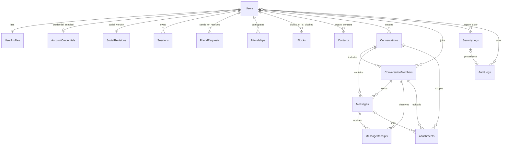

# DATA schema and ERD

Current working-tree schema is version 12 (`0012-groups.sql`); its additive group
schema is documented below. The existing DB-4B key schema is unchanged:
`0007-recipient-keys.sql` adds DeviceKeys
(public signing/agreement points, self-signature, account ownership, stable deviceId,
monotonic keyVersion and active/superseded/revoked status), ConversationKeyEpochs
(conversation/keyId PK, unique ordered epoch, creator/previous-epoch FKs, signature
and active-recipient-set digest), and ConversationKeyWraps (ordered per-device HPKE
ciphertext with epoch, membership and device-owner FKs). Key material, epochs and
wraps cannot be changed/deleted. Device revocation is permanent; one active key
version per device and at most ten active devices per account are enforced.

Messages is transactionally rebuilt with all prior columns/rows, provenance,
sequence, lifecycle, indexes, triggers and child references intact. Envelope v2
requires a 22-character key_id referencing its conversation's epoch; v1/legacy
have NULL key_id. key_id joins the immutable encrypted metadata. No private keys,
plaintext epoch keys or plaintext messages are stored. See the
[current key-directory handoff](e2ee-key-directory-handoff.md). The older ERD below
describes the foundational entities; the three new key tables extend it.

The authoritative schema is the ordered SQL in `server/database/migrations/`. `server/database/schema.sql` is a frozen legacy reference, not a current installer. `SchemaMigrations` records the applied version, filename, normalized SHA-256 checksum and application time.

Identifiers are text, generated UUIDs when the repository generates them. Existing IDs are preserved. New timestamps are UTC ISO strings unless explicitly named `_ms` (integer Unix milliseconds). Legacy SQLite timestamp strings are retained exactly. New relationships use `ON DELETE RESTRICT`; the original `Users`, `Contacts`, and `SecurityLogs` foreign keys retain SQLite's `NO ACTION` behavior. There are no cascading deletes. Account erasure and retention require a later explicit service and policy.

DB-2 adds `0003-authentication.sql` without modifying DB-1 migrations. See [session architecture](auth-sessions.md) for the authoritative authentication policy. Sessions now has an auth_version field (legacy rows default to zero); AccountCredentials is required for authenticated resolution. Legacy Users remains a public, credential-free projection.

DB-3 adds `0004-profiles-friends.sql`; prior versions remain unchanged. FriendRequests/Friendships/Blocks now carry `origin=legacy|authenticated`. Public social grants require explicit authenticated request/acceptance; existing rows default to legacy. Restrictive blocks apply in both directions regardless of provenance. See [relationship policy](relationships.md), [API](profiles-friends-api.md) and [DB-3 handoff](db3-handoff.md).

DB-4A adds `0005-conversation-provenance.sql`: `Conversations.origin=legacy|authenticated`, default legacy, plus an authenticated direct-conversation keyset index. The existing canonical pair uniqueness, member constraints and tables remain authoritative. No message schema or applied migration changes. See [conversation policy and interfaces](db4a-integration.md).

DB-4B adds `0006-encrypted-message-lifecycle.sql` to the existing Messages table: provenance defaulting to legacy, immutable conversation sequence, deleted_at and revision; authenticated partial UNIQUE indexes cover conversation/client ID and conversation/sequence. The original global message_id remains the storage UUID while client_id preserves encrypted wire identity. MessageReceipts and all ciphertext/earlier columns remain intact. See [the encrypted storage contract](db4b-e2ee-storage-contract.md); no parallel message schema or automatic legacy ciphertext approval exists.

| Table | Purpose and keys | Important constraints and indexes |
| --- | --- | --- |
| Users | Existing public identity; PK `user_id` | Original unique username plus DB-2 case-folded guards for new writes; existing case-ambiguous legacy rows are preserved/reserved. Nonblank identity/display fields, offline/online/away status; validation/timestamps and profile synchronization triggers. No passwords, email or session tokens. |
| UserProfiles | PK/FK `user_id` to Users; editable profile | Required display name, built-in avatar allowlist, available/busy/away/invisible preference, custom status and timestamps. Display name is synchronized with Users for compatibility. |
| Sessions | PK `session_id`; FK `user_id` | Unique lowercase 64-hex `token_hash`; optional 64-hex `csrf_token_hash`; integer issue/expiry/revocation/last-seen times; expiry must follow issue. Indexes `idx_sessions_user_expiry`, `idx_sessions_expiry`. Stores supplied digests, never issues tokens. |
| FriendRequests | PK `request_id`; sender/recipient FKs to Users | No self-request; pending/accepted/declined/cancelled; resolution timestamp required only after resolution. `uq_requests_pending_pair` prevents pending duplicates in either direction. Sender/recipient status/time indexes. |
| Friendships | Composite PK `(user_low,user_high)`, both FKs to Users | Canonical binary ordering `user_low < user_high`, preventing self/reversed duplicates. `idx_friendships_high` supports lookup from either participant. |
| Blocks | Composite PK `(blocker_id,blocked_id)`, both FKs to Users | Directional, no self-block; reverse lookup `idx_blocks_blocked`. |
| Conversations | PK `conversation_id`; optional creator and DM participant FKs | Direct conversations require a canonical unique participant pair and no title. Groups require a title and no DM pair. Identity/kind/DM pair immutable; timestamps/archive metadata; `idx_conversations_updated`. |
| ConversationMembers | Composite PK `(conversation_id,user_id)`; FKs to Conversations and Users | owner/admin/member roles; joined/left lifecycle; `uq_members_active_owner` allows at most one active owner. Direct membership is restricted to its declared pair with member role. Identity immutable. `idx_members_user_active`. |
| Messages | Global PK `message_id`; conversation/sender/optional receiver FKs | One shared DM/group ciphertext store. Composite FK requires sender membership. Insert trigger requires active sender; direct receiver must be the other DM participant; group receiver is NULL. Ciphertext/IV required. Versioned envelope metadata is all present or all absent for legacy compatibility. Global ID plus scoped unique `(conversation_id,message_id)` and `(conversation_id,sender_id,client_id)`. Cursor index `idx_messages_conversation_cursor`; legacy sender/receiver/time indexes retained. Envelopes immutable. |
| MessageReceipts | Composite PK `(conversation_id,message_id,user_id,status)` | Scoped composite FKs to Messages and membership; delivered/read only; observer cannot be sender. First recorded/observed times are preserved by repository insert-on-conflict. `idx_receipts_user`. |
| Attachments | PK `attachment_id`; unique opaque `storage_key` | Conversation/message composite FK; uploader membership FK; nonnegative integer byte count; pending/ready/deleted status; encrypted metadata, generic media type, timestamps. `idx_attachments_conversation`, `idx_attachments_message`. No file bytes or plaintext filename indexing. |
| AuditLogs | PK `audit_id`; optional actor FK and unique legacy-log FK | info/low/medium/high/critical severity; event/source identifiers, optional subject, JSON object metadata, timestamp. Actor/event/time cursor indexes. Repository restricts metadata to operational codes/counts. |
| Contacts | Preserved legacy directed contacts; PK `contact_id`; user/friend FKs | Original pending/accepted/blocked status, unique directed pair, self-check and user index. Remains compatibility/provenance data; DB-3 must use the normalized relationship tables as its source of truth. |
| SecurityLogs | Preserved legacy event records; PK `log_id`; optional user FK | Original uppercase severities, bot sources, resolved flag, description/details and severity/time indexes retained. New inserts mirror only event metadata into AuditLogs, not description/details. |
| SchemaMigrations | Infrastructure ledger; integer version PK | Unique ordered migration name; checksum and applied timestamp. No application entities or seed data. |
| AccountCredentials | Private credential-enabled identity; PK/FK user_id to Users | Unique normalized username/email, Argon2id hash, active/disabled status, auth_version and timestamps. Credential changes increment version/revoke sessions. No public SELECT projection. |
| AuthChallenges | Anonymous pre-session proof verifiers; PK challenge_hash | Hash-only nonce/CSRF storage, integer issue/expiry times; expiry index. No authenticated user association. |
| AuthRateLimits | Durable shared fixed-window counters; PK bucket_hash | Hashed source/identifier/account keys, integer times/attempt count; expiry index. Independent infrastructure table. |
| SocialRevisions | DB-3 user-scoped version; PK/FK user_id to Users | Nonnegative integer updated transactionally for visible social changes; supports coherent paginated snapshots, not relationship copies or a global activity count. |

The schema does not encode full business authorization. DB-3 must enforce block restrictions and atomic friendship transitions. DB-5 must enforce invitations, history visibility, owner transfer, at least one owner, and authorized leave/removal. Membership rows are retained to keep historical sender and receipt references valid. Rejoining and multiple membership intervals need an agreed DB-5 policy. Profile length/content rules require API validation in DB-3. Timestamp syntax outside session integers remains a trusted DAL caller responsibility.

`SchemaMigrations`, `AuthChallenges` and `AuthRateLimits` are independent infrastructure tables. DM pair references to Users are described in the inventory rather than duplicating lines in the ERD.

Encryption metadata is stored unchanged: algorithm, version, encoding, IV, ciphertext including its tag, sender name, client timestamp and type. The server stores no private keys or decrypted message content. Legacy ciphertext has no authenticated sender-name/client-timestamp metadata; those fields remain NULL and must not be invented or passed off as a modern envelope. Modern format/base64 validation and key-distribution verification remain the Security/Realtime owner's responsibility.

## Version 12 group migration

`0012-groups.sql` is the DB-5B draft migration. It adds sibling group tables and guards without rebuilding or changing any pre-existing row or value. Versions 1-7 remain unchanged. Applying the schema does not enable Group Chat, File Sharing or any feature gate. Messages and attachments remain in their existing shared tables; this migration changes no E2EE, key distribution or realtime security design.

| Version | Migration file |
| --- | --- |
| 1 | `0001-legacy.sql` |
| 2 | `0002-foundation.sql` |
| 3 | `0003-authentication.sql` |
| 4 | `0004-profiles-friends.sql` |
| 5 | `0005-conversation-provenance.sql` |
| 6 | `0006-encrypted-message-lifecycle.sql` |
| 7 | `0007-recipient-keys.sql` |
| 8 | `0008-authenticated-message-pins.sql` |
| 9 | `0009-authenticated-message-reactions.sql` |
| 10 | `0010-encrypted-attachments.sql` |
| 11 | `0011-encrypted-message-revisions.sql` |
| 12 | `0012-groups.sql` |
| 13 | `0013-attachment-lifecycle.sql` |

### Added tables

Every new foreign key uses `ON DELETE RESTRICT`. Primary-key indexes are implicit SQLite objects; the explicitly named indexes and triggers are inventoried below.

| Table | Keys, columns and invariants |
| --- | --- |
| `GroupExtensions` | PK/FK `conversation_id` to Conversations, whose kind must be group. Nullable description of at most 1000 characters; immutable `history_policy` is exactly `all` or `from_joined` (default). Integer `membership_revision` starts at 1 and can increase only by exactly 1 per update; identity and `created_at` are immutable. |
| `GroupMembershipIntervals` | PK `(conversation_id,user_id,interval_no)` and composite FK to ConversationMembers. Intervals append with consecutive numbers; `first_seq` is a positive safe integer; nullable `last_seq` is at least `first_seq - 1`. An empty closed interval has that latter bound. `last_seq` and `left_at` are NULL together for an open interval; `joined_at` records that period's join time. No append after an open interval, overlap (including open intervals), edit of closed history or deletion is allowed. |
| `ConversationInvitations` | Nonblank `invitation_id` PK; conversation and invitee FKs, plus composite FK for the inviter's membership. States: pending, accepted, declined, cancelled, expired. Invitee differs from inviter; expiry follows creation; `resolved_at` is NULL exactly while pending. One pending row per group/invitee. Only pending-to-terminal transitions are allowed, preserving identity, participants and creation/expiry times; rows cannot be deleted. The repository writes the fixed seven-day expiry and filters expired pending rows lazily. |
| `GroupReadPositions` | PK/FK `(conversation_id,user_id)` to retained membership; integer position 0 through 9007199254740991 and `updated_at`. Position cannot decrease; identity cannot change. Active-member authorization, high-water and permitted-range checks are repository/service responsibilities, beyond these schema checks. |
| `GroupCreationKeys` | PK `(user_id,idempotency_key)` with FKs to Users and Conversations. Key length 1-256; fingerprint is exactly 64 lowercase hexadecimal characters; stores conversation and creation time. Every field is immutable. The repository may renew a key strictly after 24 hours using conditional DELETE then INSERT in one savepoint, never implicit REPLACE. |

### Added named indexes

| Index | Purpose |
| --- | --- |
| `uq_group_intervals_open` | Unique open interval per group/member. |
| `idx_group_intervals_open_joined` | Active-member ordering by period join time and user. |
| `uq_invitations_pending` | Unique pending invitation per group/invitee. |
| `idx_invitations_invitee` | Invitee/state listing by creation time and invitation id descending. |
| `idx_invitations_group` | Group/state listing in the same order. |
| `idx_invitations_inviter` | Group/inviter lookup for cancellation. |
| `idx_group_creation_keys_conversation` | Creation-key conversation lookup. |

### Added named triggers

| Trigger | Purpose |
| --- | --- |
| `group_extensions_group_only` | Require a group conversation for an extension insert. |
| `group_extensions_update` | Preserve identity, immutable history policy and creation time; enforce exact +1 revision changes. |
| `group_extensions_keep` | Retain extension rows. |
| `group_intervals_insert` | Enforce append order and non-overlap, including open-ended intervals, and require group kind. |
| `group_intervals_close` | Allow one closure of an open interval without changing identity, start or join time. |
| `group_intervals_keep` | Retain interval history. |
| `invitations_insert` | Require pending initial state and group kind. |
| `invitations_transition` | Allow only pending-to-terminal state changes with fixed identity, participants and initial times. |
| `invitations_keep` | Retain invitation history. |
| `group_read_positions_monotonic` | Reject decreasing positions. |
| `group_read_positions_insert` | Require group kind. |
| `group_extensions_replacement_guard` | Protect extension collisions against implicit replacement. |
| `invitations_replacement_guard` | Protect invitation identity and pending-pair collisions against replacement. |
| `group_read_positions_replacement_guard` | Protect retained read-position rows against replacement. |
| `group_creation_keys_replacement_guard` | Protect immutable creation-key rows against replacement. |
| `group_members_replacement_guard` | Protect retained group membership against replacement. |
| `group_owner_replacement_guard` | Prevent a conflicting owner update from replacing the existing owner. |
| `group_read_positions_identity` | Preserve conversation/user identity. |
| `group_creation_keys_immutable` | Preserve every creation-key field. |
| `group_intervals_replacement_guard` | Protect interval identity and explicit rowid collision paths against replacement. |
| `groupextensions_row_identity` | Preserve extension rowid. |
| `groupmembershipintervals_row_identity` | Preserve interval rowid. |
| `conversationinvitations_row_identity` | Preserve invitation rowid. |
| `groupreadpositions_row_identity` | Preserve read-position rowid. |
| `groupcreationkeys_row_identity` | Preserve creation-key rowid. |
| `conversationmembers_row_identity` | Preserve member rowid. |

Replacement guards do not depend on DELETE triggers firing for SQLite's implicit replacement deletions. Ordinary INSERT uniqueness and valid UPSERT behavior remain in force. The repository's coordinated transaction must additionally enforce exactly one active owner, one open interval per active member and none per former member before COMMIT; immediate SQLite constraints remain enabled.

### Backfill and visibility

The backfill inserts one extension for every group conversation of both origins: description NULL, policy `from_joined`, revision 1, and the conversation's original creation time. It inserts one interval numbered 1 per existing group member, retaining the member's join/leave timestamps.

`first_seq` is the lowest authenticated message sequence created at or after that member's join, or the authenticated high-water plus 1 if no such message exists (1 for an empty stream). For active members `last_seq` is NULL. For former members it is the highest authenticated sequence created at or before leaving, or `first_seq - 1` when none qualifies. The SQL uses `strftime` normalization for ISO and legacy SQLite timestamp forms. Unparseable times match no message and narrow access; they never justify widening history. This bootstrap rule does not rewrite Messages or membership rows. Normal joins and closures thereafter use sequence high-water, not timestamp ordering.

Schema presence is not authorization. The repository exposes a managed group only when kind is group, origin is authenticated and an extension exists. Active authorized members retain earlier permitted intervals after rejoining; absence gaps never become visible. `all` additionally allows sequences before the first join. Former members and never-members receive no history. Server filtering does not replace key-based confidentiality; E2EE and realtime security remain under their existing contracts.

## Version 13 attachment lifecycle migration

`0013-attachment-lifecycle.sql` extends the existing shared `Attachments` table; it does not create a second attachment store. It adds nullable `integrity_digest`, `deleted_at`, `declared_algorithm`, and `declared_format_version` columns, plus `purge_state` defaulting to `not_purged` with the values `not_purged` and `purged`. `expires_at` is added by `0010-encrypted-attachments.sql` and is not repeated. Existing attachment columns and values are preserved. The migration also creates `AttachmentReservations` with restrictive foreign keys and indexes for reservation lookups and expiry. Its triggers are scoped to canonical rows (`e2ee_version IS NULL`), so main's encrypted-attachment rows and triggers remain authoritative.

The database does not validate the `storage_key` format, recompute `integrity_digest` from private-storage bytes, or interpret descriptor identifiers (`declared_algorithm` and `declared_format_version`). The migration constrains a non-NULL digest to 64 lowercase hexadecimal characters and bounds non-NULL descriptor lengths to 1..64 characters; the storage provider and service validate keys and verify byte digests.

### Added named objects

| Kind | Names |
| --- | --- |
| Indexes | `idx_attachments_pending_expiry`, `idx_attachments_uploader_usage`, `idx_attachments_search`, `idx_attachments_purge`, `idx_reservations_user`, `idx_reservations_conversation`, `idx_reservations_source`, `idx_reservations_expiry` |
| Table | `AttachmentReservations` |
| Triggers | `attachments_immutable`, `attachments_lifecycle`, `attachments_metadata_insert` |

`attachments_immutable` protects attachment identity and metadata. `attachments_lifecycle` checks every update. A deleted row permits value-preserving updates or only an isolated `purge_state` transition from `not_purged` to `purged`; it rejects any other changed value, a purge-state reversal, and a purge transition combined with another column change. Comparisons are NULL-safe. Existing status transitions, association, sender, and `deleted_at` consistency checks remain enforced. This is the Project Owner-approved Task 8.4 amendment recorded in the DB-6B design decision. `attachments_metadata_insert` enforces the encrypted metadata length bound.

Migration 0009 is DB-6B draft schema in this isolated implementation workspace. Its presence does not enable the Attachment API or any feature gate. Published migrations 0001–0008 remain unchanged.
