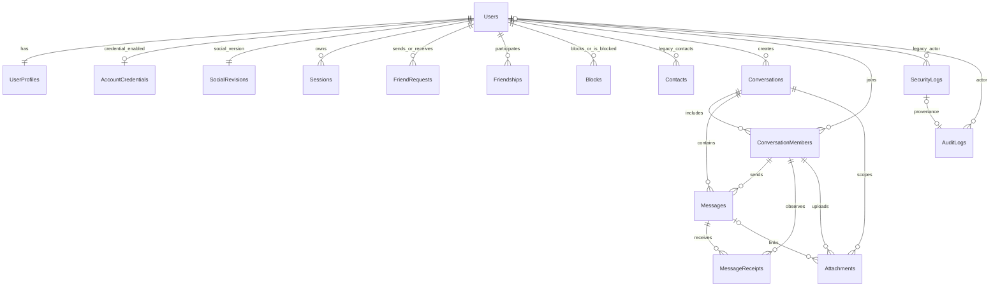

# DB-1 schema and ERD

Current post-DB-4B schema is version 7. `0007-recipient-keys.sql` adds DeviceKeys
(public signing/agreement points, self-signature, account ownership, stable deviceId,
monotonic keyVersion and active/superseded/revoked status), ConversationKeyEpochs
(conversation/keyId PK, unique ordered epoch, creator/previous-epoch FKs, signature
and active-recipient-set digest), and ConversationKeyWraps (ordered per-device HPKE
ciphertext with epoch, membership and device-owner FKs). Key material, epochs and
wraps cannot be changed/deleted. Device revocation is permanent; one active key
version per device and at most ten active devices per account are enforced.

Messages is transactionally rebuilt with all prior columns/rows, provenance,
sequence, lifecycle, indexes, triggers and child references intact. Envelope v2
requires a 22-character key_id referencing its conversation's epoch; v1/legacy
have NULL key_id. key_id joins the immutable encrypted metadata. No private keys,
plaintext epoch keys or plaintext messages are stored. See the
[current key-directory handoff](e2ee-key-directory-handoff.md). The older ERD below
describes the foundational entities; the three new key tables extend it.

The authoritative schema is the ordered SQL in `server/database/migrations/`. `server/database/schema.sql` is a frozen legacy reference, not a current installer. `SchemaMigrations` records the applied version, filename, normalized SHA-256 checksum and application time.

Identifiers are text, generated UUIDs when the repository generates them. Existing IDs are preserved. New timestamps are UTC ISO strings unless explicitly named `_ms` (integer Unix milliseconds). Legacy SQLite timestamp strings are retained exactly. New relationships use `ON DELETE RESTRICT`; the original `Users`, `Contacts`, and `SecurityLogs` foreign keys retain SQLite's `NO ACTION` behavior. There are no cascading deletes. Account erasure and retention require a later explicit service and policy.

DB-2 adds `0003-authentication.sql` without modifying DB-1 migrations. See [session architecture](auth-sessions.md) for the authoritative authentication policy. Sessions now has an auth_version field (legacy rows default to zero); AccountCredentials is required for authenticated resolution. Legacy Users remains a public, credential-free projection.

DB-3 adds `0004-profiles-friends.sql`; prior versions remain unchanged. FriendRequests/Friendships/Blocks now carry `origin=legacy|authenticated`. Public social grants require explicit authenticated request/acceptance; existing rows default to legacy. Restrictive blocks apply in both directions regardless of provenance. See [relationship policy](relationships.md), [API](profiles-friends-api.md) and [DB-3 handoff](db3-handoff.md).

DB-4A adds `0005-conversation-provenance.sql`: `Conversations.origin=legacy|authenticated`, default legacy, plus an authenticated direct-conversation keyset index. The existing canonical pair uniqueness, member constraints and tables remain authoritative. No message schema or applied migration changes. See [conversation policy and interfaces](db4a-integration.md).

DB-4B adds `0006-encrypted-message-lifecycle.sql` to the existing Messages table: provenance defaulting to legacy, immutable conversation sequence, deleted_at and revision; authenticated partial UNIQUE indexes cover conversation/client ID and conversation/sequence. The original global message_id remains the storage UUID while client_id preserves encrypted wire identity. MessageReceipts and all ciphertext/earlier columns remain intact. See [the encrypted storage contract](db4b-e2ee-storage-contract.md); no parallel message schema or automatic legacy ciphertext approval exists.

| Table | Purpose and keys | Important constraints and indexes |
| --- | --- | --- |
| Users | Existing public identity; PK `user_id` | Original unique username plus DB-2 case-folded guards for new writes; existing case-ambiguous legacy rows are preserved/reserved. Nonblank identity/display fields, offline/online/away status; validation/timestamps and profile synchronization triggers. No passwords, email or session tokens. |
| UserProfiles | PK/FK `user_id` to Users; editable profile | Required display name, built-in avatar allowlist, available/busy/away/invisible preference, custom status and timestamps. Display name is synchronized with Users for compatibility. |
| Sessions | PK `session_id`; FK `user_id` | Unique lowercase 64-hex `token_hash`; optional 64-hex `csrf_token_hash`; integer issue/expiry/revocation/last-seen times; expiry must follow issue. Indexes `idx_sessions_user_expiry`, `idx_sessions_expiry`. Stores supplied digests, never issues tokens. |
| FriendRequests | PK `request_id`; sender/recipient FKs to Users | No self-request; pending/accepted/declined/cancelled; resolution timestamp required only after resolution. `uq_requests_pending_pair` prevents pending duplicates in either direction. Sender/recipient status/time indexes. |
| Friendships | Composite PK `(user_low,user_high)`, both FKs to Users | Canonical binary ordering `user_low < user_high`, preventing self/reversed duplicates. `idx_friendships_high` supports lookup from either participant. |
| Blocks | Composite PK `(blocker_id,blocked_id)`, both FKs to Users | Directional, no self-block; reverse lookup `idx_blocks_blocked`. |
| Conversations | PK `conversation_id`; optional creator and DM participant FKs | Direct conversations require a canonical unique participant pair and no title. Groups require a title and no DM pair. Identity/kind/DM pair immutable; timestamps/archive metadata; `idx_conversations_updated`. |
| ConversationMembers | Composite PK `(conversation_id,user_id)`; FKs to Conversations and Users | owner/admin/member roles; joined/left lifecycle; `uq_members_active_owner` allows at most one active owner. Direct membership is restricted to its declared pair with member role. Identity immutable. `idx_members_user_active`. |
| Messages | Global PK `message_id`; conversation/sender/optional receiver FKs | One shared DM/group ciphertext store. Composite FK requires sender membership. Insert trigger requires active sender; direct receiver must be the other DM participant; group receiver is NULL. Ciphertext/IV required. Versioned envelope metadata is all present or all absent for legacy compatibility. Global ID plus scoped unique `(conversation_id,message_id)` and `(conversation_id,sender_id,client_id)`. Cursor index `idx_messages_conversation_cursor`; legacy sender/receiver/time indexes retained. Envelopes immutable. |
| MessageReceipts | Composite PK `(conversation_id,message_id,user_id,status)` | Scoped composite FKs to Messages and membership; delivered/read only; observer cannot be sender. First recorded/observed times are preserved by repository insert-on-conflict. `idx_receipts_user`. |
| Attachments | PK `attachment_id`; unique opaque `storage_key` | Conversation/message composite FK; uploader membership FK; nonnegative integer byte count; pending/ready/deleted status; encrypted metadata, generic media type, timestamps. `idx_attachments_conversation`, `idx_attachments_message`. No file bytes or plaintext filename indexing. |
| AuditLogs | PK `audit_id`; optional actor FK and unique legacy-log FK | info/low/medium/high/critical severity; event/source identifiers, optional subject, JSON object metadata, timestamp. Actor/event/time cursor indexes. Repository restricts metadata to operational codes/counts. |
| Contacts | Preserved legacy directed contacts; PK `contact_id`; user/friend FKs | Original pending/accepted/blocked status, unique directed pair, self-check and user index. Remains compatibility/provenance data; DB-3 must use the normalized relationship tables as its source of truth. |
| SecurityLogs | Preserved legacy event records; PK `log_id`; optional user FK | Original uppercase severities, bot sources, resolved flag, description/details and severity/time indexes retained. New inserts mirror only event metadata into AuditLogs, not description/details. |
| SchemaMigrations | Infrastructure ledger; integer version PK | Unique ordered migration name; checksum and applied timestamp. No application entities or seed data. |
| AccountCredentials | Private credential-enabled identity; PK/FK user_id to Users | Unique normalized username/email, Argon2id hash, active/disabled status, auth_version and timestamps. Credential changes increment version/revoke sessions. No public SELECT projection. |
| AuthChallenges | Anonymous pre-session proof verifiers; PK challenge_hash | Hash-only nonce/CSRF storage, integer issue/expiry times; expiry index. No authenticated user association. |
| AuthRateLimits | Durable shared fixed-window counters; PK bucket_hash | Hashed source/identifier/account keys, integer times/attempt count; expiry index. Independent infrastructure table. |
| SocialRevisions | DB-3 user-scoped version; PK/FK user_id to Users | Nonnegative integer updated transactionally for visible social changes; supports coherent paginated snapshots, not relationship copies or a global activity count. |

The schema does not encode full business authorization. DB-3 must enforce block restrictions and atomic friendship transitions. DB-5 must enforce invitations, history visibility, owner transfer, at least one owner, and authorized leave/removal. Membership rows are retained to keep historical sender and receipt references valid. Rejoining and multiple membership intervals need an agreed DB-5 policy. Profile length/content rules require API validation in DB-3. Timestamp syntax outside session integers remains a trusted DAL caller responsibility.

`SchemaMigrations`, `AuthChallenges` and `AuthRateLimits` are independent infrastructure tables. DM pair references to Users are described in the inventory rather than duplicating lines in the ERD.

Encryption metadata is stored unchanged: algorithm, version, encoding, IV, ciphertext including its tag, sender name, client timestamp and type. The server stores no private keys or decrypted message content. Legacy ciphertext has no authenticated sender-name/client-timestamp metadata; those fields remain NULL and must not be invented or passed off as a modern envelope. Modern format/base64 validation and key-distribution verification remain the Security/Realtime owner's responsibility.
